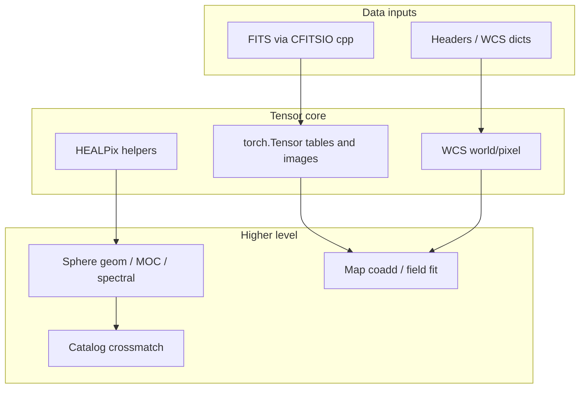

# Torchsky Composer Audit Report

**Date:** April 4, 2026  
**Repository:** `torchsky` (torch-native astronomy stack)  
**Version audited:** `0.4.0.dev0` ([`pyproject.toml`](pyproject.toml))  
**Prior report:** [`AUDIT_REPORT.md`](AUDIT_REPORT.md) (April 3, 2026) — cross-checked below.

---

## Executive summary

Torchsky is a large, ambition-aligned codebase (~224 Python files across `src/`, `tests/`, `benchmarks/`, `scripts/`), with a nanobind C++ extension wrapping CFITSIO, rich WCS and HEALPix logic, spherical geometry, mapmaking, and catalog primitives. Strengths include extensive parity and benchmark harnesses, clear separation of namespaces (`io`, `coords`, `geom`, `map`, `sphere`, `catalogs`), and documented crossover thresholds in hot WCS paths.

This audit confirms **two concrete correctness bugs** in production Python (`table.py` complex-column handling; `sphere/moc.py` device handling) and reiterates **maintainability risks**: pervasive bare `except Exception` in [`src/torchsky/__init__.py`](src/torchsky/__init.py), **O(N_pix)** fallbacks for HEALPix queries when the C++ fast path is unavailable, and **AGENTS.md** tension around heuristics (mmap cold-read policy, table routing thresholds) that are not always backed by in-repo regression proofs.

**Automated lint:** `ruff check` reports **22 issues** (9 unused imports, 8 import-not-at-top-of-file, 5 unused variables) — mostly benchmarks/tests and a few `src/` cleanups.  
**Tests:** Full `pytest` requires `PYTHONPATH=src` or editable install, plus optional deps (`astropy`, `fitsio`, `pyarrow`, `psutil`, …). A failure observed in `test_catalog_compat` was traced to **missing `scipy`** (Astropy’s `match_to_catalog_sky` uses SciPy’s KDTree), not a torchsky logic error.

---

## Methodology (macro → micro → macro)

1. **Inventory:** Count and map modules; align with [`AGENTS.md`](AGENTS.md) principles.  
2. **Automation:** `ruff` (full tree); `grep` for bare `except:` (none in `src/`); targeted verification of [`AUDIT_REPORT.md`](AUDIT_REPORT.md) claims.  
3. **Thematic deep reads:** FITS I/O and `table.py`; WCS core and HEALPix; sphere geometry; map/image plane; catalogs; C++/CMake/CI.  
4. **Synthesis:** Risk prioritization, math/conventions, recommendations, relation to prior audit.



---

## High-level architecture

| Layer | Role | Primary locations |
|-------|------|-------------------|
| **I/O** | CFITSIO-backed read/write, caching, table plumbing | [`__init__.py`](src/torchsky/__init.py), [`table.py`](src/torchsky/table.py), [`hdu.py`](src/torchsky/hdu.py), [`cpp_src/fits.cpp`](src/torchsky/cpp_src/fits.cpp), [`cpp_src/table.cpp`](src/torchsky/cpp_src/table.cpp) |
| **WCS** | Pure-PyTorch projections, SIP/TPV, parity helpers | [`wcs/core.py`](src/torchsky/wcs/core.py), [`wcs/tpv.py`](src/torchsky/wcs/tpv.py), [`wcs/sip.py`](src/torchsky/wcs/sip.py), [`cpp_src/wcs.cpp`](src/torchsky/cpp_src/wcs.cpp) |
| **HEALPix** | Indexing, queries, optional C++ CPU kernels | [`wcs/healpix.py`](src/torchsky/wcs/healpix.py), [`cpp_src/healpix.cpp`](src/torchsky/cpp_src/healpix.cpp) |
| **Sphere** | Regions, MOC, spectral/sparse utilities | [`sphere/geom.py`](src/torchsky/sphere/geom.py), [`sphere/moc.py`](src/torchsky/sphere/moc.py), [`sphere/spectral.py`](src/torchsky/sphere/spectral.py) |
| **Map** | Image-plane operations, field models, products | [`map/image_plane.py`](src/torchsky/map/image_plane.py), [`map/field.py`](src/torchsky/map/field.py), [`map/product.py`](src/torchsky/map/product.py) |
| **Catalogs** | Ball-tree style crossmatch, streaming | [`catalogs/core.py`](src/torchsky/catalogs/core.py) |
| **Encoders** | Harmonic / spectral / SIREN-style features | [`encoders/__init__.py`](src/torchsky/encoders/__init__.py) |

---

## Automated and static analysis

### Ruff (`ruff check .`)

| Code | Count | Meaning |
|------|-------|---------|
| F401 | 9 | Unused imports (fixable) |
| E402 | 8 | Module import not at top of file (benchmarks/tests path hacks) |
| F841 | 5 | Unused variables (e.g. `in_bounds` in tests, locals in `map/image_plane.py`) |

**Total:** 22 issues. Nine are auto-fixable with `ruff check --fix`. Benchmark E402 cases are partially acknowledged in [`pyproject.toml`](pyproject.toml) (`per-file-ignores` for `benchmarks/**` only — tests like `tests/test_map_smacs0723_stackers.py` still trigger E402).

### Grep hygiene

- No bare `except:` in `src/` (good). Many `except Exception:` blocks remain (see below).

### Tests (local environment)

- Installed into project venv: `ruff`, `pytest`, `astropy`, `fitsio`, `pyarrow`, `pytorch-frame`, `psutil`.  
- **`PYTHONPATH=src`** needed if the package is not installed editable.  
- **SciPy:** not pulled in by default; `tests/test_catalog_compat.py` can fail Astropy baseline matching without `scipy`. Recommend documenting under optional test deps or adding to `[project.optional-dependencies] test`.

---

## Verified correctness issues (P0/P1)

### P0: `_COMPLEX_DTYPE_MAP` corrupted to a set in `update_rows`

**File:** [`src/torchsky/table.py`](src/torchsky/table.py) (approx. lines 3354–3363)

```python
global _COMPLEX_DTYPE_MAP
if not _COMPLEX_DTYPE_MAP:
    _COMPLEX_DTYPE_MAP = {"C", "M"}  # BUG: set, not mapping
...
elif code in _COMPLEX_DTYPE_MAP:
```

The global is elsewhere initialized as a **dict** mapping FITS type codes to dtypes. After this branch, membership tests may still work, but any **subscript** use of `_COMPLEX_DTYPE_MAP[code]` on a later code path will raise `TypeError`. **Fix:** initialize to the same dict shape as other entry points (e.g. `{"C": np.complex64, "M": np.complex128}`) or use a separate `COMPLEX_CODES = frozenset({"C", "M"})` without reusing the dict name.

**Related:** In `_normalize_mutation_rows`, a **local** assignment `_COMPLEX_DTYPE_MAP = {"C": "complex64", ...}` shadows the global name for string-based logic — confusing for maintainers; rename local or use dedicated symbols.

### P1: `MOC.flatten` mask device mismatch

**File:** [`src/torchsky/sphere/moc.py`](src/torchsky/sphere/moc.py) — `flatten`

`mask = torch.zeros(12 * nside**2, dtype=torch.bool)` defaults to **CPU**. `_flat_pixels` uses `device=self.uniq.device`. On CUDA/MPS, `mask[pix] = True` raises a device mismatch. **Fix:** `device=pix.device` (or `self.uniq.device`) for `mask`.

### P1: Broad exception handling in read fast paths

**File:** [`src/torchsky/__init__.py`](src/torchsky/__init.py)

Multiple `try` / `except Exception` blocks wrap C++ readers and cache logic. This **hides programming errors**, can mask `KeyboardInterrupt`/`SystemExit` in theory, and makes performance regressions silent. **Fix:** narrow exception types (`RuntimeError`, `OSError`, CFITSIO-related), optionally log at debug, and re-raise or annotate when `force_image=True`.

*(Same theme as [`AUDIT_REPORT.md`](AUDIT_REPORT.md) §1.3; still present.)*

---

## Findings by theme

### Bugs and logic

- **`MOC.flatten` / device:** confirmed above.  
- **`table.py` complex map:** confirmed above.  
- **`read_batch`:** On per-file failure, exceptions are swallowed and files skipped (`continue`) — may hide corrupt FITS in batch pipelines; consider logging or a strict mode.

### Performance and scalability

- **`wcs/healpix.py` — `query_disc` / `query_polygon` / `query_box` / `query_strip`:** When `_cpp.healpix_query_disc_torch_cpu` is not used (non-CPU device or missing extension), implementations iterate **chunks over all pixels** (`npix`), i.e. **O(npix)** with large tensor traffic. Chunking (`chunk_size`) limits memory but not asymptotic cost. For survey scale, prefer hierarchical or ring-based pruning where available, or document “compatibility / small nside only” for pure Torch fallbacks.  
- **`sphere/geom.py`:** Several paths build **large intermediate tensors** (e.g. pairwise tests); AUDIT_REPORT’s warnings remain directionally valid — profile before native-kernel work.  
- **`wcs/healpix.py`:** MPS routes that `.cpu()` then move back (`AUDIT_REPORT`) remain a latency hazard; acceptable for correctness if documented.

### Math, rigour, and conventions

- **`wcs/core.py` — `_wrap_lon360` / `_wrap_lon180`:** When `angle.requires_grad` is True, code uses `torch.remainder` only; when False, it uses range checks and `torch.where` for speed. **Numerical paths differ**; generally equivalent modulo floating edge cases — worth a short unit test for gradient vs non-gradient parity on boundary samples.  
- **`encoders/harmonic_sky_encoding`:** Uses `lonlat_to_xyz` then polynomial features including `3*z**2 - 1` (Legendre-like). Document basis definition and normalization vs standard real spherical harmonics to avoid user misinterpretation.  
- **HEALPix `query_polygon`:** Assumes **convex** spherical polygon (documented); concave regions need triangulation or different API — good to state in docstring prominently.

### AGENTS.md alignment

| Principle | Assessment |
|-----------|------------|
| 1 — No ad hoc heuristics | **Partial:** Cold mmap heuristics (`__init__.py`), table routing thresholds (`table.py`), catalog `nside` defaults (`catalogs/core.py`) exist; some are commented as benchmark-backed, others less evidenced in-repo. |
| 2 — Forward-looking primitives | **Strong** overall; compatibility tests against Astropy/healpy patterns exist. |
| 3 — Scalability | **Mixed:** Excellent intent; O(npix) query fallbacks and some Python loops remain for large N. |
| 4 — Tensor-native | **Mixed:** Table I/O and FITS necessarily touch host; map/WCS paths are largely torch-first. |
| 5 — Cross-device | **Mixed:** MPS/CPU bounce patterns; MOC `flatten` bug on GPU. |

### Security and safety

- **Subprocess / shell:** No `shell=True` found in Python tree.  
- **Path handling:** Follow [`tests/test_security.py`](tests/test_security.py) / [`tests/test_security_fix.py`](tests/test_security_fix.py) patterns for untrusted paths.  
- **C++ / memory:** CI “memory-safety” job is placeholder; no systematic valgrind/ASAN in [`ci.yml`](.github/workflows/ci.yml).

### Packaging and CI

- **`pyproject.toml`:** `cmake.args` includes `-march=native` for C/CXX — **dangerous for portable wheels**; [`cpp_src/CMakeLists.txt`](src/torchsky/cpp_src/CMakeLists.txt) uses more portable baselines for x86/ARM. Wheel builds via [`build_wheels.yml`](.github/workflows/build_wheels.yml) may override via env — **verify** cibuildwheel does not inherit hostile flags from user `pyproject` defaults.  
- **`pixi.toml`:** `platforms = ["osx-arm64"]` only — Linux developers using pixi may need explicit platform expansion. Version string `0.4.0` vs Python `0.4.0.dev0` **mismatch**.  
- **[`.github/workflows/ci.yml`](.github/workflows/ci.yml):** Installs `black` but does not run it; `ruff format --check` commented out. Performance job runs [`benchmarks/bench_cpp_backend.py`](benchmarks/bench_cpp_backend.py); documentation job is stub. Align with `ruff`-only or enable format check.

### Documentation

- **[`docs/install.md`](docs/install.md):** States Python **3.11+**; [`pyproject.toml`](pyproject.toml) requires **>=3.10** — minor inconsistency.  
- **Research memos** ([`inr_a.md`](inr_a.md)–[`inr_next.md`](inr_next.md), [`implicit_forward.md`](implicit_forward.md)):** Design notes; not authoritative for runtime behavior — keep distinct from user-facing [`docs/api.md`](docs/api.md).  
- **[`README.md`](README.md):** Claims namespaces and features consistent with lazy imports in [`__init__.py`](src/torchsky/__init.py) (`coords`, `geom`, `map`, etc.).

---

## Deep dive by area

### `src/torchsky/__init__.py` (FITS read/write surface)

- Large module: caching (`_file_cache`, handle cache, image meta), `read`/`write`/batch APIs, compressed write sanitization.  
- **Risk:** Exception breadth and heuristic `mmap='auto'` behavior.  
- **Strength:** Path signature invalidation on write; thoughtful BSCALE/BZERO fast paths.

### `src/torchsky/table.py`

- Very large; Arrow, PyTorch, and C++ paths intertwined.  
- **Critical:** `_COMPLEX_DTYPE_MAP` bug in `update_rows`.  
- **Risk:** Row thresholds and mmap heuristics should reference tests/benchmarks by name in comments.

### `src/torchsky/hdu.py`, `core.py`, `buffer.py`, `cache.py`, `frame.py`, `dataloader.py`, `datasets.py`

- **hdu / core:** HDU abstractions and compression hooks — align with C++ capabilities.  
- **frame / dataloader:** ML-oriented — watch for TODOs in [`frame.py`](src/torchsky/frame.py) (schema overrides).

### `src/torchsky/wcs/*`

- **core.py:** WCS class, projection routing, SIP/TPV integration; lon wrap behavior as above.  
- **healpix.py:** Core mathematical and query APIs; performance caveats for fallbacks.  
- **tpv.py / sip.py / legacy.py:** Distortion and compatibility — parity tests in `tests/test_wcs_*`.

### `src/torchsky/sphere/*`

- **geom.py:** Heavy; mix of torch and NumPy; some non-differentiable compatibility paths.  
- **moc.py:** `flatten` device bug.  
- **spectral.py / sparse.py:** Caching and sparsity — verify thread-safety and device policy if extended.

### `src/torchsky/map/*`

- **image_plane.py:** Ruff unused locals (`target_pixel_area_sr`, `n_pix`) — dead code or incomplete feature.  
- **field.py / product.py:** Differentiable mapmaking — ensure docstrings state loss/coadd assumptions.

### `src/torchsky/catalogs/core.py`

- Ball-tree / healpix grid hybrid; `_choose_default_coarse_nside` thresholds — document benchmark source or add regression test names.

### `src/torchsky/encoders/__init__.py`

- Self-contained encodings; clear tensor ops; document SH vs harmonic feature naming.

### C++ (`src/torchsky/cpp_src/`)

| File | Notes |
|------|--------|
| [`bindings.cpp`](src/torchsky/cpp_src/bindings.cpp) | Nanobind module; FITS, table, HEALPix, DLPack |
| [`fits.cpp`](src/torchsky/cpp_src/fits.cpp) | I/O hot path |
| [`table.cpp`](src/torchsky/cpp_src/table.cpp) | Table read/write; debug macros commented |
| [`healpix.cpp`](src/torchsky/cpp_src/healpix.cpp) | CPU query acceleration |
| [`wcs.cpp`](src/torchsky/cpp_src/wcs.cpp) | WCS helpers |
| [`compression.cpp`](src/torchsky/cpp_src/compression.cpp) | Rice etc. |
| [`cache.cpp`](src/torchsky/cpp_src/cache.cpp) | CFITSIO cache tuning |

[`CMakeLists.txt`](src/torchsky/cpp_src/CMakeLists.txt): vendored CFITSIO, ZLIB symlink workarounds, Torch include sanitization, **DEBUG STATUS messages** suitable for removal or `VERBOSE` only.

### Tests and benchmarks

- **tests:** Broad coverage; many integration tests depend on optional tools (Montage, Swarp) or real data — use markers for CI gating.  
- **benchmarks:** Large suite tied to [`pixi.toml`](pixi.toml) tasks; E402/F401 cleanups would reduce noise.

---

## Math and formulation notes

- **Lon/lat order:** Public APIs usually document degrees vs radians; always confirm before comparing to Astropy (`SkyCoord` conventions).  
- **HEALPix:** Ring vs nested documented in helpers; query APIs document convex polygons — **critical for correct use**.  
- **Map coadd:** Image-plane stacking assumes consistent WCS/kernel choices; field fit adds implicit regularization via chosen models — document for reproducibility.

---

## Recommendations (prioritized)

### P0 (correctness)

1. Fix `_COMPLEX_DTYPE_MAP` initialization in `update_rows` ([`table.py`](src/torchsky/table.py)).  
2. Fix `MOC.flatten` device alignment ([`sphere/moc.py`](src/torchsky/sphere/moc.py)).

### P1 (robustness / maintainability)

3. Narrow `except Exception` in [`__init__.py`](src/torchsky/__init.py) read paths; add debug logging.  
4. Document or gate **SciPy** for Astropy crossmatch parity tests; add to optional test dependencies.  
5. Resolve **ruff** 22 issues; extend `per-file-ignores` or fix E402 in tests that prepend `sys.path`.  
6. Revisit **`pyproject.toml` `-march=native`** for wheel/sdist reproducibility.

### P2 (performance / scale)

7. Add structured pruning or document limits for **O(npix)** HEALPix query fallbacks.  
8. CI: enable **`ruff format --check`** or drop redundant **black**; replace memory/perf **stubs** with real steps or delete.  
9. **`pixi.toml`:** align version with Python package; consider multi-platform.

---

## Relation to `AUDIT_REPORT.md`

| Topic | Status |
|-------|--------|
| `_COMPLEX_DTYPE_MAP` set bug | **Confirmed** — still present. |
| `MOC.flatten` CPU mask | **Confirmed** — still present. |
| Silent broad `except` in `read` | **Confirmed** — still present. |
| Heuristic / AGENTS violations | **Largely still applicable** — policy choice for team. |
| O(N_pix) queries / geom bottlenecks | **Confirmed** in current [`healpix.py`](src/torchsky/wcs/healpix.py) fallback paths. |
| Dead code / imports | Partially overlapping with **ruff F401/F841** results. |

This report **supersedes** the prior file for execution tracking but **does not duplicate** every line of AUDIT_REPORT; use both for historical context.

---

## Appendix A: Repository file counts (approximate)

| Glob | Count |
|------|-------|
| `**/*.py` | 224 |
| `**/*.md` (root + docs + benchmarks/baselines) | 30 |
| `**/*.{yml,yaml}` (workflows + pre-commit) | 3 |
| `src/torchsky/cpp_src/*.{cpp,h,hpp}` | 16 |

---

## Appendix B: `src/torchsky` Python modules (reviewed as a set)

`__init__.py`, `_fastio.py`, `_where.py`, `cli.py`, `core.py`, `cache.py`, `buffer.py`, `table.py`, `header_parser.py`, `hdu.py`, `datasets.py`, `dataloader.py`, `frame.py`, `interop.py`, `logging.py`, `spectral.py`, `transforms.py`, `coords/__init__.py`, `geom/__init__.py`, `io/__init__.py`, `catalogs/__init__.py`, `catalogs/core.py`, `encoders/__init__.py`, `map/__init__.py`, `map/field.py`, `map/image_plane.py`, `map/product.py`, `sphere/__init__.py`, `sphere/core.py`, `sphere/compat.py`, `sphere/geom.py`, `sphere/moc.py`, `sphere/spectral.py`, `sphere/sparse.py`, `wcs/__init__.py`, `wcs/allsky.py`, `wcs/core.py`, `wcs/cylindrical.py`, `wcs/healpix.py`, `wcs/legacy.py`, `wcs/sip.py`, `wcs/spectral.py`, `wcs/temporal.py`, `wcs/tpv.py`, `wcs/utils.py`, `wcs/zenithal.py`.

---

## Appendix C: Other trees (aggregate review)

- **`tests/` (100+ files):** Parity, integration, real-data, and stress tests; maintain markers for slow/network tests; optional SciPy for some Astropy baselines.  
- **`benchmarks/`:** Throughput and replay harnesses; clean unused imports; consider standardizing `sys.path` pattern vs package imports.  
- **`scripts/`:** Data download and bootstrap — keep argparse and paths auditable.  
- **Docs (`docs/*.md`):** User-facing; fix Python version drift in install guide.  
- **Root memos (`inr_*.md`, `implicit_forward.md`):** Research — optional reading for contributors.

---

*End of Composer audit report.*
