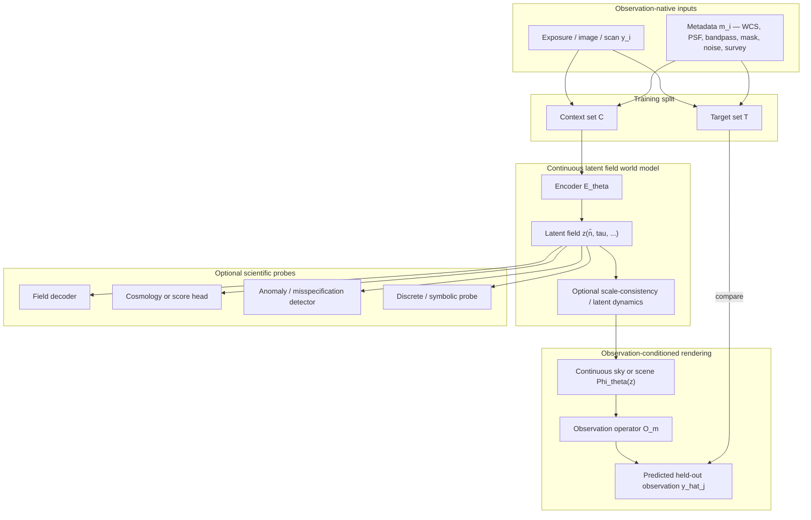
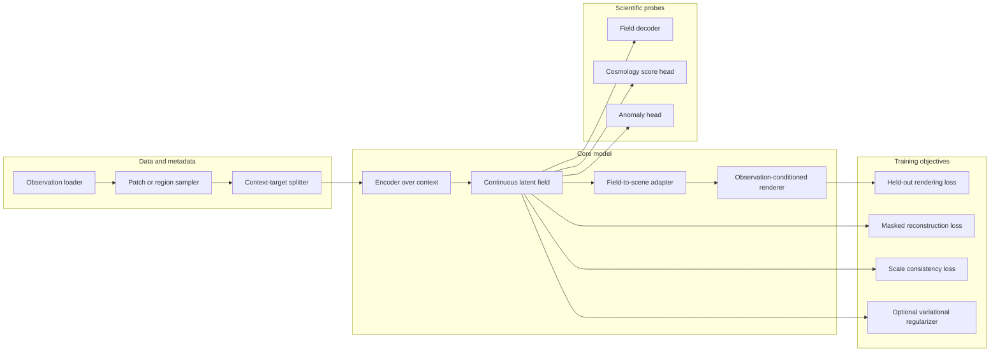

# Observation-Native Continuous Latent Field World Models for Cosmology

**A white paper for a predictive-first, field-shaped, observation-native foundation model**

---

## Abstract

Modern cosmology still relies on an uneasy compromise between two extremes. On one side are explicit physical forward models and field-level inference pipelines, which are scientifically interpretable but tightly tied to a chosen ontology, simulator stack, and likelihood factorization. On the other side are flexible machine-learning pipelines, which can be more data-driven and observation-native, but often operate on compressed intermediate products or learn latent representations that are difficult to connect back to scientific structure. We propose a third path: an **observation-native continuous latent field world model**. The model ingests raw or near-raw observations together with instrument metadata, compresses them into a **continuous latent field** defined over a structured domain such as sky position and scale, and is trained primarily by **cross-view prediction, rendering, masked reconstruction, and intervention-style consistency** rather than by commitment to a fixed physical simulator. The central claim is not that the latent field is *a priori* the true matter field or true sky field. Rather, it is a predictive latent state that is intentionally shaped so that it can later support scientific probes, field decoders, cosmological score heads, and anomaly tests.

The white paper has four goals. First, it motivates why this approach is scientifically distinct from both classical field-level inference and standard latent world models. Second, it defines the core mathematical objects and notation carefully enough to be legible to cosmologists, statisticians, and machine-learning researchers. Third, it provides a comparison table against the main competing paradigms. Fourth, it proposes a concrete implementation plan and repository strategy, including how to extend or refactor existing projects such as **cosmapper** and **torchsky**, and when a new repository is the better engineering and scientific choice.

---

## 1. Motivation

### 1.1 The current gap

There is now broad agreement in cosmology that substantial information is lost when one compresses observations too early into catalogs, summary statistics, or highly task-specific derived maps. This is one of the main motivations behind **field-level inference**: one wants to infer latent spatial structure from minimally compressed data, rather than from a few moments or object-level summaries. In practice, however, most field-level inference pipelines in cosmology remain tightly coupled to explicit simulation stacks, hierarchical Bayesian models, and predetermined physical ontologies. This is scientifically rigorous, but it is also conservative: if the assumed simulator, latent field parameterization, or likelihood decomposition is misspecified, the inference system may be excellent at estimating parameters *within* the chosen ontology while being less able to discover a deeper or alternative one \[1–4\].

At the same time, modern machine learning has produced increasingly strong **world models**, **joint-embedding predictive architectures**, and **cross-view latent models**. These methods often learn more directly from raw observations, can be more robust to heterogeneous sensors, and do not require a fully explicit mechanistic simulator during representation learning. However, most of them either (i) use global vector latents, which are too compressed and opaque for scientific use, or (ii) are developed for action-conditioned embodied settings rather than for static, observation-conditioned scientific worlds \[5–8\].

The gap is therefore the following:

- **Explicit field-level inference** is scientifically grounded, but simulator- and ontology-tied.
- **Latent world models** are flexible and predictive, but often insufficiently structured for cosmological science.

This white paper proposes to fill that gap by learning a **continuous latent field world model** directly from observations.

### 1.2 Why observation-native matters

If the model is trained against real observations rather than only against simulated latent fields or derived products, then the standard of success is stronger. The model must explain the actual measurement space: masking, point-spread functions, beams, pixelization, cadence, bandpass, noise, detector footprint, and survey heterogeneity. In this sense, the proposed approach is deliberately **less spherical-cow on the observation side** than approaches that begin from idealized convergence maps, idealized shear fields, or simulator-native latent volumes.

This does **not** remove assumptions. It replaces some scientific assumptions with representation-learning assumptions. In particular, it assumes that if a latent state is sufficiently predictive across views, instruments, resolutions, and observation operators, then that latent state is a strong candidate carrier of the information needed for downstream cosmological inference. That claim must be tested empirically, not assumed dogmatically.

### 1.3 Why a latent field, not only a latent vector

A global latent vector is too blunt an object for multiscale cosmology. The hidden state should support:

1. **local queries** (for example, render or inspect a sky patch),
2. **global queries** (for example, render a full survey field),
3. **cross-scale structure** (for example, relate coarse and fine angular information), and
4. **observation-aware rendering** (for example, produce the appearance under a different PSF or bandpass).

A natural compromise is therefore to represent the hidden state as a **continuous latent field**
$$
z : \mathcal U \to \mathbb R^{d_z},
$$
where $\mathcal U$ is a structured domain and $d_z$ is the latent channel dimension. In the simplest projected-sky version,
$$
\mathcal U = S^2 \times \mathbb R_{\tau},
$$
where:

- $S^2$ denotes the celestial sphere;
- $\tau$ denotes a continuous **scale coordinate** (for example $\tau = \log \ell$, where $\ell$ is an angular scale variable);
- $z(\hat n,\tau)$ is the latent field at sky direction $\hat n$ and scale coordinate $\tau$.

A more ambitious future version could extend the domain to include a radial or light-cone coordinate $\chi$, time $t$, or wavelength/band coordinate $\lambda$, for example
$$
\mathcal U = S^2 \times \mathbb R_{\chi} \times \mathbb R_{\tau} \times \Lambda.
$$
The key point is that the latent is **field-shaped and queryable**, but still trained primarily for predictive sufficiency rather than for exact physical literalness.

---

## 2. Scientific positioning

### 2.1 The proposal in one sentence

> We propose a predictive-first, observation-native world model in which the hidden state is a continuous latent field over a structured cosmological domain, trained by cross-view rendering and consistency objectives, and only later mapped to explicit scientific interpretations through probes and decoder heads.

### 2.2 What this proposal is **not**

This is **not** classical field-level inference in the narrow current sense. We do not assume from the outset that the latent state is the true matter density field, the true shear field, or the true initial-condition field.

This is **not** only a self-supervised encoder for downstream classification. The latent is not merely a representation for later fine-tuning; it must support explicit predictive rendering of held-out observations.

This is **not** an ordinary world model with a single latent vector. The hidden state is spatially and, optionally, scale-indexed.

This is **not** a purely symbolic or discrete program induction system. Symbolic abstractions may become useful later as probes or interfaces, but they are not the primary representational commitment.

### 2.3 What it aims to preserve

The proposed model tries to preserve four desirable properties simultaneously:

- **observation fidelity:** the ability to reconstruct or predict real observations;
- **latent continuity:** a hidden state that is continuous in coordinates rather than purely token-based;
- **scientific extensibility:** the possibility of later attaching field, score, parameter, or anomaly heads;
- **ontological flexibility:** the freedom not to hard-code the final physical ontology at the beginning.

---

## 3. Mathematical formulation

### 3.1 Observation model and notation

Let
$$
\mathcal D = \{(y_i, m_i)\}_{i=1}^{N}
$$
denote a collection of observations of the same underlying sky region or scene.

For each observation index $i$:

- $y_i$ denotes the observed data array. Depending on the application, this may be a single exposure, a multi-band image, a cutout, a scan segment, or another observation-native tensor.
- $m_i$ denotes the associated **observation metadata**. This may include sky footprint, WCS, PSF or beam information, bandpass, exposure time, noise calibration, masking, cadence, detector identifier, and survey provenance.

We partition the observations into a **context set** $\mathcal C$ and a **target set** $\mathcal T$, where:

- $\mathcal C$ contains the observations the model is allowed to condition on;
- $\mathcal T$ contains the observations the model is asked to predict, reconstruct, or render.

The representation-learning problem is then: infer a latent state from $\mathcal C$, and predict $\mathcal T$.

### 3.2 Latent field

Let
$$
z : \mathcal U \to \mathbb R^{d_z}
$$
be the latent field, where:

- $\mathcal U$ is the latent domain;
- $d_z$ is the latent channel dimension.

For the projected-sky cosmology setting considered first in this document,
$$
\mathcal U = S^2 \times \mathbb R_{\tau}.
$$
We write the latent coordinate as
$$
u = (\hat n, \tau),
$$
where:

- $\hat n \in S^2$ is a unit vector on the sky, i.e. a sky direction;
- $\tau \in \mathbb R$ is a continuous scale variable.

Then the latent field is written as
$$
z(\nu) = z(\hat n, \tau).
$$

If a radial coordinate $\chi$ is later introduced, we write
$$
\nu = (\hat n, \chi, \tau).
$$

### 3.3 Encoder and renderer

The model has two primary components.

#### Encoder

The encoder maps the context observations into a latent field:
$$
z \sim q_{\theta}(z \mid \mathcal C),
$$
or, in a deterministic version,
$$
z = E_{\theta}(\mathcal C).
$$
Here:

- $q_{\theta}(z \mid \mathcal C)$ is a variational posterior over latent fields;
- $E_{\theta}$ is a deterministic encoder;
- $\theta$ denotes learned parameters.

#### Renderer / predictor

Given the latent field and target metadata, the renderer predicts a target observation:
$$
y_j \sim p_{\theta}(y_j \mid z, m_j), \qquad j \in \mathcal T,
$$
or, deterministically,
$$
\hat y_j = R_{\theta}(z, m_j).
$$
Here:

- $R_{\theta}$ is a differentiable observation-conditioned renderer;
- $m_j$ specifies how the latent field should be projected, blurred, masked, sampled, or integrated to match target observation $j$.

### 3.4 Observation-conditioned rendering operator

A useful abstraction is to decompose the renderer as
$$
R_{\theta}(z, m_j) = \mathcal O_{m_j}(\Phi_{\theta}(z)),
$$
where:

- $\Phi_{\theta}(z)$ is an intermediate continuous scene or sky representation derived from the latent field;
- $\mathcal O_{m_j}$ is the **observation operator** induced by metadata $m_j$.

For example, $\mathcal O_{m_j}$ may include:

- geometric projection through WCS;
- integration over a bandpass or spectral response;
- convolution with a PSF or beam;
- multiplication by a mask or footprint;
- sampling onto detector pixels;
- injection of observation noise in probabilistic training.

This factorization is attractive because it separates **latent scene representation** from **instrumental realization**.

### 3.5 Training objective

A generic probabilistic objective is
$$
\mathcal L(\theta) = -\mathbb E_{\mathcal C,\mathcal T}
\left[
\mathbb E_{q_{\theta}(z \mid \mathcal C)}
\left[
\sum_{j \in \mathcal T} \log p_{\theta}(y_j \mid z, m_j)
\right]
- \beta \, \mathrm{KL}\big(q_{\theta}(z \mid \mathcal C) \;\|\; p_{\theta}(z)\big)
\right].
$$
Every term is defined as follows:

- $\mathbb E_{\mathcal C,\mathcal T}[\cdot]$ denotes expectation over random train-time context/target splits;
- $q_{\theta}(z \mid \mathcal C)$ is the approximate posterior over latent fields given the context set;
- $p_{\theta}(y_j \mid z, m_j)$ is the predictive distribution for target observation $j$;
- $p_{\theta}(z)$ is a prior over latent fields;
- $\mathrm{KL}(\cdot\|\cdot)$ is the Kullback–Leibler divergence;
- $\beta$ controls regularization strength.

If one does **not** want a fully probabilistic latent initially, a deterministic objective is simpler:
$$
\mathcal L_{\mathrm{pred}}(\theta)
= \mathbb E_{\mathcal C,\mathcal T}
\left[
\sum_{j \in \mathcal T} \ell\big(R_{\theta}(E_{\theta}(\mathcal C), m_j), y_j\big)
\right],
$$
where $\ell$ is a reconstruction or predictive loss, such as squared error, robust Huber loss, Gaussian negative log-likelihood, or a masked perceptual/statistical loss depending on the data type.

### 3.6 Scale-aware latent dynamics or consistency

If the latent domain includes the scale variable $\tau$, we can define internal scale consistency. Let
$$
\Pi_{\Delta \tau}
$$
be a coarse-graining operator along the scale axis. Then one desirable property is
$$
\Pi_{\Delta \tau} \big(z(\hat n, \tau)\big)
\approx
z(\hat n, \tau + \Delta \tau).
$$
Here:

- $\Delta \tau$ is a change in scale coordinate;
- $\Pi_{\Delta \tau}$ maps the fine-scale latent to a coarser-scale latent.

This equation does **not** assert that the latent is already a renormalization group object in the physical sense. It only states that latent descriptions at nearby scales should be mutually consistent under an appropriate learned or analytic coarse-graining map.

### 3.7 Scientific heads as probes, not commitments

After predictive pretraining, one may attach a scientific head
$$
h_{\varphi}(z)
$$
for a downstream task. Examples include:

- a field decoder $h_{\varphi}^{\mathrm{field}}(z)$ that predicts a physically interpretable field such as convergence or a denoised sky map;
- a cosmological score head $h_{\varphi}^{\mathrm{score}}(z)$ estimating a score or likelihood-ratio surrogate for parameters;
- an anomaly or misspecification head $h_{\varphi}^{\mathrm{anom}}(z)$ designed to detect discrepancies between real observations and the training manifold.

The crucial design principle is that these heads are **probes of the latent**, not assumptions imposed on the latent from the beginning.

---

## 4. Conceptual architecture



### Interpretation of the diagram

The encoder never sees the target observation tensor directly during prediction of that target. It only sees the context set. The latent field is the *shared hidden state* from which multiple held-out views can be rendered. This is why the model is world-model-like rather than merely autoencoding. The optional probes are deliberately downstream and modular.

---

## 5. Statistical perspective

A statistician may ask: what exactly is being inferred, and what is the estimand?

The most honest answer is the following.

1. The **primary estimand during pretraining** is the conditional predictive law
   $$
   p(y_{\mathcal T} \mid y_{\mathcal C}, m_{\mathcal C}, m_{\mathcal T}).
   $$
   The latent field is a learned internal parameterization of that conditional law.

2. The **secondary estimands** are whatever scientific functionals are later read out from the latent field, such as a convergence-like map, an uncertainty score, or a cosmological score function.

3. The latent field should therefore be judged first by **predictive sufficiency**, and only second by direct interpretability.

This view is deliberately closer to **predictive state representations** than to classical latent-variable models with a fixed ontological meaning. However, by making the latent field continuous and coordinate-aware, we bias it toward structures that are more amenable to scientific probing than a generic black-box hidden vector would be.

---

## 6. Cosmological perspective

A pure cosmologist will rightly ask whether this abandons too much physics.

It does **not** abandon physics; it changes when and where the physical commitments are made.

Classical field-level inference commits early:

- choose the latent physical field;
- choose the forward model;
- choose the prior and likelihood;
- infer within that ontology.

The proposed framework commits later:

- first learn a latent field that must explain real observations across many operators and views;
- then test whether that latent supports physically meaningful decoders, constraints, and parameter heads.

This has a specific scientific upside: it may be more capable of discovering a useful latent ontology that is not identical to the standard simulator-native one. That is exactly the sense in which it is less conservative and potentially more open to deeper reformulations.

---

## 7. Comparison table

| Axis | Explicit field-level inference | Generic latent world model | Continuous latent field world model (this proposal) | Current `cosmapper` direction | Current `torchsky` role |
|---|---|---|---|---|---|
| **Primary training signal** | Likelihood under explicit physical forward model | Predictive latent dynamics / reconstruction | Cross-view rendering and predictive sufficiency from observation-native data | Dense per-pixel prediction with physics-aware decoder | Infrastructure, operators, I/O, geometry, experimental continuous fields |
| **Latent state** | Usually explicitly physical field | Usually vector or token latent | Continuous coordinate-indexed latent field | Dense field over sky patches with differentiable cosmology | No single world-model latent; provides building blocks |
| **Commitment to ontology** | Strong and early | Weak | Moderate and delayed | Moderate-to-strong | Minimal |
| **Dependence on simulator** | High | Low | Low-to-moderate | Moderate | Low |
| **Observation realism during training** | Often limited by simulator and likelihood stack | High if trained on real observations | High by design | High for image inputs, but current scope is narrower | High as infrastructure layer |
| **Interpretability on day 1** | High | Low | Medium-low initially, higher via probes later | Medium | Not a model, so not directly applicable |
| **Ability to discover new ontology** | Limited by chosen model family | Potentially high, but often too opaque | High relative to explicit FLI, with more structure than generic LM/world models | Some, but currently tied to redshift/distance field framing | Enables many options, does not decide ontology |
| **Best immediate use** | Conservative science-grade inference under known physics | General prediction and control | Observation-native cosmology pretraining + scientific probing | Field-centric cosmology prototype | Core library for FITS/WCS/mapmaking/continuous rendering |
| **Main risk** | Model misspecification and sim2real conservatism | Latent may be predictive but scientifically useless | Latent may still entangle nuisance and cosmology unless designed well | Too tied to one scientific decoder family | Scope creep if turned into monolithic science repo |
| **Main opportunity** | Trustworthy inference under explicit assumptions | Very flexible predictive modeling | Predictive-first representation that can later support explicit science heads | Reuse as a field/science probe package | Reuse as the geometry/operator substrate |

---

## 8. Potential implementation

### 8.1 Design principles

A practical implementation should respect six principles.

1. **Observation-native first.** The core training data should be exposures, minimally processed images, or other sensor-native arrays with metadata, not only derived cosmology products.
2. **Renderer-first supervision.** The model should be trained to predict held-out observations through observation-conditioned rendering.
3. **Continuous latent field.** The hidden state should be queryable as a function of coordinates.
4. **Scaffolded structure.** Geometry, WCS, and observation operators should be explicit, while the latent ontology remains only partially committed.
5. **Probes are modular.** Scientific decoders and score heads should be plug-ins, not the training bottleneck.
6. **Infrastructure is not the science repo.** Low-level FITS/WCS/map infrastructure should remain separable from the world-model research code.

### 8.2 Minimum viable architecture

The first practical version should use **calibrated single-epoch or single-exposure imaging** rather than detector-raw readout. That is already much closer to the observation layer than catalogs or derived maps, but avoids making the project mainly about detector systematics.

A minimum viable training pipeline is:

1. sample a context set of observations $\mathcal C$ for a shared sky region;
2. sample one or more held-out target observations $\mathcal T$;
3. encode $\mathcal C$ into a latent field $z$;
4. render each target observation through its metadata-driven operator;
5. optimize predictive loss plus latent regularizers.

A first latent domain could be
$$
\mathcal U = S^2 \times \mathbb R_{\tau}
$$
with local tangent-plane parameterizations internally for finite patches.

### 8.3 Recommended module decomposition



### 8.4 How `cosmapper` could be extended or refactored

Your current **cosmapper** is already clearly on the field-centric side. Its public description is explicitly “dense distance-redshift-objectness maps from multi-survey imaging,” with no source catalogs as inputs, random sky crops, a dense field encoder, an LSS field network, and a physics-aware decoder with differentiable cosmology. Its roadmap also emphasizes field inference rather than centered galaxies (internal codebase context).

This makes `cosmapper` valuable, but its current ontology is still relatively committed:

- it already assumes the important latent should organize around redshift, distance, objectness, and a differentiable cosmology layer;
- its architecture is framed as a generative cosmology model for dense field estimation rather than as a general observation-native world model.

That means `cosmapper` is best reused in one of three ways:

#### Option A — keep `cosmapper` as a science head package

In this option, `cosmapper` is *not* the core world-model repository. Instead, it becomes a package of **scientific decoders / probes** attached to a more general latent field world model.

Examples of re-used components:

- dense field decoder heads;
- differentiable cosmology utilities;
- sparse-label supervision utilities;
- field-centric evaluation code.

This is attractive because it preserves the scientific specificity of `cosmapper` while avoiding overloading it with general world-model concerns.

#### Option B — refactor `cosmapper` into a narrower `cosmoheads`-style package

A more aggressive refactor is to split out:

- `cosmapper-core-heads`: cosmology-specific probes and heads;
- `cosmapper-eval`: cosmology-specific evaluation and sparse-label metrics;
- deprecate the current monolithic training loop in favour of a cleaner plug-in API.

This is scientifically elegant but may be more work than necessary unless you are already willing to break compatibility.

#### Option C — evolve `cosmapper` directly into the world-model repo

I do **not** recommend this as the primary path. The current `cosmapper` naming, scope, and design language are already strongly associated with one science ontology. Turning it into a generic observation-native latent field world model would likely create conceptual and engineering friction.

### 8.5 How `torchsky` could be extended or refactored

Your current **torchsky** already looks much closer to the right infrastructure layer. Its documented scope is “torch-native sky data, coordinates, geometry, mapmaking, and catalog workflows,” and it already includes experimental continuous-field fitting and rendering APIs inside `torchsky.map`, including field observations, field domains, implicit fields, bandpass-conditioned fields, operator-constrained fields, and rendering/fitting utilities (internal codebase context).

That is a major advantage.

`torchsky` can therefore serve as the **substrate** for the proposed project:

- FITS and table I/O;
- WCS and spherical geometry;
- map products and observation operators;
- continuous field rendering;
- spectral / multi-band observation handling;
- benchmarkable low-level image-plane and HEALPix operations.

However, `torchsky` should remain primarily an **infrastructure and operator library**, not absorb the entire world-model research programme. The risks of moving the full training stack into `torchsky` are:

- loss of clarity in package identity;
- unstable research abstractions contaminating the public API;
- harder release and maintenance discipline;
- confusion between “astronomy systems library” and “one ambitious cosmology model family.”

So the right move is to extend `torchsky` only where it naturally belongs:

- observation-operator abstractions needed by the world model;
- efficient rendering primitives;
- optional helper data structures for context/target sampling;
- geometry-native continuous field parameterizations.

### 8.6 Recommended repository strategy

**Recommendation: create a new repository** for the world model, and use:

- `torchsky` as the infrastructure dependency,
- selected `cosmapper` components as optional probes/heads,
- perhaps `torchfits` and related packages where relevant for low-level I/O.

A suitable new repository name could be something like:

- `torchworldsky`
- `latentsky`
- `skywm`
- `cosmoworld`
- `fieldjepa-sky`

The exact name matters less than preserving a clear separation of concerns.

### 8.7 Proposed new-repo layout

```text
latent_sky_world_model/
├── README.md
├── docs/
│   ├── theory.md
│   ├── training.md
│   ├── probes.md
│   └── experiments.md
├── configs/
│   ├── pretrain/
│   ├── probes/
│   └── ablations/
├── lswm/
│   ├── data/
│   │   ├── observations.py
│   │   ├── samplers.py
│   │   └── splits.py
│   ├── latent/
│   │   ├── domains.py
│   │   ├── fields.py
│   │   └── scale_space.py
│   ├── models/
│   │   ├── encoder.py
│   │   ├── renderer.py
│   │   ├── losses.py
│   │   └── priors.py
│   ├── probes/
│   │   ├── field_decoder.py
│   │   ├── cosmology_head.py
│   │   └── anomaly_head.py
│   ├── training/
│   │   ├── pretrain.py
│   │   ├── probe_train.py
│   │   └── evaluate.py
│   └── utils/
└── scripts/
    ├── pretrain_world_model.py
    ├── fit_probe.py
    └── render_targets.py
```

### 8.8 Phased implementation plan

#### Phase 0 — observation-native pretraining scaffold

Goal: prove that the model can infer a latent field from context exposures and render held-out exposures better than strong baselines.

Deliverables:

- context/target sampler over real observations;
- observation-conditioned renderer on top of `torchsky` operators;
- deterministic latent field encoder;
- held-out predictive benchmark.

#### Phase 1 — scale-aware latent structure

Goal: add the explicit scale coordinate $\tau$ and test whether scale-aware latent fields improve predictive consistency across resolution and masking.

Deliverables:

- latent domain $S^2 \times \mathbb R_{\tau}$;
- scale-consistency loss;
- ablation against latent-without-scale baseline.

#### Phase 2 — scientific probes

Goal: attach field-like and cosmology-oriented heads.

Deliverables:

- convergence/shear-like probe on projected data;
- redshift/distance-like probe reusing `cosmapper` ideas where useful;
- anomaly head for sim2real and misspecification diagnostics.

#### Phase 3 — probabilistic latent field model

Goal: move from deterministic rendering to probabilistic predictive laws and uncertainty-aware latent state.

Deliverables:

- variational or flow-based latent prior;
- predictive uncertainty metrics;
- comparison with explicit field-level inference outputs where possible.

---

## 9. Risks, pushbacks, and empirical tests

### 9.1 Main pushback

The strongest criticism is straightforward:

> A latent world model may reconstruct observations well while still failing to preserve the faint, high-order, and parameter-sensitive information required for cosmology.

This is a valid criticism. It cannot be answered by rhetoric. It requires explicit empirical tests.

### 9.2 Necessary empirical tests

A serious programme should include at least the following.

1. **Held-out observation likelihood / rendering quality.** This establishes the base predictive competence.
2. **Cross-instrument and cross-resolution consistency.** This tests whether the latent captures view-invariant structure rather than memorizing one observation mode.
3. **Probe recoverability.** Can a physically meaningful field or score be decoded from the latent with competitive fidelity?
4. **Anomaly sensitivity.** Does the model detect regimes where its representation is being forced outside the training manifold?
5. **Comparative cosmology utility.** Does the latent improve downstream parameter sensitivity, score estimation, or field reconstruction relative to standard baselines?

---

## 10. Outlook and broader applications

Although the motivation here is cosmology-first, the framework is broader. Any domain in which observations are partial, noisy, operator-dependent views of an underlying continuous scene or field is a candidate.

Examples include:

- Earth observation and climate reanalysis;
- geophysical or seismic inverse problems;
- medical imaging and tomography;
- microscopy and scientific imaging;
- remote sensing with heterogeneous sensors;
- multi-instrument laboratory science.

The broad principle is the same: use observation-native predictive supervision to learn a continuous latent field, then attach scientific interpretation layers afterwards.

---

## 11. Conclusion

The central claim of this white paper is modest in one sense and ambitious in another.

It is modest because it does **not** claim to have identified the final physical ontology of cosmological structure. It explicitly refuses to assume too early that the latent state must be the true matter field, the true shear field, or another simulator-native object.

It is ambitious because it asks for something harder: a world model trained on real observation space that is powerful enough to support later scientific structure without having been forced into that structure at initialization.

The resulting design is a **continuous latent field world model**:

- continuous, because the latent is not only token-based or vector-based;
- field-like, because it is coordinate-indexed and queryable;
- world-model-like, because it is trained for predictive sufficiency across held-out views;
- observation-native, because it is supervised in measurement space;
- scientifically extensible, because probes and decoders can later map it toward explicit cosmological meaning.

The strongest engineering recommendation is therefore:

- keep **`torchsky`** as the infrastructure and observation-operator substrate,
- keep **`cosmapper`** as a valuable source of cosmology-specific field heads and evaluation logic,
- and build the core world-model programme in a **new repository** whose identity is not prematurely tied to one fixed ontology.

That gives the project the best chance of being simultaneously predictive, extensible, and genuinely open to deeper physical reformulations.

---

## References

[1] Jasche, J., & Wandelt, B. D. (2013). Bayesian physical reconstruction of initial conditions from large-scale structure surveys.

[2] Porqueres, N., et al. (2021). Bayesian forward modelling of cosmic shear data. *Monthly Notices of the Royal Astronomical Society*.

[3] Kodi Ramanah, D., et al. (2023/2024). Field-level inference with emulators / BORG-EM.

[4] Field-level inference lecture notes / review articles in cosmology (2025).

[5] Li, Z., Kovachki, N., Azizzadenesheli, K., et al. (2020). Fourier Neural Operator for Parametric Partial Differential Equations.

[6] Akhmetzhanova, A., Mishra-Sharma, S., & Dvorkin, C. (2023). Self-supervised cosmological data compression and inference.

[7] Sharma, R., Hogervorst, G., Mackey, W. E., Heeger, D. J., & Martiniani, S. (2026). Cross-View World Models.

[8] Nam, H., Le Lidec, Q., Maes, L., LeCun, Y., & Balestriero, R. (2026). Causal-JEPA: Learning World Models through Object-Level Latent Interventions.

[9] Islam, M. K., Fox, J., et al. (2026). OmniSpectra: A Unified Foundation Model for Native Resolution Astronomical Spectra.

[10] Internal codebase context: `cosmapper` current README / roadmap / architecture notes; `torchsky` README and API documentation.
