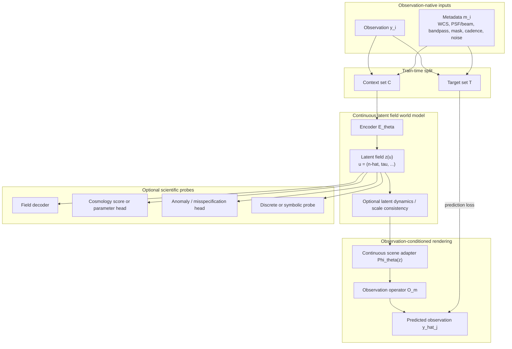
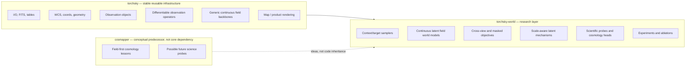

# Observation-Native Continuous Latent Field World Models for Cosmology

**A white paper for a predictive-first, field-shaped, observation-native foundation model**

---

## Abstract

Modern cosmology sits between two unsatisfactory extremes. At one extreme are **explicit field-level inference** pipelines: scientifically interpretable, statistically principled, and often impressively close to the data, but tightly coupled to a chosen ontology, a chosen simulator family, and a chosen likelihood factorization. At the other extreme are flexible **machine-learning pipelines** and **world models**: highly expressive and naturally observation-native, but often trained on compressed products, built around opaque global latents, or optimized for generic prediction rather than for scientific extraction.

This white paper develops a third view. We propose an **observation-native continuous latent field world model** for cosmology. The model ingests raw or near-raw observations together with instrument metadata, encodes them into a **continuous latent field** defined over a structured domain such as sky position and scale, and is trained primarily by **cross-view prediction, observation-conditioned rendering, masked reconstruction, and consistency under observational interventions** rather than by commitment to a fixed physical simulator. The central claim is deliberately modest: the latent field is *not* assumed a priori to be the true matter field, the true shear field, or any other final physical field. Rather, it is a **predictive latent state** that is intentionally shaped so that it can later support scientific probes, field decoders, cosmological score heads, uncertainty heads, or anomaly tests.

The scientific motivation is twofold. First, this approach is potentially **less conservative** than simulator-tied field-level inference, because it does not force the ontology of the latent state to coincide from the start with the ontology of the current forward model. Second, it is potentially **less opaque** than generic latent world models, because the hidden state is not a single vector or token sequence but a coordinate-indexed field that can be queried locally, globally, and across scales.

This document has six aims.  
1. Motivate why this approach is scientifically distinct from both classical field-level inference and standard latent world models.  
2. Define the mathematical objects and notation carefully enough to be legible to cosmologists, statisticians, and AI/ML researchers.  
3. Make an explicit parallel with physical fields and explain both where the analogy is useful and where it should not be overclaimed.  
4. State the main drawbacks and open problems directly, rather than hiding them behind architectural enthusiasm.  
5. Propose a concrete software split between **`torchsky`** and **`torchsky-world`**.  
6. Explain how this new direction should relate to, but not directly inherit, the current **`cosmapper`** codebase.

---

## 1. Motivation

### 1.1 The current gap in cosmological inference

There is now broad agreement that substantial cosmological information is lost when observations are compressed too early into object catalogues, summary statistics, or a small number of task-specific map products. This is one of the main motivations behind **field-level inference**: rather than estimating a few summary quantities, one attempts to infer latent spatial structure from minimally compressed data. In cosmology this logic has produced powerful hierarchical pipelines for inferring initial conditions, matter fields, bias parameters, and cosmological parameters from galaxy surveys, weak-lensing data, or related observables.

However, current field-level inference is still overwhelmingly **ontology-first**:

- one chooses a latent field (for example an initial Gaussian density field, a matter overdensity field, a convergence field, or a biased tracer field),
- one chooses an explicit forward model or simulator,
- one chooses a prior and likelihood family,
- and one performs inference *within that model class*.

This is scientifically rigorous and often exactly the right thing to do if the ontology and simulator are trusted. But it is also conservative. If the ontology, nuisance factorization, or simulator family is misspecified, then the inference may be excellent at estimating parameters **within the chosen formalism** while being much less capable of discovering a better one.

At the same time, modern AI has produced increasingly strong **world models**, **joint-embedding predictive architectures**, **latent state-space models**, and **cross-view latent models**. These approaches often learn directly from raw observations, naturally accommodate heterogeneous sensors, and do not need a fully explicit mechanistic simulator during representation learning. Yet most of them are not immediately suitable for cosmological science because they typically use:

- a **global latent vector** that is too compressed and too opaque,
- a **tokenized latent sequence** whose relationship to physical geometry is indirect,
- or an **action-conditioned embodied setting** that does not match the observational character of cosmology.

The gap is therefore:

- **Explicit field-level inference** is scientifically grounded but simulator- and ontology-tied.
- **Generic world models** are flexible and predictive but often insufficiently structured for cosmological use.

This white paper proposes a middle path: an **observation-native continuous latent field world model**.

### 1.2 Why observation-native learning matters

If a model is trained directly against real observations rather than only against simulator-native latent fields or pre-made cosmological products, then the standard of success becomes stricter and, in an important sense, more realistic. The model must explain the actual measurement space:

- point-spread functions or beams,
- masks and irregular footprints,
- pixelization and WCS distortions,
- bandpass integration,
- cadence, dithers, and multi-epoch structure,
- survey heterogeneity,
- and the characteristic noise structure of real instruments.

In that sense, the proposal here is deliberately **less spherical-cow on the observation side** than methods that begin from idealized convergence maps, idealized shear fields, or latent volumes that were never forced to render the real observations faithfully.

This does **not** remove assumptions. It replaces some **physics-explicit assumptions** with **representation-learning assumptions**. In particular, it assumes that a latent state that is sufficiently predictive across views, instruments, masks, resolutions, and observing conditions is likely to preserve much of the information needed for later scientific inference. That assumption is weaker than assuming the correct latent ontology from the outset, but it is still an assumption, and it must be tested empirically.

### 1.3 Why a field-shaped latent instead of only a latent vector

A global latent vector is too blunt an object for multiscale cosmology. The hidden state should support at least four kinds of operation:

1. **local queries**: inspect or render a sky patch;
2. **global queries**: render a large field or survey region;
3. **cross-scale queries**: relate coarse and fine angular structure;
4. **observation-conditioned rendering**: produce the appearance under a different PSF, bandpass, resolution, or instrument.

A natural compromise is therefore to represent the hidden state as a **continuous latent field**
\[
z : \mathcal U \to \mathbb R^{d_z},
\]
where:

- \(\mathcal U\) is a structured domain;
- \(d_z\) is the latent channel dimension;
- \(z(u)\) is the latent state at coordinate \(u \in \mathcal U\).

In the first projected-sky version, a natural choice is
\[
\mathcal U = S^2 \times \mathbb R_{\tau},
\]
where:

- \(S^2\) is the celestial sphere;
- \(\tau\) is a continuous **scale coordinate**;
- \(z(\hat n,\tau)\) is the latent field at sky direction \(\hat n\) and scale coordinate \(\tau\).

A more ambitious later version could extend the domain to include radial or light-cone coordinate \(\chi\), time \(t\), or wavelength \(\lambda\), for example
\[
\mathcal U = S^2 \times \mathbb R_{\chi} \times \mathbb R_{\tau} \times \Lambda \times \mathbb R_t.
\]

The essential point is this: the latent is **field-shaped and queryable**, but is trained primarily for **predictive sufficiency**, not for exact physical literalness.

### 1.4 The core scientific bet

The central bet of this proposal is not that the universe is “really” a latent field in the machine-learning sense. The bet is more operational:

> There exists a structured, coordinate-indexed hidden state that is compact enough to be learnable, rich enough to predict held-out observations across modalities and observing conditions, and regular enough that explicit scientific structure can later be decoded or probed from it.

This is deliberately weaker than assuming the correct physical latent field from the start, but stronger than assuming only that a black-box latent vector is enough.

---

## 2. Scientific positioning

### 2.1 The proposal in one sentence

> We propose a predictive-first, observation-native world model in which the hidden state is a continuous latent field over a structured cosmological domain, trained by cross-view rendering and intervention-style consistency, and only later mapped to explicit scientific interpretations through probes and decoder heads.

### 2.2 What this proposal is **not**

This is **not** classical field-level inference in the narrow current sense. We do not assume from the outset that the latent state is the true matter field, the true shear field, or the true initial-condition field.

This is **not** only a self-supervised feature encoder. The latent must support observation-conditioned rendering of held-out observations, not only downstream fine-tuning.

This is **not** an ordinary world model with a single hidden vector or purely tokenized latent sequence. The hidden state is spatially indexed, and optionally scale indexed.

This is **not** a purely symbolic or program-induction system. Symbolic abstractions may become useful later as probes or interfaces, but they are not the initial representational commitment.

### 2.3 What the proposal tries to preserve

The model attempts to preserve four things at once:

- **observation fidelity**: the ability to predict or reconstruct real held-out observations;
- **latent continuity**: a hidden state that is continuous in coordinates rather than purely discrete or vectorized;
- **scientific extensibility**: the ability to attach field probes, cosmological heads, and anomaly diagnostics later;
- **ontological flexibility**: the freedom not to hard-code the final physical ontology at the beginning.

That combination is the real novelty claim, not any one architectural ingredient in isolation.

---

## 3. Relation to physical fields

### 3.1 Why the field analogy is useful

The phrase “continuous latent field” is not only a metaphor. There is a real structural analogy to physical fields.

A physical field is a map
\[
x : \mathcal M \to \mathbb R^{d_x},
\]
where:

- \(\mathcal M\) is a domain such as space, spacetime, or a manifold with additional structure;
- \(d_x\) is the number of field components;
- \(x(m)\) gives the field value at location \(m \in \mathcal M\).

Examples in cosmology include:
- density contrast \(\delta(\mathbf r)\),
- gravitational potential \(\Phi(\mathbf r)\),
- weak-lensing convergence \(\kappa(\hat n)\),
- spin-2 shear field \(\gamma(\hat n)\),
- CMB temperature \(T(\hat n)\),
- and polarization fields \(Q(\hat n), U(\hat n)\) or \(E(\hat n), B(\hat n)\).

The proposed latent object shares several of these properties:
- it is defined over a continuous domain;
- it supports local and global queries;
- it may contain multiple channels;
- and it can be transformed by observation operators.

### 3.2 Why the field analogy should **not** be overclaimed

However, a latent field world model is **not automatically a physical field theory**. The difference is important.

A physical field usually carries:
- a clear ontological interpretation,
- symmetry constraints,
- a dynamical law,
- often a variational principle or action,
- and a measurement model with known semantics.

A latent field in this proposal initially carries only:
- predictive meaning,
- geometric indexing,
- and whatever structure is induced by the training objectives and architecture.

So the correct parallel is:

- a physical field is an explicitly interpreted field over a domain;
- a latent field here is a **predictive state field** over a domain.

The proposal is therefore closer in spirit to an **effective field** or **renormalized predictive state** than to a literal fundamental field.

### 3.3 Predictive state interpretation

A useful interpretation is that the latent field \(z\) is a **predictive sufficient state** for the conditional law of future or held-out observations. In that interpretation, \(z\) plays a role analogous to a latent state in state-space models, but with the crucial difference that it is indexed by coordinates and supports querying as a field.

This gives the following hierarchy:

- **physical field view**: \(z\) is literally the cosmological field of interest;
- **effective field view**: \(z\) is a coarse but scientifically meaningful field summarizing what matters for the observations;
- **predictive state view**: \(z\) is whatever continuous field-shaped latent best supports prediction across observation operators.

The proposal deliberately begins from the third view, while trying to make the second and possibly the first available later through probing.

### 3.4 Parallel with coarse-graining and effective theories

If the latent domain includes a scale variable \(\tau\), then the analogy with coarse-graining becomes stronger. One may interpret
\[
z(\hat n,\tau)
\]
as a family of latent descriptions of the same underlying scene at different effective scales. This is not yet a renormalization group formalism in the strict physics sense, but it naturally suggests questions analogous to those in effective theory:

- how does structure at scale \(\tau\) map to structure at scale \(\tau+\Delta \tau\)?
- which information is preserved or discarded under coarse-graining?
- can the model learn transferable cross-scale operators?
- are there latent quantities that remain stable or nearly invariant across \(\tau\)?

This is one of the reasons a scale-aware latent field is more promising for multiscale cosmology than a single hidden vector.

---

## 4. Mathematical formulation

### 4.1 Observation set

Let
\[
\mathcal D = \{(y_i,m_i)\}_{i=1}^{N}
\]
denote a collection of observations of the same underlying sky region or scene.

For each observation index \(i \in \{1,\dots,N\}\):

- \(y_i\) is the observed data array;
- \(m_i\) is the corresponding metadata.

Depending on the application, \(y_i\) may be:
- a single-epoch exposure,
- a multi-band image,
- a scan segment,
- a minimally processed detector-plane tensor,
- or another observation-native array.

The metadata \(m_i\) may include:
- world-coordinate system (WCS),
- PSF or beam parameters,
- bandpass information,
- footprint and mask,
- detector geometry,
- exposure time,
- time or cadence information,
- noise calibration,
- and survey/instrument provenance.

### 4.2 Context and target sets

At training time we partition the observations into:

- a **context set** \(\mathcal C \subset \mathcal D\),
- a **target set** \(\mathcal T \subset \mathcal D\),

with \(\mathcal C \cap \mathcal T = \varnothing\).

The context set is what the model conditions on. The target set is what the model must predict or reconstruct. By varying the split during training, one can encourage the latent to become robust across:
- missing views,
- missing bands,
- held-out epochs,
- held-out instruments,
- or held-out masked subregions.

### 4.3 Latent domain

The hidden state is a latent field
\[
z : \mathcal U \to \mathbb R^{d_z}.
\]

The latent domain \(\mathcal U\) is chosen according to the application.

#### First projected-sky version
\[
\mathcal U = S^2 \times \mathbb R_{\tau}.
\]

A latent coordinate is then written as
\[
u = (\hat n,\tau),
\]
where:

- \(\hat n \in S^2\) is a unit vector on the sphere, representing sky direction;
- \(\tau \in \mathbb R\) is a continuous scale coordinate;
- \(d_z\) is the number of latent channels.

#### Later extension with line-of-sight structure
\[
\mathcal U = S^2 \times \mathbb R_{\chi} \times \mathbb R_{\tau}.
\]

Here:
- \(\chi\) is a radial or light-cone coordinate.

#### Later extension with wavelength or time
\[
\mathcal U = S^2 \times \mathbb R_{\chi} \times \mathbb R_{\tau} \times \Lambda \times \mathbb R_t.
\]

Here:
- \(\Lambda\) denotes wavelength or band coordinate;
- \(t\) denotes time.

The proposal does **not** require committing to the full maximal domain from day one.

### 4.4 Encoder

The encoder maps the context observations into a latent field.

#### Deterministic version
\[
z = E_{\theta}(\mathcal C).
\]

Here:
- \(E_{\theta}\) is the encoder with parameters \(\theta\);
- \(z\) is the latent field produced from the context set.

#### Probabilistic version
\[
z \sim q_{\theta}(z \mid \mathcal C).
\]

Here:
- \(q_{\theta}(z \mid \mathcal C)\) is an approximate posterior over latent fields.

The deterministic version is the simplest starting point. The probabilistic version becomes attractive later if uncertainty quantification in the latent is important.

### 4.5 Renderer and observation operator

Given the latent field \(z\) and target metadata \(m_j\), the model predicts a target observation \(y_j\).

#### Deterministic rendering
\[
\hat y_j = R_{\theta}(z, m_j).
\]

#### Probabilistic rendering
\[
y_j \sim p_{\theta}(y_j \mid z, m_j).
\]

A useful factorization of the deterministic renderer is
\[
R_{\theta}(z,m_j) = \mathcal O_{m_j}\big(\Phi_{\theta}(z)\big),
\]
where:

- \(\Phi_{\theta}(z)\) is a continuous scene or sky representation derived from \(z\);
- \(\mathcal O_{m_j}\) is the observation operator implied by metadata \(m_j\).

The operator \(\mathcal O_{m_j}\) may include:
- geometric projection through WCS,
- integration over wavelength or bandpass,
- PSF or beam convolution,
- masking,
- detector sampling,
- and optional noise injection in probabilistic training.

This separation is important. It allows one to distinguish between:
- the latent scene representation,
- and the observation-specific transformation of that representation.

### 4.6 Predictive training objective

A generic deterministic training objective is
\[
\mathcal L_{\mathrm{pred}}(\theta)
=
\mathbb E_{\mathcal C,\mathcal T}
\left[
\sum_{j \in \mathcal T}
\ell\big(R_{\theta}(E_{\theta}(\mathcal C),m_j), y_j\big)
\right],
\]
where:

- \(\mathbb E_{\mathcal C,\mathcal T}[\cdot]\) denotes expectation over train-time context/target splits;
- \(\ell(\hat y,y)\) is a prediction loss, such as squared error, Huber loss, Gaussian negative log-likelihood, or another observation-space loss.

A corresponding probabilistic objective is
\[
\mathcal L_{\mathrm{ELBO}}(\theta)
=
-
\mathbb E_{\mathcal C,\mathcal T}
\left[
\mathbb E_{q_{\theta}(z\mid\mathcal C)}
\left(
\sum_{j \in \mathcal T}\log p_{\theta}(y_j \mid z,m_j)
\right)
-
\beta\,\mathrm{KL}\!\left(q_{\theta}(z\mid\mathcal C)\,\|\,p_{\theta}(z)\right)
\right].
\]

Every symbol is defined as follows:

- \(q_{\theta}(z\mid\mathcal C)\): approximate posterior over latent fields given the context;
- \(p_{\theta}(y_j \mid z,m_j)\): predictive distribution for target observation \(j\);
- \(p_{\theta}(z)\): prior over latent fields;
- \(\mathrm{KL}(\cdot\|\cdot)\): Kullback–Leibler divergence;
- \(\beta\): regularization weight.

### 4.7 Masked and cross-view objectives

In practice, the training objective should not rely on only one prediction mode. It is better to combine several related objectives:

1. **held-out observation rendering**
   \[
   \mathcal L_{\mathrm{render}}
   =
   \sum_{j\in\mathcal T}\ell(\hat y_j,y_j);
   \]

2. **masked reconstruction**
   \[
   \mathcal L_{\mathrm{mask}}
   =
   \ell\big(M \odot \hat y_j,\; M \odot y_j\big),
   \]
   where \(M\) is a binary mask and \(\odot\) denotes elementwise multiplication;

3. **cross-instrument or cross-band prediction**
   \[
   \mathcal L_{\mathrm{cross}}
   =
   \sum_{j\in\mathcal T_{\mathrm{other}}}\ell(\hat y_j,y_j),
   \]
   where \(\mathcal T_{\mathrm{other}}\) contains observations from a different band, PSF, epoch, or instrument than the context;

4. **consistency under observational interventions**
   \[
   \mathcal L_{\mathrm{intv}}
   =
   \ell\!\left(
   R_{\theta}(z,m'),
   \tilde y'
   \right),
   \]
   where \(m'\) describes a changed observation operator and \(\tilde y'\) is the corresponding target.

These objectives push the latent toward being **view-stable** and **operator-aware** rather than merely autoencoding one observation at a time.

### 4.8 Scale-aware latent consistency

If the latent includes a continuous scale coordinate \(\tau\), we may impose consistency across scales. Let
\[
\Pi_{\Delta\tau}
\]
denote a coarse-graining operator along the scale axis. Then one desirable property is
\[
\Pi_{\Delta\tau}\big(z(\hat n,\tau)\big)
\approx
z(\hat n,\tau+\Delta\tau).
\]

Here:

- \(\Delta\tau\) is a displacement along the scale coordinate;
- \(\Pi_{\Delta\tau}\) maps a fine-scale latent description toward a coarser-scale one.

This does not yet mean the model has learned a true renormalization group flow, but it does encode the intuition that latent structure should remain coherent when the query scale changes.

### 4.9 Scientific probes

After predictive pretraining, one may attach a scientific head
\[
h_{\varphi}(z)
\]
with parameters \(\varphi\).

Examples include:
- a field decoder \(h_{\varphi}^{\mathrm{field}}(z)\),
- a cosmological score head \(h_{\varphi}^{\mathrm{score}}(z)\),
- a parameter head \(h_{\varphi}^{\mathrm{param}}(z)\),
- an anomaly head \(h_{\varphi}^{\mathrm{anom}}(z)\).

The crucial design principle is that these are **probes of the latent** rather than commitments imposed on the latent from the beginning.

---

## 5. Conceptual architecture



### Interpretation

The encoder does not see the target observation directly when predicting it. Instead, it sees only the context set, and it must encode enough structure into the latent field that the renderer can reproduce held-out target observations under their metadata-defined observation operators. This is what makes the system a **world model** rather than a simple autoencoder.

---

## 6. Drawbacks, risks, and open problems

This proposal has real weaknesses. They should be stated plainly.

### 6.1 Predictive sufficiency may not imply cosmological sufficiency

A model may reconstruct held-out observations very well while still failing to preserve the faint, high-order, parameter-sensitive information that matters for cosmology. This is the strongest pushback against the whole approach.

The proposal therefore requires explicit downstream tests:
- does the latent support competitive cosmological score estimation?
- does it preserve non-Gaussian information?
- can it decode field-like quantities with scientific utility?
- does it help rather than hurt when compared with more explicit inference pipelines?

### 6.2 Identifiability is weaker than in explicit hierarchical models

Because the latent is not assigned a fixed physical meaning from the start, identifiability is less direct. Multiple different latent organizations may support similar predictive performance. This is not necessarily fatal, but it means that scientific interpretation must be earned through probes and tests, not assumed.

### 6.3 Nuisance entanglement is a real danger

If the model is not designed carefully, the latent may entangle:
- cosmological structure,
- calibration residuals,
- PSF regimes,
- survey-specific artefacts,
- and source morphology,

into a predictive but scientifically awkward hidden state.

This is one reason observation-conditioned rendering must be explicit: one wants nuisance variation to be expressed as much as possible through the observation operators and metadata, not silently cached inside the latent.

### 6.4 Scale is not automatically physical

Introducing a scale coordinate \(\tau\) is attractive, but it does not guarantee that the learned scale structure corresponds to any physically meaningful notion of coarse-graining. The scale axis may simply become a flexible internal bookkeeping device unless the model and the evaluation protocol explicitly test scale consistency and transfer.

### 6.5 Probabilistic calibration is hard

If the latent field is made probabilistic, one inherits all the usual problems of uncertainty modelling in flexible generative systems:
- posterior collapse,
- underdispersed predictive uncertainty,
- miscalibrated uncertainty under dataset shift,
- and ambiguity between aleatoric and epistemic effects.

### 6.6 Cosmology provides weaker interventions than robotics or video

Many world-model successes rely on strong intervention signals: actions, viewpoint changes, agent control, or explicit causal perturbations. Cosmology is mostly observational. The strongest interventions available are not actions on the universe, but changes in observation operator:
- different instruments,
- different bands,
- different PSFs,
- different masks,
- different cadences,
- different survey footprints.

This is useful, but it is weaker than agent-environment interventions, and the proposal should not pretend otherwise.

---

## 7. Comparison table

| Axis | Explicit field-level inference | Generic latent world model | Continuous latent field world model (this proposal) | `cosmapper` as currently framed | `torchsky` as currently framed |
|---|---|---|---|---|---|
| **Primary objective** | Infer latent physical field under explicit forward model | Predict observations or latent future states | Predict held-out observations through a continuous latent field | Dense field prediction with cosmology-aware decoding | Provide reusable astronomy infrastructure and field primitives |
| **Latent state** | Explicit physical field | Vector or token latent | Continuous coordinate-indexed latent field | Dense redshift/distance/objectness style field | No single latent; provides reusable modules |
| **Commitment to ontology** | Strong and early | Weak | Moderate and delayed | Moderate-to-strong | Minimal |
| **Dependence on simulator** | High | Low | Low-to-moderate | Moderate | Low |
| **Observation realism during training** | Often limited by simulator and chosen likelihood | Potentially high | High by design | High for imaging inputs, but narrower ontology | High as infrastructure layer |
| **Interpretability at initialization** | High | Low | Low-to-medium | Medium | Not applicable |
| **Ability to discover new ontology** | Limited by model class | Potentially high but often opaque | Higher than explicit FLI, more structured than generic world models | Some, but tied to one scientific decoder family | Enables many ontologies without choosing one |
| **Best immediate use** | Conservative inference under known physics | General predictive modelling | Observation-native cosmology pretraining plus scientific probing | Field-centric cosmology prototype | I/O, WCS, geometry, map products, differentiable rendering |
| **Main risk** | Sim2real conservatism, model misspecification | Scientifically useless latent | Predictive but nuisance-entangled latent | Overcommitment to one ontology | Scope creep if turned into full research stack |
| **Main opportunity** | Rigorous inference under explicit assumptions | Flexible representation learning | Predictive-first latent that can later support explicit science heads | Valuable cosmology probes and lessons | Stable substrate for the new ecosystem |

---

## 8. Software architecture: `torchsky` versus `torchsky-world`

The software split is not a minor engineering detail. It mirrors the scientific split between **infrastructure that should remain stable** and **research logic that should remain free to change**.

### 8.1 Principle of the split

The right question is not:

> should this all live in `torchsky`?

The right question is:

> which components are reusable, stable scientific-ML infrastructure, and which components are fast-moving world-model research logic?

The proposal of this document is:

- **`torchsky`** should remain the reusable infrastructure layer;
- **`torchsky-world`** should become the research layer for continuous latent field world models.

### 8.2 What belongs in `torchsky`

`torchsky` should contain components that are likely to remain useful regardless of the final ontology of the world model.

That includes:

1. **Observation primitives**
   - `Observation`
   - `ObservationSet`
   - PSF/beam, WCS, bandpass, mask, and metadata containers
   - dataset-agnostic observation abstractions

2. **Geometric and coordinate abstractions**
   - spherical coordinates
   - tangent-plane and HEALPix utilities
   - domain normalization
   - coordinate query structures

3. **Differentiable observation operators**
   - rendering through WCS
   - bandpass integration
   - PSF/beam convolution
   - resampling between representations
   - map-product generation

4. **Generic continuous field primitives**
   - coordinate encoders
   - implicit field modules
   - operator-style latent field backbones
   - query APIs for field-valued modules
   - generic scale-space utilities where sufficiently reusable

5. **Abstract interfaces**
   - optional abstract `LatentFieldModel` or `WorldModel` contracts
   - but not the full speculative research stack

This is consistent with the current direction of `torchsky`, which already includes continuous-field fitting and rendering primitives as part of its map and field APIs.

### 8.3 What belongs in `torchsky-world`

`torchsky-world` should contain the fast-moving research layer.

That includes:

1. **World-model training logic**
   - context/target samplers
   - cross-view losses
   - masked reconstruction objectives
   - latent consistency objectives
   - variational or stochastic latent logic

2. **Continuous latent field world model implementations**
   - observation encoders
   - latent field state modules
   - scene adapters
   - observation-conditioned render heads

3. **Scale-aware latent mechanisms**
   - scale-space latent fields
   - coarse-to-fine consistency modules
   - optional learned cross-scale operators

4. **Scientific probes**
   - field decoders
   - cosmology score heads
   - anomaly and misspecification heads
   - discrete or symbolic probe layers

5. **Experiment orchestration**
   - benchmark suites
   - ablations
   - survey-specific recipes
   - paper-specific evaluation code

This split protects `torchsky` from research churn while allowing `torchsky-world` to evolve aggressively.

### 8.4 Why `cosmapper` should not be directly reused as the core

The current `cosmapper` direction is conceptually valuable but architecturally too committed. It is already framed around dense redshift, distance, and objectness fields with a differentiable cosmology-aware decoder. That is scientifically interesting, but it is not the right neutral core for the new proposal.

The correct relation is:

- keep **conceptual lessons** from `cosmapper`:
  - field-first thinking,
  - no-catalog-first philosophy,
  - sparse supervision as optional probe,
  - differentiable scientific heads,
  - multi-survey fusion mindset;

- do **not** inherit the codebase directly as the new world-model core.

Instead:
- re-implement what is needed in a cleaner, more general way in `torchsky-world`;
- optionally salvage or repackage selected `cosmapper` ideas later as scientific probes or heads.

### 8.5 Repository-level diagram



### 8.6 Proposed repo layout

#### `torchsky`
```text
torchsky/
├── io/
├── coords/
├── geom/
├── obs/
├── render/
├── fields/
├── products/
├── encoders/
└── maybe world/   # abstract interfaces only
```

#### `torchsky-world`
```text
torchsky-world/
├── docs/
│   ├── theory.md
│   ├── training.md
│   ├── probes.md
│   └── experiments.md
├── configs/
├── torchsky_world/
│   ├── data/
│   ├── models/
│   ├── latent/
│   ├── objectives/
│   ├── probes/
│   ├── training/
│   └── utils/
└── scripts/
```

### 8.7 Recommended implementation phases

#### Phase 0 — infrastructure alignment
- upstream missing observation and rendering abstractions into `torchsky`;
- keep APIs generic and reusable;
- do **not** move training logic into `torchsky`.

#### Phase 1 — deterministic world-model baseline in `torchsky-world`
- context/target sampler over real observations;
- deterministic latent field encoder;
- observation-conditioned renderer;
- held-out rendering benchmark.

#### Phase 2 — scale-aware latent field
- introduce scale coordinate \(\tau\);
- test coarse/fine consistency objectives;
- benchmark versus latent-without-scale baseline.

#### Phase 3 — probes
- field decoder heads;
- cosmology score or parameter heads;
- anomaly and misspecification diagnostics.

#### Phase 4 — probabilistic latent field
- latent posterior and prior;
- predictive uncertainty;
- calibration tests.

---

## 9. Potential implementation details

### 9.1 Minimum viable training loop

A minimum viable version should start from **calibrated single-epoch or single-exposure imaging**, not fully raw detector readout. This is already much closer to the observation layer than catalogs or derived cosmology products, but avoids making the project mostly about detector calibration and ISR.

A basic loop is:

1. select a sky region or patch;
2. gather all available observations and metadata for that region;
3. split them into context \(\mathcal C\) and target \(\mathcal T\);
4. encode \(\mathcal C\) into latent field \(z\);
5. render each target using its metadata \(m_j\);
6. optimize prediction loss and latent regularizers.

### 9.2 Minimal viable mathematical core

A first deterministic system may be written as:
\[
z = E_{\theta}(\mathcal C), \qquad
\hat y_j = R_{\theta}(z,m_j), \qquad
\mathcal L = \sum_{j\in\mathcal T}\ell(\hat y_j,y_j).
\]

A first scale-aware extension may be:
\[
z = z(\hat n,\tau),
\]
with additional regularization
\[
\mathcal L_{\mathrm{scale}}
=
\mathbb E_{\hat n,\tau,\Delta\tau}
\left[
\left\|
\Pi_{\Delta\tau}\big(z(\hat n,\tau)\big)
-
z(\hat n,\tau+\Delta\tau)
\right\|^2
\right].
\]

Then the total loss could be
\[
\mathcal L_{\mathrm{total}}
=
\mathcal L_{\mathrm{pred}}
+
\lambda_{\mathrm{mask}}\mathcal L_{\mathrm{mask}}
+
\lambda_{\mathrm{scale}}\mathcal L_{\mathrm{scale}}
+
\lambda_{\mathrm{reg}}\mathcal L_{\mathrm{reg}},
\]
where:
- \(\lambda_{\mathrm{mask}}, \lambda_{\mathrm{scale}}, \lambda_{\mathrm{reg}}\) are scalar weights;
- \(\mathcal L_{\mathrm{reg}}\) may include latent smoothness, norm regularization, or stochastic prior penalties.

### 9.3 Evaluation strategy

A credible evaluation needs more than pixel reconstruction metrics.

The following are necessary:

1. **Held-out observation prediction quality**
   - RMSE, NLL, robust residual metrics;
   - stratified by instrument, band, noise level, and mask fraction.

2. **Cross-view generalization**
   - train on some observation types, predict others;
   - test across instruments and resolutions.

3. **Latent stability**
   - perturb masks, PSFs, or observation subsets and test whether the latent field is stable where it should be.

4. **Probe success**
   - attach field or cosmology heads and test whether they recover meaningful scientific structure.

5. **Failure and anomaly diagnostics**
   - identify where the model is confident but wrong;
   - quantify misspecification under unseen instrument regimes or sky morphologies.

---

## 10. Broader applications

Although this document is cosmology-first, the basic framework is broader. The proposal applies wherever observations are partial, noisy, operator-dependent views of an underlying continuous scene or field.

Examples include:
- Earth observation and climate reanalysis,
- geophysics and seismic inverse problems,
- medical tomography,
- microscopy,
- remote sensing with heterogeneous instruments,
- multi-instrument laboratory imaging.

The common pattern is:
1. a continuous underlying scene or field,
2. multiple observation operators,
3. incomplete or noisy observations,
4. and a desire not to compress too early into handcrafted summaries.

---

## 11. Conclusion

The central claim of this white paper is modest in one sense and ambitious in another.

It is modest because it does **not** claim to know the final ontology of cosmological structure in advance. It explicitly avoids assuming from the beginning that the hidden state must be the true matter field, the true shear field, or another simulator-native object.

It is ambitious because it asks for something more difficult: a world model trained on real or near-real observation space that is strong enough to support later scientific structure without having been forced into that structure at initialization.

The resulting object is a **continuous latent field world model**:

- **continuous**, because the hidden state is not merely tokenized or vectorized;
- **field-like**, because it is indexed by coordinates and queryable as a function;
- **world-model-like**, because it is trained by predictive sufficiency across held-out views;
- **observation-native**, because supervision happens in measurement space;
- **scientifically extensible**, because explicit field, score, parameter, and anomaly heads can later be attached.

The software recommendation follows directly from the scientific one:

- keep **`torchsky`** as the reusable infrastructure and observation-operator substrate,
- treat **`cosmapper`** as a conceptual predecessor and possible future source of scientific probes, not as the core implementation,
- and build the new programme in **`torchsky-world`**, where the continuous latent field world-model ideas can evolve rapidly without destabilizing the core astronomy infrastructure.

The cleanest summary is:

> If explicit field-level inference is best when the ontology is trusted, then continuous latent field world models are most attractive when one wants the ontology itself to remain at least partly learnable.

---

## References

1. Jasche, J., & Wandelt, B. D. (2013). Bayesian physical reconstruction of initial conditions from large-scale structure surveys.
2. Porqueres, N., et al. (2021). Bayesian forward modelling of cosmic shear data.
3. Kodi Ramanah, D., et al. (2023/2024). BORG-EM and related field-level emulator work.
4. Recent field-level inference reviews and lecture notes in cosmology.
5. Li, Z., Kovachki, N., Azizzadenesheli, K., et al. (2020). Fourier Neural Operator for Parametric Partial Differential Equations.
6. Self-supervised and simulation-based cosmological compression literature.
7. Cross-view and JEPA-style world-model literature.
8. Observation-native astronomy foundation-model literature.
9. Internal edited draft used as the base for this revision.
