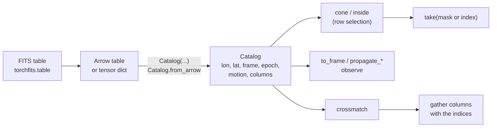

# Catalog containers

A [`Catalog`](../reference/catalogs.md#torchsky.catalogs.Catalog) is a batch of
sky rows held as tensors on one device: longitude and latitude in degrees, a
coordinate **frame** (such as ICRS or Galactic), an **epoch** (the Julian year
at which the positions hold), optional proper motion, parallax, and radial
velocity, an optional validity mask, and any number of payload columns. There
is no object per source. Every operation works on whole columns, so a catalog
of a hundred rows and one of ten million take the same code path, on a CPU or
a GPU.

Use a `Catalog` when positions need their frame and epoch to travel with them:
frame conversion, proper-motion propagation, cone and footprint selection,
crossmatching, and placing sources on an observation. It is not a table
library. Read, filter, and write FITS tables with
[`torchfits.table`](https://astroai.github.io/torchfits/api-tables/), keep
string identifiers in Arrow, and hand the numeric columns to torchsky.

## How It Fits Together



Operations that change positions (`to_frame`, `propagate_angular`,
`propagate_physical`, `observe`) return a new catalog with the same rows in the
same order and the payload columns unchanged. Selection returns row indices or
a Boolean mask, and `take` copies the selected rows. A
[`HealpixIndex`](../reference/catalogs.md#torchsky.catalogs.HealpixIndex) over
the positions is built on the first cone query and cached.

**Assumptions.** Longitudes and latitudes are degrees, proper motions mas/yr
with the longitude component multiplied by cos(latitude), parallax mas, radial
velocity km/s, and epochs Julian years. Missing kinematics stay
`None` and are never filled with zero. Positions are float64 on CPU and CUDA
and float32 on MPS. Frame rotations and proper-motion propagation are compared
with Astropy and ERFA; see [Frames and time](../coordinates/frames.md) and
[parity](../performance/parity.md).

## A Catalog From a Survey Table

The [M67 example](../published-examples/crossmatch_gaia_2mass_allwise.py)
downloads a Gaia DR3 cone as an Arrow table. The same table becomes a catalog
with motion, which can be selected and converted without touching the
columns you keep in Arrow:

```python
# gaia is a pyarrow table fetched by examples/crossmatch_gaia_2mass_allwise.py.
import torch

from torchsky.catalogs import Catalog

def col(name):
    return torch.tensor(gaia[name].to_numpy(zero_copy_only=False), dtype=torch.float64)

stars = Catalog(
    lon=col("ra"), lat=col("dec"), frame="ICRS", epoch=2016.0,
    pm_lon_coslat_mas_yr=col("pmra").nan_to_num(), pm_lat_mas_yr=col("pmdec").nan_to_num(),
    columns={"g_mag": col("phot_g_mean_mag"), "parallax": col("parallax")},
)
core = stars.cone(132.825, 11.8, radius_deg=0.1)            # row indices
members = stars.take(core)
members = members.take((members.columns["parallax"] - 1.15).abs() < 0.15)
galactic = members.propagate_angular(2000.0).to_frame("galactic")
source_ids = gaia["source_id"].take(core.numpy())          # identifiers stay in Arrow
```

## Types That Compose

<!-- docs: run -->
```python
import torch

from torchsky.catalogs import Catalog, HealpixIndex
from torchsky.sphere import MOC

g = torch.Generator().manual_seed(0)
ra = torch.rand(1000, generator=g, dtype=torch.float64) * 20 + 10
dec = torch.rand(1000, generator=g, dtype=torch.float64) * 20 - 10

cat = Catalog(lon=ra, lat=dec, frame="ICRS", columns={"id": torch.arange(1000)})
assert isinstance(cat.index(), HealpixIndex)          # built once, cached
hits = cat.cone(20.0, 0.0, radius_deg=0.5)            # row indices
inside = cat.inside(MOC.from_lonlat(ra[:100], dec[:100], max_order=8))  # Boolean mask
gal = cat.to_frame("galactic")
matches = cat.crossmatch(Catalog(lon=ra + 1e-4, lat=dec), radius_arcsec=1.5)
subset = cat.take(inside)

assert gal.frame != cat.frame and len(gal) == len(cat)
assert matches.left_index.numel() == 1000
assert subset.lon.shape[0] == int(inside.sum())
assert torch.equal(subset.columns["id"], cat.columns["id"][inside])
```

## Recipes

### Select by cone or footprint

`Catalog.cone(lon, lat, radius_deg)` and `HealpixIndex.query_disc` return the
row indices inside a spherical cap. The index buckets rows by nested HEALPix
cell (about 64 rows per cell by default, or `nside=`), looks up the cells that
overlap the cap, and applies the exact distance test to their rows.
`Catalog.inside(coverage)` returns a mask for any coverage with a `contains`
method, such as a [MOC](../sphere/moc.md); `HealpixIndex.lookup_moc(moc)` uses
the buckets to prune first. `HealpixIndex.occupied_moc()` describes where the
catalog has rows. Radii here are degrees; crossmatch radii are arcseconds.

### Arrow and FITS tables

[`Catalog.from_arrow`](../reference/catalogs.md#torchsky.catalogs.Catalog)
takes a `pyarrow.Table`, an IPC reader, or an IPC file path, with the names of
the position columns and of the numeric columns to carry. A FITS table reaches
Arrow through `torchfits.table.read`. To match two catalogs that are too large
for memory, give both to
[`crossmatch_sky_from_arrow`](../reference/catalogs.md#torchsky.catalogs.crossmatch_sky_from_arrow):
it streams each once into HEALPix tiles on disk (Parquet row groups) and matches
one tile and its neighbours at a time, so coordinate memory follows the largest
tile. The returned pairs stay in memory. `pyarrow` is an optional dependency.

<!-- docs: run -->
```python
import pyarrow as pa

from torchsky.catalogs import Catalog, crossmatch_sky_from_arrow

left = pa.table({"source_id": [11, 12, 13], "ra": [10.0, 20.0, 30.0], "dec": [0.0, 1.0, 2.0]})
right = pa.table({"name": ["a", "b"], "ra": [20.0001, 30.0], "dec": [1.0, 2.0002]})

cat = Catalog.from_arrow(left, lon="ra", lat="dec", columns=("source_id",))
assert cat.columns["source_id"].tolist() == [11, 12, 13]

pairs = crossmatch_sky_from_arrow(left, right, radius_arcsec=2.0, find="all")
names = right["name"].take(pairs.right_index.numpy()).to_pylist()
assert pairs.left_index.tolist() == [1, 2] and names == ["a", "b"]
```

Gather identifiers with the returned indices (`Table.take`) rather than
converting them to floats. `left_columns=` and `right_columns=` name the
position columns when they are not `("ra", "dec")`.

### Stream partitions into a training loop

[`CatalogStreamDataset`](../reference/catalogs.md#torchsky.catalogs.CatalogStreamDataset)
wraps an iterable of partitions (files, sky tiles, row ranges) and a loader
function into a PyTorch `IterableDataset`. With several `DataLoader` workers,
each worker takes every *n*-th partition, so no partition is read twice.
`CatalogStreamDataset.from_arrow(table, batch_size=...)` yields `(ra, dec)`
tensor batches, the input `crossmatch_sky_streamed` expects.

```python
# load_partition and process are your code; partitions can be file paths.
from torch.utils.data import DataLoader

from torchsky.catalogs import CatalogStreamDataset

dataset = CatalogStreamDataset(partitions=range(8), loader=load_partition)
for partition in DataLoader(dataset, num_workers=2, batch_size=None):
    process(partition)
```

### Frames, epochs, and motion

`to_frame(name)` converts positions and rotates proper motion with them; the
rigid ICRS, Galactic, FK5 (J2000), and ecliptic rotations keep the motion's
length and are differentiable. `propagate_angular(epoch)` moves positions along
their proper motion; `propagate_physical(epoch)` also uses parallax and radial
velocity. Both require the motion they need and raise otherwise.

`Catalog.crossmatch(..., target_epoch=2016.0)` propagates both catalogs to one
epoch before matching, preserving row indices and columns. A prebuilt
`right_index` cannot be combined with an epoch or frame change, because the
matched positions are new. Conversions do not propagate covariances; use the
motion Jacobians in [Frames and time](../coordinates/frames.md) for that. FK4
motion conversion is not provided.

### Observe from a site

`Catalog.observe("ALTAZ", obstime_mjd_utc=..., site=..., eop=...)` returns
apparent azimuth and altitude for a ground-based site, with optional aberration
and refraction. See [Observed place](../coordinates/observed-place.md).

### Move between devices

`cat.to("cuda")` moves every column and casts positions to the device's work
dtype. Operations then run where the catalog is; `crossmatch` moves the right
catalog to the left catalog's device.

## Pitfalls

- **NaN rows.** Positions must be finite. Drop or mask rows with missing
  coordinates before building the catalog; `valid` records a mask but does not
  hide rows from matching.
- **Frame names.** Use the frame of the data: Gaia is ICRS, not FK5. A frame
  mismatch between two catalogs is resolved by converting the right catalog to
  the left frame.
- **Index reuse.** An index belongs to the positions it was built from; a reused
  index built on other coordinates is rejected.
- **Copies.** `take` copies rows; keep row indices instead when you only need to
  gather a few columns later.

## See Also

- [Crossmatch](crossmatch.md): matchers, `find` modes, scaling.
- [Frames and time](../coordinates/frames.md) and
  [Observed place](../coordinates/observed-place.md).
- [HEALPix](../sphere/healpix.md) and [MOC](../sphere/moc.md) for the index and
  footprints.
- Reference: [`torchsky.catalogs`](../reference/catalogs.md).
