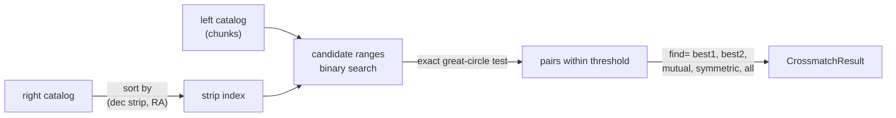
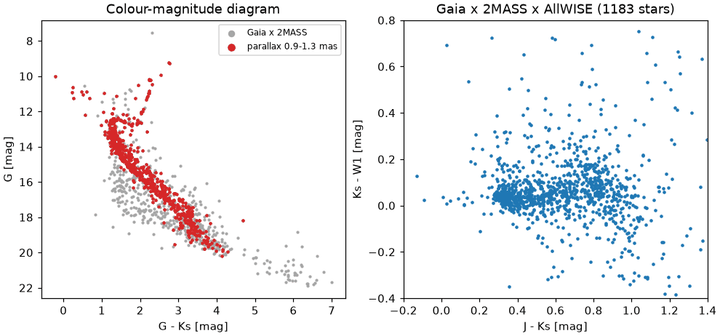

# Crossmatch

A **crossmatch** pairs rows of one catalog (the *left* table) with rows of
another (the *right* table) whose positions agree on the sky. Two rows match
when their **separation**, the great-circle angle between them, is no larger
than a threshold: a fixed **radius**, a per-row radius, or the sum of the two
rows' positional errors. torchsky returns the pairs as row indices plus
separations, so you gather any column of either table afterwards.

Use it to find counterparts across surveys or bands, to flag duplicates inside
one catalog, to group detections from several catalogs, or to join tables on
an integer key. It is a positional, deterministic match: it does not compute
association probabilities, propagate covariances, or split blends. When you
need a likelihood-ratio or Bayesian association, use the pairs from `find="all"`
as the candidate list and score them yourself.

## How It Works

Testing every left row against every right row costs \(O(NM)\). torchsky
sorts the right catalog once by **declination strip** (strips at least one
radius high) and right ascension inside each strip. The match cap of a left row
then touches a few adjacent strips, and in each strip it covers one contiguous
range of right ascension (two at the 0/360° wrap, the whole strip near a pole),
found with a binary search. Only those candidates go through the exact test

\[
\theta = \operatorname{atan2}\left(\lVert \mathbf a \times \mathbf b \rVert,\; \mathbf a \cdot \mathbf b\right) \le r,
\]

where \(\mathbf a, \mathbf b\) are unit vectors. This form stays accurate at
sub-milliarcsecond separations, where the arccosine of a dot product does not.



The cost is \(O((N + M)\log M + K)\) for \(K\) candidate pairs, and candidate
generation never drops a pair that passes the exact test. Chunk sizes bound
memory without changing the result. When you pass a prebuilt
[`HealpixIndex`](../reference/catalogs.md#torchsky.catalogs.HealpixIndex) as
`right_index=`, the candidates come from nested HEALPix cells instead, with the
same exact test.

**Assumptions.** Both tables are in the same frame at the same epoch; positions
are degrees and thresholds arcseconds; the threshold is a circle (no error
ellipses). **Validation.** Every `find` mode is tested against a brute-force
\(O(NM)\) search, and separations agree with Astropy `SkyCoord` to about
\(10^{-10}\) arcsec; see [parity](../performance/parity.md).

## Gaia, 2MASS and AllWISE Around M67

The [M67 example](../examples/index.md#gaia-dr3-x-2mass-x-allwise-in-the-field-of-m67)
fetches a 0.25° cone from three public TAP services, propagates Gaia DR3 to the
2MASS epoch, and matches the three catalogs. The core of it:

```python
# gaia and tmass are pyarrow tables fetched by
# examples/crossmatch_gaia_2mass_allwise.py (needs network on the first run).
import torch

from torchsky.catalogs import Catalog

def col(table, name):
    return torch.tensor(table[name].to_numpy(zero_copy_only=False), dtype=torch.float64)

# Two-parameter Gaia solutions have no proper motion; treat it as zero here.
optical = Catalog(
    lon=col(gaia, "ra"), lat=col(gaia, "dec"), epoch=2016.0,
    pm_lon_coslat_mas_yr=col(gaia, "pmra").nan_to_num(),
    pm_lat_mas_yr=col(gaia, "pmdec").nan_to_num(),
)
infrared = Catalog(lon=col(tmass, "ra"), lat=col(tmass, "dec"), epoch=2000.0)

pairs = optical.crossmatch(infrared, radius_arcsec=2.0, find="mutual", target_epoch=2000.0)
k_mag = col(tmass, "k_m")[pairs.right_index]
```



On about 2,100 Gaia and 1,300 2MASS rows the `best1` and `mutual` matches take a
few milliseconds, with a median separation of 0.08 arcsec, and a brute-force
search on a subset reproduces the indexed result exactly.

## The Result

Every matcher returns a
[`CrossmatchResult`](../reference/catalogs.md#torchsky.catalogs.CrossmatchResult)
with `left_index`, `right_index`, and `separation_arcsec`. Indices refer to the
original input row order, also for Arrow and streamed inputs. Exact ties go to
the lowest row index, so results do not depend on chunking or device. An empty
input returns empty tensors.

<!-- docs: run -->
```python
import torch

from torchsky.catalogs import crossmatch_sky

left_ra = torch.tensor([10.0, 30.0], dtype=torch.float64)
left_dec = torch.zeros(2, dtype=torch.float64)
right_ra = torch.tensor([10.0001, 10.0002, 29.9998, 80.0], dtype=torch.float64)
right_dec = torch.zeros(4, dtype=torch.float64)

best = crossmatch_sky(left_ra, left_dec, right_ra, right_dec, radius_arcsec=2.0)
assert best.left_index.tolist() == [0, 1]
assert best.right_index.tolist() == [0, 2]

every = crossmatch_sky(left_ra, left_dec, right_ra, right_dec, radius_arcsec=2.0, find="all")
assert every.left_index.tolist() == [0, 0, 1]
assert every.right_index.tolist() == [0, 1, 2]
print(best.separation_arcsec)
```

## STILTS-style Matching

`find=` chooses which of the pairs inside the threshold are kept. The names
follow [STILTS](https://www.star.bris.ac.uk/~mbt/stilts/) `tmatch2`, except
that torchsky's `"best"` is STILTS `best1`.

| `find` | Keeps | One-to-one | STILTS |
|---|---|---|---|
| `"best"`, `"best1"` (default) | the nearest right row for each left row | no: right rows may repeat | `find=best1` |
| `"best2"` | the nearest left row for each right row | no: left rows may repeat | `find=best2` |
| `"mutual"` | pairs that are each other's nearest | yes | `find=best` |
| `"symmetric"` | greedy assignment by ascending separation | yes, and maximal | none |
| `"all"` | every pair inside the threshold | no | `find=all` |

`mutual` leaves a row unmatched when its nearest partner prefers another row;
`symmetric` then gives it its next-nearest free partner. `all` is ordered by
left index, separation, right index; the other modes by left, then right
index.

| torchsky | STILTS |
|---|---|
| `crossmatch_sky(..., radius_arcsec=r)` | `tmatch2 matcher=sky params=r` |
| `crossmatch_sky(..., left_err_arcsec=, right_err_arcsec=)` | `tmatch2 matcher=skyerr` (match if `sep <= err1 + err2`) |
| `crossmatch_sky(..., left_distance=, right_distance=, distance_tol=)` | `sky` plus a 1-d cut on distance |
| [`crossmatch_exact(key1, key2)`](../reference/catalogs.md#torchsky.catalogs.crossmatch_exact) | `tmatch2 matcher=exact` |
| [`join_rows(result, n1, n2, join)`](../reference/catalogs.md#torchsky.catalogs.join_rows) | `join=1and2`, `1or2`, `all1`, `all2`, `1not2`, `2not1` |
| [`crossmatch_self(..., group=True)`](../reference/catalogs.md#torchsky.catalogs.crossmatch_self) | `tmatch1 action=identify` |
| [`crossmatch_many(cats, r, mode="pairs")`](../reference/catalogs.md#torchsky.catalogs.crossmatch_many) / `"group"` | `tmatchn multimode=pairs` / `group` |

Elliptical errors (`skyellipse`) and error-normalised ranking are not provided:
ranking always uses the separation in arcseconds.

<!-- docs: run -->
```python
import torch

from torchsky.catalogs import crossmatch_exact, crossmatch_many, crossmatch_self, crossmatch_sky, join_rows

d = torch.float64
ra1 = torch.tensor([10.0, 10.0, 359.9999, 50.0], dtype=d)
ra2 = torch.tensor([10.0002, 0.0001, 80.0], dtype=d)
z1, z2 = torch.zeros(4, dtype=d), torch.zeros(3, dtype=d)

sym = crossmatch_sky(ra1, z1, ra2, z2, radius_arcsec=2.0, find="symmetric")
assert sym.left_index.tolist() == [0, 2] and sym.right_index.tolist() == [0, 1]
left, right = join_rows(sym, 4, 3, "1or2")
assert left.tolist() == [0, 2, 1, 3, -1] and right.tolist() == [0, 1, -1, -1, 2]

# The three pairs are 0.72" apart: 0.5" + 0.3" accepts them, 0.3" + 0.3" does not.
near = crossmatch_sky(ra1, z1, ra2, z2, left_err_arcsec=0.5, right_err_arcsec=0.3, find="all")
assert near.left_index.tolist() == [0, 1, 2]
far = crossmatch_sky(ra1, z1, ra2, z2, left_err_arcsec=0.3, right_err_arcsec=0.3, find="all")
assert far.left_index.numel() == 0

own = crossmatch_self(ra1, z1, 2.0, group=True)
assert own.group_id.tolist() == [0, 0, -1, -1] and own.group_size.tolist() == [2, 2, 1, 1]

keys = crossmatch_exact(torch.tensor([1, 2, 2]), torch.tensor([2, 3]))
assert keys.left_index.tolist() == [1, 2] and keys.right_index.tolist() == [0, 0]

groups = crossmatch_many([(ra1, z1), (ra2, z2)], 2.0, mode="group")
assert groups.index.tolist() == [[0, 0], [2, 1], [3, -1], [-1, 2]]
```

## Recipes

### Match with per-source errors

Pass `left_err_arcsec` and `right_err_arcsec` (scalars or per-row tensors,
`>= 0`, either side optional) instead of `radius_arcsec`. A pair matches when
`separation <= err_left[i] + err_right[j]`. Scale catalog errors to the
confidence you want, for example three times the 1σ position error, as the M67
example does. `Catalog.crossmatch` also accepts a column name for either side.

### Keep unmatched rows: joins

`join_rows(result, n_left, n_right, join)` turns pairs into two index tensors
with `-1` for the absent side: matched pairs first, then unmatched left rows,
then unmatched right rows. Use `"all1"` for a left outer join and `"1not2"` for
the left rows without a counterpart.

### Find duplicates and groups in one catalog

`crossmatch_self(ra, dec, radius)` returns each pair `i < j` once. With
`group=True` it also links rows into **friends-of-friends** groups (connected
components of the pair graph): `group_id` is `-1` for rows without a partner and
`0..n_groups-1` otherwise, numbered by smallest member row; `group_size` is 1
for singletons. Chains can join rows farther apart than the radius.

### Combine more than two catalogs

`crossmatch_many(catalogs, radius, mode=...)` returns one output row per group
and `index[g, c]`, the row of catalog `c` (`-1` if absent).
`mode="pairs"` takes the first catalog as reference and gives each reference row
its `best1` partner in every other catalog; unclaimed rows follow alone.
`mode="group"` links all cross-catalog pairs friends-of-friends style and keeps,
per catalog, the member with the smallest separation to the rest of the group;
`group_size` counts every member.

### Match catalogs at different epochs

Stars move. For catalogs observed years apart, propagate positions to one epoch
before matching: `Catalog.crossmatch(..., target_epoch=2000.0)` applies linear
proper motion (`motion="angular"`) or full space motion with parallax and
radial velocity (`motion="physical"`). Rows with missing or NaN motion raise
rather than being treated as fixed; fill them explicitly if that is what you
want. See [Frames and time](../coordinates/frames.md) and
[Catalog containers](containers.md#frames-epochs-and-motion).

### Per-row radii and streaming

`radius_arcsec` may be a tensor with one radius per left row; candidate windows
use the largest radius, the exact test each row's own.
[`crossmatch_sky_streamed`](../reference/catalogs.md#torchsky.catalogs.crossmatch_sky_streamed)
takes an iterable of `(ra, dec)` left batches against one in-memory right
catalog and returns `best1` pairs with left indices into the concatenated
stream. Scalar radii only.

<!-- docs: run -->
```python
import torch

from torchsky.catalogs import crossmatch_sky, crossmatch_sky_streamed

left_ra = torch.tensor([10.0, 10.0], dtype=torch.float64)
left_dec = torch.tensor([0.0, 0.001], dtype=torch.float64)
right_ra, right_dec = left_ra[:1].clone(), left_dec[:1].clone()

per_row = crossmatch_sky(left_ra, left_dec, right_ra, right_dec, radius_arcsec=torch.tensor([1.0, 1.0]))
assert per_row.left_index.tolist() == [0]

batches = iter([(left_ra[:1], left_dec[:1]), (left_ra[1:], left_dec[1:])])
streamed = crossmatch_sky_streamed(batches, right_ra, right_dec, radius_arcsec=4.0)
assert streamed.left_index.tolist() == [0, 1]
```

### Scale to large catalogs and other devices

- `left_chunk_size` and `right_chunk_size` bound the working set; they never
  change the result.
- `device="cuda"` moves the inputs and returns results there. Indices agree
  with the CPU; separations agree to floating-point tolerance. On MPS positions
  are float32 (about 0.1 arcsec near RA 360°), so smaller radii are not
  meaningful there.
- When the left table does not fit in memory, stream it; when both tables are
  Arrow tables or IPC files, use
  [`crossmatch_sky_from_arrow`](containers.md#arrow-and-fits-tables), which
  tiles both on disk.
- The [million-row example](../published-examples/crossmatch_million.py)
  matches \(10^6 \times 10^6\) rows in about 0.5 s per mode on a CPU.

## Pitfalls

- **`best` is not one-to-one.** Two left rows can pick the same right row. Use
  `mutual` or `symmetric` when each source may be used once.
- **Order of arguments matters** for `best1`, `best2`, and `pairs`: the left or
  reference table decides who chooses.
- **Units.** Match radii are arcseconds; cone queries take degrees.
- **Wrap-around and poles** need no special handling, but positions must be
  finite; drop or mask NaN rows first.
- **Crowded fields.** With a radius larger than the typical source spacing,
  `best` picks the nearest neighbour, which may be the wrong source. Inspect
  `find="all"` multiplicities before trusting a one-to-one result.

## See Also

- [Catalog containers](containers.md): `Catalog`, cone queries, Arrow input.
- [Frames and time](../coordinates/frames.md): frames and proper motion.
- Reference: [`torchsky.catalogs`](../reference/catalogs.md).
- Examples: [Gaia, 2MASS and AllWISE](../published-examples/crossmatch_gaia_2mass_allwise.py),
  [a million-row crossmatch](../published-examples/crossmatch_million.py).
- Measurements: [benchmarks](../performance/benchmarks.md#catalogs) and
  [parity](../performance/parity.md).
