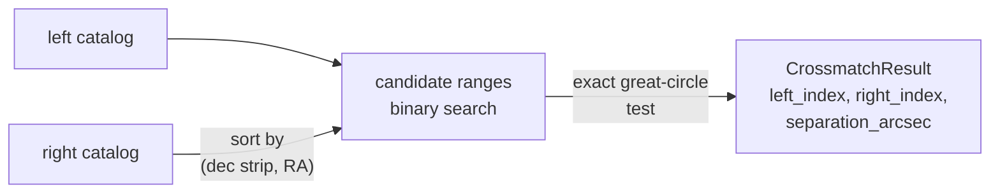

# Catalogs: overview

This area handles tables of sources on the sky: positions, frames, epochs,
motion, and the operations that relate one table to another. A catalog in
torchsky is a batch of tensors, `lon` and `lat` in degrees plus optional proper
motion, parallax, radial velocity, a validity mask, and your own columns. There
is no per-source object. `torchsky.catalogs` indexes those tensors on the
sphere, selects rows by cone or footprint, and crossmatches tables of any size.

## The Core Idea: Prune, Then Test Exactly

A crossmatch pairs each row of one catalog with rows of another that lie within
a radius. Comparing every pair is \(O(NM)\). torchsky first sorts the right
catalog by declination strip and right ascension, uses binary search to produce
a small set of candidate pairs per left row, and then applies the exact
great-circle distance test to each candidate. The strips are at least one radius
high, so pruning never drops a true match inside the radius. When you pass a
prebuilt `HealpixIndex` as `right_index=`, candidates come from nested HEALPix
cells (padded by the maximum pixel radius) instead.



The result holds indices into the original row order, never a sorted copy, so
you can gather any column of either table with them.

## Choose a Page

| Task | Page | Entry point |
|---|---|---|
| Nearest match within a radius | [Crossmatch](crossmatch.md) | [`crossmatch_sky`](../reference/catalogs.md#torchsky.catalogs.crossmatch_sky), [`Catalog.crossmatch`](../reference/catalogs.md#torchsky.catalogs.Catalog) |
| All pairs, one-to-one, groups, per-row error radii (STILTS modes) | [Crossmatch](crossmatch.md#stilts-style-matching) | `find=` on [`crossmatch_sky`](../reference/catalogs.md#torchsky.catalogs.crossmatch_sky) |
| Left catalog larger than memory | [Crossmatch](crossmatch.md#per-row-radii-and-streaming) | [`crossmatch_sky_streamed`](../reference/catalogs.md#torchsky.catalogs.crossmatch_sky_streamed) |
| Both catalogs are Arrow tables or IPC files | [Crossmatch](crossmatch.md) | [`crossmatch_sky_from_arrow`](../reference/catalogs.md#torchsky.catalogs.crossmatch_sky_from_arrow) |
| Hold columns with frame and epoch; cone, footprint, and frame operations | [Catalog containers](containers.md) | [`Catalog`](../reference/catalogs.md#torchsky.catalogs.Catalog), [`HealpixIndex`](../reference/catalogs.md#torchsky.catalogs.HealpixIndex) |
| Propagate proper motion to another epoch before matching | [Frames and time](../coordinates/frames.md) | [`CatalogState`](../reference/coords.md#torchsky.coords.CatalogState) |

`crossmatch(...)` dispatches on its arguments: two `Catalog` objects, four
coordinate arrays, two `(lon, lat)` tuples, or Arrow inputs. Prefer the explicit
function when you want the call site to state which path runs.

## A Crossmatch

<!-- docs: run -->
```python
import torch

from torchsky.catalogs import Catalog

g = torch.Generator().manual_seed(0)
ra = 150.0 + torch.rand(2000, generator=g, dtype=torch.float64)
dec = 2.0 + torch.rand(2000, generator=g, dtype=torch.float64)
optical = Catalog(lon=ra, lat=dec, frame="ICRS")

# The same sources with 0.1 arcsec scatter, plus 500 unrelated rows.
scatter = 0.1 / 3600.0 * torch.randn(2, 2000, generator=g, dtype=torch.float64)
extra = torch.rand(2, 500, generator=g, dtype=torch.float64)
infrared = Catalog(
    lon=torch.cat([ra + scatter[0], 151.5 + extra[0]]),
    lat=torch.cat([dec + scatter[1], 2.0 + extra[1]]),
)

matches = optical.crossmatch(infrared, radius_arcsec=1.0)
assert torch.equal(matches.left_index, matches.right_index)
assert matches.separation_arcsec.max() < 1.0
```

## Conventions and Pitfalls

- **Units.** Positions are degrees. Match radii and separations are
  arcseconds (`radius_arcsec`), while cone queries take `radius_deg`.
- **Precision.** Keep positions in float64. On MPS they are float32, whose
  resolution near RA 360° is about 0.1 arcsecond; radii close to that are not
  meaningful there.
- **Best is not one-to-one.** The default `find="best"` returns the nearest
  right row for each left row; two left rows may pick the same right row. Use
  `find="symmetric"` for a one-to-one match.
- **Frames and epochs.** Two catalogs are compared in one frame at one epoch.
  `Catalog` carries both; convert or propagate proper motion before matching
  high-proper-motion sources.
- **Index reuse.** Build the right index once and pass `right_index=` when you
  match many left batches against the same table.
- **I/O.** Read FITS tables with `torchfits.table` and pass the columns as
  tensors or Arrow batches; see [the file boundary](../introduction/concepts.md#file-boundary).

## Connections

Catalog indexing uses [HEALPix](../sphere/healpix.md), and footprint selection
uses [MOC](../sphere/moc.md) coverage. Frames, epochs, and proper motion come
from [Coordinates](../coordinates/frames.md). A catalog combined with a
[WCS](../coordinates/index.md) places sources on an image, for example as
inputs to a [scene model](../models/scenes.md).

Separations are validated against Astropy `SkyCoord` in
[torchsky-harness](https://github.com/astroai/torchsky-harness); see the
[parity page](../performance/parity.md).
