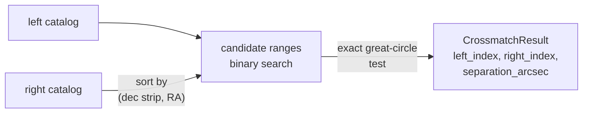

# Catalogs: overview

This area handles tables of sources on the sky: positions, frames, epochs,
motion, and the operations that relate one table to another. A catalog in
torchsky is a batch of tensors, `lon` and `lat` in degrees plus optional proper
motion, parallax, radial velocity, a validity mask, and your own columns. There
is no per-source object. `torchsky.catalogs` indexes those tensors on the
sphere, selects rows by cone or footprint, and crossmatches tables of any size.

## The Core Idea: Prune, Then Test Exactly

A crossmatch pairs each row of one catalog with rows of another that lie within
a radius. Comparing every pair is \(O(NM)\). torchsky first sorts the right
catalog by declination strip and right ascension, uses binary search to produce
a small set of candidate pairs per left row, and then applies the exact
great-circle distance test to each candidate. The strips are at least one radius
high, so pruning never drops a true match inside the radius. When you pass a
prebuilt `HealpixIndex` as `right_index=`, candidates come from nested HEALPix
cells (padded by the maximum pixel radius) instead.



The result holds indices into the original row order, never a sorted copy, so
you can gather any column of either table with them.

## Choose a Page

| Task | Page | Entry point |
|---|---|---|
| Nearest match within a radius | [Crossmatch](crossmatch.md) | [`crossmatch_sky`](../reference/catalogs.md#torchsky.catalogs.crossmatch_sky), [`Catalog.crossmatch`](../reference/catalogs.md#torchsky.catalogs.Catalog) |
| All pairs, one-to-one, groups, per-row error radii (STILTS modes) | [Crossmatch](crossmatch.md#stilts-style-matching) | `find=` on [`crossmatch_sky`](../reference/catalogs.md#torchsky.catalogs.crossmatch_sky) |
| Left catalog larger than memory | [Crossmatch](crossmatch.md#per-row-radii-and-streaming) | [`crossmatch_sky_streamed`](../reference/catalogs.md#torchsky.catalogs.crossmatch_sky_streamed) |
| Both catalogs are Arrow tables or IPC files | [Crossmatch](crossmatch.md) | [`crossmatch_sky_from_arrow`](../reference/catalogs.md#torchsky.catalogs.crossmatch_sky_from_arrow) |
| Hold columns with frame and epoch; cone, footprint, and frame operations | [Catalog containers](containers.md) | [`Catalog`](../reference/catalogs.md#torchsky.catalogs.Catalog), [`HealpixIndex`](../reference/catalogs.md#torchsky.catalogs.HealpixIndex) |
| Propagate proper motion to another epoch before matching | [Frames and time](../coordinates/frames.md) | [`CatalogState`](../reference/coords.md#torchsky.coords.CatalogState) |

`crossmatch(...)` dispatches on its arguments: two `Catalog` objects, four
coordinate arrays, two `(lon, lat)` tuples, or Arrow inputs. Prefer the explicit
function when you want the call site to state which path runs.

## A Crossmatch

The rows below are every Gaia DR3 star with a proper motion, and every 2MASS
source, within 43 arcsec of the centre of the open cluster M67. Gaia positions
are at epoch J2016.0; 2MASS observed this field in November 1997 (J1997.875).
Cluster members move by about 11 mas a year, so in 18 years they shift by
0.2 arcsec. Propagating Gaia to the 2MASS epoch before matching halves the
separations.

<!-- docs: run -->
```python
import torch

from torchsky.catalogs import Catalog

f64 = dict(dtype=torch.float64)
gaia = Catalog(   # Gaia DR3 gaia_source, cone r = 0.012 deg at (132.825, 11.8)
    lon=torch.tensor([132.8210755, 132.8290199, 132.8210048, 132.8298726, 132.8300139,
                      132.8211976, 132.8291247, 132.8154407, 132.8287306], **f64),
    lat=torch.tensor([11.8085863, 11.8060330, 11.8074335, 11.7985114, 11.8074898,
                      11.8044791, 11.7892283, 11.8043686, 11.8089885], **f64),
    frame="ICRS", epoch=2016.0,
    pm_lon_coslat_mas_yr=torch.tensor([-10.51, -11.11, -10.82, -10.99, -11.00, -11.38, -11.22,
                                       7.09, 0.25], **f64),
    pm_lat_mas_yr=torch.tensor([-2.60, -2.59, -2.94, -3.16, -2.99, -3.06, -2.67, 0.94, -2.78], **f64),
)
twomass = Catalog(   # 2MASS Point Source Catalog (IRSA fp_psc), same cone
    lon=torch.tensor([132.829189, 132.829927, 132.830069, 132.823341, 132.815406, 132.821257], **f64),
    lat=torch.tensor([11.789187, 11.798506, 11.807475, 11.80454, 11.804343, 11.80446], **f64),
    frame="ICRS", epoch=1997.875,
)

as_stored = gaia.crossmatch(twomass, radius_arcsec=1.0)
same_epoch = gaia.crossmatch(twomass, radius_arcsec=1.0, target_epoch=1997.875)

assert same_epoch.left_index.tolist() == [3, 4, 5, 6, 7]
assert same_epoch.right_index.tolist() == [1, 2, 5, 0, 4]
assert as_stored.separation_arcsec.median() > 0.19 > 0.11 > same_epoch.separation_arcsec.median()
```

Five of the six 2MASS sources have a Gaia counterpart. The sixth, 7.6 arcsec
from the G = 9.9 star, has no Gaia source within 1 arcsec. Indices
refer to the rows as you passed them, before any propagation.

## Conventions and Pitfalls

- **Units.** Positions are degrees. Match radii and separations are
  arcseconds (`radius_arcsec`), while cone queries take `radius_deg`.
- **Precision.** Keep positions in float64. On MPS they are float32, whose
  resolution near RA 360° is about 0.1 arcsecond; radii close to that are not
  meaningful there.
- **Best is not one-to-one.** The default `find="best"` returns the nearest
  right row for each left row; two left rows may pick the same right row. Use
  `find="symmetric"` for a one-to-one match.
- **Frames and epochs.** Two catalogs are compared in one frame at one epoch.
  `Catalog` carries both; convert or propagate proper motion before matching
  high-proper-motion sources.
- **Index reuse.** Build the right index once and pass `right_index=` when you
  match many left batches against the same table.
- **I/O.** Read FITS tables with `torchfits.table` and pass the columns as
  tensors or Arrow batches; see [the file boundary](../introduction/concepts.md#file-boundary).

## Connections

Catalog indexing uses [HEALPix](../sphere/healpix.md), and footprint selection
uses [MOC](../sphere/moc.md) coverage. Frames, epochs, and proper motion come
from [Coordinates](../coordinates/frames.md). A catalog combined with a
[WCS](../coordinates/index.md) places sources on an image, for example as
inputs to a [scene model](../models/scenes.md).

Separations are validated against Astropy `SkyCoord` in
[torchsky-harness](https://github.com/astroai/torchsky-harness); see the
[parity page](../performance/parity.md).

The [Gaia × 2MASS × AllWISE example](../examples/index.md#gaia-dr3-x-2mass-x-allwise-in-the-field-of-m67)
runs every matching mode on the full 0.25° cone around M67.
