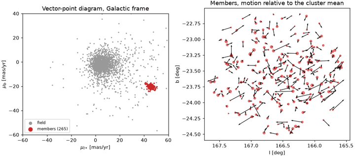

# Frames and time

A celestial *frame* fixes the axes against which a direction is measured: the
pole, the origin of longitude, and, for frames tied to the Earth's orbit or
equator, the date those axes refer to. A catalog position also has an
*epoch*: the time at which the star was at that position. Converting between
frames rotates the axes; propagating to a new epoch moves the star.
`torchsky.coords` does both on batched tensors, keeps gradients, and refuses
to invent quantities the catalog does not have.

## Frames

| Frame | Name in torchsky | Defined by | Needs |
|---|---|---|---|
| ICRS | `ICRS` | Extragalactic radio sources; the frame of Gaia and of modern headers (`RADESYS = 'ICRS'`) | — |
| FK5 | `FK5` | Mean equator and equinox of a date, conventionally J2000 | `to_equinox` / `from_equinox` for other equinoxes |
| FK4 | `FK4` | Pre-1984 Besselian system with E-terms | Positions only |
| Galactic | `GALACTIC` | IAU 1958 pole and centre, tied to ICRS | — |
| Ecliptic (J2000) | `ECLIPTIC` | Mean ecliptic and equinox of J2000 | — |
| Ecliptic of date | `ECLIPTIC_OF_DATE` | IAU 2006 precession-nutation at the given date | TT MJD |
| Galactocentric | [`icrs_to_galactocentric`](../reference/coords.md#torchsky.coords.icrs_to_galactocentric) | Cartesian frame centred on the Galactic centre | A distance; Sun distance and height are explicit arguments |
| LSR | [`heliocentric_rv_to_lsr`](../reference/coords.md#torchsky.coords.heliocentric_rv_to_lsr) | Local standard of rest velocity | Solar UVW (explicit arguments) |

ICRS and FK5 J2000 differ by a frame bias of a few tens of mas; Galactic is defined
as a fixed rotation of ICRS. Representations are layouts, not classes:
`lonlat_deg`, `unit_xyz`, and `barycentric_au` (which needs a positive
parallax). Earth-tied frames for a site and an instant (`GCRS`, `CIRS`,
`TETE`, `ITRS`, `ALTAZ`) are covered in [Observed place](observed-place.md).

## Motion

Stars move. Over a span \(\Delta t\), *proper motion*
\((\mu_{\alpha*}, \mu_\delta)\) shifts the direction on the sky; *parallax*
\(\varpi\) and *radial velocity* \(v_r\) complete the six-parameter space
motion. Two propagation models are available:

- **Angular** ([`propagate_proper_motion`](../reference/coords.md#torchsky.coords.propagate_proper_motion),
  `CatalogState.propagate_angular`): moves the direction with constant proper
  motion along a great circle. It needs both proper-motion components and
  nothing else.
- **Physical** ([`propagate_space_motion`](../reference/coords.md#torchsky.coords.propagate_space_motion),
  `CatalogState.propagate_physical`): the ERFA/SOFA `starpm` model. The star
  moves on a straight line in space at constant velocity, so its proper motion
  and parallax change with time (perspective acceleration), and the changing
  light travel time is included. It needs all six parameters.

The difference matters for nearby, fast stars and long baselines. Missing
components stay `None`: torchsky never imputes a parallax or a radial velocity,
and there is no `pmsafe`-style fallback, so an incomplete state raises
`ValueError` rather than silently propagating with a guessed distance.

## Time Scales and Epochs

| Scale | Meaning | Use |
|---|---|---|
| UTC | Civil time with leap seconds | Observation timestamps (`MJD-OBS`, `DATE-OBS`) |
| TAI | Atomic time, UTC + leap seconds | Intermediate |
| TT | TAI + 32.184 s | Precession-nutation, ecliptic of date |
| GPS | TAI − 19 s | Instrument clocks |
| UT1 | Earth rotation angle; UTC + DUT1 | Observed place (needs Earth orientation) |
| TCB, TDB | Barycentric coordinate / dynamical time | Catalog epochs (Gaia uses TCB Julian years) |

[`Epoch`](../reference/wcs.md#torchsky.wcs.Epoch) pairs a value with a
[`TimeSpec`](../reference/wcs.md#torchsky.wcs.TimeSpec) (format `jd`, `mjd`,
`jyear`, `byear`, or `unix`, plus a scale) and converts among UTC, TAI, TT, and
GPS with the built-in leap-second table. A `CatalogState` epoch defaults to a
TCB Julian year, the Gaia convention, and physical propagation requires it.

## Minimal Example: Barnard's Star

Barnard's star has the largest proper motion of any star, 10.4 arcsec per
year. The values are Gaia DR3 astrometry (epoch J2016.0) with the radial
velocity rounded.

<!-- docs: run -->
```python
import math

import torch

from torchsky.coords import CatalogState

f64 = dict(dtype=torch.float64)
star = CatalogState(
    lon=torch.tensor([269.44850253], **f64), lat=torch.tensor([4.73942005], **f64),
    frame="ICRS", epoch=2016.0,
    pm_lon_coslat_mas_yr=torch.tensor([-801.551], **f64),
    pm_lat_mas_yr=torch.tensor([10362.394], **f64),
    parallax_mas=torch.tensor([546.976], **f64),
    radial_velocity_km_s=torch.tensor([-110.4], **f64),
)

linear = star.propagate_angular(2050.0)      # constant proper motion
rigorous = star.propagate_physical(2050.0)   # straight line in space

moved = float(rigorous.lat - star.lat) * 3600
assert 350.0 < moved < 355.0                   # about 352 arcsec north in 34 years
gap_mas = 3.6e6 * math.hypot(
    float(linear.lon - rigorous.lon) * math.cos(math.radians(float(rigorous.lat))),
    float(linear.lat - rigorous.lat),
)
assert 700.0 < gap_mas < 800.0                 # perspective acceleration: ~0.74 arcsec
assert float(rigorous.parallax_mas) > 546.976  # the star is approaching
```

A 0.74 arcsec error is four pixels of a 0.19 arcsec camera; for a typical
field star the two models differ by far less than a milliarcsecond. The
[frames and motion example](../published-examples/frames_and_motion.py) runs
the same comparison and the frame conversions below on several sources.

## Real Data: The Pleiades in Gaia DR3

The [Pleiades example](../published-examples/gaia_pleiades_motion.py) loads
2745 Gaia DR3 stars into one `CatalogState`, rotates positions and proper
motions to the Galactic frame, and selects 265 cluster members with a Gaussian
mixture in proper motion and parallax:

```python
# fragment: ra, dec, pmra, pmdec, plx are Gaia DR3 columns as float64 tensors
from torchsky.coords import CatalogState

icrs = CatalogState(lon=ra, lat=dec, frame="ICRS", epoch=2016.0,
                    pm_lon_coslat_mas_yr=pmra, pm_lat_mas_yr=pmdec, parallax_mas=plx)
gal = icrs.to_frame("GALACTIC")          # mean (mu_l*, mu_b) = (45.43, -20.32) mas/yr
back = icrs.propagate_angular(2000.0)    # members move 0.80 arcsec in 16 years
```

The members' mean motion, (19.97, −45.58) mas/yr in ICRS at 7.373 mas, matches
the Gaia DR2 cluster value. For the 205 members with a radial velocity, the
proper-motion-only model and `propagate_physical` differ by at most 9 µas over
16 years. `tests/test_gaia_pleiades_motion_parity.py` checks the same steps
against astropy's `SkyCoord.apply_space_motion`.



## Recipes

### Convert Frames

[`transform`](../reference/coords.md#torchsky.coords.transform) works on bare
tensors; `CatalogState.to_frame` also rotates the proper-motion vector.

<!-- docs: run -->
```python
import torch

from torchsky.coords import CatalogState, transform

ra = torch.tensor([266.41683, 83.63308], dtype=torch.float64)   # Sgr A*, Crab
dec = torch.tensor([-29.00781, 22.01450], dtype=torch.float64)

l, b = transform(ra, dec, from_frame="ICRS", to_frame="GALACTIC")
assert abs(float(l[0]) - 359.944) < 1e-3 and abs(float(b[0]) + 0.046) < 1e-3
ra_back, dec_back = transform(l, b, from_frame="GALACTIC", to_frame="ICRS")
torch.testing.assert_close(ra_back, ra, atol=1e-9, rtol=0.0)

state = CatalogState(
    lon=ra, lat=dec, frame="ICRS", epoch=2016.0,
    pm_lon_coslat_mas_yr=torch.tensor([-3.2, -11.0], dtype=torch.float64),
    pm_lat_mas_yr=torch.tensor([-5.6, 2.0], dtype=torch.float64),
)
gal = state.to_frame("galactic")
torch.testing.assert_close(       # the total proper motion is frame-independent
    torch.hypot(gal.pm_lon_coslat_mas_yr, gal.pm_lat_mas_yr),
    torch.hypot(state.pm_lon_coslat_mas_yr, state.pm_lat_mas_yr),
)
```

### Precess to Another Equinox

<!-- docs: run -->
```python
import torch

from torchsky.coords import convert_celestial

ra = torch.tensor([83.63308], dtype=torch.float64)
dec = torch.tensor([22.01450], dtype=torch.float64)
ra_1975, dec_1975 = convert_celestial(ra, dec, from_frame="ICRS", to_frame="FK5", to_equinox=1975.0)
assert 0.3 < float(ra - ra_1975) < 0.4    # 25 years of precession: about 0.38 degree in RA
```

### Convert a Timestamp Between Scales

<!-- docs: run -->
```python
import torch

from torchsky.wcs import Epoch, TimeSpec

utc = Epoch(60000.0, TimeSpec(format="mjd", scale="utc"))   # 2023-02-25 00:00 UTC
tt = utc.to(TimeSpec(format="mjd", scale="tt"))
torch.testing.assert_close((tt.value - utc.value) * 86400.0, torch.tensor(69.184, dtype=torch.float64))
jyear = utc.to(TimeSpec(format="jyear", scale="tt")).value
assert 2023.14 < float(jyear) < 2023.16
```

### Propagate Uncertainties

`propagate_proper_motion_with_jacobian` and
`propagate_space_motion_with_jacobian` (in `torchsky.wcs`) also return the
local Jacobian, 2 × 4 and 6 × 6, in east/north tangent-plane offsets.
Propagate a covariance with `J @ C @ J.mT`. The 6 × 6 form lets you keep
Gaia's correlated five-parameter block without inventing a joint
radial-velocity covariance. Gradients through every function above come from
autograd as usual.

### Use Ephemerides and Satellites

Opt-in extras are never imported by `torchsky.wcs` at import time:

- `torchsky.wcs.ephemeris.get_body` reads a JPL DE kernel through
  `jplephem`. DE440s covers the Sun, Moon, and inner planets; Mars and the
  outer planets need the full DE440.
- `torchsky.wcs.tle.catalog_state_from_tle` propagates a two-line element set
  with `sgp4` into a `TEME` state.
- `torchsky.wcs.astropy_interop` converts a `CatalogState` to and from an
  Astropy `SkyCoord` (`catalog_state_from_astropy`, `catalog_state_to_astropy`)
  at a boundary.

## Accuracy and Validation

Geometric frames and space motion are checked against Astropy and ERFA in
[torchsky-harness](https://github.com/astroai/torchsky-harness); see the
[parity page](../performance/parity.md). Galactic round trips close to below
1e-6 mas in float64.

## Pitfalls

- **FK4 proper motions.** FK4 conversion is position-only; a state with proper
  motion is rejected because the time-dependent E-term transform is not
  implemented.
- **Epoch is not equinox.** `epoch=` says when the star was there;
  `to_equinox=` says which FK5 axes to use. A J2000 catalog in ICRS has no
  equinox at all.
- **Mixed scales.** `MJD-OBS` is UTC unless `TIMESYS` says otherwise; Gaia
  epochs are TCB. Convert explicitly; nothing is guessed from the magnitude of
  the number.
- **Ecliptic of date** takes a TT date. Without one, `transform` raises.

## See Also

- [Observed place](observed-place.md): alt/az, aberration, and refraction.
- [Catalogs](../catalogs/index.md): epoch-aware crossmatch uses `CatalogState`.
- Examples: [frames and motion](../published-examples/frames_and_motion.py),
  [Pleiades proper motions](../published-examples/gaia_pleiades_motion.py).
- [Kinematics](../spectra/kinematics.md): radial velocity frames and Doppler shifts.
- Reference: [`torchsky.coords`](../reference/coords.md),
  [`CatalogState`](../reference/coords.md#torchsky.coords.CatalogState).
