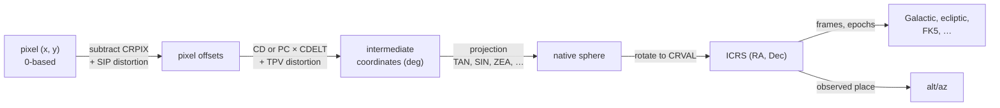

# Coordinates and WCS: overview

This area turns detector pixels into sky positions and sky positions into other
frames. Its centre is the world coordinate system (WCS): the FITS standard that
describes, in header keywords, how a pixel maps to a position on the sky, a
wavelength, or a time. `torchsky.wcs` implements FITS-WCS in torch, and
`torchsky.coords` converts between celestial frames, propagates stellar motion,
and computes observed place.

## How a Celestial WCS Works

A celestial WCS is a chain of simple steps, each set by header keywords:



- `CRPIX` is the reference pixel, `CRVAL` its sky position, and the `CD` (or
  `PC` with `CDELT`) matrix sets scale, rotation, and skew.
- The projection code in `CTYPE` (`RA---TAN`, `GLON-ZEA`, …) flattens the
  sphere onto the plane. The zenithal, cylindrical, conic, polyconic,
  HEALPix, and quadcube families of FITS Paper II are supported.
- Distortions describe what a linear model cannot: SIP (Simple Imaging
  Polynomial, used by HST and JWST) adds polynomials in pixel offsets; TPV
  (used by SCAMP and CFHT MegaCam) adds polynomials in intermediate
  coordinates. Lookup-table axes (`-TAB`) cover the rest.

Every arrow is differentiable, and every step is batched over any tensor shape.

## Choose a Page

| Task | Page | Entry point |
|---|---|---|
| Map pixels to sky and back, footprints, pixel scales | This page, [Projections](projections.md) | [`WCS`](../reference/wcs.md#torchsky.wcs.WCS) |
| Read SIP, TPV, or `-TAB` distortions; refine a WCS against reference stars | [Distortions](distortions.md) | [`WCS`](../reference/wcs.md#torchsky.wcs.WCS), [`fit_sky_affine`](../reference/wcs.md#torchsky.wcs.fit_sky_affine) |
| Convert ICRS, Galactic, ecliptic, FK5; propagate proper motion | [Frames and time](frames.md) | [`transform`](../reference/coords.md#torchsky.coords.transform), [`CatalogState`](../reference/coords.md#torchsky.coords.CatalogState) |
| Alt/az, refraction, and aberration for a site and time | [Observed place](observed-place.md) | [`observed_altaz`](../reference/coords.md#torchsky.coords.observed_altaz) |
| Spectral axes as free functions | [Spectral axes](../spectra/spectral-axes.md) | [`SpectralAxis`](../reference/spectral.md#torchsky.spectral.SpectralAxis) |

## Pixel to World and Back

Build a `WCS` from the header dict torchfits returns, then transform tensors.
The header below is a 512 × 512 pixel cutout of CFHT MegaPipe tile 712.165
(g band, 0.186 arcsec pixels), copied from the CADC cutout service. Its
reference pixel lies far outside the cutout, at the tangent point of the full
tile.

<!-- docs: run -->
```python
import torch

from torchsky.wcs import WCS

header = {   # CADC MegaPipe cutout of tile 712.165 (megapipe_mosaic_a in the examples)
    "NAXIS": 2, "NAXIS1": 512, "NAXIS2": 512, "RADESYS": "ICRS", "EQUINOX": 2000.0,
    "CTYPE1": "RA---TAN", "CTYPE2": "DEC--TAN", "CUNIT1": "deg", "CUNIT2": "deg",
    "CRVAL1": 359.07190997, "CRVAL2": -7.5, "CRPIX1": -4488.0, "CRPIX2": -4488.0,
    "CD1_1": -5.160234650248e-05, "CD1_2": 0.0, "CD2_1": 0.0, "CD2_2": 5.160234650248e-05,
}
wcs = WCS(header)

x = torch.tensor([0.0, 477.0, 511.0], dtype=torch.float64)   # a corner, a star, a corner
y = torch.tensor([0.0, 315.0, 511.0], dtype=torch.float64)
ra, dec = wcs.pixel_to_world(x, y)
x_back, y_back = wcs.world_to_pixel(ra, dec)

torch.testing.assert_close(x_back, x, atol=1e-7, rtol=0.0)
torch.testing.assert_close(y_back, y, atol=1e-7, rtol=0.0)
assert abs(ra[1].item() - 358.81359) < 1e-5 and abs(dec[1].item() + 7.25203) < 1e-5
corners = wcs.footprint(shape=(512, 512))                     # (4, 2) RA, Dec in degrees
assert corners.shape == (4, 2) and abs(3600 * wcs.pixel_scales()[0] - 0.186) < 1e-3
```

`footprint`, `pixel_scales`, `pixel_area`, and `position_angle` describe the
grid itself. `wcs.to("cuda")` moves the cached parameters with your tensors.

## Alternate Keys, Slicing, and Compiled Paths

`WCS(header, key="A")` selects an alternate WCS, such as the `O` solution that
HST and JWST files carry next to the primary one. `slice`, `sub`, `dropaxis`,
and `celestial` derive new objects with the CRPIX/CD bookkeeping already
updated. `wcs.compile()` returns a tensor-path object for repeated small-batch
calls, where the transform takes an `(..., 2)` pixel tensor.

<!-- docs: run -->
```python
import torch

from torchsky.wcs import WCS

header = {   # the MegaPipe cutout of the previous block
    "NAXIS": 2, "NAXIS1": 512, "NAXIS2": 512, "CTYPE1": "RA---TAN", "CTYPE2": "DEC--TAN",
    "CRVAL1": 359.07190997, "CRVAL2": -7.5, "CRPIX1": -4488.0, "CRPIX2": -4488.0,
    "CD1_1": -5.160234650248e-05, "CD1_2": 0.0, "CD2_1": 0.0, "CD2_2": 5.160234650248e-05,
}
wcs = WCS(header)

stamp = wcs.slice((slice(305, 326), slice(467, 488)))     # 21 x 21 pixels around the star
assert stamp.pixel_shape == (21, 21)
full = wcs.pixel_to_world(torch.tensor([477.0]), torch.tensor([315.0]))
cut = stamp.pixel_to_world(torch.tensor([10.0]), torch.tensor([10.0]))
torch.testing.assert_close(full, cut)

fast = wcs.compile()
pixels = torch.tensor([[477.0, 315.0], [0.0, 0.0]], dtype=torch.float64)
world = fast.pixel_to_world(pixels)                     # (2, 2) RA, Dec
torch.testing.assert_close(world[0], torch.cat(full))
```

## Jacobians and Gradients

`jacobian` returns the local `d(world)/d(pixel)` matrix per point, and the
`*_differentiable` variants keep the autograd graph in pure torch for geometry
fitting. The header below is the Digitized Sky Survey plate of the Horsehead
Nebula (UK Schmidt, 1990) from `data.astropy.org`. Its `CD` matrix has a small
skew, so the two axes have slightly different scales.

<!-- docs: run -->
```python
import torch

from torchsky.wcs import WCS

horsehead = {   # data.astropy.org tutorials/FITS-images/HorseHead.fits, primary HDU
    "NAXIS": 2, "NAXIS1": 891, "NAXIS2": 893, "RADESYS": "ICRS", "EQUINOX": 2000.0,
    "CTYPE1": "RA---TAN", "CTYPE2": "DEC--TAN", "CRPIX1": 446.0, "CRPIX2": 447.0,
    "CRVAL1": 85.27497, "CRVAL2": -2.458265, "CD1_1": -0.0002802651, "CD1_2": 3.159e-07,
    "CD2_1": 2.767e-07, "CD2_2": 0.0002798187,
}
wcs = WCS(horsehead)
pixels = torch.tensor([[549.0, 445.8], [0.0, 0.0], [890.0, 892.0]], dtype=torch.float64)
jac = wcs.jacobian(pixels)                                   # (3, 2, 2) degrees per pixel
assert jac.shape == (3, 2, 2)

ra, dec = wcs.pixel_to_world(pixels[:, 0], pixels[:, 1])
area = jac.det().abs() * torch.cos(torch.deg2rad(dec)) * 3600**2   # arcsec^2 per pixel
assert torch.allclose(area, torch.full_like(area, 1.009 * 1.007), rtol=2e-3)
```

At the reference point (CRPIX) the native longitude is undefined for zenithal
projections (the pole) and `cot(theta)` is singular for `PCO`. There the
Jacobian is analytic rather than differenced: for zenithal projections it is
`J = W K^-1 CD`, where `K = d(xi, eta)/dt` and `W = d(lon, lat)/dt` follow
`t = 90 - theta` along two native longitudes, so `K` carries the projection's own
`R'(theta_0)`; `PCO` uses the identity native Jacobian. The inverse direction
uses the matrix inverse. The Hessian on those reference rows is not defined by
this construction (zero).

`XPH` and `QSC` have a genuine kink at CRPIX: the derivative depends on the
direction of approach. The WCS returns one defined subgradient, the autograd
Jacobian of the branch entered along `(+1, +0.371)` pixels, evaluated 1e-4 pixel
from CRPIX (about 1e-4 relative accuracy), and the world-to-pixel Jacobian is
its exact inverse, so the two directions are consistent.

## Spectral and Temporal Axes

The same `WCS` handles non-celestial axes. Spectral WCS covers linear axes,
`-LOG`, reciprocal compounds (`WAVE-F2W`, `FREQ-W2F`), velocity compounds
(`WAVE-V2W`), and the grism algorithms `GRI` and `GRA`. Air wavelengths use the
WCSLIB Edlen form. Temporal helpers convert UTC/TAI/TT/GPS and apply a local
Keplerian light-time correction; ephemeris-grade apparent place is outside the
runtime contract.

## Conventions and Pitfalls

- **Pixels are 0-based.** FITS keywords are 1-based (`CRPIX1 = 1` is the
  first pixel); `pixel_to_world` subtracts that for you. Use
  `pixel_to_world_values(..., origin=1)` if your pixel values come from a
  1-based tool.
- **World values are degrees** for celestial axes. Spectral and time axes keep
  the units in the header.
- **Out-of-domain points return NaN.** A pixel beyond a projection's valid
  region, or a singular inverse, yields NaN for that row rather than an error.
- **MPS is float32.** Expect arcsecond-class error; a
  [`PrecisionWarning`](../reference/wcs.md#torchsky.wcs.PrecisionWarning) tells
  you when it reaches half a pixel. See [MPS precision](projections.md#mps-precision).
- **Frames are explicit.** A WCS reports positions in the frame its header
  declares (`RADESYS`, `EQUINOX`); conversion to another frame is a separate
  [`transform`](../reference/coords.md#torchsky.coords.transform) call.

## Connections

A `WCS` is the input to almost everything else: [catalogs](../catalogs/index.md)
use sky positions, [maps](../maps/index.md) resample between two WCS grids,
[HEALPix mapmaking](../maps/healpix-mapmaking.md) projects a WCS image onto the
[sphere](../sphere/index.md), and [models](../models/index.md) render through
the WCS of each exposure.

Exhaustive Astropy/WCSLIB parity and throughput are measured in
[torchsky-harness](https://github.com/astroai/torchsky-harness) and summarized
on the [parity page](../performance/parity.md). Examples: the
[Horsehead WCS tour](../examples/index.md#horsehead-nebula-wcs-footprint-and-reprojection)
on a real plate, and the synthetic [WCS tour](../published-examples/wcs_tour.py) of
SIP, TPV, and the extended projections.
