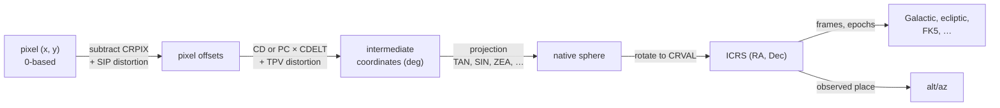

# Coordinates and WCS: overview

This area turns detector pixels into sky positions and sky positions into other
frames. Its centre is the world coordinate system (WCS): the FITS standard that
describes, in header keywords, how a pixel maps to a position on the sky, a
wavelength, or a time. `torchsky.wcs` implements FITS-WCS in torch, and
`torchsky.coords` converts between celestial frames, propagates stellar motion,
and computes observed place.

## How a Celestial WCS Works

A celestial WCS is a chain of simple steps, each set by header keywords:



- `CRPIX` is the reference pixel, `CRVAL` its sky position, and the `CD` (or
  `PC` with `CDELT`) matrix sets scale, rotation, and skew.
- The projection code in `CTYPE` (`RA---TAN`, `GLON-ZEA`, …) flattens the
  sphere onto the plane. The zenithal, cylindrical, conic, polyconic,
  HEALPix, and quadcube families of FITS Paper II are supported.
- Distortions describe what a linear model cannot: SIP (Simple Imaging
  Polynomial, used by HST and JWST) adds polynomials in pixel offsets; TPV
  (used by SCAMP and CFHT MegaCam) adds polynomials in intermediate
  coordinates. Lookup-table axes (`-TAB`) cover the rest.

Every arrow is differentiable, and every step is batched over any tensor shape.

## Choose a Page

| Task | Page | Entry point |
|---|---|---|
| Map pixels to sky and back, footprints, pixel scales | This page, [Projections](projections.md) | [`WCS`](../reference/wcs.md#torchsky.wcs.WCS) |
| Read SIP, TPV, or `-TAB` distortions; refine a WCS against reference stars | [Distortions](distortions.md) | [`WCS`](../reference/wcs.md#torchsky.wcs.WCS), [`fit_sky_affine`](../reference/wcs.md#torchsky.wcs.fit_sky_affine) |
| Convert ICRS, Galactic, ecliptic, FK5; propagate proper motion | [Frames and time](frames.md) | [`transform`](../reference/coords.md#torchsky.coords.transform), [`CatalogState`](../reference/coords.md#torchsky.coords.CatalogState) |
| Alt/az, refraction, and aberration for a site and time | [Observed place](observed-place.md) | [`observed_altaz`](../reference/coords.md#torchsky.coords.observed_altaz) |
| Spectral axes as free functions | [Spectral axes](../spectra/spectral-axes.md) | [`SpectralAxis`](../reference/spectral.md#torchsky.spectral.SpectralAxis) |

## Pixel to World and Back

Build a `WCS` from the header dict torchfits returns, then transform tensors.

<!-- docs: run -->
```python
import torch

from torchsky.wcs import WCS

header = {
    "NAXIS": 2, "NAXIS1": 512, "NAXIS2": 512,
    "CTYPE1": "RA---TAN", "CTYPE2": "DEC--TAN",
    "CRPIX1": 256.5, "CRPIX2": 256.5,
    "CRVAL1": 150.0, "CRVAL2": 2.0,
    "CD1_1": -1e-5, "CD1_2": 0.0, "CD2_1": 0.0, "CD2_2": 1e-5,
}
wcs = WCS(header)

x = torch.linspace(0.0, 511.0, 5, dtype=torch.float64)
y = x.flip(0)
ra, dec = wcs.pixel_to_world(x, y)
x_back, y_back = wcs.world_to_pixel(ra, dec)

torch.testing.assert_close(x_back, x, atol=1e-7, rtol=0.0)
torch.testing.assert_close(y_back, y, atol=1e-7, rtol=0.0)
assert wcs.footprint(shape=(512, 512)).shape == (4, 2)
```

`footprint`, `pixel_scales`, `pixel_area`, and `position_angle` describe the
grid itself. `wcs.to("cuda")` moves the cached parameters with your tensors.

## Alternate Keys, Slicing, and Compiled Paths

`WCS(header, key="A")` selects an alternate WCS. `slice`, `sub`, `dropaxis`, and
`celestial` derive new objects with the CRPIX/CD bookkeeping already updated.
`wcs.compile()` returns a tensor-path object for repeated small-batch calls, where
the transform takes an `(..., 2)` pixel tensor.

<!-- docs: run -->
```python
import torch

from torchsky.wcs import WCS

header = {
    "NAXIS": 2, "NAXIS1": 64, "NAXIS2": 64,
    "CTYPE1": "RA---TAN", "CTYPE2": "DEC--TAN",
    "CRPIX1": 32.5, "CRPIX2": 32.5, "CRVAL1": 10.0, "CRVAL2": 20.0,
    "CDELT1": -1e-3, "CDELT2": 1e-3,
    "CRVAL1A": 11.0, "CRVAL2A": 21.0, "CRPIX1A": 1.0, "CRPIX2A": 1.0,
    "CTYPE1A": "RA---TAN", "CTYPE2A": "DEC--TAN",
    "CDELT1A": -1e-3, "CDELT2A": 1e-3,
}
primary, alternate = WCS(header), WCS(header, key="A")
pixel = torch.tensor([[0.0, 0.0]], dtype=torch.float64)
assert (primary.compile().pixel_to_world(pixel) != alternate.compile().pixel_to_world(pixel)).any()

cutout = primary.slice((slice(16, 48), slice(16, 48)))
full_ra, full_dec = primary.pixel_to_world(torch.tensor([20.0]), torch.tensor([30.0]))
cut_ra, cut_dec = cutout.pixel_to_world(torch.tensor([4.0]), torch.tensor([14.0]))
torch.testing.assert_close(full_ra, cut_ra)
torch.testing.assert_close(full_dec, cut_dec)
```

## Jacobians and Gradients

`jacobian` returns the local `d(world)/d(pixel)` matrix per point, and the
`*_differentiable` variants keep the autograd graph in pure torch for geometry
fitting.

<!-- docs: run -->
```python
import torch

from torchsky.wcs import WCS

header = {
    "NAXIS": 2, "NAXIS1": 64, "NAXIS2": 64,
    "CTYPE1": "RA---TAN", "CTYPE2": "DEC--TAN",
    "CRPIX1": 32.5, "CRPIX2": 32.5, "CRVAL1": 10.0, "CRVAL2": 20.0,
    "CDELT1": -1e-3, "CDELT2": 1e-3,
}
wcs = WCS(header)
pixels = torch.tensor([[10.0, 12.0], [40.0, 50.0]], dtype=torch.float64)
jac = wcs.jacobian(pixels)
assert jac.shape == (2, 2, 2)
assert torch.isfinite(jac).all()
```

At the reference point (CRPIX) the native longitude is undefined for zenithal
projections (the pole) and `cot(theta)` is singular for `PCO`. There the
Jacobian is analytic rather than differenced: for zenithal projections it is
`J = W K^-1 CD`, where `K = d(xi, eta)/dt` and `W = d(lon, lat)/dt` follow
`t = 90 - theta` along two native longitudes, so `K` carries the projection's own
`R'(theta_0)`; `PCO` uses the identity native Jacobian. The inverse direction
uses the matrix inverse. The Hessian on those reference rows is not defined by
this construction (zero).

`XPH` and `QSC` have a genuine kink at CRPIX: the derivative depends on the
direction of approach. The WCS returns one defined subgradient, the autograd
Jacobian of the branch entered along `(+1, +0.371)` pixels, evaluated 1e-4 pixel
from CRPIX (about 1e-4 relative accuracy), and the world-to-pixel Jacobian is
its exact inverse, so the two directions are consistent.

## Spectral and Temporal Axes

The same `WCS` handles non-celestial axes. Spectral WCS covers linear axes,
`-LOG`, reciprocal compounds (`WAVE-F2W`, `FREQ-W2F`), velocity compounds
(`WAVE-V2W`), and the grism algorithms `GRI` and `GRA`. Air wavelengths use the
WCSLIB Edlen form. Temporal helpers convert UTC/TAI/TT/GPS and apply a local
Keplerian light-time correction; ephemeris-grade apparent place is outside the
runtime contract.

## Conventions and Pitfalls

- **Pixels are 0-based.** FITS keywords are 1-based (`CRPIX1 = 1` is the
  first pixel); `pixel_to_world` subtracts that for you. Use
  `pixel_to_world_values(..., origin=1)` if your pixel values come from a
  1-based tool.
- **World values are degrees** for celestial axes. Spectral and time axes keep
  the units in the header.
- **Out-of-domain points return NaN.** A pixel beyond a projection's valid
  region, or a singular inverse, yields NaN for that row rather than an error.
- **MPS is float32.** Expect arcsecond-class error; a
  [`PrecisionWarning`](../reference/wcs.md#torchsky.wcs.PrecisionWarning) tells
  you when it reaches half a pixel. See [MPS precision](projections.md#mps-precision).
- **Frames are explicit.** A WCS reports positions in the frame its header
  declares (`RADESYS`, `EQUINOX`); conversion to another frame is a separate
  [`transform`](../reference/coords.md#torchsky.coords.transform) call.

## Connections

A `WCS` is the input to almost everything else: [catalogs](../catalogs/index.md)
use sky positions, [maps](../maps/index.md) resample between two WCS grids,
[HEALPix mapmaking](../maps/healpix-mapmaking.md) projects a WCS image onto the
[sphere](../sphere/index.md), and [models](../models/index.md) render through
the WCS of each exposure.

Exhaustive Astropy/WCSLIB parity and throughput are measured in
[torchsky-harness](https://github.com/astroai/torchsky-harness) and summarized
on the [parity page](../performance/parity.md). Example:
[WCS tour](../published-examples/wcs_tour.py).
