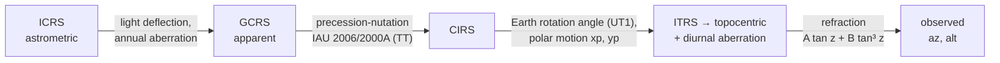

# Observed place

The *observed place* of a star is where a telescope at a given site and
instant must point: azimuth (from north through east) and altitude above the
horizon. Getting from a catalog (ICRS) direction to it takes four physical
corrections, applied in order, each with its own inputs.
[`observed_altaz`](../reference/coords.md#torchsky.coords.observed_altaz)
implements the ERFA/SOFA chain in torch; `transform(..., to_frame="ALTAZ")` and
`Catalog.observe("ALTAZ", ...)` call the same code.

## How It Works



| Step | Physics | Size | Inputs |
|---|---|---|---|
| Aberration and deflection | The Earth's orbital velocity tilts incoming light; the Sun bends it | up to 20.5 arcsec | `aberration=True`; Earth ephemeris (ERFA `epv00`, built in) |
| Precession-nutation | The equator and equinox move | 50 arcsec per year since J2000 | On by default (`pn=None` or `"iau2006"`); TT from `EarthOrientation.tt_minus_utc_s` or the leap-second table |
| Earth rotation | Sidereal angle from UT1; the pole wanders | 15 arcsec per second of DUT1; ~0.3 arcsec polar motion | `EarthOrientation.dut1_s`, `xp_arcsec`, `yp_arcsec` |
| Refraction | The atmosphere lifts sources toward the zenith | ~1 arcmin at 45° altitude at sea level, 35 arcmin at the horizon | `refraction=True`, `Site.pressure_mbar`, `temperature_c`, `relative_humidity`, `wavelength_um` |

The refraction model is ERFA `refco`: \(\Delta z = A \tan z + B \tan^3 z\),
with \(A, B\) computed from pressure, temperature, humidity, and wavelength;
wavelengths above 100 µm select the radio formula.
`refraction_model="saemundsson"` selects the Saemundsson/Meeus altitude
formula instead.

## Inputs Are Explicit

Earth orientation parameters (EOP) are measured, not computed: DUT1 = UT1 −
UTC and polar motion come from IERS Bulletin A or B for the date of
observation, and TT − UTC follows from the leap-second count. torchsky does
not download or interpolate IERS tables. You pass the values in an
[`EarthOrientation`](../reference/coords.md#torchsky.coords.EarthOrientation),
the site in a [`Site`](../reference/coords.md#torchsky.coords.Site), and every
correction is off unless requested.

- Precession-nutation (`pn=None`, the default, or `"iau2006"`) is always
  applied. TT − UTC is `tt_minus_utc_s` when you set it, otherwise
  32.184 s + TAI − UTC from torchsky's built-in leap-second table (ERFA
  `dat`). Epochs before 1972 or after the table expires (2027-06-28) raise
  `ValueError`: pass `tt_minus_utc_s` for them.
- `pn="none"` is an explicit opt-in that uses GMST with no precession or
  nutation; it is off by about 0.3 degree in 2025, so use it only for rough
  visibility checks.
- Polar motion, when `xp_arcsec`/`yp_arcsec` are set, applies the CIO/ERA
  chain and the SOFA polar-motion matrix into ITRS geodetic alt/az.
- `Site.height_m` is the WGS84 ellipsoidal height. It enters diurnal
  aberration, not the direction of a star at infinity.

## Minimal Example: Three Sources from Maunakea

<!-- docs: run -->
```python
import torch

from torchsky.coords import CatalogState, EarthOrientation, Site, observed_altaz

f64 = dict(dtype=torch.float64)
site = Site(  # CFHT, Maunakea
    lon_deg=torch.tensor(-155.4681, **f64), lat_deg=torch.tensor(19.8253, **f64),
    height_m=4204.0, pressure_mbar=615.0, temperature_c=0.0,
    relative_humidity=0.2, wavelength_um=0.5,
)
eop = EarthOrientation(  # illustrative IERS-style values for the date
    dut1_s=torch.tensor(-0.0136, **f64), xp_arcsec=torch.tensor(0.1, **f64),
    yp_arcsec=torch.tensor(0.4, **f64), tt_minus_utc_s=torch.tensor(69.184, **f64),
)
stars = CatalogState(  # Crab, Sirius, Betelgeuse
    lon=torch.tensor([83.63308, 101.28716, 88.79294], **f64),
    lat=torch.tensor([22.01450, -16.71612, 7.40706], **f64), frame="ICRS",
)
when = torch.tensor(60310.35, **f64)   # 2024-01-01 08:24 UTC

az, alt = observed_altaz(stars, obstime_mjd_utc=when, site=site, eop=eop,
                         aberration=True)
_, alt_refr = observed_altaz(stars, obstime_mjd_utc=when, site=site, eop=eop,
                             aberration=True, refraction=True)
_, alt_gmst = observed_altaz(stars, obstime_mjd_utc=when, site=site, eop=eop,
                             pn="none")

assert bool((alt > 30.0).all()) and bool(((az >= 0.0) & (az < 360.0)).all())
lift = (alt_refr - alt) * 3600.0                  # arcsec, at 615 mbar
assert bool((lift > 5.0).all()) and bool((lift < 60.0).all())
assert float((alt_gmst - alt).abs().max()) > 0.1  # pn="none": tenths of a degree off
```

The [frames and motion example](../published-examples/frames_and_motion.py)
computes alt/az for a catalog at the same site.

## Recipes

### Observe a Catalog

`Catalog.observe` returns a catalog in the `ALTAZ` frame, with longitude =
azimuth and latitude = altitude, on the catalog's device.

<!-- docs: run -->
```python
import torch

from torchsky.catalogs import Catalog
from torchsky.coords import EarthOrientation, Site

cat = Catalog(
    lon=torch.tensor([10.0, 266.4], dtype=torch.float64),
    lat=torch.tensor([-5.0, -28.9], dtype=torch.float64),
    frame="ICRS",
)
observed = cat.observe(
    "ALTAZ",
    obstime_mjd_utc=torch.full((2,), 60000.5, dtype=torch.float64),
    site=Site(lon_deg=torch.tensor(-155.47), lat_deg=torch.tensor(19.83)),
    eop=EarthOrientation(dut1_s=torch.tensor(0.1), tt_minus_utc_s=torch.tensor(69.184)),
)
assert observed.frame == "ALTAZ" and bool((observed.lat.abs() <= 90.0).all())
```

### Stop Before Alt/Az

`transform(..., to_frame="GCRS" | "CIRS" | "TETE" | "ITRS")` stops at an
intermediate frame with the same time and EOP inputs: GCRS for apparent
geocentric places, CIRS or TETE (true equator, true equinox) for hour angles,
ITRS for Earth-fixed directions.

### Refraction and Its Colour Dependence

[`apply_refraction`](../reference/coords.md#torchsky.coords.apply_refraction)
lifts a geometric altitude by the Saemundsson formula without the rest of the
chain. [`dcr_offset`](../reference/coords.md#torchsky.coords.dcr_offset)
returns the differential chromatic refraction of one wavelength relative to a
reference wavelength as east and north offsets in degrees, oriented by the
parallactic angle: the shift that stretches a broad-band star image toward the
zenith.

<!-- docs: run -->
```python
import torch

from torchsky.coords import apply_refraction, dcr_offset

alt = torch.tensor([30.0, 60.0], dtype=torch.float64)
lifted = apply_refraction(alt, pressure_mbar=615.0, temperature_c=0.0)
assert bool(((lifted - alt) * 3600 > 10.0).all())          # tens of arcsec at 615 mbar

blue_vs_red = dcr_offset(torch.tensor([3600.0, 9000.0], dtype=torch.float64), 45.0,
                         pressure_mbar=615.0, temperature_c=0.0)
d_east, d_north = blue_vs_red                               # degrees
```

### Pick a Device

Time-only quantities (precession-nutation angles, Earth rotation, the Earth
ephemeris) are evaluated in float64 on the CPU on every device; only the final
rotation matrices move to the coordinate device. CUDA runs in float64. MPS
runs in float32, and its IAU 2006 results differ from CPU float64 by a few
arcseconds. Gradients flow through the coordinates; the kernels are ATen, not
fused C++.

## Accuracy and Validation

With the same EOP on both sides, alt/az agrees with ERFA `atco13` to 0.012 mas
at the maximum (median 0.009 mas) over 4000 random positions and epochs in
2017–2026, with polar motion, DUT1, and 4.2 km site height, and to 0.012 mas
with refraction for zenith distances below 85°, optical and radio. The
residual is the TIO locator \(s'\) (taken as 0) and TT used for TDB. Parity
checks run in [torchsky-harness](https://github.com/astroai/torchsky-harness);
see the [parity page](../performance/parity.md).

## Pitfalls

- **Stale EOP.** One second of DUT1 error rotates the sky by 15 arcsec at the
  equator. Use the bulletin for the observation date.
- **Refraction near the horizon.** The `refco` model is fitted for zenith
  distances below about 85°; below the horizon its output has no meaning.
- **Comparing with Astropy.** Astropy downloads IERS tables by default. Pin the
  same DUT1, polar motion, and TT − UTC on both sides before comparing at the
  mas level.
- **Planets and satellites.** The chain assumes a source at infinity with
  catalog proper motion. Solar-system bodies need an ephemeris
  (`torchsky.wcs.ephemeris`) for their geocentric position first.

## See Also

- [Frames and time](frames.md): ICRS, epochs, and time scales.
- [Coordinates overview](index.md).
- Reference: [`observed_altaz`](../reference/coords.md#torchsky.coords.observed_altaz),
  [`Site`](../reference/coords.md#torchsky.coords.Site),
  [`EarthOrientation`](../reference/coords.md#torchsky.coords.EarthOrientation),
  [`transform`](../reference/coords.md#torchsky.coords.transform).
