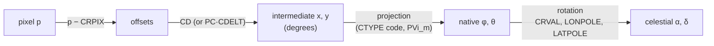

# Projections

A map projection flattens the celestial sphere onto the plane of a detector or
a map. In FITS-WCS it is the step between *intermediate world coordinates*
(the linear, degree-valued plane reached from pixels by `CRPIX` and the `CD`
matrix) and *native spherical coordinates* \((\phi, \theta)\); a rotation then
carries native coordinates to the celestial frame named in the header.
[`WCS`](../reference/wcs.md#torchsky.wcs.WCS) reads the projection from the
three-letter code at the end of `CTYPE` (`RA---TAN`, `GLON-MOL`, …) and
implements every celestial projection of FITS WCS Paper II
(Calabretta & Greisen 2002).

## How It Works

For pixel \(p\) (FITS 1-based), reference pixel \(r\) (`CRPIXj`), and the
linear matrix \(C\) (`CDi_j`, or `PCi_j` scaled by `CDELTi`), the intermediate
coordinates in degrees are

\[
x_i = \sum_j C_{ij}\,(p_j - r_j).
\]

The projection maps \((x, y)\) to native \((\phi, \theta)\). For the gnomonic
`TAN` projection, for example, the native radius is
\(R_\theta = \frac{180^\circ}{\pi}\cot\theta\), with
\(\phi = \operatorname{atan2}(x, -y)\) and \(\theta = \arctan(180^\circ / (\pi R))\),
\(R = \sqrt{x^2 + y^2}\). Finally a spherical rotation takes the native pole
to the celestial position fixed by `CRVAL`, `LONPOLE`, and `LATPOLE`:



- **Reference point.** For zenithal projections `CRVAL` is the tangent point,
  the native pole \(\theta = 90^\circ\). For cylindrical, conic, and all-sky
  projections the reference point sits on the native equator.
- **`LONPOLE`** is the native longitude of the celestial pole. Its default is
  \(\phi_0\) when \(\delta_0 \ge \theta_0\) and \(\phi_0 + 180^\circ\)
  otherwise, so a zenithal map has north up when `CD` has no rotation.
  Changing it rotates the image about the reference point.
- **`LATPOLE`** picks between the two solutions for the celestial latitude of
  the native pole when the geometry leaves it ambiguous. Invalid
  `LONPOLE`/`LATPOLE` combinations raise.
- **`PVi_m`** carries projection parameters (`AZP` distance, `ZPN`
  polynomial, conic standard parallels). `PV1_1`/`PV1_2` set a non-default
  native fiducial point \((\phi_0, \theta_0)\) as in WCSLIB `celset`.

Every step is differentiable and batched over any tensor shape.

## Supported Codes

| Family | Codes | Typical use |
|---|---|---|
| Zenithal | `TAN`, `SIN`, `ARC`, `ZPN`, `STG`, `ZEA`, `AZP`, `SZP`, `AIR`, `NCP` | `TAN` for optical images; `SIN` for radio interferometry; `ZEA` and `ARC` for wide polar fields |
| Cylindrical | `CAR`, `CEA`, `MER`, `CYP` | `CAR` for plate-carrée lon/lat grids and CAR harmonic transforms; `CEA` for equal-area strips |
| Pseudocylindrical and all-sky | `SFL` (and `GLS`), `PAR`, `MOL`, `AIT` | Equal-area all-sky maps |
| Conic | `COP`, `COE`, `COD`, `COO` | Mid-latitude survey stripes |
| Polyconic | `BON`, `PCO` | Legacy atlases |
| Quadcube | `TSC`, `CSC`, `QSC` | COBE-style cube faces |
| HEALPix | `HPX`, `XPH` | HEALPix grids rendered as images |
| Distortion-carrying | `TPV`, `TNX`, `ZPX` | See [Distortions](distortions.md) |

`TAN` with any `PV` card is read as SCAMP `TPV`, so its `PV1_1`/`PV1_2` are
distortion terms, not a fiducial point.

## Pixel Origin

torchsky pixels are 0-based: the centre of the first pixel is `(0, 0)` and
its edges are at `-0.5` and `+0.5`. FITS keywords are 1-based, so
`CRPIX1 = 1` names that same pixel and `pixel_to_world` subtracts one for you.
Pixel values that come from a 1-based tool go through
`pixel_to_world_values(..., origin=1)`.

## Minimal Example: A Real MegaPipe Cutout

This is the WCS of a 512 × 512 g-band cutout of the CFHT MegaPipe stack
712.165, served by the CADC cutout service (sample `cadc_megapipe_cutout` in
the example registry). The cutout keeps the stack's tangent point, so
`CRPIX1 = -2999`: the reference pixel lies 3000 pixels outside the cutout.
That is normal; the projection does not need its reference pixel to be on the
image.

<!-- docs: run -->
```python
import torch

from torchsky.wcs import WCS

header = {  # CFHT MegaPipe 712.165, g band, CADC cutout [8000:8511, 4000:4511]
    "NAXIS": 2, "NAXIS1": 512, "NAXIS2": 512,
    "CTYPE1": "RA---TAN", "CTYPE2": "DEC--TAN", "CUNIT1": "deg", "CUNIT2": "deg",
    "CRVAL1": 359.07190997, "CRVAL2": -7.5, "CRPIX1": -2999.0, "CRPIX2": 1001.0,
    "CD1_1": -5.160234650248e-05, "CD1_2": 0.0,
    "CD2_1": 0.0, "CD2_2": 5.160234650248e-05,
    "RADESYS": "ICRS", "EQUINOX": 2000.0,
}
wcs = WCS(header)

# 0-based pixel (-3000, 1000) is FITS pixel (CRPIX1, CRPIX2): the tangent point.
ra0, dec0 = wcs.pixel_to_world(torch.tensor([-3000.0], dtype=torch.float64),
                               torch.tensor([1000.0], dtype=torch.float64))
torch.testing.assert_close(ra0, torch.tensor([359.07190997], dtype=torch.float64))

# The same point given in 1-based pixels.
ra1, _ = wcs.pixel_to_world_values(torch.tensor([-2999.0], dtype=torch.float64),
                                   torch.tensor([1001.0], dtype=torch.float64), origin=1)
torch.testing.assert_close(ra1, ra0)

scale_x, scale_y = wcs.pixel_scales()          # degrees per pixel
assert abs(scale_x * 3600 - 0.1858) < 1e-4
corners = wcs.footprint(shape=(512, 512))      # (4, 2) RA, Dec in degrees
assert corners.shape == (4, 2) and bool((corners[:, 1] < -7.5).all())
```

The [MegaPipe mosaic example](../published-examples/megapipe_mosaic.py)
resamples four such cutouts, each with its own tangent point, onto one grid.
The [Horsehead WCS tour](../published-examples/horsehead_wcs_tour.py) reads a
DSS plate with torchfits and reprojects it from `TAN` to `CAR`:

```python
# fragment: needs the cached sample; `pixi run fetch-example-samples` downloads it
from pathlib import Path

import torchfits
from torchsky.wcs import WCS

path = Path.home() / ".cache/torchsky/samples/horsehead.fits"
image = torchfits.read(str(path), 0)
wcs = WCS(dict(torchfits.read_header(str(path), 0)))   # RA---TAN, 1.0 arcsec/pixel
corners = wcs.footprint(shape=tuple(image.shape))      # about 15 x 15 arcmin
```

## Recipes

### Build an All-Sky Grid

All-sky projections leave the corners of the rectangle off the sky. Those
pixels return NaN, which you can use directly as a validity mask.

<!-- docs: run -->
```python
import torch

from torchsky.wcs import WCS

def allsky(code: str) -> WCS:
    return WCS({
        "NAXIS": 2, "NAXIS1": 360, "NAXIS2": 180,
        "CTYPE1": f"GLON-{code}", "CTYPE2": f"GLAT-{code}",
        "CRPIX1": 180.5, "CRPIX2": 90.5, "CRVAL1": 0.0, "CRVAL2": 0.0,
        "CDELT1": -1.0, "CDELT2": 1.0,
    })

x = torch.tensor([179.5, 0.0], dtype=torch.float64)   # map centre, corner
y = torch.tensor([89.5, 0.0], dtype=torch.float64)
for code in ("CAR", "MOL", "AIT", "ZEA"):
    lon, lat = allsky(code).pixel_to_world(x, y)
    assert torch.isfinite(lat[0])
    assert torch.isfinite(lat[1]) == (code == "CAR")    # only CAR fills the rectangle
```

Use `MOL` or `AIT` for figures, `CAR` when you need a regular lon/lat grid, and
a HEALPix map (see [HEALPix](../sphere/healpix.md)) when you need equal-area
pixels for analysis.

### Keep CAR Rectilinear

A `CAR` header with `CRVAL2 ≠ 0` is an *oblique* plate carrée: the native
equator passes through `CRVAL`, so rows of pixels follow great circles, not
parallels. For a grid whose rows are lines of constant latitude, set
`CRVAL2 = 0` and move the reference pixel instead:

<!-- docs: run -->
```python
import torch

from torchsky.wcs import WCS

common = {"NAXIS": 2, "NAXIS1": 100, "NAXIS2": 100,
          "CTYPE1": "RA---CAR", "CTYPE2": "DEC--CAR",
          "CRVAL1": 10.0, "CRPIX1": 50.5, "CDELT1": -0.1, "CDELT2": 0.1}
oblique = WCS({**common, "CRVAL2": 60.0, "CRPIX2": 50.5})
regular = WCS({**common, "CRVAL2": 0.0, "CRPIX2": 50.5 - 600.0})  # row 49.5 at Dec 60

x = torch.tensor([0.0, 99.0], dtype=torch.float64)
y = torch.tensor([49.5, 49.5], dtype=torch.float64)
assert (oblique.pixel_to_world(x, y)[1] - 60.0).abs().max() > 0.3   # bends off the parallel
torch.testing.assert_close(regular.pixel_to_world(x, y)[1], torch.full((2,), 60.0, dtype=torch.float64))
```

### Rotate a Field with LONPOLE

The `CD` matrix rotates the pixel grid; `LONPOLE` rotates the sky about the
reference point. Both produce a rotated image, but only `CD` is the usual
place for a camera rotation. Use `LONPOLE` when a header sets it explicitly.

<!-- docs: run -->
```python
import torch

from torchsky.wcs import WCS

header = {"NAXIS": 2, "NAXIS1": 100, "NAXIS2": 100,
          "CTYPE1": "RA---TAN", "CTYPE2": "DEC--TAN",
          "CRPIX1": 50.5, "CRPIX2": 50.5, "CRVAL1": 10.0, "CRVAL2": 20.0,
          "CDELT1": -0.01, "CDELT2": 0.01}
default, rotated = WCS(header), WCS({**header, "LONPOLE": 90.0})

x, y = torch.tensor([99.0], dtype=torch.float64), torch.tensor([49.5], dtype=torch.float64)
_, dec_default = default.pixel_to_world(x, y)   # +x is east-west: Dec barely changes
_, dec_rotated = rotated.pixel_to_world(x, y)   # +x now runs north-south
assert abs(float(dec_default) - 20.0) < 1e-3 and abs(float(dec_rotated) - 20.0) > 0.4
```

### MPS Precision

MPS has no float64, so a WCS on MPS runs in float32. `wcs.to("mps")` (and the
first MPS tensor passed to a WCS on another device) emits
[`PrecisionWarning`](../reference/wcs.md#torchsky.wcs.PrecisionWarning) once
per WCS when the expected float32 error reaches half a pixel, the point at
which the nearest pixel is no longer reliable. The estimate is one float32 ulp
of the largest world value (longitude up to 360 degrees times
\(\cos\delta_0\), latitude up to 90) divided by the smallest `CD` column norm
in degrees per pixel, plus one ulp of the largest pixel coordinate. At
0.2 arcsec per pixel and \(\delta_0 = 0\) that is 111 mas, 0.55 pixel, so the
warning fires; at 1 arcsec per pixel it is 0.11 pixel and stays silent. Use
CPU or CUDA for such grids.

## Accuracy and Validation

Every projection code is checked for pixel → world → pixel round trips in the
test suite, and against Astropy/WCSLIB in
[torchsky-harness](https://github.com/astroai/torchsky-harness); the
[parity page](../performance/parity.md) summarizes the agreement.

`CSC` reproduces WCSLIB's float32 evaluation, including its float32
polynomial and face-offset arithmetic (up to 1e-5 degree on faces away from
the base face). A baseline x86-64 WCSLIB build matches it to 6e-14 degree;
AArch64 WCSLIB builds fuse the multiply-add and differ by one float32 ulp.
Fused C++ kernels cover `PCO`, `XPH`, `TSC`, `CSC`, and `QSC` on CPU; other
devices, and headers with a non-default fiducial point, use the tensor path.

## Pitfalls

- **NaN is a result, not an error.** Pixels outside a projection's domain (the
  far hemisphere of `SIN`, the corners of `MOL`) come back as NaN.
- **`TAN` is a small-field projection.** Distortion grows as
  the squared secant of the angle from the tangent point; beyond a few degrees prefer
  `ZEA`, `ARC`, or `SIN`.
- **The frame comes from the header.** `RADESYS` and `EQUINOX` declare it;
  [Frames and time](frames.md) converts to others.
- **GWCS.** JWST GWCS models are sampled onto regular grid transforms at
  calibration time; the runtime never imports `gwcs`.

## See Also

- [Coordinates overview](index.md): the pixel → world chain, Jacobians, alternate keys.
- [Distortions](distortions.md): SIP, TPV, and lookup tables on top of a projection.
- [Resampling](../maps/resampling.md): moving images between projections.
- Reference: [`WCS`](../reference/wcs.md#torchsky.wcs.WCS).
- Examples: [Horsehead WCS tour](../published-examples/horsehead_wcs_tour.py),
  [WCS tour](../published-examples/wcs_tour.py) (every projection family).
