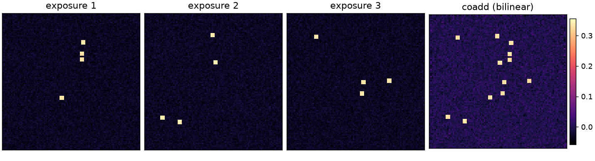
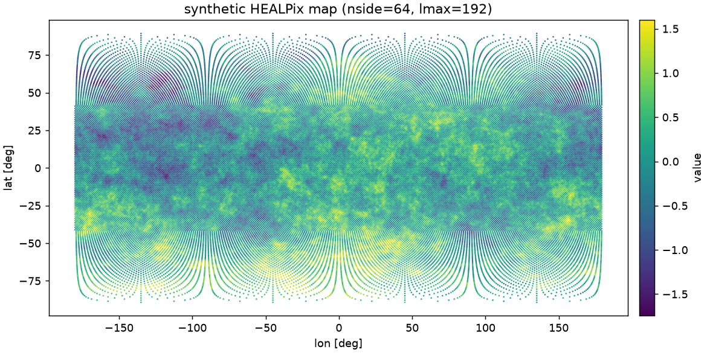
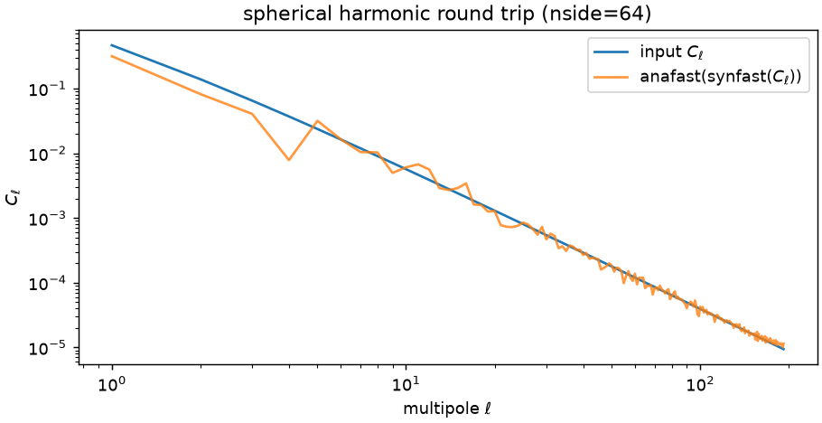
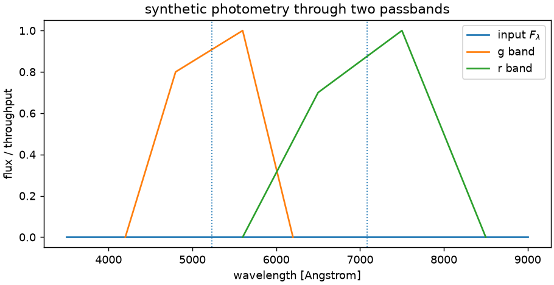

# Gallery


Rendered results from the package, with the code that produced them. Every
figure is generated by [`scripts/gen_gallery.py`](https://github.com/astroai/torchsky/blob/main/scripts/gen_gallery.py) on
small synthetic inputs; regenerate with `pixi run docs-gallery`. Figures are
committed so the documentation build does not need a plotting stack.

## Coadd three offset exposures

Three synthetic TAN exposures with noise and point sources are planned onto a
common grid and combined with the bilinear kernel. The result keeps a weight
plane alongside the data; `result.data`, `result.weight`, and `result.header`
are the product contract.



```python
from torchsky.map import Observation, coadd, plan

observations = [Observation(data=data_i, wcs=header_i) for i in range(3)]
target = plan(observations, projection="TAN")
result = coadd(observations, target, kernel="bilinear")
```

See the [map guide](../maps/index.md) and [`coadd`](../reference/map.md#torchsky.map.coadd).

## A synthetic all-sky HEALPix map

`synfast` draws a Gaussian random field from a power-law spectrum; the pixels
are plotted in an equal-area scatter projection. Indexing and map values use the
same tensor API, so the map can be analysed or sampled without a host round
trip.



```python
import torch
import torchsky.sphere as sphere

nside = 64
ell = torch.arange(1, 3 * nside + 1, dtype=torch.float64)
cl = 1.0 / (ell * (ell + 1.0)) ** 1.2
healpix_map = sphere.synfast(cl, nside, lmax=3 * nside)
```

See [sphere.md](../sphere/index.md) and the
[HEALPix kernels reference](../reference/sphere-healpix.md).

## Spherical harmonic round trip

`anafast(synfast(C_ell))` recovers the input spectrum up to the expected
realization scatter and pixel window. The transform pair, smoothing, and spectra
share the tensor API documented in [sht.md](../sphere/sht.md).



```python
lmax = 3 * nside
recovered = sphere.anafast(healpix_map, lmax=lmax, pol=False)
```

## Synthetic photometry through passbands

An input spectrum is integrated through two explicit passbands. The result
carries its unit, coverage, and validity instead of a bare number. See
[spectrophotometry.md](../spectra/photometry.md).



```python
from torchsky.spectrophotometry import synthetic_photometry

result = synthetic_photometry(wavelength, flux_lambda, passband)
print(result.unit, result.value, result.coverage, result.valid)
```

## More runnable demonstrations

The [examples gallery](index.md) collects the curated, runnable scripts under
[`examples/`](https://github.com/astroai/torchsky/tree/main/examples), grouped by science scenario with
thumbnails, runtimes, and links to each script.
