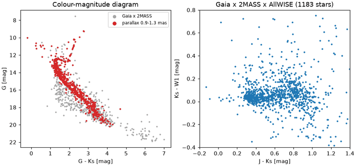
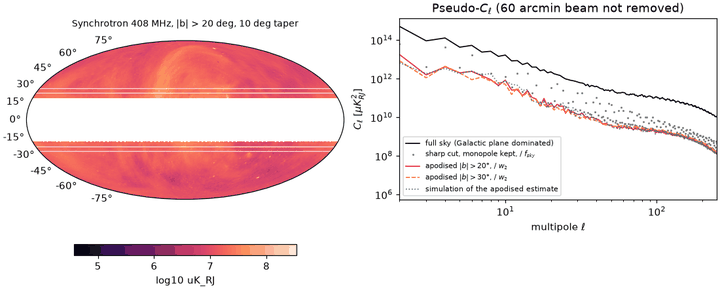
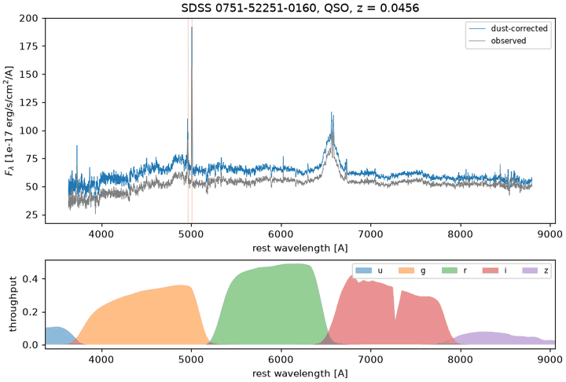
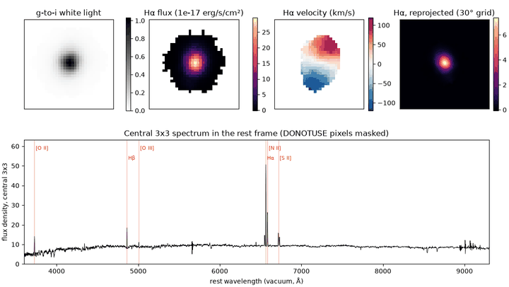
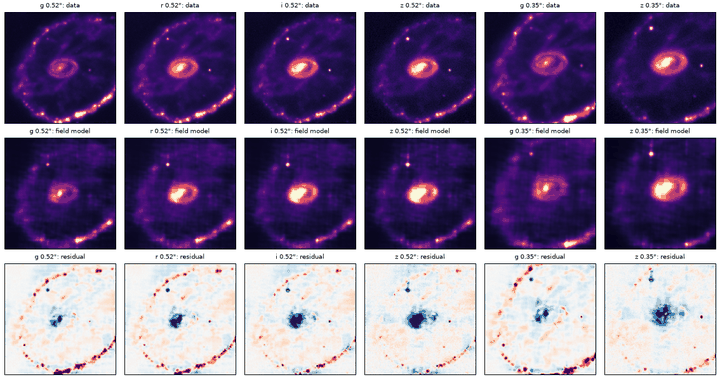
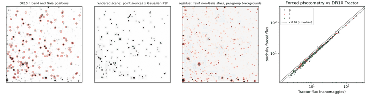
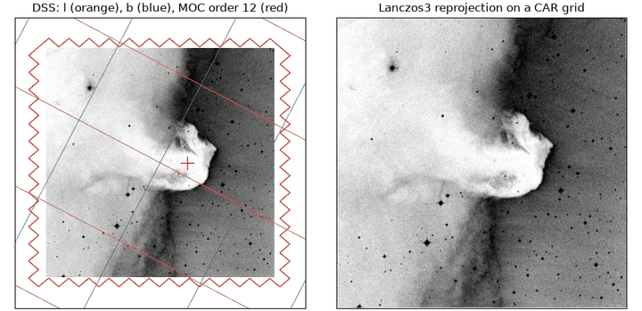
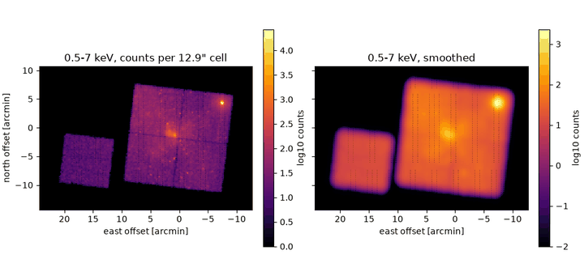
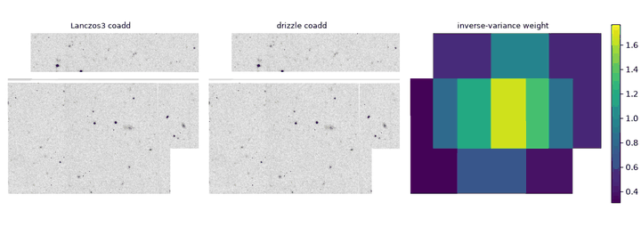

<!-- Generated by scripts/gen_example_index.py; edit the example docstrings or SCENARIOS instead. -->

# Examples

Curated, runnable scripts that show what torchsky does and how to use it. The
first group works on real public data (Gaia, Planck, SDSS, Chandra, CFHT and more);
each script fetches a small sample once into `~/.cache/torchsky/samples`
(`TORCHSKY_SAMPLE_CACHE` overrides it), is deterministic, uses only public torchsky
APIs, prints a short quantitative result, saves at most one figure to a temporary
directory (or `--out`), and finishes in under a minute on a CPU once its data is
cached. Scripts that take `--device` run on CUDA when it is available. With
`TORCHSKY_EXAMPLE_FAST=1` (set under CI) downloads are forbidden and a script
whose data is not cached exits with status 77, which `pixi run examples` reports
as SKIP. The synthetic examples at the end isolate one mechanism and need no network.

```bash
pixi run fetch-example-samples            # cache every small sample
pixi run -e test -- python examples/planck_power_spectrum.py --out ./figures
pixi run -e test -- python examples/coadd_dithered_sip.py --device cuda
```

Scientific campaigns, large real-data runs, and parity scorecards live in
[`torchsky-harness`](https://github.com/astroai/torchsky-harness).

## Gaia, 2MASS and AllWISE catalogues

Crossmatching public survey catalogues, fetched from TAP services.

### Gaia DR3 x 2MASS x AllWISE in the field of M67



Crossmatch Gaia DR3, 2MASS and AllWISE in the field of the open cluster M67. *Runtime: about 2 s on CPU once the cones are cached.*

Script: [`examples/crossmatch_gaia_2mass_allwise.py`](https://github.com/astroai/torchsky/blob/main/examples/crossmatch_gaia_2mass_allwise.py) · [site copy](../published-examples/crossmatch_gaia_2mass_allwise.py)

```text
cone r=0.25 deg at (132.825, 11.8): Gaia 2086, 2MASS 1330, AllWISE 2806 rows
Gaia x 2MASS within 2.0 arcsec: best1 1330 pairs (3 ms), mutual 1301 pairs (4 ms), median separation 0.083 arcsec
skyerr (3 x catalogue errors): 1275 pairs (2 ms), 1275 shared with the fixed radius
Gaia x AllWISE skyerr: 1249 pairs (2 ms), median separation 0.138 arcsec
brute-force check on 300 Gaia rows: 180 matches, identical = True
crossmatch_many group (2.5 arcsec, 7 ms): 3383 groups; groups with 1/2/3 catalogues: 1764/436/1183
```

## Planck

All-sky HEALPix maps, masks and power spectra.

### Apodised-mask power spectrum of the Commander synchrotron map



Power spectrum of the Planck Commander synchrotron map with an apodised Galactic mask. *Runtime: about 5 s on CPU once the map (9 MB) is cached.*

Script: [`examples/planck_power_spectrum.py`](https://github.com/astroai/torchsky/blob/main/examples/planck_power_spectrum.py) · [site copy](../published-examples/planck_power_spectrum.py)

```text
COMP-MAP-Synchrotron: nside 256, 786432 pixels, unit uK_RJ, median 1.65e+07
mask |b| > 20 deg, 10 deg cosine taper: f_sky = 0.6576 (MOC area; analytic 0.6580), w2 = 0.5579
even/odd multipole ratio at ell 100-200: sharp cut, monopole kept 1.90; apodised, monopole+dipole removed 1.005
high-latitude spectrum: C_ell ~ ell^-2.91 over ell 10-50
band          |b|>20 / full sky   |b|>30 / |b|>20   simulation out / in
ell  10- 30         0.0326              0.761             1.184
ell  30- 60         0.0202              0.845             1.037
ell  60-150         0.0176              1.166             1.028
```

## SDSS

Calibrated spectra and IFU cubes: rest frames, dust, emission-line maps and synthetic photometry.

### A quasar spectrum: rest frame, dust and ugriz magnitudes



Rest frame, dust correction and synthetic ugriz photometry of an SDSS spectrum. *Runtime: about 2 s on CPU once the files are cached.*

Script: [`examples/sdss_spectrum_photometry.py`](https://github.com/astroai/torchsky/blob/main/examples/sdss_spectrum_photometry.py) · [site copy](../published-examples/sdss_spectrum_photometry.py)

```text
plate 751 MJD 52251 fibre 160: class QSO, z = 0.04559 (v = 13356 km/s), 3840/3841 good pixels, 3799-9198 A
[OIII]4960: rest-frame centroid 4960.38 A -> +5 km/s from the pipeline redshift
[OIII]5008: rest-frame centroid 5008.47 A -> +14 km/s from the pipeline redshift
band  coverage  torchsky AB  SDSS synthetic  diff    dust-corrected  A_lambda(pivot)
  u     0.12      invalid         18.237
  g     1.00       17.470         17.496  -0.027          17.213         0.263
  r     1.00       16.776         16.764  +0.012          16.597         0.180
  i     1.00       16.370         16.374  -0.004          16.236         0.134
  z     0.69      invalid         16.125
rms difference to the SDSS synthetic magnitudes (griz): 0.017 mag; dust-corrected g-r = 0.616
```

### A MaNGA IFU cube: Hα map, rotation and reprojection



Hα map, velocity field and spectrum of a MaNGA IFU cube. *Runtime: about 5 s on CPU once the 39 MB cube is cached.*

Script: [`examples/manga_ifu_cube.py`](https://github.com/astroai/torchsky/blob/main/examples/manga_ifu_cube.py) · [site copy](../published-examples/manga_ifu_cube.py)

```text
manga_8485_1901.fits.gz: 34 x 34 spaxels x 4563 channels, WAVE-LOG, 1E-17 erg/s/cm^2/Angstrom/spaxel
WAVE-LOG axis 3621.60-10353.81 Å; max |WCS - WAVE HDU| = 1.5e-04 Å
systemic redshift from central Hα: z = 0.04077 (cz = 12221 km/s)
Hα detected at 5 sigma in 254 spaxels; total Hα flux 1187 x 1e-17 erg/s/cm^2; velocity range -102 to +90 km/s
integrated [N II] 6585 / Hα = 0.41 (log -0.39: star formation, not AGN)
reprojected cube (16, 93, 93) at 0.25 arcsec, rotated 30 deg: Hα total 1194 vs 1194 (1.0000)
```

## Legacy Surveys (DECam)

Multi-band DECam images: a continuous field fit and catalogue forced photometry.

### One continuous field fitted to g/r/i/z images of the Cartwheel



Fit one continuous field to Legacy Surveys g/r/i/z images of the Cartwheel galaxy. *Runtime: about 60 s on CPU once the 1 MB of cutouts and filter curves are cached.*

Script: [`examples/legacy_field_fit.py`](https://github.com/astroai/torchsky/blob/main/examples/legacy_field_fit.py) · [site copy](../published-examples/legacy_field_fit.py)

```text
g 0.52"   (128, 128) px, passband 3835-5570 A, total   634.1 nmgy
r 0.52"   (128, 128) px, passband 5405-7290 A, total   829.0 nmgy
i 0.52"   (128, 128) px, passband 6775-8690 A, total   907.0 nmgy
z 0.52"   (128, 128) px, passband 8255-10140 A, total  1019.5 nmgy
g 0.35"   (160, 160) px, passband 3835-5570 A, total  1084.5 nmgy
z 0.35"   (160, 160) px, passband 8255-10140 A, total  1888.7 nmgy
fit: 240 steps, loss 0.0352 -> 0.0041
g 0.52"   model/data flux 0.942, variance explained 0.737
r 0.52"   model/data flux 0.976, variance explained 0.811
i 0.52"   model/data flux 1.018, variance explained 0.840
z 0.52"   model/data flux 1.085, variance explained 0.826
g 0.35"   model/data flux 0.963, variance explained 0.744
```

### Forced photometry of 143 Gaia stars near NGC 288



Forced photometry of Gaia stars on Legacy Surveys g/r/z images near NGC 288. *Runtime: about 20 s on CPU once the 4 MB of samples are cached.*

Script: [`examples/legacy_forced_photometry.py`](https://github.com/astroai/torchsky/blob/main/examples/legacy_forced_photometry.py) · [site copy](../published-examples/legacy_forced_photometry.py)

```text
384 x 384 px at 0.262 arcsec; 143 catalogue stars on the image
g: PSF sigma 2.09 px, FWHM 1.29 arcsec
r: PSF sigma 1.59 px, FWHM 0.98 arcsec
z: PSF sigma 1.39 px, FWHM 0.86 arcsec
blend groups: 71 for 143 stars
g: forced / Tractor flux, 143 stars at S/N > 50: median 0.817, robust scatter 0.034
r: forced / Tractor flux, 143 stars at S/N > 50: median 0.856, robust scatter 0.028
z: forced / Tractor flux, 143 stars at S/N > 50: median 0.858, robust scatter 0.034
```

## DSS photographic plates

A WCS from a real header, frames, footprints and reprojection.

### Horsehead Nebula: WCS, footprint and reprojection



Pixel to sky on a real photographic-plate image: the Horsehead Nebula. *Runtime: about 4 s on CPU once the 1.6 MB file is cached.*

Script: [`examples/horsehead_wcs_tour.py`](https://github.com/astroai/torchsky/blob/main/examples/horsehead_wcs_tour.py) · [site copy](../published-examples/horsehead_wcs_tour.py)

```text
horsehead.fits: 891 x 893 px, RA---TAN/DEC--TAN, ICRS
pixel -> world -> pixel round trip: max |dpix| = 6.8e-11
pixel scale 1.009 x 1.007 arcsec, field 15.0 x 15.0 arcmin, rotation +0.065 deg
footprint centre l, b = 206.97, -16.75 deg; exact polygon area 225 arcmin^2
Horsehead at pixel (549.0, 445.8), Galactic l, b = 206.96, -16.78 deg
MOC order 15: 674 cells, area 229 arcmin^2 (1.020 x polygon)
MOC degraded to order 12: 104 cells, 1 boundary loop(s), area 258 arcmin^2
rotated TAN grid (1219, 1219), CAR grid (895, 893); original -> CAR -> original residual rms = 0.015 of the image std
mean surface brightness: original 9831.5, CAR 9832.0 (ratio 1.0001)
```

## Chandra

Photon event lists placed on the sphere.

### Sgr A* events as a sparse HEALPix map and MOC



Chandra ACIS events of Sgr A* as a sparse HEALPix counts map and a MOC. *Runtime: about 6 s on CPU once the 31 MB file is cached.*

Script: [`examples/chandra_events_on_sphere.py`](https://github.com/astroai/torchsky/blob/main/examples/chandra_events_on_sphere.py) · [site copy](../published-examples/chandra_events_on_sphere.py)

```text
ObsID 5950 (Sgr A*, 48.5 ks): 483964 events, 323657 in 0.5-7 keV; field centre 266.401, -28.987 deg
sparse map nside 16384 (12.9 arcsec cells): 8105 occupied cells of 3.22e+09, 323657 events conserved, peak 26512 counts/cell
MOC order 12: 132 cells, 420 arcmin^2 (five chips, edges inflated by the 51 arcsec cells); contains 323657/323657 events
smoothed 6 steps (sigma ~ 26 arcsec): 12236 cells, counts 323657.0 (conserved: True)
brightest smoothed cell (2266 counts) lies 10.0 arcmin from Sgr A*, a point source; the cell at Sgr A* holds 367 counts
```

## CFHT MegaCam (MegaPipe)

Mosaicking independent stacks with different projections.

### Four MegaPipe cutouts coadded with Lanczos3 and drizzle



Mosaic four overlapping CFHT MegaPipe cutouts with Lanczos3 and drizzle. *Runtime: about 10 s on CPU once the four 1 MB cutouts are cached.*

Script: [`examples/megapipe_mosaic.py`](https://github.com/astroai/torchsky/blob/main/examples/megapipe_mosaic.py) · [site copy](../published-examples/megapipe_mosaic.py)

```text
tile 712.165: CRVAL (359.072, -7.500), exposure 240 s, noise 1.76 counts/px
tile 711.165: CRVAL (358.568, -7.500), exposure 240 s, noise 1.62 counts/px
tile 712.166a: CRVAL (358.673, -7.000), exposure 1224 s, noise 1.43 counts/px
tile 712.166b: CRVAL (358.673, -7.000), exposure 1224 s, noise 1.46 counts/px
common TAN grid: (712, 868) px
lanczos3: pairwise overlaps (interior, 8 px eroded)
  712.165 - 711.165: 152896 px, median offset -0.000, rms 0.25 (noise-only 2.39, ratio 0.10)
  712.165 - 712.166a: 127221 px, median offset -0.002, rms 0.56 (noise-only 2.26, ratio 0.25)
  712.165 - 712.166b:  47861 px, median offset -0.002, rms 0.69 (noise-only 2.29, ratio 0.30)
  711.165 - 712.166a: 125550 px, median offset -0.002, rms 0.52 (noise-only 2.16, ratio 0.24)
  711.165 - 712.166b: 112216 px, median offset -0.002, rms 0.47 (noise-only 2.19, ratio 0.22)
  coadd: 554955 covered px; pixels seen by 1/2/3/4 cutouts: 250638/178767/77689/47861
```

## Mechanisms with synthetic data

Each example below builds its own inputs to isolate one mechanism.

## Coordinates, frames and WCS (synthetic)

Pixel/world geometry and celestial frames, differentiable end to end.

### WCS tour: TAN, SIP, TPV and extended projections


A tour of torchsky WCS: TAN, TAN-SIP, TPV and extended projections.

Script: [`examples/wcs_tour.py`](https://github.com/astroai/torchsky/blob/main/examples/wcs_tour.py) · [site copy](../published-examples/wcs_tour.py)

### Frames, proper motion and observed alt/az

Celestial frames, proper motion, and observed alt/az in torchsky.coords. *Runtime: about 2 s on CPU.*

Script: [`examples/frames_and_motion.py`](https://github.com/astroai/torchsky/blob/main/examples/frames_and_motion.py) · [site copy](../published-examples/frames_and_motion.py)

```text
source      l [deg]   b [deg]   ecl.lon  ecl.lat
Sgr A*    359.9443   -0.0462  267.1751  -5.6107
Crab      184.5575   -5.7844   84.4209  -1.2914
LMC       280.4652  -32.8884  312.8596 -85.3536
Galactic round trip: 8.2e-07 mas; ICRS->FK5(J2000) shift: 28.6 mas
Barnard's star moves 351.9 arcsec in Dec over 34 yr; rigorous vs linear proper motion differ by 741.9 mas
Sgr A*   az= 119.77 alt= -68.82
Crab     az= 279.86 alt=  67.69
LMC      az= 188.90 alt=  -1.54
device=cpu
```

## Sphere, HEALPix and spherical harmonics (synthetic)

Pixelization, regions and MOCs, power spectra, and inverse problems on the sphere.

### HEALPix queries, sparse maps and MOC algebra


HEALPix pixelization, region queries, sparse maps and MOC set algebra. *Runtime: about 3 s on CPU.*

Script: [`examples/healpix_and_moc.py`](https://github.com/astroai/torchsky/blob/main/examples/healpix_and_moc.py) · [site copy](../published-examples/healpix_and_moc.py)

```text
nside=64 npix=49152: max pixel-centre offset 0.934 deg (resolution 0.916 deg)
disc: 210 px, polygon: 241 px, overlap: 155 px
catalogue 7000 rows -> 1363/3072 occupied pixels (sparse == dense); degraded sum preserved: 7000
MOC areas [deg^2] cone=747.8 box=819.4 union=1016.6 intersection=550.6 difference=197.2; 2000 randoms drawn inside the intersection
```

### Spherical harmonic transforms and C_ell recovery


Spherical harmonic transforms: synthesis, power spectrum recovery, smoothing. *Runtime: about 3 s on CPU (NSIDE=128).*

Script: [`examples/sht_power_spectrum.py`](https://github.com/astroai/torchsky/blob/main/examples/sht_power_spectrum.py) · [site copy](../published-examples/sht_power_spectrum.py)

```text
NSIDE=128 lmax=256: mean C_l(out)/C_l(in) over l=20..200 = 1.001 (cosmic-variance sigma 0.008)
map std 6.796e-01 -> 5.980e-01 after 2 deg beam; smoothed/(C_l b_l^2) = 1.001
```

### All-sky harmonic fit from flat cutouts


Fit an all-sky harmonic model to flat cutouts with priors and constraints. *Runtime: about 3 s.*

Script: [`examples/sphere_image_inverse.py`](https://github.com/astroai/torchsky/blob/main/examples/sphere_image_inverse.py) · [site copy](../published-examples/sphere_image_inverse.py)

### Joint T/E/B inverse from temperature and Q/U cutouts


Joint temperature and polarization (T/E/B) inverse from flat cutouts. *Runtime: about 3 s.*

Script: [`examples/polarization_teb.py`](https://github.com/astroai/torchsky/blob/main/examples/polarization_teb.py) · [site copy](../published-examples/polarization_teb.py)

## Catalogs at survey scale (synthetic)

Indexed, chunked catalogue operations that stay near-linear in N.

### Crossmatch of two million-source catalogues

Crossmatch two large synthetic catalogues (1e6 x 1e6 by default). *Runtime: about 3 s on CPU (about 0.5 s per mode for the match itself).*

Script: [`examples/crossmatch_million.py`](https://github.com/astroai/torchsky/blob/main/examples/crossmatch_million.py) · [site copy](../published-examples/crossmatch_million.py)

## Mapmaking: coadds, drizzle and cubes (synthetic)

Resample many exposures onto one grid, a HEALPix map, or a spectral cube.

### Coadd dithered SIP exposures: Lanczos3 and drizzle


Coadd dithered, rotated TAN-SIP exposures with Lanczos3 and drizzle. *Runtime: about 3 s on CPU.*

Script: [`examples/coadd_dithered_sip.py`](https://github.com/astroai/torchsky/blob/main/examples/coadd_dithered_sip.py) · [site copy](../published-examples/coadd_dithered_sip.py)

```text
lanczos3 : shape (99, 99), 12 stars: median |dF/F| = 0.001, max centroid error = 0.025 pix
drizzle  : shape (99, 99), 12 stars: median |dF/F| = 0.002, max centroid error = 0.036 pix
background rms: single exposure 0.0201 -> coadd 0.0068 (expect ~0.0071 before correlated-noise inflation)
```

### Exact square drizzle with flux conservation

Exact square drizzle of two sub-pixel-shifted detector images. *Runtime: under 1 s on CPU.*

Script: [`examples/drizzle_flagship.py`](https://github.com/astroai/torchsky/blob/main/examples/drizzle_flagship.py) · [site copy](../published-examples/drizzle_flagship.py)

### Multiband tiles coadded directly onto HEALPix


Coadd overlapping multiband tiles directly onto a HEALPix grid. *Runtime: about 3 s on CPU.*

Script: [`examples/coadd_to_healpix.py`](https://github.com/astroai/torchsky/blob/main/examples/coadd_to_healpix.py) · [site copy](../published-examples/coadd_to_healpix.py)

### IFU frames to a spectral cube


Build a spectral cube from IFU-like detector frames with ``coadd_cube``. *Runtime: about 2 s on CPU.*

Script: [`examples/spectral_cube.py`](https://github.com/astroai/torchsky/blob/main/examples/spectral_cube.py) · [site copy](../published-examples/spectral_cube.py)

```text
cube shape (20, 16, 16) (wave, y, x); spectral range 5002-5078 A
line peak at 5038 A (truth 5040); continuum 1.000 (truth 1.0); moment-0 centroid (6.01, 8.99) (truth 6.0, 9.0)
```

## Spectra, photometry and cosmology (synthetic)

From a rest-frame SED to observed magnitudes.

### Redshift, dust and synthetic photometry


Redshift, dust extinction, and synthetic photometry of a galaxy SED. *Runtime: about 2 s on CPU.*

Script: [`examples/sed_photometry.py`](https://github.com/astroai/torchsky/blob/main/examples/sed_photometry.py) · [site copy](../published-examples/sed_photometry.py)

```text
z      D_L [Mpc]  D_A [Mpc]  DM [mag]
 0.1      475.8      393.2    38.387
 0.5     2919.7     1297.7    42.327
 1.0     6791.7     1697.9    44.160
 2.0    15926.6     1769.6    46.011
flat-f_nu m(z=0.5) = [20.887, 20.887, 20.887, 20.887] vs closed form 20.886: max err 0.0001 mag
band dust dimming [mag]: {'g': 0.36, 'r': 0.275, 'i': 0.211, 'z': 0.159}  CCM89 A_lambda at pivot: [0.367, 0.274, 0.212, 0.158]
g-r: 0.11 at z=0.02, peaks at 0.85 (z=0.41) as the 4000 A break crosses g and r
```

## Continuous fields and observation operators (experimental) (synthetic)

Field-like models and native forward models; these APIs are still evolving.

### Multiband neural field


Fit a continuous multiband neural field to three noisy images. *Runtime: about 5 s on CPU.*

Script: [`examples/neural_field_multiband.py`](https://github.com/astroai/torchsky/blob/main/examples/neural_field_multiband.py) · [site copy](../published-examples/neural_field_multiband.py)

### Shared versus survey-private components

Separate a shared sky from survey-private components with a field model. *Runtime: about 5 s.*

Script: [`examples/survey_split.py`](https://github.com/astroai/torchsky/blob/main/examples/survey_split.py) · [site copy](../published-examples/survey_split.py)

### Native detector, response and likelihood operators

Native observation operators: detector moments, field response, pixel likelihood.

Script: [`examples/native_operators.py`](https://github.com/astroai/torchsky/blob/main/examples/native_operators.py) · [site copy](../published-examples/native_operators.py)

## Visualization (synthetic)

Presentation-quality figures from tensors.

### All-sky figures for talks and papers


Render slide-ready all-sky figures with ``torchsky.viz``. *Runtime: about 15 s.*

Script: [`examples/allsky_figures.py`](https://github.com/astroai/torchsky/blob/main/examples/allsky_figures.py) · [site copy](../published-examples/allsky_figures.py)

## Sample data sources

Samples are validated (size, magic bytes, sha256 where the server file is
immutable) on every cache hit. Catalogue cones use the TAP services of the Gaia
archive and IRSA, with a `COUNT(*)` check against truncation.

| Sample | Size | Description | Credit and licence |
|---|---|---|---|
| `horsehead` | 1.7 MB | Horsehead Nebula DSS image with a TAN WCS (astropy tutorial). | astropy-data tutorial file; DSS credit STScI/DSS |
| `chandra_events` | 31.1 MB | Chandra ACIS event list (binary table). | astropy-data tutorial file; Chandra X-ray Center public data |
| `sdss_spectrum` | 0.6 MB | SDSS DR16 optical spectrum, plate 0751 MJD 52251 fiber 0160. | SDSS public data (CC BY-style; cite SDSS DR16) |
| `cadc_megapipe_cutout` | 1.1 MB | 512x512 g-band cutout (pixels 8000:8511, 4000:4511) of the CFHT MegaPipe stack MegaPipe.712.165 from the CADC cutout service; TAN WCS, float32. | CFHT/CADC MegaPipe (Gwyn 2008), open data; cite CFHT and CADC |
| `megapipe_mosaic_a` | 1.1 MB | 512x512 g-band cutout of the CFHT MegaPipe stack, pixels 9489:10000 x 9489:10000 (the north-west corner on the sky) of tile 712.165. The four cutouts share one sky window near RA 358.82, Dec -7.25 where tiles 712.165, 711.165 and 712.166 overlap (each tile has its own TAN reference point). | CFHT/CADC MegaPipe (Gwyn 2008), open data; cite CFHT and CADC |
| `megapipe_mosaic_b` | 1.1 MB | 512x512 g-band cutout of the CFHT MegaPipe stack, pixels 1:512 x 9489:10000 of tile 711.165, the western neighbour of tile 712.165 in the same row. The four cutouts share one sky window near RA 358.82, Dec -7.25 where tiles 712.165, 711.165 and 712.166 overlap (each tile has its own TAN reference point). | CFHT/CADC MegaPipe (Gwyn 2008), open data; cite CFHT and CADC |
| `megapipe_mosaic_c` | 1.1 MB | 512x512 g-band cutout of the CFHT MegaPipe stack, pixels 1930:2442 x 1:512 of tile 712.166, the next row north (the rows are staggered in RA). The four cutouts share one sky window near RA 358.82, Dec -7.25 where tiles 712.165, 711.165 and 712.166 overlap (each tile has its own TAN reference point). | CFHT/CADC MegaPipe (Gwyn 2008), open data; cite CFHT and CADC |
| `megapipe_mosaic_d` | 1.1 MB | 512x512 g-band cutout of the CFHT MegaPipe stack, pixels 2186:2697 x 1:512 of tile 712.166, shifted 256 px from the previous cutout of the same stack. The four cutouts share one sky window near RA 358.82, Dec -7.25 where tiles 712.165, 711.165 and 712.166 overlap (each tile has its own TAN reference point). | CFHT/CADC MegaPipe (Gwyn 2008), open data; cite CFHT and CADC |
| `svo_sdss_u` | 0.0 MB | SDSS u-band filter transmission (wavelength [A], photon response) from the SVO Filter Profile Service. | SVO Filter Profile Service (Rodrigo, Solano & Bayo 2012); cite SVO and Doi et al. 2010 |
| `svo_sdss_g` | 0.0 MB | SDSS g-band filter transmission (wavelength [A], photon response) from the SVO Filter Profile Service. | SVO Filter Profile Service (Rodrigo, Solano & Bayo 2012); cite SVO and Doi et al. 2010 |
| `svo_sdss_r` | 0.0 MB | SDSS r-band filter transmission (wavelength [A], photon response) from the SVO Filter Profile Service. | SVO Filter Profile Service (Rodrigo, Solano & Bayo 2012); cite SVO and Doi et al. 2010 |
| `svo_sdss_i` | 0.0 MB | SDSS i-band filter transmission (wavelength [A], photon response) from the SVO Filter Profile Service. | SVO Filter Profile Service (Rodrigo, Solano & Bayo 2012); cite SVO and Doi et al. 2010 |
| `svo_sdss_z` | 0.0 MB | SDSS z-band filter transmission (wavelength [A], photon response) from the SVO Filter Profile Service. | SVO Filter Profile Service (Rodrigo, Solano & Bayo 2012); cite SVO and Doi et al. 2010 |
| `healpy_full_weights_256` | 0.4 MB | HEALPix ring-weight file for nside=256 (healpy-data). | healpy-data repository (healpy licence) |
| `planck_commander_sync_256` | 9.5 MB | Planck PR2 Commander synchrotron component, HEALPix nside=256. | Planck Legacy Archive (ESA); cite Planck Collaboration 2015 X |
| `planck_commander_dust_256` | 28.3 MB | Planck PR2 Commander thermal dust component, HEALPix nside=256. | Planck Legacy Archive (ESA); cite Planck Collaboration 2015 X |
| `planck_smica_1024` (opt-in) | 176.2 MB | Planck PR2 SMICA CMB I/Q/U, nside=1024 (smallest official CMB map; the PR3 SMICA map is 2 GB at nside=2048). | Planck Legacy Archive (ESA); cite Planck Collaboration 2015 IX |
| `manga_logcube` (opt-in) | 212.0 MB | SDSS-IV MaNGA DR17 LOGCUBE, plate-IFU 7443-12703. | SDSS public data; cite SDSS DR17 and MaNGA (Bundy et al. 2015) |
| `manga_8485_1901` | 38.9 MB | SDSS-IV MaNGA DR17 LOGCUBE, plate-IFU 8485-1901 (19-fibre bundle, 34 x 34 spaxels of 0.5 arcsec, 4563 log-lambda channels, 3622-10354 A); the smallest MaNGA cube format, a star-forming disc galaxy at z = 0.037. | SDSS public data; cite SDSS DR17 and MaNGA (Bundy et al. 2015) |
| `legacy_cartwheel_griz` | 0.5 MB | Legacy Surveys DR10 g/r/i/z cutout of the Cartwheel galaxy, 128 x 128 px at 0.524 arcsec/px (TAN), image cube in HDU 0 and inverse variance in HDU 1, nanomaggies. | Legacy Surveys DR10 (Dey et al. 2019), public data; acknowledge the Legacy Surveys, DECam/DES and NOIRLab per legacysurvey.org/acknowledgment |
| `legacy_cartwheel_gz_fine` | 0.4 MB | Legacy Surveys DR10 g/z cutout of the Cartwheel on a second grid: 160 x 160 px at 0.35 arcsec/px, centre offset by 3 and 2.5 arcsec. | Legacy Surveys DR10 (Dey et al. 2019), public data; acknowledge the Legacy Surveys, DECam/DES and NOIRLab per legacysurvey.org/acknowledgment |
| `legacy_ngc288_grz` | 3.5 MB | Legacy Surveys DR10 g/r/z cutout 4 arcmin west of the globular cluster NGC 288, 384 x 384 px at the native 0.262 arcsec/px, image cube in HDU 0 and inverse variance in HDU 1, nanomaggies. | Legacy Surveys DR10 (Dey et al. 2019), public data; acknowledge the Legacy Surveys, DECam/DES and NOIRLab per legacysurvey.org/acknowledgment |
| `legacy_ngc288_catalog` | 0.4 MB | Legacy Surveys DR10 Tractor catalogue of the same field (143 Gaia stars with Tractor g/r/z fluxes and inverse variances). | Legacy Surveys DR10 (Dey et al. 2019), public data; acknowledge the Legacy Surveys, DECam/DES and NOIRLab per legacysurvey.org/acknowledgment; Gaia DR3 (ESA/DPAC) astrometry |
| `svo_decam_g` | 0.0 MB | DECam g-band total throughput (wavelength [A], transmission) from the SVO Filter Profile Service. | SVO Filter Profile Service (Rodrigo, Solano & Bayo 2012); DECam throughputs from CTIO/DES |
| `svo_decam_r` | 0.0 MB | DECam r-band total throughput (wavelength [A], transmission) from the SVO Filter Profile Service. | SVO Filter Profile Service (Rodrigo, Solano & Bayo 2012); DECam throughputs from CTIO/DES |
| `svo_decam_i` | 0.0 MB | DECam i-band total throughput (wavelength [A], transmission) from the SVO Filter Profile Service. | SVO Filter Profile Service (Rodrigo, Solano & Bayo 2012); DECam throughputs from CTIO/DES |
| `svo_decam_z` | 0.0 MB | DECam z-band total throughput (wavelength [A], transmission) from the SVO Filter Profile Service. | SVO Filter Profile Service (Rodrigo, Solano & Bayo 2012); DECam throughputs from CTIO/DES |

```bash
pixi run fetch-example-samples                  # all small samples
pixi run fetch-example-samples -- --with-large  # also the opt-in ones
```

## Applications and evaluation

- [`examples/applications/catalogue_photoz.py`](https://github.com/astroai/torchsky/blob/main/examples/applications/catalogue_photoz.py): a CLI photometric-redshift pilot that needs an external catalogue and checkpoint; it is not part of the smoke gate. See [Encoders and ML](../models/encoders.md).
- [Synthetic field fit](https://github.com/astroai/torchsky-harness/blob/main/notebooks/01_field_fit_synthetic.ipynb)
- [Multiband hyperspectral reconstruction](https://github.com/astroai/torchsky-harness/blob/main/notebooks/02_multiband_hyperspectral_synthetic.ipynb)
- [SMACS0723 real-data mini-cutout](https://github.com/astroai/torchsky-harness/blob/main/notebooks/03_smacs0723_real_minicutout.ipynb)
- [SMACS campaign scripts](https://github.com/astroai/torchsky-harness/tree/main/scripts)

Harness notebooks run from the harness checkout against a separately installed
torchsky build; see its methodology page for subject selection and environment pinning.
