<!-- Generated by scripts/gen_example_index.py; edit the example docstrings or SCENARIOS instead. -->

# Examples

Curated, runnable scripts that show what torchsky does and how to use it. Each one
builds its own deterministic inputs, uses only public torchsky APIs, prints a short
result summary, saves at most one figure to a temporary directory (or `--out`), and
finishes in under 30 seconds on a CPU. Scripts that take `--device` run on CUDA when
it is available. All of them are smoke-run by `pixi run examples`.

```bash
pixi run -e test -- python examples/wcs_tour.py --out ./figures
pixi run -e test -- python examples/coadd_dithered_sip.py --device cuda
```

Scientific campaigns, real-data notebooks, and parity scorecards live in
[`torchsky-harness`](https://github.com/astroai/torchsky-harness).

## Coordinates, frames and WCS

Pixel/world geometry and celestial frames, differentiable end to end.

### WCS tour: TAN, SIP, TPV and extended projections

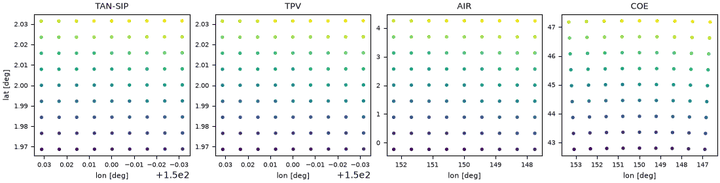

A tour of torchsky WCS: TAN, TAN-SIP, TPV and extended projections.

Script: [`examples/wcs_tour.py`](https://github.com/astroai/torchsky/blob/main/examples/wcs_tour.py) · [site copy](../published-examples/wcs_tour.py)

### Frames, proper motion and observed alt/az

Celestial frames, proper motion, and observed alt/az in torchsky.coords. *Runtime: about 2 s on CPU.*

Script: [`examples/frames_and_motion.py`](https://github.com/astroai/torchsky/blob/main/examples/frames_and_motion.py) · [site copy](../published-examples/frames_and_motion.py)

```text
source      l [deg]   b [deg]   ecl.lon  ecl.lat
Sgr A*    359.9443   -0.0462  267.1751  -5.6107
Crab      184.5575   -5.7844   84.4209  -1.2914
LMC       280.4652  -32.8884  312.8596 -85.3536
Galactic round trip: 8.2e-07 mas; ICRS->FK5(J2000) shift: 28.6 mas
Barnard's star moves 351.9 arcsec in Dec over 34 yr; rigorous vs linear proper motion differ by 741.9 mas
Sgr A*   az= 119.77 alt= -68.82
Crab     az= 279.86 alt=  67.69
LMC      az= 188.90 alt=  -1.54
device=cpu
```

## Sphere, HEALPix and spherical harmonics

Pixelization, regions and MOCs, power spectra, and inverse problems on the sphere.

### HEALPix queries, sparse maps and MOC algebra

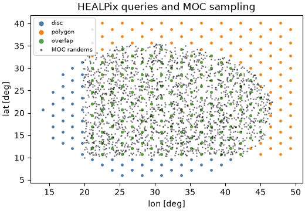

HEALPix pixelization, region queries, sparse maps and MOC set algebra. *Runtime: about 3 s on CPU.*

Script: [`examples/healpix_and_moc.py`](https://github.com/astroai/torchsky/blob/main/examples/healpix_and_moc.py) · [site copy](../published-examples/healpix_and_moc.py)

```text
nside=64 npix=49152: max pixel-centre offset 0.934 deg (resolution 0.916 deg)
disc: 210 px, polygon: 241 px, overlap: 155 px
catalogue 7000 rows -> 1363/3072 occupied pixels (sparse == dense); degraded sum preserved: 7000
MOC areas [deg^2] cone=747.8 box=819.4 union=1016.6 intersection=550.6 difference=197.2; 2000 randoms drawn inside the intersection
```

### Spherical harmonic transforms and C_ell recovery

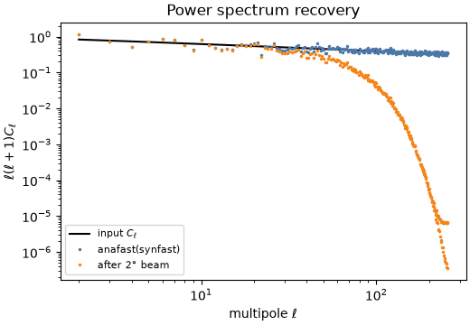

Spherical harmonic transforms: synthesis, power spectrum recovery, smoothing. *Runtime: about 3 s on CPU (NSIDE=128).*

Script: [`examples/sht_power_spectrum.py`](https://github.com/astroai/torchsky/blob/main/examples/sht_power_spectrum.py) · [site copy](../published-examples/sht_power_spectrum.py)

```text
NSIDE=128 lmax=256: mean C_l(out)/C_l(in) over l=20..200 = 1.001 (cosmic-variance sigma 0.008)
map std 6.796e-01 -> 5.980e-01 after 2 deg beam; smoothed/(C_l b_l^2) = 1.001
```

### All-sky harmonic fit from flat cutouts

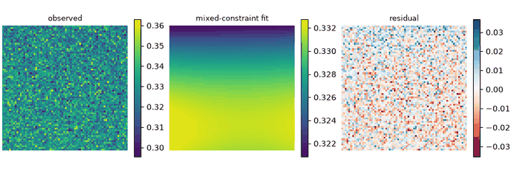

Fit an all-sky harmonic model to flat cutouts with priors and constraints. *Runtime: about 3 s.*

Script: [`examples/sphere_image_inverse.py`](https://github.com/astroai/torchsky/blob/main/examples/sphere_image_inverse.py) · [site copy](../published-examples/sphere_image_inverse.py)

### Joint T/E/B inverse from temperature and Q/U cutouts

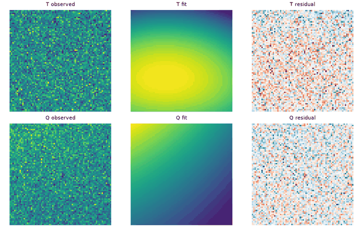

Joint temperature and polarization (T/E/B) inverse from flat cutouts. *Runtime: about 3 s.*

Script: [`examples/polarization_teb.py`](https://github.com/astroai/torchsky/blob/main/examples/polarization_teb.py) · [site copy](../published-examples/polarization_teb.py)

## Catalogs at survey scale

Indexed, chunked catalogue operations that stay near-linear in N.

### Crossmatch of two million-source catalogues

Crossmatch two large synthetic catalogues (1e6 x 1e6 by default). *Runtime: about 3 s on CPU (about 0.5 s per mode for the match itself).*

Script: [`examples/crossmatch_million.py`](https://github.com/astroai/torchsky/blob/main/examples/crossmatch_million.py) · [site copy](../published-examples/crossmatch_million.py)

## Mapmaking: coadds, drizzle and cubes

Resample many exposures onto one grid, a HEALPix map, or a spectral cube.

### Coadd dithered SIP exposures: Lanczos3 and drizzle

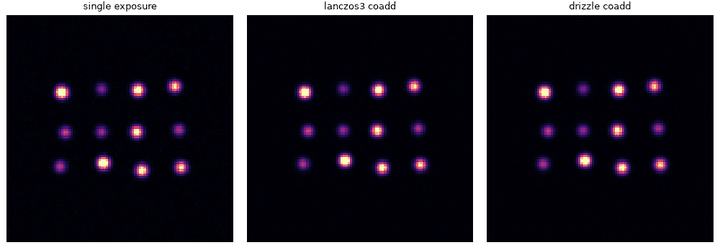

Coadd dithered, rotated TAN-SIP exposures with Lanczos3 and drizzle. *Runtime: about 3 s on CPU.*

Script: [`examples/coadd_dithered_sip.py`](https://github.com/astroai/torchsky/blob/main/examples/coadd_dithered_sip.py) · [site copy](../published-examples/coadd_dithered_sip.py)

```text
lanczos3 : shape (99, 99), 12 stars: median |dF/F| = 0.001, max centroid error = 0.025 pix
drizzle  : shape (99, 99), 12 stars: median |dF/F| = 0.002, max centroid error = 0.036 pix
background rms: single exposure 0.0201 -> coadd 0.0068 (expect ~0.0071 before correlated-noise inflation)
```

### Exact square drizzle with flux conservation

Exact square drizzle of two sub-pixel-shifted detector images. *Runtime: under 1 s on CPU.*

Script: [`examples/drizzle_flagship.py`](https://github.com/astroai/torchsky/blob/main/examples/drizzle_flagship.py) · [site copy](../published-examples/drizzle_flagship.py)

### Multiband tiles coadded directly onto HEALPix

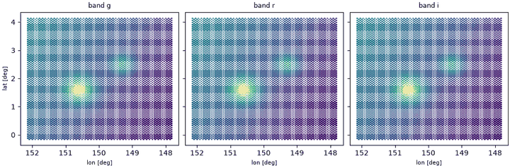

Coadd overlapping multiband tiles directly onto a HEALPix grid. *Runtime: about 3 s on CPU.*

Script: [`examples/coadd_to_healpix.py`](https://github.com/astroai/torchsky/blob/main/examples/coadd_to_healpix.py) · [site copy](../published-examples/coadd_to_healpix.py)

### IFU frames to a spectral cube

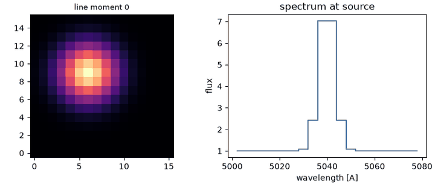

Build a spectral cube from IFU-like detector frames with ``coadd_cube``. *Runtime: about 2 s on CPU.*

Script: [`examples/spectral_cube.py`](https://github.com/astroai/torchsky/blob/main/examples/spectral_cube.py) · [site copy](../published-examples/spectral_cube.py)

```text
cube shape (20, 16, 16) (wave, y, x); spectral range 5002-5078 A
line peak at 5038 A (truth 5040); continuum 1.000 (truth 1.0); moment-0 centroid (6.01, 8.99) (truth 6.0, 9.0)
```

### Real survey cutouts, opt-in

Coadd overlapping pieces of a real CFHT MegaPipe cutout onto one TAN grid. *Runtime: a few seconds.*

Script: [`examples/real_data_cutout.py`](https://github.com/astroai/torchsky/blob/main/examples/real_data_cutout.py) · [site copy](../published-examples/real_data_cutout.py)

## Spectra, photometry and cosmology

From a rest-frame SED to observed magnitudes.

### Redshift, dust and synthetic photometry

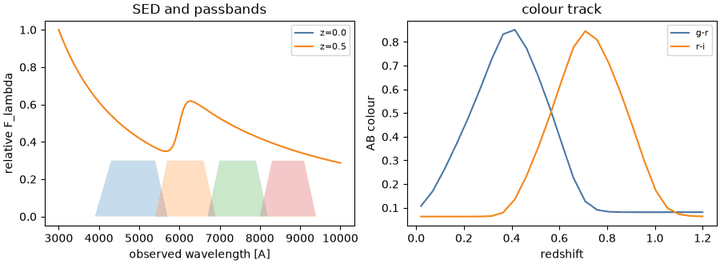

Redshift, dust extinction, and synthetic photometry of a galaxy SED. *Runtime: about 2 s on CPU.*

Script: [`examples/sed_photometry.py`](https://github.com/astroai/torchsky/blob/main/examples/sed_photometry.py) · [site copy](../published-examples/sed_photometry.py)

```text
z      D_L [Mpc]  D_A [Mpc]  DM [mag]
 0.1      475.8      393.2    38.387
 0.5     2919.7     1297.7    42.327
 1.0     6791.7     1697.9    44.160
 2.0    15926.6     1769.6    46.011
flat-f_nu m(z=0.5) = [20.887, 20.887, 20.887, 20.887] vs closed form 20.886: max err 0.0001 mag
band dust dimming [mag]: {'g': 0.36, 'r': 0.275, 'i': 0.211, 'z': 0.159}  CCM89 A_lambda at pivot: [0.367, 0.274, 0.212, 0.158]
g-r: 0.11 at z=0.02, peaks at 0.85 (z=0.41) as the 4000 A break crosses g and r
```

## Continuous fields and observation operators (experimental)

Field-like models and native forward models; these APIs are still evolving.

### Multiband neural field

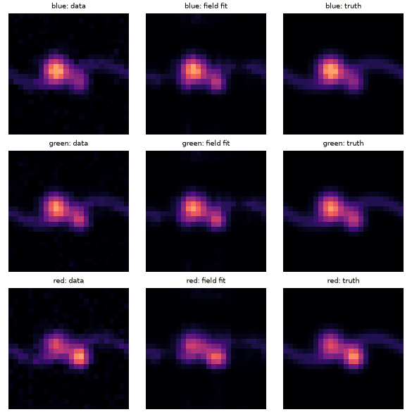

Fit a continuous multiband neural field to three noisy images. *Runtime: about 5 s on CPU.*

Script: [`examples/neural_field_multiband.py`](https://github.com/astroai/torchsky/blob/main/examples/neural_field_multiband.py) · [site copy](../published-examples/neural_field_multiband.py)

### Shared versus survey-private components

Separate a shared sky from survey-private components with a field model. *Runtime: about 5 s.*

Script: [`examples/survey_split.py`](https://github.com/astroai/torchsky/blob/main/examples/survey_split.py) · [site copy](../published-examples/survey_split.py)

### Native detector, response and likelihood operators

Native observation operators: detector moments, field response, pixel likelihood.

Script: [`examples/native_operators.py`](https://github.com/astroai/torchsky/blob/main/examples/native_operators.py) · [site copy](../published-examples/native_operators.py)

## Visualization

Presentation-quality figures from tensors.

### All-sky figures for talks and papers

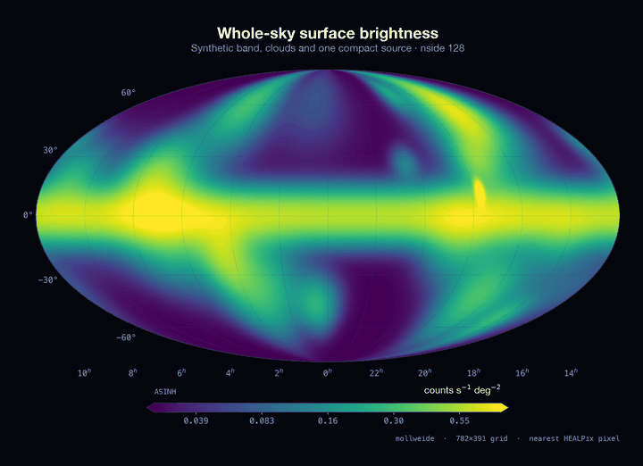

Render slide-ready all-sky figures with ``torchsky.viz``. *Runtime: about 15 s.*

Script: [`examples/allsky_figures.py`](https://github.com/astroai/torchsky/blob/main/examples/allsky_figures.py) · [site copy](../published-examples/allsky_figures.py)

## Applications and evaluation

- [`examples/applications/catalogue_photoz.py`](https://github.com/astroai/torchsky/blob/main/examples/applications/catalogue_photoz.py): a CLI photometric-redshift pilot that needs an external catalogue and checkpoint; it is not part of the smoke gate. See [Encoders and ML](../models/encoders.md).
- [Synthetic field fit](https://github.com/astroai/torchsky-harness/blob/main/notebooks/01_field_fit_synthetic.ipynb)
- [Multiband hyperspectral reconstruction](https://github.com/astroai/torchsky-harness/blob/main/notebooks/02_multiband_hyperspectral_synthetic.ipynb)
- [SMACS0723 real-data mini-cutout](https://github.com/astroai/torchsky-harness/blob/main/notebooks/03_smacs0723_real_minicutout.ipynb)
- [SMACS campaign scripts](https://github.com/astroai/torchsky-harness/tree/main/scripts)

Harness notebooks run from the harness checkout against a separately installed
torchsky build; see its methodology page for subject selection and environment pinning.
