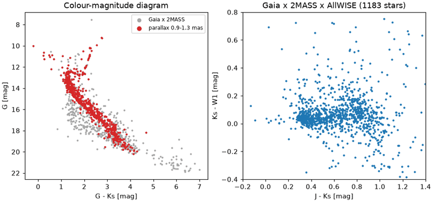
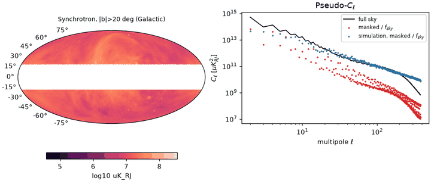
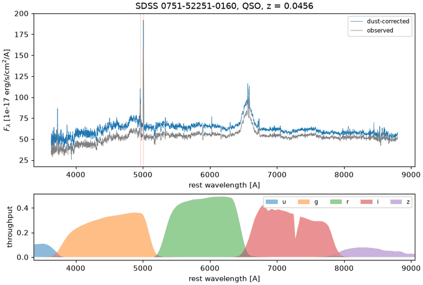
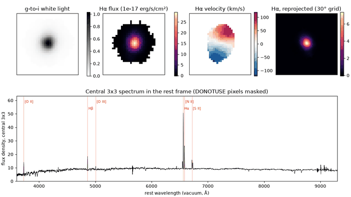
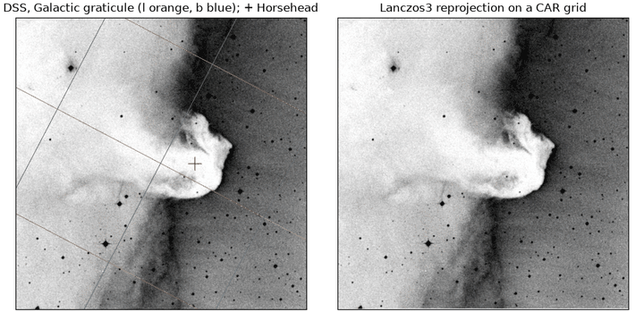
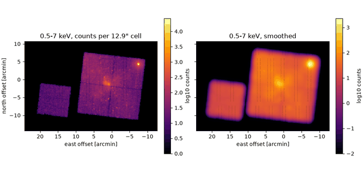
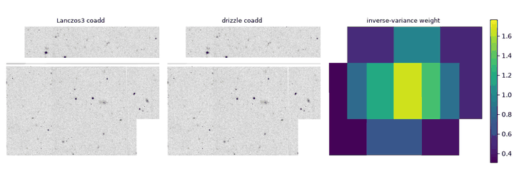
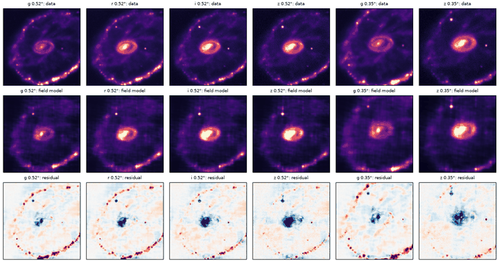
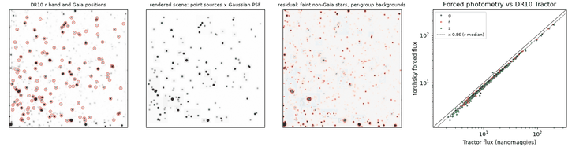

!!! danger "These docs have not yet been verified by a human"
    The guides, examples and reference text for this first release were
    drafted with AI assistance. Automated tests run every code snippet and
    example, but no person has yet reviewed the prose, the numbers or the
    recommendations. Treat them as a draft, check results that matter, and
    [report anything wrong](https://github.com/astroai/torchsky/issues).

**torchsky** does astronomy's sky-domain computations as PyTorch tensor code:
coordinates and WCS, HEALPix and spherical geometry, catalog crossmatches,
image coadds and HEALPix maps, spectra and synthetic photometry, and
differentiable sky models. Inputs are tensors and header dicts, outputs are
tensors on the same device (CPU, CUDA, or Apple MPS), and the autograd graph
stays intact. The kernels batch, index, and stream, so the call that handles a
hundred rows also handles a survey.

[`torchfits`](https://github.com/astroai/torchfits) reads and writes the FITS
files; torchsky starts from the tensors it returns.

---

## Real Data

Each example fetches a small public sample once, runs in seconds on a CPU, and
prints quantitative checks of its result. Select a figure to open the example.

-   

    **[Gaia × 2MASS × AllWISE](examples/index.md#gaia-dr3-x-2mass-x-allwise-in-the-field-of-m67)**
    Best, one-to-one, error-radius, and group matches of three catalogs in M67.

-   

    **[Planck power spectrum](examples/index.md#apodised-mask-power-spectrum-of-the-commander-synchrotron-map)**
    An apodised Galactic mask and the angular power spectrum of a HEALPix map.

-   

    **[SDSS spectrum photometry](examples/index.md#a-quasar-spectrum-rest-frame-dust-and-ugriz-magnitudes)**
    Rest frame, dust correction, and ugriz magnitudes that match the SDSS pipeline.

-   

    **[MaNGA IFU cube](examples/index.md#a-manga-ifu-cube-h-map-rotation-and-reprojection)**
    Hα flux and velocity maps, and a flux-conserving reprojection of the cube.

-   

    **[Horsehead WCS tour](examples/index.md#horsehead-nebula-wcs-footprint-and-reprojection)**
    A photographic plate: pixel to sky, footprint, MOC, and reprojection.

-   

    **[Chandra events on the sphere](examples/index.md#sgr-a-events-as-a-sparse-healpix-map-and-moc)**
    X-ray events near Sgr A* as a sparse HEALPix counts map and a MOC of the chips.

-   

    **[CFHT MegaPipe mosaic](examples/index.md#four-megapipe-cutouts-coadded-with-lanczos3-and-drizzle)**
    Four cutouts on four TAN projections, registered and coadded.

-   

    **[Cartwheel field fit](examples/index.md#one-continuous-field-fitted-to-griz-images-of-the-cartwheel)**
    One continuous sky model fitted to g, r, i, and z images at once.

-   

    **[Gaia forced photometry](examples/index.md#forced-photometry-of-143-gaia-stars-near-ngc-288)**
    Fluxes of 143 Gaia stars in NGC 288, compared with the Legacy Surveys catalog.

---

## Areas

-   :material-compass-outline:{ .lg .middle } **Coordinates and WCS**

    ---

    Pixels to sky and back with FITS WCS, SIP and TPV distortions, celestial
    frames, proper motion, and observed place.

    [:octicons-arrow-right-24: Coordinates](coordinates/index.md)

-   :material-globe-model:{ .lg .middle } **Celestial sphere**

    ---

    HEALPix indexing and queries, exact spherical regions, MOC coverage,
    sparse maps, and spherical harmonic transforms.

    [:octicons-arrow-right-24: Celestial sphere](sphere/index.md)

-   :material-table-search:{ .lg .middle } **Catalogs**

    ---

    Catalogs as tensors with frame and epoch; cone and footprint selection;
    exact crossmatches from a few rows to billions.

    [:octicons-arrow-right-24: Catalogs](catalogs/index.md)

-   :material-image-filter-center-focus:{ .lg .middle } **Images and maps**

    ---

    Plan a target grid, resample with declared kernels or drizzle, and coadd
    images, spectral cubes, and HEALPix maps.

    [:octicons-arrow-right-24: Images and maps](maps/index.md)

-   :material-chart-bell-curve:{ .lg .middle } **Spectra and photometry**

    ---

    Spectral axes, redshift and Doppler shifts, dust laws, passbands,
    synthetic magnitudes, and cosmological distances.

    [:octicons-arrow-right-24: Spectra and photometry](spectra/index.md)

-   :material-math-integral:{ .lg .middle } **Models** (experimental)

    ---

    Forward models of the sky through each exposure's WCS, PSF, and bandpass,
    fitted by gradient descent with exact adjoints.

    [:octicons-arrow-right-24: Models](models/index.md)

---

## Start Here

-   **New users**

    ---

    [What torchsky is](introduction/index.md) · [Install](introduction/install.md) ·
    [Quick start](introduction/quickstart.md) · [Concepts](introduction/concepts.md)

-   **Examples and evidence**

    ---

    [Examples](examples/index.md) · [Performance](performance/highlights.md) ·
    [Parity](performance/parity.md)

-   **Reference**

    ---

    [API reference](reference/index.md) · [CLI](introduction/cli.md) ·
    [Coming from Astropy and healpy](introduction/coming-from.md)

-   **Project**

    ---

    [Changelog](project/changelog.md) · [Roadmap](project/roadmap.md) ·
    [Contributing](project/contributing.md)

---

torchsky 0.5.0rc1 is a GitHub pre-release and is not on PyPI until 0.5.0;
[Install](introduction/install.md) covers wheels and source builds.

