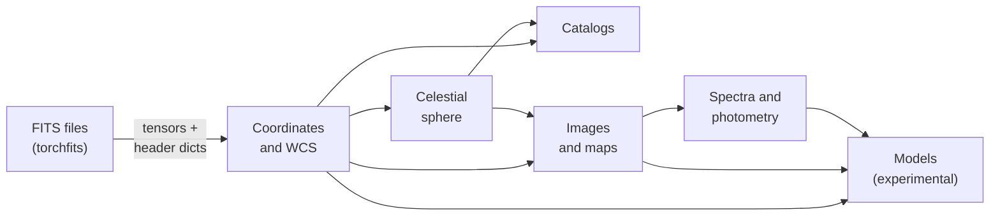

# What torchsky is

torchsky does sky geometry, maps, catalogs, and spectra as PyTorch tensor
operations. A pixel grid, a list of sky positions, a HEALPix map, or a batch of
spectra is a tensor. torchsky transforms it on the device it already lives on
(CPU, CUDA, or Apple MPS) and keeps the autograd graph intact. The same call
handles a hundred rows or a survey-sized table.

## The Problem It Solves

Astronomy software is mostly written for one object at a time, on the CPU, in
float64 NumPy arrays, with no gradients. Those tools are trusted and well
tested, but they break a modern pipeline in three places:

- **Scale.** Coadding thousands of exposures or crossmatching catalogs with
  billions of rows needs batched kernels, spatial indexing, and bounded memory.
- **Devices.** A model that trains on a GPU should not copy its tensors back to
  NumPy each time it needs a sky position.
- **Gradients.** Fitting a sky model, an astrometric solution, or a photometric
  redshift through the instrument response needs derivatives of every step,
  including the WCS (world coordinate system: the mapping from pixels to sky
  positions) and the resampling kernel.

torchsky gives you the sky-domain operations you already use, written as torch
code: batched, device-resident, and differentiable wherever the maths is
smooth.

## What Is in the Box

**[Coordinates and WCS](../coordinates/index.md).** FITS-WCS from a plain
header dict: celestial projections, SIP and TPV polynomial distortions,
spectral and time axes, Jacobians, and affine alignment. Frame conversion
(ICRS, Galactic, ecliptic, FK5, …), proper-motion propagation, and observed
alt/az place are in the same area.

**[Celestial sphere](../sphere/index.md).** HEALPix pixelization (an
equal-area division of the sphere into \(12\,N_\mathrm{side}^2\) pixels),
region queries, spherical polygons, multi-order coverage maps (MOC), sparse
maps, and spherical harmonic transforms (SHT) with power spectra.

**[Catalogs](../catalogs/index.md).** Batched sky tables with frames and
epochs, a HEALPix row index, cone and footprint selection, and exact
great-circle crossmatch in the matching modes STILTS users know.

**[Images and maps](../maps/index.md).** Plan a target grid, resample
exposures onto it with interpolation or drizzle kernels, and coadd them with
explicit weights, masks, and outlier rejection. The same area builds spectral
cubes from filter images or IFU (integral field unit) frames, and HEALPix maps
from images.

**[Spectra and photometry](../spectra/index.md).** Spectral axes and
flux-conserving rebinning, redshift and Doppler kinematics, synthetic
photometry through passbands, dust extinction laws, and differentiable FLRW
cosmology distances.

**[Models](../models/index.md) (experimental).** Forward models of the sky
observed through an instrument: scenes, observation operators with exact
adjoints, continuous field models, and native pixel likelihoods.

Command-line coadds and sky estimation are in the [CLI guide](cli.md),
and plotting helpers in [Visualization](viz.md).

## How It Fits the Ecosystem

**torchfits reads and writes the files.** FITS images and tables are decoded by
[torchfits](https://github.com/astroai/torchfits), which installs with
torchsky. torchsky receives tensors and header dictionaries and never opens a
FITS file in its compute paths. [Concepts](concepts.md#file-boundary)
describes the boundary.

**Astropy, healpy, reproject, and STILTS are the references.** torchsky
reproduces the results of the libraries you already trust, at the level of the
behaviour you rely on: Astropy WCS transforms and frame conversions, healpy
indexing and harmonic transforms, STScI drizzle, and STILTS crossmatch modes.
Resampling and coadds are compared with reproject and SWarp. None of these
packages is imported at runtime. The parity is
measured in the sibling
[torchsky-harness](https://github.com/astroai/torchsky-harness) repository and
summarized on the [parity page](../performance/parity.md). If you are porting
code, the [call mapping](coming-from.md) lists the equivalents.

## Who It Is For

- **Survey and pipeline developers** who coadd, crossmatch, or pixelize at a
  scale where batching and GPUs matter.
- **Machine-learning practitioners** who want sky coordinates, HEALPix
  sampling, and photometry inside a training loop, on the GPU, with gradients.
- **Modellers** who fit a sky, an instrument, or an astrometric solution by
  gradient descent through the observation process.
- **Astronomers** who already know Astropy or healpy and want the same answers
  on tensors.

torchsky assumes you are comfortable with PyTorch tensors and with basic FITS
conventions. It does not provide a units system, a `SkyCoord` object graph, or
plotting axes; inputs carry their units by documented convention.

## Where to Start

1. [Install](install.md) torchsky. torchfits comes with it.
2. Take the [Quickstart](quickstart.md): a short tour of WCS, HEALPix,
   crossmatch, and a coadd.
3. Read [Concepts](concepts.md) once. Devices, dtypes, gradients, and the
   shared conventions apply to every area.
4. Pick the area that matches your task from the list above, or browse the
   [examples](../examples/index.md).

Signatures and per-function contracts are in the
[API reference](../reference/index.md).
