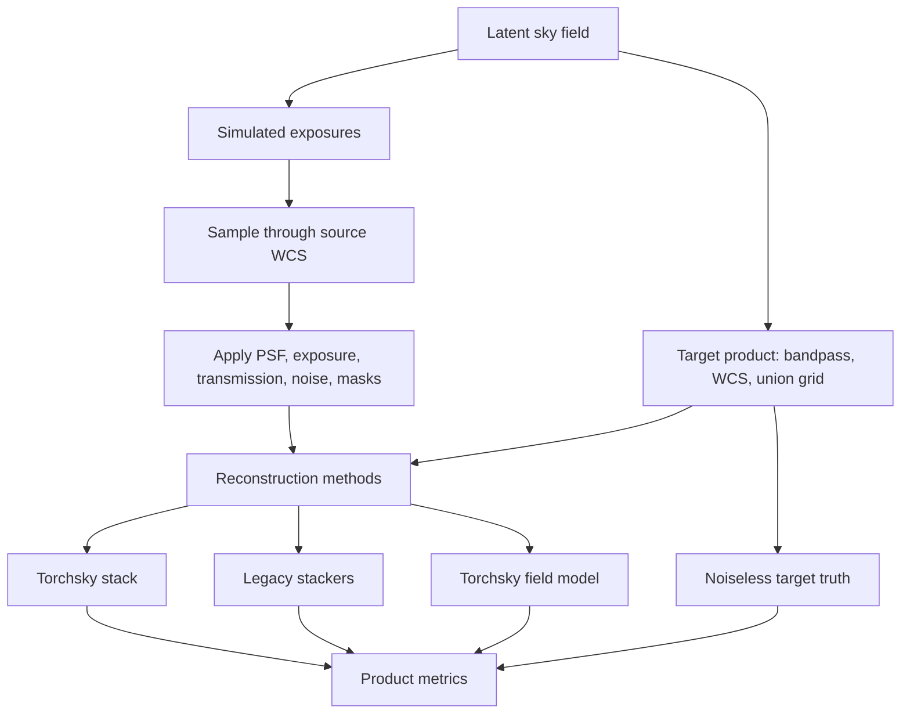

# `torchsky.map`

`torchsky.map` is the promoted mapmaking facade: image-plane coadds, spectral
cube coadds, multiband coadds, and declared map-product specs/results.
Implementation modules such as `torchsky.map.field`, `torchsky.map.product`,
and `torchsky.map.image_plane` remain available for advanced workflows, but the
flat `torchsky.map` namespace is intentionally lean.

## What This Namespace Is For

Use `torchsky.map` when the unit of work is a requested sky product rather than
a single FITS HDU. The core contract is explicit: observations are projected
onto a target product with declared WCS, bandpass, value semantics, masks, and
weights. External tools such as SWarp, Montage, drizzle, and `reproject` are
comparators and parity baselines, not runtime dependencies of the core map path.

Stable promoted surfaces include `coadd_image_plane(...)`,
`coadd_image_plane_cube(...)`, `coadd_image_plane_multiband(...)`,
`stack_map_product(...)`, `MapProductSpec`, and the map result/spec objects.
Field/INR modelling is exposed through the shorter `torchsky.field` namespace;
the implementation still lives under `torchsky.map.field`.

## Core Concepts

- **Observation:** `ImageObservation` describes one calibrated input image plus
  optional weight map, mask map, photometric scale, background offset, spectral
  metadata, and band label.
- **Product:** `MapProductSpec` describes the final requested grid and bands.
  This is the common contract for direct stacks and rendered continuous fields.
- **Value semantics:** `surface_brightness` and `flux` products use different
  area-scaling rules. Pick the semantics before comparing against legacy stacks.
- **Resampling kernel:** kernels are explicit (`bilinear`, `lanczos3`,
  `drizzle_point`, `conservative_polygon`, etc.) and have different support,
  interpolation, and flux behavior.
- **Truth evaluation:** methods are compared after producing the same final
  target-grid product, not by inspecting internal warps.

## Recipes

### Coadd Images Onto A Shared Grid

```python
from torchsky import scene
from torchsky.map import coadd_image_plane

result = coadd_image_plane(
    [
        scene.image_observation("img_a.fits", weight=1.0),
        scene.image_observation("img_b.fits", weight_path="img_b_wht.fits"),
    ],
    resampling_kernel="bilinear",
    value_semantics="surface_brightness",
    footprint_order=8,
)
```

### Plan A Product Once, Stack Many Times

```python
from torchsky import scene
from torchsky.map import MapBandpassSpec, MapProductSpec, stack_map_product

observations = [scene.image_observation("g_1.fits"), scene.image_observation("g_2.fits")]
product = MapProductSpec(
    target_header=target_header,
    bands=(MapBandpassSpec(label="g"),),
    value_semantics="surface_brightness",
)
stacked = stack_map_product(observations, product, resampling_kernel="bilinear")
```

### Assemble A Spectral Cube

```python
import torch
from torchsky.map import coadd_image_plane_cube
from torchsky.spectral import SpectralAxis

wavelengths = torch.tensor([4800.0, 6500.0], dtype=torch.float64)
edges = torch.tensor([4700.0, 4900.0, 6600.0], dtype=torch.float64)

cube = coadd_image_plane_cube(
    observations,
    spectral_axis=SpectralAxis(values=wavelengths, unit="Angstrom", type="WAVE"),
    spectral_bin_edges=edges,
)
```

### Compare A Stack To Truth

```python
from torchsky.map.product import evaluate_map_product

metrics = evaluate_map_product(
    prediction=stacked.data,
    truth=truth_image,
    header=stacked.header,
    value_semantics="surface_brightness",
)
print(metrics["reconstruction_rmse"])
```

## API Surface

Promoted flat `torchsky.map` names:

- `coadd_image_plane(...)`
- `coadd_image_plane_cube(...)`
- `coadd_image_plane_multiband(...)`
- `stack_map_product(...)`
- `MapProductSpec(...)`
- `TargetRenderSpec(...)`
- `MapBandpassSpec(...)`
- `MapProductResult`
- `MapResult`
- `MultiBandMapResult`
- `SpectralCubeMapResult`

Advanced planning, evaluation, and implementation helpers live in explicit
submodules such as `torchsky.map.image_plane`, `torchsky.map.product`,
`torchsky.map.operators`, and `torchsky.map.field`.

Experimental continuous-field layer (tutorial: [field.md](field.md), losses/context:
[implicit_forward.md](implicit_forward.md)):

- `torchsky.field.Observation`, `torchsky.field.Domain`, `torchsky.field.fit(...)`
- `ObservationOperatorBundle` as the shared observation-law substrate across
  image-plane and field paths.
- `torchsky.field.render(...)`, `torchsky.field.sample(...)`
- SIREN/WIRE, Fourier, spectral-basis, sky-encoder, hash-grid, and
  operator-constrained field models.
- `ConstrainedKernelPSF`, `AffineRadiometry`, `SubPixelShift`, and
  `LearnedInstrumentOperator` for constrained learned instrument effects.

## Resampling And Value Semantics

| Kernel family | Typical external analogue | Notes |
|---|---|---|
| `nearest`, `bilinear` | Nearest and linear regridding | Main compatibility baseline. |
| `bicubic`, `catmull_rom`, `mitchell_netravali` | Cubic families | Polynomial definitions differ across tools. |
| `lanczos3`, `lanczos5` | Lanczos mosaickers | Wider support, higher cost. |
| `fft_shift`, `fft_diagonal_affine`, `fft_linear_affine`, `periodic_linear_affine` | Restricted FFT/affine remappers | Same-shape linear-frame tools with explicit boundary semantics. |
| `drizzle_point`, `drizzle_square` | Drizzle drop kernels | Native torchsky implementations. |
| `conservative_polygon` | Conservative overlap | Native overlap remapper. |
| `splat_point`, `splat_box` | Forward deposition | Approximate differentiable splats. |
| `splat_bilinear` (`splat_to_native`) | Adjoint of bilinear `grid_sample` | Flux-conserving deposit onto a native grid. |

Mismatch with SWarp/Montage-style products usually traces to value semantics,
pixel-area treatment, mask policy, or weight maps rather than FITS I/O.

## Truth Evaluation Flow



Metrics include RMSE, MAE, p95/max error, flux error, SNR, coverage, and
zero-support diagnostics.

## Examples

- [HEALPix inverse solve](../examples/example_map_healpix_inverse.py)
- [Harmonic inverse solve](../examples/example_map_harmonic_inverse.py)
- [Shared-vs-survey-private harmonic decomposition](../examples/example_map_harmonic_survey_split.py)
- [Field survey split](../examples/example_map_field_survey_split.py)
- [Spin harmonic inverse solve](../examples/example_map_spin_harmonic_inverse.py)

See [examples.md](examples.md#map) for the full map example index.

## Compatibility And Validation

Key tests:

- `tests/test_map_image_plane.py`
- `tests/test_map_product.py`
- `tests/test_map_ground_truth.py`
- `tests/test_map_multifield_truth.py`
- `tests/test_map_compat_bench.py`

Key benchmarks:

- `benchmarks/bench_map_image_plane.py`
- `benchmarks/bench_map_ground_truth.py`
- `benchmarks/bench_map_multifield_truth.py`
- `benchmarks/bench_map_field_fit.py`
- `benchmarks/bench_map_compat.py`
- `benchmarks/bench_map_smacs0723_*`

See [benchmarks.md](benchmarks.md) for command lines, comparator environments,
SMACS/UPdec real-data runs, and baseline policy.
