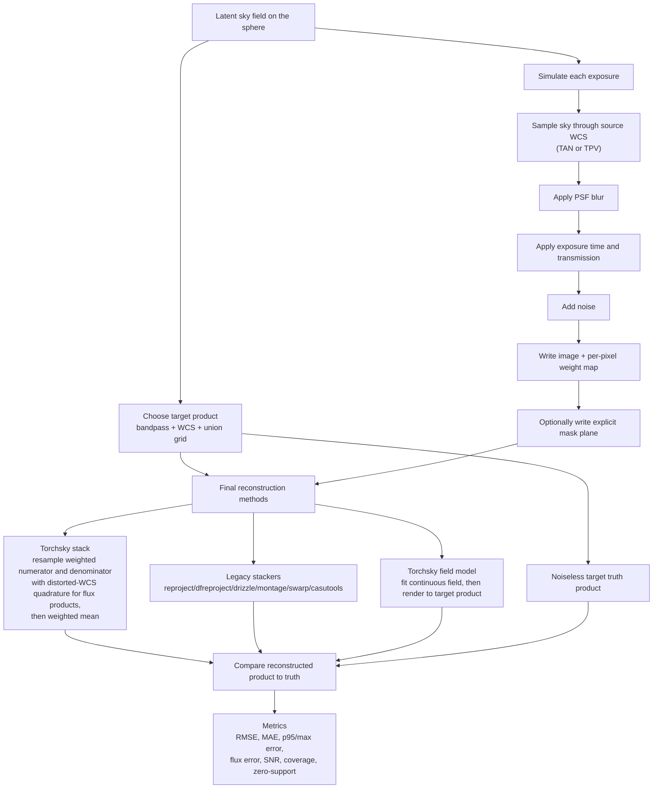

# Map Truth Pipeline

The evaluation contract is always the final requested product, not an internal warp.
Each method is judged after producing the same target-grid image or cube.
For the current distorted `SIP`/`TPV` stack path, torchsky approximates target-pixel area integration with fixed 2x2 Gauss-Legendre subpixel quadrature for `flux` products. The default `surface_brightness` product path uses a single target-center sample instead of pixel-area integration.
