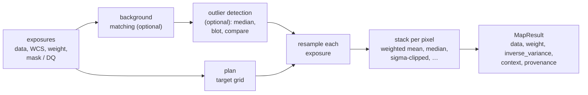
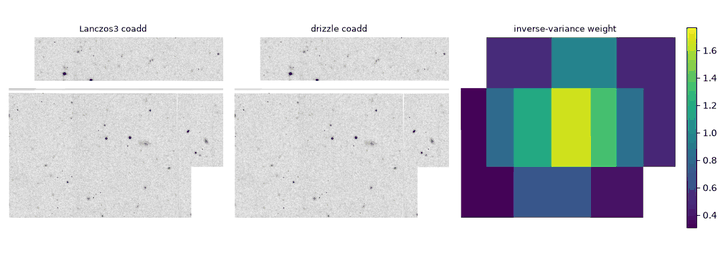

# Coadds

A **coadd** (also a stack or mosaic) combines several exposures of overlapping
sky into one image on a shared grid. It is deeper than any single exposure,
fills gaps between detectors, and removes defects that appear in only some
exposures. [`coadd`](../reference/map.md#torchsky.map.coadd) does it in three
steps: [`plan`](../reference/map.md#torchsky.map.plan) a target grid,
[resample](resampling.md) each exposure onto it, and **stack** the resampled
pixels with per-pixel weights.

Use it for mosaics of calibrated, astrometrically registered exposures. The
inputs must already share a photometric scale (or carry `photometric_scale`)
and accurate WCS; `coadd` does not solve astrometry or photometric zero points.
For maps on the whole sphere use [HEALPix mapmaking](healpix-mapmaking.md); for
a spectral third axis, [cubes](cubes.md).

## How It Works



For the default weighted mean, the value of target pixel \(j\) from exposures
\(k\) with resampled data \(d_{kj}\) and weights \(w_{kj}\) is

\[
I_j = \frac{\sum_k w_{kj}\, d_{kj}}{\sum_k w_{kj}}, \qquad
\sigma_j^2 = \frac{1}{\sum_k w_{kj}} \quad \text{(only for inverse-variance weights)}.
\]

Masked and flagged pixels get zero weight before resampling, so they never
enter the sum. A target pixel no exposure reaches has `weight == 0`.

**What the resampled weight means.** An interpolation kernel (bilinear, bicubic,
Lanczos, Catmull-Rom, Mitchell-Netravali) resamples exposure \(k\) with
coefficients \(c_{ij}\) over source pixels \(i\) with weights \(w_i\):

\[
d_{kj} = \frac{\sum_i c_{ij} w_i x_i}{\sum_i c_{ij} w_i}, \qquad
w_{kj} = \frac{\sum_i c_{ij} w_i}{\sum_{i \in \text{image}} c_{ij}}.
\]

The weight is the kernel-weighted mean of the input weights. Near an image edge
the kernel taps that fall off the image are dropped and the remaining
coefficients are renormalised, so a constant inverse-variance map stays
constant up to the last covered pixel, whatever the sign of the dropped
taps. The coadd value is linear in the input pixels,
\(I_j = \sum_i a_{ij} x_i\), and `inverse_variance` is its exact diagonal
inverse variance \(1 / \sum_i a_{ij}^2 / w_i\) over all exposures. It exceeds
`weight` in the interior because interpolation averages neighbouring pixels
(see [Uncertainty](#uncertainty)). SWarp and `reproject` also resample the
weight map with the data kernel, so interior weights equal the input inverse
variance in all three. Drizzle and conservative kernels instead give the covered
fraction of the input weight at footprint edges.

**Weights are relative by default.** A weight only sets each exposure's share of
the mean. Declare `weight_is_inverse_variance=True` when the weight map is
\(1/\sigma^2\) in data units; only then does the result carry
`inverse_variance` and an uncertainty product.

**Validation.** A coadd of 280 CFHT MegaCam CCDs onto an official UNIONS tile
reproduces its aperture photometry within 2.1 mmag and centroids within 1 mas,
and NIRCam coadds agree with SWarp and STScI drizzle; see
[performance highlights](../performance/highlights.md).

## Four MegaPipe Tiles in One Mosaic

The [MegaPipe example](../published-examples/megapipe_mosaic.py) fetches four
512 × 512 g-band cutouts from three CFHT MegaPipe tiles, each with its own TAN
projection, and coadds them with inverse-variance weights from each cutout's
measured pixel noise.

```python
# megapipe_mosaic_[abcd].fits: examples/megapipe_mosaic.py downloads them from CADC.
import torch
import torchfits

from torchsky.map import Observation, coadd, plan

def noise(image):
    """Per-pixel noise from adjacent-pixel differences (robust MAD)."""
    d = (image[:, 1:] - image[:, :-1]).flatten()
    return float(1.4826 * (d - d.median()).abs().median() / 2**0.5)

exposures = []
for name in ("megapipe_mosaic_a", "megapipe_mosaic_b", "megapipe_mosaic_c", "megapipe_mosaic_d"):
    image = torchfits.read(f"{name}.fits", 0).to(torch.float32)
    header = dict(torchfits.read_header(f"{name}.fits", 0))
    exposures.append(Observation(
        data=image, wcs=header,
        weight_map=torch.full_like(image, noise(image) ** -2),
        weight_is_inverse_variance=True,
    ))

target = plan(exposures, projection="TAN")    # one 712 x 868 grid covering all four
mosaic = coadd(exposures, target, kernel="lanczos3", method="weighted_mean")
```



Where tiles overlap, they agree to a median offset below 0.002 counts, and the
Lanczos-3 and drizzle mosaics correlate at 0.998 pixel by pixel.

## A Weighted Coadd

<!-- docs: run -->
```python
import torch

from torchsky.map import Observation, ResampleConfig, StackConfig, coadd, plan

header = {
    "NAXIS": 2, "NAXIS1": 64, "NAXIS2": 64,
    "CTYPE1": "RA---TAN", "CTYPE2": "DEC--TAN",
    "CRPIX1": 32.5, "CRPIX2": 32.5, "CRVAL1": 150.0, "CRVAL2": 2.0,
    "CDELT1": -1e-3, "CDELT2": 1e-3,
}
gen = torch.Generator().manual_seed(1)
observations = [
    Observation(
        data=torch.randn(64, 64, generator=gen) + 10.0,
        wcs={**header, "CRVAL1": 150.0 + shift},
        weight_map=torch.full((64, 64), 4.0),
        weight_is_inverse_variance=True,
    )
    for shift in (0.0, 0.01, 0.02)
]

target = plan(observations, projection="TAN")
result = coadd(
    observations,
    target,
    resample=ResampleConfig(kernel="bilinear", semantics="surface_brightness"),
    stack=StackConfig(method="weighted_mean"),
)
covered = result.weight > 0
assert abs(float(result.data[covered].mean()) - 10.0) < 0.5
assert result.inverse_variance is not None
```

With files on disk, pass paths instead of tensors, for example
`Observation("img_a.fits", weight_path="img_a_wht.fits")`; torchfits reads
them. The `torchsky map` [command line](../introduction/cli.md) runs the same
workflow.

## Recipes

### Masks and data-quality flags

`mask=` is a Boolean map with `True` for usable pixels. `dq=` is an integer
**data-quality** (DQ) bit map, as delivered by HST and JWST pipelines; pixels
with any bit set outside `good_bits` get zero weight.
[`DQPolicy`](../reference/map.md#torchsky.map.DQPolicy) states
bit-level rules explicitly, and
[`build_weight_product`](../reference/quality.md#torchsky.quality.build_weight_product)
records weight and mask polarity when you build the planes yourself.

### Match backgrounds

Exposures taken at different times have different sky levels. `SkyConfig`
removes them before stacking:

| `SkyConfig(mode=...)` | Removes |
|---|---|
| `"overlap_constant"` (`"constant"`, `"match"`) | one offset per exposure, solved jointly from the overlaps |
| `"overlap_planar"`, `"overlap_mesh"` | a plane or a smooth mesh per exposure, from the overlaps |
| `"global"` | the common sky level of every exposure (absolute sky subtraction) |
| `"global+match"` | both: a global level, then relative offsets |
| `"per_exposure"`, `"local"` | a mesh background estimated in each exposure alone |

Overlap matching only equalizes exposures; the mosaic keeps one undetermined
overall level. The fitted offsets appear in
`result.provenance["observation_operators"]`.

### Reject outliers

Cosmic rays, satellite trails, and other transients appear in one exposure only.
With `outliers=OutlierConfig()`, torchsky follows the AstroDrizzle and JWST
procedure: build a median coadd, [blot](resampling.md#map-a-mosaic-back-onto-an-exposure)
it back onto each exposure, and mask pixels that differ from it by more than
`snr` times the noise (plus `scale` times the local gradient), grown by `grow`
pixels. Declared inverse variance or variance planes give the noise model.

<!-- docs: run -->
```python
import torch

from torchsky.map import Observation, OutlierConfig, coadd, plan

header = {
    "NAXIS": 2, "NAXIS1": 64, "NAXIS2": 64,
    "CTYPE1": "RA---TAN", "CTYPE2": "DEC--TAN",
    "CRPIX1": 32.5, "CRPIX2": 32.5, "CRVAL1": 150.0, "CRVAL2": 2.0,
    "CDELT1": -1e-4, "CDELT2": 1e-4,
}
g = torch.Generator().manual_seed(0)
exposures = []
for i in range(4):
    data = 10.0 + 0.1 * torch.randn(64, 64, generator=g)
    if i == 1:
        data[30, 30] += 500.0                        # a cosmic-ray hit
    exposures.append(Observation(
        data=data, wcs={**header, "CRVAL1": 150.0 + 4e-4 * i},
        weight_map=torch.full((64, 64), 100.0), weight_is_inverse_variance=True,
    ))
target = plan(exposures)

plain = coadd(exposures, target, kernel="lanczos3")
clean = coadd(exposures, target, kernel="lanczos3", outliers=OutlierConfig())
assert float(plain.data.max()) > 100.0
assert float(clean.data[clean.weight > 0].max()) < 11.0
```

### Choose a stacking method

| `method` | Result | Inverse variance |
|---|---|---|
| `"weighted_mean"` (default) | weighted mean | yes |
| `"sigma_clipped"` | weighted mean after iterative clipping (`clip_sigma`, `clip_iterations`) | yes |
| `"mean"`, `"median"` | unweighted mean or median of contributing exposures | no |
| `"min"`, `"max"`, `"sum"` | per-pixel extreme or sum | no |
| `"chi2"` | sum of squared signal-to-noise, for detection images | no |

Median and clipped stacks need every exposure's value per pixel at once; they
use on-disk scratch storage (`scratch_dir=`) that grows linearly with the number
of exposures.

### Drizzle dithered exposures

For undersampled, dithered data, plan a finer grid and drizzle:
`plan(exposures, pixel_scale_arcsec=...)`, then
`coadd(..., kernel="drizzle_square", pixfrac=0.8)`. Inspect `result.weight`: a
strongly varying weight map means too few dithers for that `pixfrac`.

### Uncertainty

With inverse-variance weights, `result.inverse_variance` is the diagonal
per-pixel inverse variance. Resampling correlates neighbouring pixels, so an
aperture sum is noisier than the diagonal suggests.
[`aperture_uncertainty`](../reference/map.md#torchsky.map.aperture_uncertainty)
evaluates the exact detector-noise variance of a weighted aperture with the
adjoint of the same projection, without building a covariance matrix.

<!-- docs: run -->
```python
import torch

from torchsky.map import Observation, ResampleConfig, aperture_uncertainty, coadd, plan

header = {
    "NAXIS": 2, "NAXIS1": 64, "NAXIS2": 64,
    "CTYPE1": "RA---TAN", "CTYPE2": "DEC--TAN",
    "CRPIX1": 32.5, "CRPIX2": 32.5, "CRVAL1": 150.0, "CRVAL2": 2.0,
    "CDELT1": -1e-3, "CDELT2": 1e-3,
}
observations = [
    Observation(data=torch.ones(64, 64), wcs={**header, "CRVAL1": 150.0 + shift},
                weight_map=torch.full((64, 64), 4.0), weight_is_inverse_variance=True)
    for shift in (0.0, 0.01, 0.02)
]
target = plan(observations, projection="TAN")
resample = ResampleConfig(kernel="drizzle_square", pixfrac=0.8)
result = coadd(observations, target, resample=resample)

aperture = torch.zeros_like(result.data)
aperture[20:30, 20:30] = 1.0
noise = aperture_uncertainty(observations, result, aperture, resample=resample)
assert float(noise.variance) > 0.0
```

It fails closed for median or clipped stacks, data-dependent background fits,
and Fourier kernels, whose noise is not a linear function of the inputs.

### Tile large targets

`coadd` splits the target into tiles when the working set would exceed a memory
budget (30% of free device memory on CUDA, of available host memory on CPU),
processes only the tiles each exposure reaches, and accumulates one exposure at
a time. Set `tile_size=` explicitly, or change the budget with
`TORCHSKY_TILE_MEMORY_BUDGET_BYTES` (or `tile_memory_budget_bytes=` on
[`coadd_image_plane`](../reference/map.md#torchsky.map.coadd_image_plane), the
engine behind `coadd`). A 10k × 10k UNIONS tile from 280 CCDs runs
in a single 12 GB GPU slice. See [scaling and tuning](../performance/scaling.md).

### Record and reuse a product definition

`result.provenance` records the kernel, semantics, stacking method, per-exposure
calibration (weights, scales, fitted background offsets), and the input
identities; `result.context` holds per-pixel bit masks of the contributing
exposures. [`ProductSpec`](../reference/map.md#torchsky.map.ProductSpec)
declares grid, bands, and semantics once, so that
[`stack_product`](../reference/map.md#torchsky.map.stack_product) calls on
different inputs give comparable products.

## Pitfalls

- **Relative versus inverse-variance weights.** Without
  `weight_is_inverse_variance=True` there is no uncertainty product, even if the
  numbers happen to be inverse variances.
- **Photometric scale.** Exposures with different zero points need
  `photometric_scale`; a coadd of mismatched units is a weighted mean of
  incompatible numbers.
- **Semantics.** Compare with other stacks only at the same
  [value semantics](resampling.md#surface-brightness-or-flux).

## See Also

- [Resampling](resampling.md): kernels, drizzle, semantics.
- [HEALPix mapmaking](healpix-mapmaking.md) and [Cubes and IFU](cubes.md).
- Reference: [`torchsky.map`](../reference/map.md),
  [`StackConfig`](../reference/map.md#torchsky.map.StackConfig),
  [`SkyConfig`](../reference/map.md#torchsky.map.SkyConfig),
  [`OutlierConfig`](../reference/map.md#torchsky.map.OutlierConfig).
- Examples: [MegaPipe mosaic](../published-examples/megapipe_mosaic.py),
  [dithered SIP coadd](../published-examples/coadd_dithered_sip.py).
