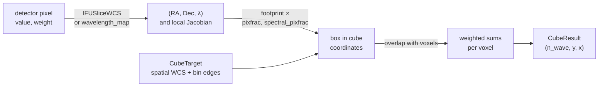
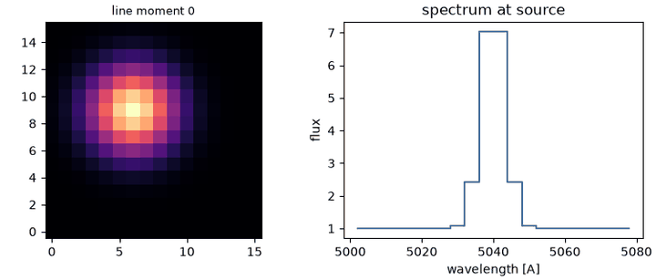

# Cubes and IFU

A **spectral cube** is a sky image with a third, spectral axis: an array of
shape `(n_wave, y, x)` whose elements, **voxels**, hold the brightness at one
position and one wavelength bin. An **integral field unit** (IFU) is a
spectrograph that records a spectrum for every element of a two-dimensional
field, with an image slicer, a fibre bundle, or a lenslet array. On the
detector, each IFU pixel has its own sky position and wavelength, so building a
cube is a three-dimensional resampling problem.
[`coadd_cube`](../reference/map.md#torchsky.map.coadd_cube) solves it for two
kinds of input:

- **Filter images**, 2D exposures through different bands, each with one
  representative wavelength. The cube then has one plane per band group.
- **IFU frames**, 2D detector images with a sky position and a wavelength per
  pixel (an `IFUSliceWCS` or a `wavelength_map`).

Use it to combine dithered IFU exposures into one cube, or to assemble
narrow-band images into a cube for spectral fitting. To analyse a cube that a
pipeline already delivered, such as a MaNGA or MUSE data cube, read it with
torchfits and use the [spectral tools](../spectra/spectral-axes.md) directly.

## How It Works



With the `drizzle` spectral kernel, every detector pixel is mapped to cube
coordinates \((x, y, z)\). Its footprint is the box spanned by the local
Jacobian of that detector-to-cube mapping, shrunk by `pixfrac` spatially and
`spectral_pixfrac` along wavelength. Each voxel \(v\) then receives the
overlap-weighted mean

\[
C_v = \frac{\sum_p a_{pv}\, w_p\, d_p}{\sum_p a_{pv}\, w_p},
\]

with \(a_{pv}\) the overlap volume of pixel \(p\) with voxel \(v\), the 3D form of
[drizzle](resampling.md#how-it-works). The Shepard kernels `emsm` (exponential)
and `msm` (inverse power) weight by distance to the voxel centre instead, as the
JWST `cube_build` step does; `nearest` assigns each pixel to one voxel; `linear`
interpolates between filter-image wavelengths.

**Assumptions.** The detector-to-sky and detector-to-wavelength mappings are
known per pixel and smooth on the scale of one pixel; the spectral axis is
strictly increasing. **Validation.** Package tests check flux and line recovery
on synthetic scenes, variance propagation, and adjoints; reference comparisons
are tracked in [parity](../performance/parity.md).

## A Cube From Sixteen IFU Exposures

The [IFU example](../published-examples/spectral_cube.py) scans a synthetic
galaxy with an emission line at 5040 Å in sixteen exposures of sixteen slices,
then drizzles them onto a 16 × 16 × 20 cube. The line peak, the continuum, and
the moment-0 centroid are recovered within one bin and 0.01 pixel.



## Which Path Am I On?

| Input | Path | Notes |
|---|---|---|
| Filter images, one `wavelength` (or `wavelength_map`) each | image-plane cube path | `spectral_kernel="linear"` by default |
| IFU frames with `ifu_wcs` or a per-pixel `wavelength_map` | 3D IFU path | spectral kernel `drizzle`, `emsm`, `msm`, or `nearest` |
| Physical IFU products, [`IFUObservation`](../reference/map.md#torchsky.map.IFUObservation) | [`build_ifu_cube`](../reference/map.md#torchsky.map.build_ifu_cube) | detector footprints, slice ids, variance components, covariance |
| 2D images with band labels, no spectral axis | [`coadd_multiband`](../reference/map.md#torchsky.map.coadd_multiband) | one labelled plane per band, not a physical cube |

Mixing `Observation` and `IFUObservation` in one call raises: a cube has one
detector model.

## Recipes

### Build a cube from filter images

<!-- docs: run -->
```python
import torch

from torchsky.map import Observation, ResampleConfig, coadd_cube, plan_cube

header = {
    "NAXIS": 2, "NAXIS1": 16, "NAXIS2": 16,
    "CTYPE1": "RA---TAN", "CTYPE2": "DEC--TAN",
    "CRPIX1": 8.5, "CRPIX2": 8.5, "CRVAL1": 150.0, "CRVAL2": 2.0,
    "CDELT1": -0.001, "CDELT2": 0.001,
}
bands = [5000.0, 6000.0, 7000.0]                 # Angstrom
observations = [
    Observation(
        data=torch.full((16, 16), 1.0 + 0.5 * i), wcs=header, wavelength=wavelength,
        weight=1.0, weight_is_inverse_variance=True,
    )
    for i, wavelength in enumerate(bands)
]

target = plan_cube(observations, spectral_axis=bands)
cube = coadd_cube(observations, target, resample=ResampleConfig(semantics="surface_brightness"))

assert tuple(cube.data.shape) == (3, 16, 16)
assert [round(float(v), 2) for v in cube.data[:, 8, 8]] == [1.0, 1.5, 2.0]
```

[`plan_cube`](../reference/map.md#torchsky.map.plan_cube) derives a spatial
grid that covers the observations and records the spectral axis and bin edges.

### Build a cube from IFU frames

An `IFUSliceWCS` gives the RA, Dec, wavelength, and slice number of every
detector pixel. With an explicit
[`CubeTarget`](../reference/map.md#torchsky.map.CubeTarget) (spatial WCS plus
spectral bin edges) the output grid is fixed in advance:

<!-- docs: run -->
```python
import torch

from torchsky.map import CubeTarget, Observation, ResampleConfig, coadd_cube
from torchsky.wcs import WCS, IFUSliceWCS

header = {
    "NAXIS": 2, "NAXIS1": 16, "NAXIS2": 16,
    "CTYPE1": "RA---TAN", "CTYPE2": "DEC--TAN",
    "CRPIX1": 8.5, "CRPIX2": 8.5, "CRVAL1": 150.0, "CRVAL2": 2.0,
    "CDELT1": -0.001, "CDELT2": 0.001,
}
n_wave, n_slice = 12, 16
rows = torch.arange(n_wave, dtype=torch.float64)
cols = torch.arange(n_slice, dtype=torch.float64)

def per_pixel(values_along_axis, axis):
    return values_along_axis.unsqueeze(axis).expand(n_wave, n_slice).clone()

ifu_wcs = IFUSliceWCS(
    ra_map=per_pixel(150.0 + (cols - 7.5) * 0.001, 0),
    dec_map=torch.full((n_wave, n_slice), 2.0, dtype=torch.float64),
    wavelength_map=per_pixel(5000.0 + 2.0 * rows, 1),
    slice_id_map=per_pixel(cols.to(torch.int64), 0),
)
frame = Observation(
    data=torch.ones(n_wave, n_slice), ifu_wcs=ifu_wcs,
    weight=torch.ones(n_wave, n_slice), weight_is_inverse_variance=True,
)

target = CubeTarget(spatial_wcs=WCS(header), spectral_bin_edges=[4980.0, 5000.0, 5020.0, 5040.0])
cube = coadd_cube([frame], target, resample=ResampleConfig(spectral_kernel="drizzle", spectral_pixfrac=0.8))
assert cube.data.shape == (3, 16, 16)
```

`cube.data` is `(n_wave, y, x)`, `cube.weight` the matching weights,
`cube.spectral_axis` the target axis, and `cube.header` the spatial header.
`cube.to_data_cube()` returns a
[`DataCube`](../reference/spectral.md#torchsky.spectral.DataCube) for spectral
analysis.

### Use a physical IFU product

For instrument products, construct
[`IFUObservation`](../reference/map.md#torchsky.map.IFUObservation) with the
science image, a `detector_to_world` transform, a DQ plane, slice ids, optional
detector pixel footprints, and named `variance_components` (for example
Poisson and read noise). [`build_ifu_cube`](../reference/map.md#torchsky.map.build_ifu_cube)
returns the science cube, a DQ cube, a usability mask, the explicit voxel
covariance, and the response plan that produced them.

### Choose a spectral kernel

| `spectral_kernel` | Use for |
|---|---|
| `linear` | filter images: interpolates between band wavelengths |
| `drizzle` | IFU frames: overlap of each pixel's footprint with voxels |
| `emsm`, `msm` | Shepard weighting as in JWST `cube_build` (`emsm_scale` sets the width) |
| `nearest` | exact assignment of each pixel to one spectral bin |

Kernel, `spectral_pixfrac`, and value semantics (`surface_brightness` or `flux`)
are recorded in `cube.provenance`.

### Irregular spectral axes

Target axes are used as given, including non-uniform ones; non-increasing axes
are rejected. The spectral kernels work in bin-index space, so on a strongly
irregular axis they bias values near bin edges by about
\((\Delta\lambda_{\rm right} - \Delta\lambda_{\rm left})\,\partial F/\partial\lambda\).
The bias is small for regular or logarithmic axes; use `nearest` when exact
bin assignment matters more than smoothness.

### Uncertainty and covariance

`cube.inverse_variance` is the diagonal voxel inverse variance, present only
when every input weight is declared inverse variance. One detector pixel spread
over several voxels makes neighbouring voxels correlated, and that covariance is
not stored. `cube.correlation_factor` reports the local ratio to correct
aperture errors; `build_ifu_cube` returns the explicit covariance when you need
exact voxel correlations.

### Bound memory

Observations are processed one at a time, so peak memory is the cube plus one
resampled frame. `response_chunk_size`, `max_response_entries`, and
`footprint_max_depth` in [`ResampleConfig`](../reference/map.md#torchsky.map.ResampleConfig)
bound the IFU response tables; lower them on small devices, raise them when
many slices overlap one voxel.

## Pitfalls

- **Wavelength units.** Bin edges and wavelength maps must share a unit
  (Ångström by default); edges in another unit place every pixel in the wrong bin or outside the cube.
- **Voxel size against sampling.** A spectral bin narrower than the detector
  sampling leaves empty planes; a spatial pixel smaller than the slice width
  needs several dithers, as in 2D drizzle.
- **MPS.** The 3D drizzle and spectral resamplers need float64; use CPU or CUDA.

## See Also

- [Resampling](resampling.md) and [Coadds](coadds.md) for the 2D methods.
- [Spectral axes](../spectra/spectral-axes.md) for `SpectralAxis`, rebinning,
  and writing cubes with torchfits.
- [HEALPix mapmaking](healpix-mapmaking.md) for spherical products.
- Reference: [`coadd_cube`](../reference/map.md#torchsky.map.coadd_cube),
  [`CubeResult`](../reference/map.md#torchsky.map.CubeResult).
- Example: [IFU frames to a spectral cube](../published-examples/spectral_cube.py).
