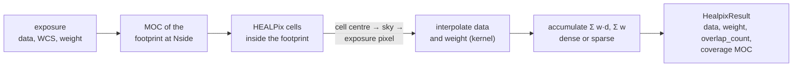
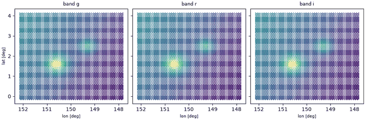

# HEALPix mapmaking

An image-plane coadd describes the sky on one flat grid, tied to a projection
and a tangent point. A **HEALPix map** describes it on the whole sphere: the
[HEALPix](../sphere/healpix.md) pixelization divides the sky into
\(12\,N_{\rm side}^2\) equal-area cells, so a map built from any number of
pointings has one pixel layout, no projection distortion, and no edges between
tiles. [`coadd_healpix`](../reference/map.md#torchsky.map.coadd_healpix)
projects calibrated images directly onto such a map, and
[`resample_healpix`](../reference/map.md#torchsky.map.resample_healpix) takes a
map back onto any image WCS.

Use it for products that span many fields or the whole sky, for maps that must
be combined with other HEALPix data (Planck, WMAP, survey depth and mask maps),
and as input to [spherical harmonic](../sphere/sht.md) analysis. For a single
field that you will measure with image tools, a [coadd](coadds.md) on a TAN grid
is simpler.

## How It Works



For each exposure, torchsky lists the HEALPix cells inside its footprint,
maps each cell centre into the exposure's pixel coordinates, interpolates data
and weight there with the chosen kernel, and accumulates. The map value of cell
\(p\) is the weighted mean over exposures \(k\),

\[
M_p = \frac{\sum_k w_k(\mathbf x_{kp})\, d_k(\mathbf x_{kp})}{\sum_k w_k(\mathbf x_{kp})},
\]

with \(\mathbf x_{kp}\) the position of the centre of cell \(p\) in exposure \(k\).
Cells are processed in chunks, so memory is the map plus one chunk. Optional
`sky=` and `outliers=` configurations work as in [coadds](coadds.md).

**Assumptions.** Each cell is sampled at its centre, so the map resolution
should match or exceed the image resolution (see *Choose Nside* below). The map
is in ICRS: exposures with Galactic, ecliptic, FK4, or FK5 WCS are converted.
An FK5 (J2000) header gets the roughly 20 mas FK5 to ICRS frame bias and emits
`CelestialFrameBiasWarning`, as in the image-plane path; set `RADESYS = 'ICRS'`
if the astrometry was solved against Gaia. An exposure whose footprint overlaps
cells but contains none of their centres (cells larger than the image) raises
`ValueError`; use a higher `nside`. **Validation.** HEALPix indexing matches healpy exactly
([parity](../performance/parity.md)), and the
[multiband example](../published-examples/coadd_to_healpix.py) checks the map
against an analytic sky at every cell centre.

## Four MegaPipe Cutouts on HEALPix

The four CFHT MegaPipe cutouts of the [mosaic example](coadds.md#four-megapipe-tiles-in-one-mosaic)
(0.186 arcsec pixels) go straight onto a sparse map with 0.40 arcsec cells,
without an intermediate flat mosaic:

```python
# megapipe_mosaic_[abcd].fits: examples/megapipe_mosaic.py downloads them from CADC.
import torch
import torchfits

from torchsky.map import Observation, coadd_healpix, resample_healpix

exposures = []
for name in ("megapipe_mosaic_a", "megapipe_mosaic_b", "megapipe_mosaic_c", "megapipe_mosaic_d"):
    image = torchfits.read(f"{name}.fits", 0).to(torch.float32)
    header = dict(torchfits.read_header(f"{name}.fits", 0))
    exposures.append(Observation(data=image, wcs=header))

sky = coadd_healpix(exposures, nside=2**19, nest=True, sparse=True, kernel="lanczos3")
print(sky.coverage_moc.area_sq_deg * 3600)            # about 5.5 arcmin^2 covered

cutout = resample_healpix(sky, exposures[0].wcs)     # back onto the first cutout's grid
```

The map takes about 6 s on a laptop CPU. Projected back onto the first cutout,
it differs from the original by a median of 0.003 counts.

## Dense or Sparse?

| Situation | Choice | Why |
|---|---|---|
| Small fraction of the sky at high resolution | `sparse=True` | only covered cells are stored |
| All-sky or broad survey field | `sparse=False` | a dense tensor of length \(12 N_{\rm side}^2\) indexes directly |
| Downstream harmonic analysis | dense | `map2alm` takes a full map |

In sparse mode `sky.data` and `sky.weight` are
[`SparseHealpixMap`](../reference/sphere.md#torchsky.sphere.SparseHealpixMap)
objects; `nside_coverage` sets the resolution of their coverage index (not the
map resolution). `nside = 4096` is already 201 million cells, so use sparse
maps unless you need the full sphere.

## Recipes

### Coadd images onto a dense map

<!-- docs: run -->
```python
import torch

from torchsky.map import Observation, coadd_healpix

header = {
    "NAXIS": 2, "NAXIS1": 64, "NAXIS2": 64,
    "CTYPE1": "RA---TAN", "CTYPE2": "DEC--TAN",
    "CRPIX1": 32.5, "CRPIX2": 32.5, "CRVAL1": 150.0, "CRVAL2": 2.0,
    "CDELT1": -0.02, "CDELT2": 0.02,
}
observations = [
    Observation(data=torch.full((64, 64), value), wcs=header,
                weight=1.0, weight_is_inverse_variance=True)
    for value in (1.0, 2.0)
]
# 1.3 deg image, 0.23 deg cells (Nside 256).
result = coadd_healpix(observations, nside=256, nest=False, kernel="bilinear")

covered = result.weight > 0
assert result.data.numel() == 12 * 256**2 and int(covered.sum()) > 20
assert abs(float(result.data[covered].mean()) - 1.5) < 1e-5
print("covered cells:", int(covered.sum()), "MOC cells:", int(result.coverage_moc.uniq.numel()))
```

`nest=False` (the default) gives RING ordering; pass `nest=True` when the
consumer expects NESTED. Kernels are `nearest`, `bilinear`, `bicubic`, and
`lanczos2` to `lanczos4`. The result carries `data`, `weight`, `nside`, `nest`,
`overlap_count` (exposures per cell), and the coverage MOC.

### Choose Nside

The cell size is about \(58.6°/N_{\rm side}\)
([`nside2resol`](../reference/sphere.md#torchsky.sphere.nside2resol)). Because
cells are sampled at their centres, pick \(N_{\rm side}\) so that cells are no
larger than about twice the image pixels; coarser cells skip image pixels
instead of averaging them. For a coarse map from fine images, build it at the
fine resolution and average down with `SparseHealpixMap.ud_grade(nside_out,
reduction="mean")`.

### Make one map per band

Call `coadd_healpix` once per band with the same `nside` and ordering; cells
then align across bands by construction, and a colour is a ratio of two tensors.
The [multiband example](../published-examples/coadd_to_healpix.py) builds three
bands from twelve overlapping tiles at \(N_{\rm side} = 1024\).



### Project a map onto an image

<!-- docs: run -->
```python
import torch

from torchsky.map import Observation, coadd_healpix, resample_healpix

header = {
    "NAXIS": 2, "NAXIS1": 64, "NAXIS2": 64,
    "CTYPE1": "RA---TAN", "CTYPE2": "DEC--TAN",
    "CRPIX1": 32.5, "CRPIX2": 32.5, "CRVAL1": 150.0, "CRVAL2": 2.0,
    "CDELT1": -0.02, "CDELT2": 0.02,
}
result = coadd_healpix([Observation(data=torch.ones(64, 64), wcs=header)], nside=256)

image = resample_healpix(result, header, method="bilinear")
covered = image.weight > 0
assert tuple(image.data.shape) == (64, 64) and int(covered.sum()) > 1000
assert torch.allclose(image.data[covered], torch.tensor(1.0))
```

`resample_healpix` takes a dense tensor (with `nside=`), a sparse map, or a
`HealpixResult`, and a header, [`WCS`](../reference/wcs.md#torchsky.wcs.WCS), or
[`Target`](../reference/map.md#torchsky.map.Target). It returns a
[`MapResult`](../reference/map.md#torchsky.map.MapResult) with the same
data and weight contract as an image coadd. `method="harmonic"` interpolates
through spherical harmonics; use it only when the map is band-limited and well
sampled.

### Bound memory on large maps

`reduction_chunk_size` (default 262,144) bounds how many sampled values are
held before each reduction; lower it when many images overlap the same
high-resolution cells. Dense accumulation writes each chunk into the output, and
sparse accumulation grows with the covered sky, not with \(12 N_{\rm side}^2\).

### Weights and uncertainty

Weights follow the [coadd rules](coadds.md#how-it-works): relative by default,
inverse variance only with `weight_is_inverse_variance=True`. Exposures enter
in their own value semantics; for HEALPix products, surface brightness is the
natural choice because every cell has the same area. Cross-cell covariance is
not computed.

## Pitfalls

- **Ordering.** RING and NESTED maps hold the same values in different orders.
  Pass the ordering along with the map; most bugs show as a scrambled sky.
- **Frame.** The map is ICRS. To compare with a Galactic HEALPix product, rotate
  one of them; see [SHT](../sphere/sht.md) for harmonic-space rotation.
- **Undersampling.** Cells much larger than image pixels sample rather than
  average the image; see *Choose Nside*.
- **Zero means empty.** Uncovered cells have `weight == 0` and value 0; use the
  weight or the coverage MOC, not the value, to find them.

## See Also

- [HEALPix](../sphere/healpix.md), [MOC](../sphere/moc.md), and
  [sparse maps](../sphere/sparse-maps.md) for the pixelization and its data
  structures.
- [Coadds](coadds.md) for flat-grid mosaics; [SHT](../sphere/sht.md) for power
  spectra of the result.
- Reference: [`coadd_healpix`](../reference/map.md#torchsky.map.coadd_healpix),
  [`HealpixResult`](../reference/map.md#torchsky.map.HealpixResult).
- Example: [multiband tiles onto HEALPix](../published-examples/coadd_to_healpix.py).
