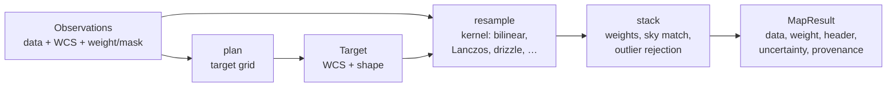

# Images and maps: overview

This area turns many calibrated exposures into one sky product: an image on a
chosen grid, a spectral cube, or a HEALPix map. `torchsky.map` plans the
target grid, resamples each exposure onto it, and stacks the results with
explicit weights, masks, and outlier rejection. Use it when the unit of work is
a requested product rather than a single image.

## The Core Idea: Plan, Resample, Stack



- An **observation** ([`Observation`](../reference/map.md#torchsky.map.Observation))
  is one calibrated exposure: pixel data, a WCS header, and optionally a weight
  or variance map, a data-quality (DQ) mask, a photometric scale, a background
  offset, or a wavelength.
- A **target** is the output grid: WCS, shape, and bands.
  [`plan`](../reference/map.md#torchsky.map.plan) builds one that covers the
  inputs.
- **Resampling** moves pixel values from one grid to another with a declared
  kernel. Interpolating kernels (bilinear, bicubic, Lanczos) sample the input
  at each output pixel. Drizzle instead drops each input pixel, shrunk by
  `pixfrac`, onto the output grid and shares its flux by overlap area; it
  preserves flux and handles undersampled, dithered data.
- **Stacking** combines the resampled exposures with their weights, optional
  sky matching, and sigma-clipping or median rejection.

## Choose a Page

| Task | Page | Entry point |
|---|---|---|
| Put one image on another grid; choose a kernel; drizzle | [Resampling](resampling.md) | [`resample`](../reference/map.md#torchsky.map.resample), [`ResampleConfig`](../reference/map.md#torchsky.map.ResampleConfig) |
| Coadd exposures, propagate uncertainty, bound memory | [Coadds](coadds.md) | [`coadd`](../reference/map.md#torchsky.map.coadd), [`plan`](../reference/map.md#torchsky.map.plan) |
| Build a cube from filter images or IFU frames | [Cubes and IFU](cubes.md) | [`coadd_cube`](../reference/map.md#torchsky.map.coadd_cube) |
| Coadd images onto HEALPix, or project HEALPix onto an image | [HEALPix mapmaking](healpix-mapmaking.md) | [`coadd_healpix`](../reference/map.md#torchsky.map.coadd_healpix), [`resample_healpix`](../reference/map.md#torchsky.map.resample_healpix) |
| Run the same workflows from the shell | [CLI](../introduction/cli.md) | `torchsky map` |

## A Weighted Coadd

Two exposures, offset on the sky, with inverse-variance weights 1 and 3. Where
they overlap, the coadd is the weighted mean.

<!-- docs: run -->
```python
import torch

from torchsky.map import Observation, coadd, plan

header = {
    "NAXIS": 2, "NAXIS1": 48, "NAXIS2": 48,
    "CTYPE1": "RA---TAN", "CTYPE2": "DEC--TAN",
    "CRPIX1": 24.5, "CRPIX2": 24.5, "CRVAL1": 150.0, "CRVAL2": 2.0,
    "CDELT1": -1e-4, "CDELT2": 1e-4,
}
exposures = [
    Observation(
        data=torch.full((48, 48), level),
        wcs={**header, "CRVAL1": 150.0 + offset},
        weight_map=torch.full((48, 48), ivar),
        weight_is_inverse_variance=True,
    )
    for level, offset, ivar in ((3.0, 0.0, 1.0), (5.0, 0.0012, 3.0))
]
target = plan(exposures, projection="TAN")
result = coadd(exposures, target, kernel="lanczos3")

assert result.data.shape == target.shape
overlap = result.weight > 3.5
torch.testing.assert_close(result.data[overlap].mean(), torch.tensor(4.5), atol=1e-3, rtol=0.0)
```

## Conventions and Pitfalls

- **Value semantics.** A product is either surface brightness (the default:
  values per unit area, unchanged by resampling to a finer grid) or flux (values
  per pixel, scaled by pixel area). Choose before comparing with another stack;
  differences with SWarp or Montage usually trace to value semantics, pixel-area
  treatment, mask policy, or weights.
- **Weights.** `weight` always controls the coadd denominator. It is treated as
  inverse variance, and an uncertainty product is attached, only with
  `weight_is_inverse_variance=True`.
  [`build_weight_product`](../reference/quality.md#torchsky.quality.build_weight_product)
  attaches inverse-variance, confidence, and mask-polarity semantics when you
  build masks yourself.
- **Kernels are configuration.** `ResampleConfig(kernel=...)` sets support,
  interpolation, and flux behaviour; nothing switches kernels behind your back.
  See the [kernel table](resampling.md#kernels).
- **Memory.** Large mosaics are tiled and chunked by configuration
  (`tile_size`, `response_chunk_size`); the [scaling guide](../performance/scaling.md)
  lists the knobs.

## Device Placement

Map APIs compute and return on the device of their tensor inputs; CPU tensors
stay on CPU even when CUDA is available. An explicit `device=` always wins, and
tensors on different devices without it raise `ValueError`. When observations
are file paths, `torchsky.device.default_compute_device()` applies. Float64-only
kernels (exact drizzle, conservative polygon and splat projection, spectral
resamplers) raise `NotImplementedError` on MPS. The general rules are in
[Concepts](../introduction/concepts.md#device-follows-the-input).

## Connections

Every observation and target carries a [WCS](../coordinates/index.md).
[HEALPix mapmaking](healpix-mapmaking.md) writes to the
[celestial sphere](../sphere/index.md), and cubes connect to
[spectral axes](../spectra/spectral-axes.md). The observation operators that
resample and convolve here are the same ones the experimental
[models](../models/index.md) differentiate through.

Resampling and coadds are compared with SWarp, Montage, STScI drizzle, and
reproject in [torchsky-harness](https://github.com/astroai/torchsky-harness);
see [performance highlights](../performance/highlights.md) and the
[parity page](../performance/parity.md). Examples:
[dithered SIP coadd](../published-examples/coadd_dithered_sip.py),
[drizzle](../published-examples/drizzle_flagship.py),
[coadd to HEALPix](../published-examples/coadd_to_healpix.py), and the
[examples index](../examples/index.md).
