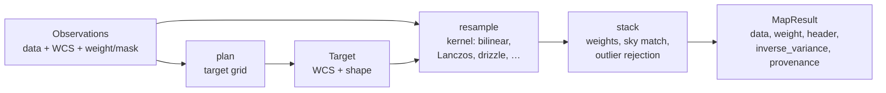

# Images and maps: overview

This area turns many calibrated exposures into one sky product: an image on a
chosen grid, a spectral cube, or a HEALPix map. `torchsky.map` plans the
target grid, resamples each exposure onto it, and stacks the results with
explicit weights, masks, and outlier rejection. Use it when the unit of work is
a requested product rather than a single image.

## The Core Idea: Plan, Resample, Stack



- An **observation** ([`Observation`](../reference/map.md#torchsky.map.Observation))
  is one calibrated exposure: pixel data, a WCS header, and optionally a weight
  or variance map, a data-quality (DQ) mask, a photometric scale, a background
  offset, or a wavelength.
- A **target** is the output grid: WCS, shape, and bands.
  [`plan`](../reference/map.md#torchsky.map.plan) builds one that covers the
  inputs.
- **Resampling** moves pixel values from one grid to another with a declared
  kernel. Interpolating kernels (bilinear, bicubic, Lanczos) sample the input
  at each output pixel. Drizzle instead drops each input pixel, shrunk by
  `pixfrac`, onto the output grid and shares its flux by overlap area; it
  preserves flux and handles undersampled, dithered data.
- **Stacking** combines the resampled exposures with their weights, optional
  sky matching, and sigma-clipping or median rejection.

## Choose a Page

| Task | Page | Entry point |
|---|---|---|
| Put one image on another grid; choose a kernel; drizzle | [Resampling](resampling.md) | [`resample`](../reference/map.md#torchsky.map.resample), [`ResampleConfig`](../reference/map.md#torchsky.map.ResampleConfig) |
| Coadd exposures, propagate uncertainty, bound memory | [Coadds](coadds.md) | [`coadd`](../reference/map.md#torchsky.map.coadd), [`plan`](../reference/map.md#torchsky.map.plan) |
| Build a cube from filter images or IFU frames | [Cubes and IFU](cubes.md) | [`coadd_cube`](../reference/map.md#torchsky.map.coadd_cube) |
| Coadd images onto HEALPix, or project HEALPix onto an image | [HEALPix mapmaking](healpix-mapmaking.md) | [`coadd_healpix`](../reference/map.md#torchsky.map.coadd_healpix), [`resample_healpix`](../reference/map.md#torchsky.map.resample_healpix) |
| Run the same workflows from the shell | [CLI](../introduction/cli.md) | `torchsky map` |

## A Weighted Coadd

The two images below are the same star in two CFHT MegaPipe g-band stacks:
tile 712.165 (240 s) and tile 712.166 (1224 s), 11 × 11 pixels each, copied
from the cutouts of the
[mosaic example](../examples/index.md#four-megapipe-cutouts-coadded-with-lanczos3-and-drizzle).
Each tile has its own TAN tangent point, half a degree apart, so the pixel grids
do not line up. `plan` builds one grid covering both, `coadd` resamples each
image with Lanczos3 and stacks them with inverse-variance weights from the
measured pixel noise (1.76 and 1.43 counts).

<!-- docs: run -->
```python
import torch

from torchsky.map import Observation, coadd, plan
from torchsky.wcs import WCS

tile_712_165 = torch.tensor([
    [6, 4, 2, 3, 4, 6, 5, 4, 1, 0, -1], [1, 4, 5, 6, 6, 10, 6, 8, 6, 1, 2],
    [1, 4, 6, 14, 18, 21, 19, 12, 8, 4, 2], [6, 9, 18, 27, 37, 48, 39, 21, 8, 1, 5],
    [9, 11, 23, 40, 60, 71, 58, 33, 19, 11, 4], [9, 15, 34, 57, 80, 89, 70, 39, 23, 10, 5],
    [9, 17, 33, 63, 90, 87, 64, 42, 18, 7, 6], [10, 21, 31, 55, 70, 69, 50, 24, 11, 6, 2],
    [8, 11, 23, 36, 44, 42, 29, 18, 12, 6, 4], [5, 11, 14, 25, 27, 19, 11, 8, 8, 7, 6],
    [6, 8, 6, 10, 12, 12, 7, 5, 7, 3, 2],
], dtype=torch.float32)
tile_712_166 = torch.tensor([
    [4, 4, 2, 3, 3, 4, 4, 3, 0, -1, 0], [4, 4, 5, 3, 6, 8, 5, 7, 3, 0, 0],
    [1, 3, 6, 10, 12, 14, 11, 10, 7, 3, 1], [4, 7, 14, 22, 30, 36, 27, 15, 5, 1, 3],
    [8, 12, 22, 36, 53, 61, 46, 26, 11, 6, 3], [9, 16, 33, 54, 74, 83, 61, 33, 20, 10, 4],
    [10, 19, 39, 68, 92, 88, 64, 39, 18, 7, 6], [12, 22, 37, 65, 83, 76, 53, 28, 12, 5, 3],
    [10, 17, 30, 46, 56, 53, 35, 18, 10, 5, 2], [6, 11, 20, 31, 33, 26, 16, 12, 9, 7, 6],
    [8, 10, 10, 17, 17, 13, 6, 7, 7, 5, 4],
], dtype=torch.float32)
grid = {"NAXIS": 2, "NAXIS1": 11, "NAXIS2": 11, "CTYPE1": "RA---TAN", "CTYPE2": "DEC--TAN",
        "CD1_1": -5.160234650248e-05, "CD1_2": 0.0, "CD2_1": 0.0, "CD2_2": 5.160234650248e-05}
headers = [   # the tiles' CRVAL; CRPIX moved to each 11 x 11 corner
    {**grid, "CRVAL1": 359.07190997, "CRVAL2": -7.5, "CRPIX1": -4960.0, "CRPIX2": -4798.0},
    {**grid, "CRVAL1": 358.67349786, "CRVAL2": -7.0, "CRPIX1": 2699.0, "CRPIX2": 4891.0},
]
exposures = [
    Observation(data=image, wcs=header, weight_map=torch.full((11, 11), 1 / noise**2),
                weight_is_inverse_variance=True)
    for image, header, noise in zip((tile_712_165, tile_712_166), headers, (1.76, 1.43))
]
target = plan(exposures, projection="TAN")
result = coadd(exposures, target, kernel="lanczos3")


def star_position(image, header):   # flux-weighted centroid of the bright pixels, as RA, Dec
    yy, xx = torch.meshgrid(*(torch.arange(n, dtype=torch.float64) for n in image.shape), indexing="ij")
    w = torch.where(image > 20, image.double(), 0.0)
    x, y = (w * xx).sum() / w.sum(), (w * yy).sum() / w.sum()
    return torch.cat(WCS(header).pixel_to_world(x.reshape(1), y.reshape(1)))


inputs = [star_position(image, header) for image, header in zip((tile_712_165, tile_712_166), headers)]
stacked = star_position(result.data.nan_to_num(), result.header)
for position in inputs:      # the star lands in the same place: within 0.02 arcsec
    assert ((stacked - position) * 3600).abs().max() < 0.02
covered = result.weight[result.weight > 0]   # every covered pixel, edges included
torch.testing.assert_close(covered, torch.full_like(covered, 1 / 1.76**2 + 1 / 1.43**2), rtol=1e-4, atol=0.0)
```

Both tiles reach every covered target pixel, so the weight is the sum of the two
inverse variances right up to the edge; `result.inverse_variance` holds the propagated per-pixel inverse
variance, which [Coadds](coadds.md) explains. The full example mosaics four 512 × 512 cutouts with Lanczos3 and drizzle and checks
every pairwise overlap.

## Conventions and Pitfalls

- **Value semantics.** A product is either surface brightness (the default:
  values per unit area, unchanged by resampling to a finer grid) or flux (values
  per pixel, scaled by pixel area). Choose before comparing with another stack;
  differences with SWarp or Montage usually trace to value semantics, pixel-area
  treatment, mask policy, or weights.
- **Weights.** `weight` always controls the coadd denominator. It is treated as
  inverse variance, and `result.inverse_variance` is filled, only with
  `weight_is_inverse_variance=True`.
  [`build_weight_product`](../reference/quality.md#torchsky.quality.build_weight_product)
  attaches inverse-variance, confidence, and mask-polarity semantics when you
  build masks yourself.
- **Kernels are configuration.** `ResampleConfig(kernel=...)` sets support,
  interpolation, and flux behaviour; nothing switches kernels behind your back.
  See the [kernel table](resampling.md#kernels).
- **Memory.** Large mosaics are tiled and chunked by configuration
  (`tile_size`, `response_chunk_size`); the [scaling guide](../performance/scaling.md)
  lists the knobs.

## Device Placement

Map APIs compute and return on the device of their tensor inputs; CPU tensors
stay on CPU even when CUDA is available. An explicit `device=` always wins, and
tensors on different devices without it raise `ValueError`. When observations
are file paths, `torchsky.device.default_compute_device()` applies. Float64-only
kernels (exact drizzle, conservative polygon and splat projection, spectral
resamplers) raise `NotImplementedError` on MPS. The general rules are in
[Concepts](../introduction/concepts.md#device-follows-the-input).

## Connections

Every observation and target carries a [WCS](../coordinates/index.md).
[HEALPix mapmaking](healpix-mapmaking.md) writes to the
[celestial sphere](../sphere/index.md), and cubes connect to
[spectral axes](../spectra/spectral-axes.md). The observation operators that
resample and convolve here are the same ones the experimental
[models](../models/index.md) differentiate through.

Resampling and coadds are compared with SWarp, Montage, STScI drizzle, and
reproject in [torchsky-harness](https://github.com/astroai/torchsky-harness);
see [performance highlights](../performance/highlights.md) and the
[parity page](../performance/parity.md). Examples: the
[MegaPipe mosaic](../examples/index.md#four-megapipe-cutouts-coadded-with-lanczos3-and-drizzle),
the [MaNGA IFU cube](../examples/index.md#a-manga-ifu-cube-h-map-rotation-and-reprojection),
[dithered SIP coadd](../published-examples/coadd_dithered_sip.py),
[drizzle](../published-examples/drizzle_flagship.py),
[coadd to HEALPix](../published-examples/coadd_to_healpix.py), and the
[examples index](../examples/index.md).
