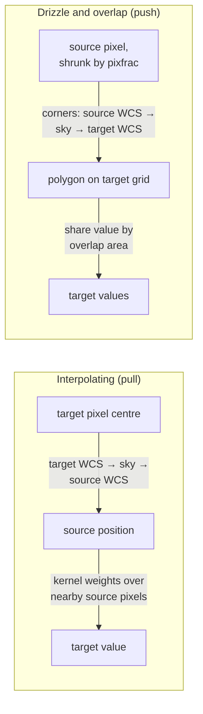
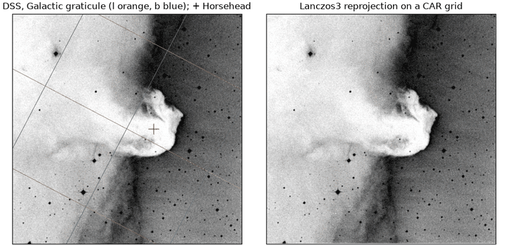

# Resampling

**Resampling** moves an image from the pixel grid it was observed on to another
grid: a different projection, orientation, pixel scale, or a shared mosaic
grid. Both grids are described by a [WCS](../coordinates/index.md), and a
**kernel** decides how source pixel values become target pixel values.
[`resample`](../reference/map.md#torchsky.map.resample) does this for one or
more images without combining them; [`coadd`](coadds.md) resamples and then
stacks.

Use it to put an image on another survey's grid, to align exposures before a
pixel comparison, to make a cutout in a chosen projection, or to drizzle
dithered, undersampled data onto a finer grid. To map an image onto the sphere,
use [HEALPix mapmaking](healpix-mapmaking.md); to combine several exposures
with weights and outlier rejection, use [coadds](coadds.md).

## How It Works

Two families of kernels walk the grids in opposite directions.



An **interpolating** kernel maps each target pixel centre back to a position
in the source image and evaluates a weighted sum of nearby source pixels:
bilinear uses 2×2 pixels, Lanczos-\(a\) uses \(2a \times 2a\) pixels with
weights \(L(x) = \operatorname{sinc}(x)\operatorname{sinc}(x/a)\) per axis.
Interpolation assumes the image is well sampled (the PSF spans at least about two
pixels) and does not conserve total flux exactly.

A **drizzle** kernel (Fruchter and Hook 2002) pushes each source pixel forward
instead. The pixel is shrunk about its centre by `pixfrac` (between 0 and 1),
its corners are projected onto the target grid, and its value is shared among
the target pixels it overlaps. With \(a_{ij}\) the overlap area of shrunk source
pixel \(i\) with target pixel \(j\), and \(w_i\) its weight,

\[
I_j = \frac{\sum_i a_{ij}\, w_i\, d_i}{\sum_i a_{ij}\, w_i}.
\]

Drizzle conserves flux and suits undersampled, dithered data. A small `pixfrac`
sharpens the result but leaves holes unless many dithers cover each target
pixel. `conservative_polygon` is the same exact overlap at `pixfrac = 1`.

For distorted source WCS (SIP, TPV), the target-to-source mapping is evaluated
exactly on a coarse lattice and interpolated in between; each lattice cell is
verified to stay within \(10^{-3}\) source pixel and refined or solved per
pixel where it does not.

**Validation.** On 135 JWST NIRCam exposures, drizzle agrees with STScI
`drizzle` to better than \(2\times10^{-6}\) σ and Lanczos-3 with SWarp to a
median below 0.1 σ ([performance highlights](../performance/highlights.md));
the package tests check adjoints, gradients, and flux conservation.

## Kernels

| Kernel | Family | Conserves flux | Variance | Use for |
|---|---|---|---|---|
| `nearest` | interpolating | no | yes | masks, labels, integer data |
| `bilinear` (default) | interpolating | no | yes | quick looks, smooth images |
| `bicubic`, `catmull_rom`, `mitchell_netravali` | interpolating, cubic | no | yes | smoother than bilinear; definitions differ between tools |
| `lanczos2` … `lanczos5` | interpolating, windowed sinc | no | yes | well-sampled images; `lanczos3` is the SWarp default |
| `fft_shift`, `fft_diagonal_affine`, `fft_linear_affine`, `periodic_linear_affine` | Fourier / periodic | no | none | same-shape grids related by a shift or affine map; periodic boundaries |
| `spectral_linear_affine`, `spectral_nonuniform` | Fourier series | no | none | band-limited data under a general mapping (CPU/CUDA, float64) |
| `drizzle_square` | drizzle | yes | yes | dithered, undersampled exposures |
| `drizzle_turbo` | drizzle | yes | yes | as `drizzle_square`, faster box overlap when the grids are axis-aligned |
| `drizzle_point` | drizzle, `pixfrac` → 0 | yes | yes | many dithers; leaves holes otherwise |
| `drizzle_gaussian`, `drizzle_lanczos2`, `drizzle_lanczos3` | drizzle, smooth drop | no | yes | compatibility with the STScI kernels of the same name |
| `conservative_polygon` | exact overlap | yes | yes | flux-exact regridding without `pixfrac` |
| `splat_point`, `splat_box` | forward deposition | approximately | yes | differentiable source positions in models |

`drizzle_turbo` and `splat_box` fall back to the exact polygon overlap when a
pixel pair is rotated or sheared. At the grid edge `drizzle_point` keeps drops
whose centre falls in the outer half-pixel rim (target coordinates in
\([-0.5, n - 0.5]\)), where STScI `drizzle` keeps only \([0, n - 1]\), so no
drop that overlaps the grid is lost.

## Surface Brightness or Flux

A pixel value is either **surface brightness** (per unit solid angle, the
default) or **flux** (per pixel). Resampling to pixels a quarter of the area
leaves surface brightness unchanged and divides flux by four. Set
`semantics="flux"` for counts or flux-calibrated pixels whose sum must be
preserved, and `semantics="surface_brightness"` for calibrated intensity maps.

<!-- docs: run -->
```python
import torch

from torchsky.map import Observation, resample

source = {
    "NAXIS": 2, "NAXIS1": 32, "NAXIS2": 32,
    "CTYPE1": "RA---TAN", "CTYPE2": "DEC--TAN",
    "CRPIX1": 16.5, "CRPIX2": 16.5, "CRVAL1": 150.0, "CRVAL2": 2.0,
    "CDELT1": -1e-4, "CDELT2": 1e-4,
}
# Half-size pixels: four target pixels cover one source pixel.
target = {**source, "NAXIS1": 64, "NAXIS2": 64, "CRPIX1": 32.5, "CRPIX2": 32.5,
          "CDELT1": -0.5e-4, "CDELT2": 0.5e-4}

image = torch.zeros(32, 32)
image[10:20, 12:22] = 1.0                       # 100 source pixels of value 1
observation = Observation(data=image, wcs=source)

sb = resample(observation, target, kernel="drizzle_square", semantics="surface_brightness")
flux = resample(observation, target, kernel="drizzle_square", semantics="flux")
assert abs(float(sb.data.max()) - 1.0) < 1e-6        # value per unit area kept
assert abs(float(flux.data.sum()) - 100.0) < 1e-3    # total flux kept
```

## A Photographic Plate in Another Projection

The [Horsehead example](../published-examples/horsehead_wcs_tour.py) reads a
DSS plate of the Horsehead Nebula with torchfits and resamples it onto a
rotated TAN grid and a plate carrée (CAR) grid. A round trip back to the
original grid leaves a residual of 1.5% of the image standard deviation, and the
mean surface brightness changes by \(10^{-4}\).

```python
# horsehead.fits: examples/horsehead_wcs_tour.py downloads it from data.astropy.org.
import torch
import torchfits

from torchsky.map import Observation, plan, resample

image = torchfits.read("horsehead.fits", 0).to(torch.float32)
header = dict(torchfits.read_header("horsehead.fits", 0))
plate = Observation(data=image, wcs=header)

grid = plan([plate], projection="CAR")          # CAR grid covering the plate
car = resample(plate, grid, kernel="lanczos3")  # MapResult: data, weight, header
```



## Recipes

### Reproject onto an existing header

Pass any target WCS: a header `dict`, a [`WCS`](../reference/wcs.md#torchsky.wcs.WCS),
or a planned [`Target`](../reference/map.md#torchsky.map.Target). Pixels outside
the source footprint get `weight == 0`; mask with `result.weight > 0` rather than
testing values. With several observations and no target, `resample` plans one
grid covering all of them and returns one result per input.

### Drizzle dithered exposures

Undersampled exposures with sub-pixel dithers recover resolution on a finer
grid: plan a target with a smaller `pixel_scale_arcsec`, then coadd with
`kernel="drizzle_square"` and `pixfrac` between 0.6 and 1.0. Check the weight
map: with too few dithers for the chosen `pixfrac`, weights vary strongly from
pixel to pixel and some reach zero. See
[coadds](coadds.md#drizzle-dithered-exposures) and the
[drizzle example](../published-examples/drizzle_flagship.py).

### Propagate variance

Declare noise as variance components (`var_poisson`, `var_rnoise`, `var_flat`)
or as an inverse-variance weight map with `weight_is_inverse_variance=True`.
Each output variance is the sum of the input variances times the squared kernel
coefficients. Neighbouring output pixels then share input noise, so the
per-pixel variance is smaller than the input variance while the noise is
correlated. `result.correlation_factor` reports the local ratio needed to
correct aperture errors, and [`aperture_uncertainty`](coadds.md#uncertainty)
computes the exact variance of an aperture sum. Fourier kernels return no
variance product.

<!-- docs: run -->
```python
import torch

from torchsky.map import Observation, resample

header = {
    "NAXIS": 2, "NAXIS1": 32, "NAXIS2": 32,
    "CTYPE1": "RA---TAN", "CTYPE2": "DEC--TAN",
    "CRPIX1": 16.5, "CRPIX2": 16.5, "CRVAL1": 150.0, "CRVAL2": 2.0,
    "CDELT1": -1e-4, "CDELT2": 1e-4,
}
noisy = Observation(data=torch.ones(32, 32), wcs=header, var_rnoise=torch.full((32, 32), 4.0))
shifted = resample(noisy, {**header, "CRPIX1": 16.8}, kernel="bilinear")

# Bilinear weights 0.7 and 0.3: variance 4 * (0.7**2 + 0.3**2) = 2.32.
assert abs(float(shifted.var_rnoise[16, 16]) - 2.32) < 1e-4
```

### Differentiate through resampling

Resampling is linear in the pixel values, and autograd applies its exact
adjoint, so a loss on the resampled image has gradients with respect to the
input pixels. This is what [forward models](../models/index.md) use to compare a
model on one grid with data on another.

<!-- docs: run -->
```python
import torch

from torchsky.map import Observation, resample

header = {
    "NAXIS": 2, "NAXIS1": 32, "NAXIS2": 32,
    "CTYPE1": "RA---TAN", "CTYPE2": "DEC--TAN",
    "CRPIX1": 16.5, "CRPIX2": 16.5, "CRVAL1": 150.0, "CRVAL2": 2.0,
    "CDELT1": -1e-4, "CDELT2": 1e-4,
}
model = torch.rand(32, 32, dtype=torch.float64, requires_grad=True)
on_data_grid = resample(Observation(data=model, wcs=header), {**header, "CRPIX1": 16.8}, kernel="lanczos3")

loss = (on_data_grid.data * on_data_grid.weight).sum()
loss.backward()
assert model.grad is not None and torch.isfinite(model.grad).all()
```

### Map a mosaic back onto an exposure

[`blot`](../reference/map.md#torchsky.map.blot) is the reverse step: it
interpolates a coadd onto the grid of each input exposure, for example to
compare an exposure with the median sky and flag cosmic rays. It is what
[outlier rejection](coadds.md#reject-outliers) uses internally.

### Large images and devices

Resampling runs on the device of the input tensors. Large targets are tiled to
a memory budget; the knobs are in [coadds](coadds.md#tile-large-targets).
Exact drizzle, conservative polygon, splat, and Fourier-series kernels need
float64 and raise `NotImplementedError` on MPS; run them on CPU or CUDA.

## Pitfalls

- **Value semantics.** Comparing a torchsky product with SWarp, Montage, or
  `reproject` output starts with the same semantics and the same treatment of
  pixel area. Most disagreements trace to those, not to the kernel.
- **Lanczos ringing.** Lanczos kernels have negative lobes and ring around
  sharp features such as saturated stars and masked edges.
- **Interpolation of undersampled data.** Interpolating kernels assume a smooth
  image. For undersampled data use drizzle.
- **`pixfrac` and holes.** Point and small-`pixfrac` drizzle leave empty target
  pixels unless many dithers cover each one.
- **Masks.** Resample masks with `nearest`, or pass them as `mask=` on the
  observation so they become zero weight.

## See Also

- [Coadds](coadds.md): weights, background matching, outlier rejection,
  stacking.
- [HEALPix mapmaking](healpix-mapmaking.md) and [Cubes and IFU](cubes.md).
- Reference: [`resample`](../reference/map.md#torchsky.map.resample),
  [`ResampleConfig`](../reference/map.md#torchsky.map.ResampleConfig).
- Examples: [Horsehead reprojection](../published-examples/horsehead_wcs_tour.py),
  [MegaPipe mosaic](../published-examples/megapipe_mosaic.py),
  [exact square drizzle](../published-examples/drizzle_flagship.py).
