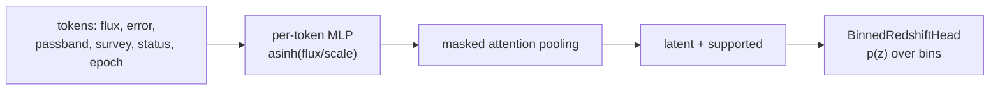

# Encoders

!!! warning "Experimental surface"
    `torchsky.encoders` is experimental. Feature layouts, constructor
    arguments, and the contents of saved buffers may change between minor
    releases without a deprecation period, which makes old checkpoints
    unloadable. There are no pretrained weights and no claim of accuracy on
    real catalogues.

An **encoder** turns astronomical inputs into fixed-length feature vectors
that a neural network can use. Neural networks learn fine structure poorly
from raw coordinates or from catalogue rows with missing values; an encoder
supplies multi-scale features of sky position and wavelength, or a single
latent vector summarizing a variable-length set of photometric measurements.
All encoders are `torch.nn.Module`s or tensor functions: they run on the input's
device and pass gradients.

| Encoder | Input | Output |
|---|---|---|
| [`harmonic_sky_encoding`](../reference/encoders.md#torchsky.encoders.harmonic_sky_encoding) | RA, Dec | 9 low-order polynomials on the unit sphere |
| [`log_spectral_encoding`](../reference/encoders.md#torchsky.encoders.log_spectral_encoding) | wavelength or frequency | sines and cosines of \(\ln\lambda\) at octave scales |
| [`SkyCoordinateEncoder`](../reference/encoders.md#torchsky.encoders.SkyCoordinateEncoder) | RA, Dec, optional λ | both of the above plus spherical Fourier features |
| [`PhotometryEncoder`](../reference/encoders.md#torchsky.encoders.PhotometryEncoder) | a set of flux measurements per object | one latent vector per object and a support flag |
| [`MaskedSetFusion`](../reference/encoders.md#torchsky.encoders.MaskedSetFusion) | a set of latent vectors (bands, surveys, modalities) | one fused latent |
| [`BinnedRedshiftHead`](../reference/encoders.md#torchsky.encoders.BinnedRedshiftHead) | a latent vector | a binned redshift probability distribution |

Use sky encoders when you build your own continuous sky model; most users meet
them inside [fields](fields.md). Use the photometry encoder and redshift head
for catalogue-level learning such as photometric redshifts, where each object
has a different set of bands, surveys, and upper limits.

## How It Works

**Sky and wavelength features.** Positions become unit vectors
\((x, y, z)\) on the sphere, which have no wrap at RA = 360° and no
singularity at the poles. Fourier features
\(\sin(2^k \omega_0 \cdot), \cos(2^k \omega_0 \cdot)\) at octave scales
\(k = 0, \dots, K-1\) let a small network represent structure at many angular
scales. The lowest frequency \(\omega_0\) (`min_frequency`) should match the
field: about \(2\pi/\theta\) for a patch of angular size \(\theta\), so that the
octaves cover structure inside the patch rather than whole-sky modes.

**Measurement sets.** An object's photometry is a set of **tokens**, one per
measurement: a flux, its error, and integer identifiers of passband, survey,
measurement method, and detection status. Each token is embedded by a small
network and the set is pooled with learned attention over the valid tokens, so
the result does not depend on token order or on how many measurements an
object has.



## Assumptions

- Encoders compute features only. Matching sources between catalogues,
  choosing training labels and splits, and recording provenance are the
  application's responsibility.
- Integer identifiers (passband, survey, method) index the caller's
  vocabularies. They are not global, so save the vocabulary with the model.
- Flux scales and epoch normalization are model buffers saved in
  `state_dict`. Fit any data-dependent scale on training data only.

## Sky Features for a Small Field

<!-- docs: run -->
```python
import math

import torch

from torchsky.encoders import SkyCoordinateEncoder

ra = 150.0 + 0.01 * torch.rand(1000, dtype=torch.float64)          # 36 arcsec patch
dec = 2.0 + 0.01 * torch.rand(1000, dtype=torch.float64)
wave = torch.full((1000,), 6000.0, dtype=torch.float64)

encoder = SkyCoordinateEncoder(num_fourier_frequencies=6, min_frequency=2 * math.pi / math.radians(0.01))
features = encoder(ra, dec, wavelength=wave)
network = torch.nn.Sequential(torch.nn.Linear(features.shape[-1], 32), torch.nn.SiLU(), torch.nn.Linear(32, 1)).double()
assert network(features).shape == (1000, 1)
```

## Recipes

### Encode Photometry and Predict a Redshift Distribution

<!-- docs: run -->
```python
import torch

from torchsky.encoders import BinnedRedshiftHead, PhotometryEncoder

encoder = PhotometryEncoder(num_passbands=3, num_surveys=2, flux_scale=[10.0, 10.0, 20.0], latent_dim=32)
flux = torch.tensor([[8.0, -2.0, 30.0], [float("nan"), 6.0, 0.0]])
error = torch.tensor([[1.0, 2.0, float("nan")], [float("nan"), 1.0, 0.0]])
mask = torch.tensor([[True, True, True], [False, True, False]])     # False = padding
latent, supported = encoder(
    flux, error,
    passband_id=torch.tensor([[0, 1, 2], [-1, 1, -1]]),
    survey_id=torch.tensor([[0, 0, 1], [-1, 0, -1]]),
    status=torch.tensor([[0, 0, 1], [-1, 0, -1]]),                  # 1 = upper limit
    epoch=torch.tensor([[2016.0, 2016.0, float("nan")], [0.0, 2016.0, 0.0]]),
    mask=mask,
)
head = BinnedRedshiftHead(32, [0.0, 0.2, 0.5, 1.0, 2.0, 4.0])
logits = head(latent, supported=supported)
loss = -head.log_prob(logits, torch.tensor([0.4, 1.2])).mean()
loss.backward()
```

| Input | Meaning |
|---|---|
| `flux` | Signed flux, or the threshold of an upper limit; finite where observed |
| `error` | Positive uncertainty in the same unit; `NaN` means unknown |
| `passband_id`, `survey_id`, `method_id` | Indices into the caller's vocabularies |
| `status` | 0 for a detection, 1 for an upper limit |
| `epoch` | Decimal year of the observation; `NaN` means unknown |
| `mask` | `False` for padding, not for a non-detection |

Continuous features are \(\operatorname{asinh}(f/s)\) and
\(\ln(1 + \sigma/s)\) with one scale \(s\) per passband (`flux_scale`), so
negative and very bright fluxes stay finite. Unknown errors and epochs carry
their own availability flag; a placeholder zero never means zero noise.

`log_prob` evaluates a piecewise-uniform density: bin probability divided by
bin width. Bins are left-closed, the last also right-closed; a target outside
the bins has log probability \(-\infty\).

### Fuse Other Modalities

[`MaskedSetFusion`](../reference/encoders.md#torchsky.encoders.MaskedSetFusion)
pools any set of latent vectors of shape `(..., items, latent_dim)` with a
mask, for example image, spectrum, and photometry latents mapped to a common
size. Fully masked sets give a zero latent with `supported=False`; pass that
flag on, because the head rejects unsupported rows.

### Average Over Cross-Match Hypotheses

When a source has several possible counterparts,
[`marginalize_association_logits`](../reference/encoders.md#torchsky.encoders.marginalize_association_logits)
mixes the redshift distributions of each hypothesis with their weights. This
averages probabilities, not embeddings, which would give a different answer.

<!-- docs: run -->
```python
import torch

from torchsky.encoders import marginalize_association_logits

conditional_logits = torch.tensor([[[2.0, 0.0], [0.0, 2.0]]])      # 2 hypotheses x 2 bins
weights = torch.tensor([[0.75, 0.25]])
log_mass = marginalize_association_logits(conditional_logits, weights)
torch.testing.assert_close(log_mass.exp().sum(-1), torch.ones(1))
```

Include "no match" and blend hypotheses with their own models when they are
possible; otherwise the result is conditional on the hypotheses supplied.

### A Catalogue Photometric-Redshift Application

[`examples/applications/catalogue_photoz.py`](https://github.com/astroai/torchsky/blob/main/examples/applications/catalogue_photoz.py)
trains, predicts, and evaluates a photo-z model from a directory of photometry
shards, a membership table (`source_id`, `object_id`, `split`, `split_group`),
and spectroscopic labels (`object_id`, `redshift`, `evidence_id`, `category`).
It streams a Parquet feature cache through Polars and Arrow, keeps lineage
groups within one split, pins every input by hash in the checkpoint, and reports
NLL, outlier fraction, PIT histograms, and interval coverage on the test split.
It needs the `test` environment and your own data:

```bash
pixi run -e test -- python examples/applications/catalogue_photoz.py train \
  --release /data/observations-dr1 --memberships memberships.parquet \
  --labels spec-labels.parquet --feature-cache photoz-features \
  --checkpoint photoz.pt --epochs 20 --bin-edges 0,0.2,0.5,1,2,4,6
```

The bundled synthetic check shows the pipeline learns and reloads correctly;
it does not establish photo-z accuracy on a real survey.

### Image Transforms for Training

`torchsky.transforms` holds tensor transforms for image training pipelines
(`ZScale`, `AsinhStretch`, `RandomCrop`, `RandomFlip`, `PoissonNoise`,
`PerturbByError`, `Compose`, and others). Load files with torchfits in your
`Dataset`, then transform:

<!-- docs: run -->
```python
import torch

from torchsky.transforms import Compose, MinMaxScale, ZScale

image = torch.randn(64, 64) * 3.0 + 100.0
scaled = Compose([ZScale(), MinMaxScale()])(image)
assert scaled.shape == image.shape and 0.0 <= float(scaled.min()) <= float(scaled.max()) <= 1.0
```

Wavelength-aware operations (rebinning, Doppler shifts) are spectral
operations, not augmentations; see [Spectral axes](../spectra/spectral-axes.md).

## Pitfalls

- **Coordinates in float32.** Encode absolute RA/Dec in float64, or subtract
  the field centre first, as [fields](fields.md) do through their `Domain`.
- **Equinox is not epoch.** `epoch` is when a flux was measured, not the
  coordinate equinox of the catalogue.
- **Vocabulary drift.** Adding a band or survey changes the meaning of integer
  identifiers; retrain or migrate the checkpoint explicitly.
- **Unsupported rows.** An object with no usable measurement gets a zero
  latent; that is not a prior, and its prediction must be skipped.

## See Also

- [Fields](fields.md): continuous sky models built on these features.
- [Synthetic photometry](../spectra/photometry.md): model fluxes for training
  sets.
- [Formulation](formulation.md#implicit-neural-representations): why
  multi-scale features matter for INRs.
- Reference: [`torchsky.encoders`](../reference/encoders.md),
  [`torchsky.transforms`](../reference/transforms.md).
