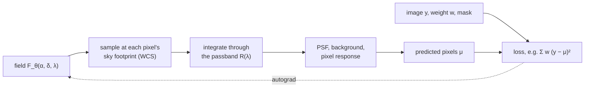
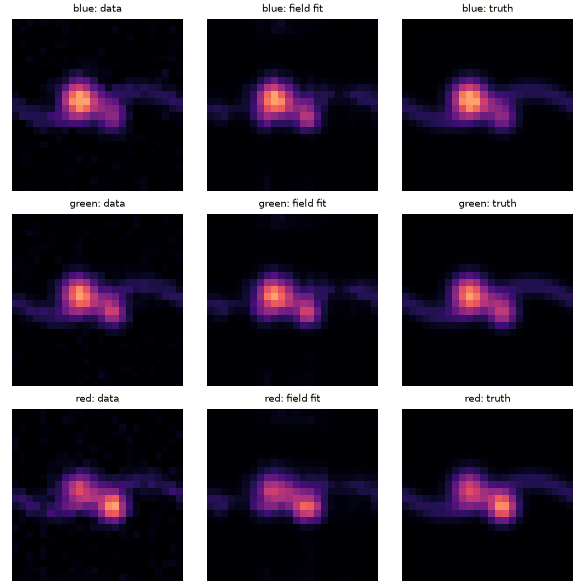

# Fields

!!! warning "Experimental surface"
    `torchsky.field` is experimental. Model kinds, presets, default
    hyperparameters, the keys of `FitResult.diagnostics`, and the saved
    artifact format may change between minor releases without a deprecation
    period; the implementation modules under `torchsky.map.field` may move.
    The forward model is tested for gradient, adjoint, and device contracts,
    but no scientific accuracy on real surveys is claimed. Pin a version if you
    depend on it.

A **field** is a continuous model of the sky,
\(F_\theta(\alpha, \delta, \lambda)\): a function you can evaluate at any right
ascension, declination, and wavelength, with parameters \(\theta\). It has no
pixel grid of its own. `torchsky.field` fits such a function to a set of images
in different bands and exposures by predicting every recorded pixel through a
differentiable model of the instrument and minimizing the residuals by gradient
descent. The fitted field can then be rendered onto any grid: the original
exposures, a new WCS image, a spectral cube, or a HEALPix map.

Two families of representations are available:

- An **implicit neural representation (INR)** is a small neural network that
  takes encoded coordinates and returns intensity. It is smooth, compact, and
  couples space and wavelength through shared weights.
- A **spectral Power Foam** divides the sky into adaptive cells (a bounded
  weighted Voronoi diagram), each with its own spectrum. It is local, explicit,
  and, with the cells fixed, linear in its spectral coefficients, so it can be
  solved exactly. Hybrids start an INR from a fitted Foam.

Use a field when you want one sky model constrained jointly by all bands and
exposures, at native detector pixels, rather than a stack of per-band coadds;
or when you need to render the same model onto several products. For a
conventional stacked image, use [coadds](../maps/coadds.md); they are also the
baseline any field fit should be compared with.

## How It Works



For observation \(n\) and pixel \(p\), the prediction is, schematically,

\[
\mu_{np} = \int R_n(\lambda)\,\big[\mathcal P_n * F_\theta(\cdot,\lambda)\big](\boldsymbol x_{np})\,\mathrm d\lambda + B_{np},
\]

with the passband \(R_n\), spatial response (PSF) \(\mathcal P_n\), pixel
position \(\boldsymbol x_{np}\) from the WCS, and background \(B_{np}\). Each
input is a [`FieldObservation`](../reference/field.md#torchsky.field.FieldObservation):
an image tensor, its FITS header as a dict, band limits or a tabulated
throughput, optional weight and mask, and a
[`PSFSpec`](../reference/field.md#torchsky.field.PSFSpec). A
[`Domain`](../reference/field.md#torchsky.field.Domain) centres and scales
sky and wavelength coordinates before they reach the model, so a float32
network never sees absolute RA and Dec. The [formulation](formulation.md) page
derives the model and its assumptions.

## Assumptions and Limits

- The sky is static during the exposures; time enters only through the
  observation context.
- The WCS, passbands, and noise weights are taken as calibrated. Learned PSF
  and background operators are available but must be constrained by
  calibration data (see below).
- A low training loss does not show that the reconstruction is right: compare
  held-out exposures, injected sources, and a classical coadd.
- On MPS, fields run in float32; fine angular structure there is not verified.

## A Multi-Band Fit

Two bands of one source, fitted by a small INR and rendered back. The
[multiband example](https://github.com/astroai/torchsky/blob/main/examples/neural_field_multiband.py)
does the same with three noisy bands of a two-component galaxy and masked rows:



<!-- docs: run -->
```python
import torch

from torchsky import field


def tangent_header(n: int = 32) -> dict:
    return {
        "NAXIS": 2, "NAXIS1": n, "NAXIS2": n,
        "CTYPE1": "RA---TAN", "CTYPE2": "DEC--TAN",
        "CRPIX1": n / 2 + 0.5, "CRPIX2": n / 2 + 0.5,
        "CRVAL1": 150.0, "CRVAL2": 2.0,
        "CDELT1": -0.05 / 3600.0, "CDELT2": 0.05 / 3600.0,
    }


gen = torch.Generator().manual_seed(0)
yy, xx = torch.meshgrid(torch.arange(32.0), torch.arange(32.0), indexing="ij")
blob = torch.exp(-((xx - 16) ** 2 + (yy - 16) ** 2) / (2 * 3.0**2))

observations = [
    field.FieldObservation(
        image=scale * blob + 0.01 * torch.randn(32, 32, generator=gen),
        header=tangent_header(),
        spectral_min=lo, spectral_max=hi, transmission_center=(lo + hi) / 2,
        weight=torch.ones(32, 32),
        band_name=name,
    )
    for scale, lo, hi, name in ((1.0, 4500.0, 5500.0, "g"), (0.8, 5500.0, 6500.0, "r"))
]

domain = field.estimate_domain(observations)
model = field.preset("fast", domain, hidden_dim=32, hidden_layers=2)
result = field.fit(observations, model, steps=30, lr=1e-2)
assert result.final_loss < result.loss_history[0]

prediction = field.render(model, observations[0])
assert prediction.shape == (32, 32) and torch.isfinite(prediction).all()
```

## Recipes

### Build Observations From FITS Files

Read pixels and headers with torchfits and pass them in; tabulated filter
curves from [`torchsky.filter_profiles`](../reference/filter-profiles.md) give
the throughput.

```python
# fragment: needs science images, weight maps, and SVO filter files on disk
import torch
import torchfits

from torchsky import field
from torchsky.filter_profiles import bandpass_from_transmission_file, field_observation_spectral_kwargs

observations = []
for band in ("g", "r", "i"):
    image, header = torchfits.read(f"cutout_{band}.fits", hdu=0, return_header=True)
    weight = torchfits.read(f"cutout_{band}.weight.fits", hdu=0)
    spectral = field_observation_spectral_kwargs(
        bandpass_from_transmission_file(f"SDSS.{band}.dat", band_name=band)
    )
    observations.append(field.FieldObservation(
        image=image.float(), header=dict(header), weight=weight.float(),
        psf_spec=field.PSFSpec.gaussian(1.2), **spectral,
    ))
```

For IFU cubes, [`field_observations_from_ifu_cube`](../reference/field.md#torchsky.field.field_observations_from_ifu_cube)
and [`field_observations_from_bin_edges`](../reference/field.md#torchsky.field.field_observations_from_bin_edges)
build one observation per spectral bin.

### Choose a Model

[`field.preset`](../reference/field.md#torchsky.field.preset) gives a
recommended configuration; [`field.model`](../reference/field.md#torchsky.field.model)
builds any kind in `field.FIELD_MODEL_KINDS` with explicit arguments.

| Preset | Kind | Use it for |
|---|---|---|
| `fast` | `sky_encoder_mlp` | Smoke tests and quick baselines |
| `balanced` | `sky_lambda_feature_field` | Default multi-band model with learned sky–wavelength features |
| `spectral` | `hashgrid_spectral_field` | More spectral structure, more parameters |
| `operator_constrained` | `operator_constrained_feature_field` | Experiments with operator-side constraints |

A Power Foam is built from explicit cells: sites and radii in normalized
tangent-plane coordinates and Legendre spectral coefficients per cell.

<!-- docs: run -->
```python
import torch

from torchsky import field

header = field.make_tangent_plane_header(24, 24, crval_ra_deg=150.0, crval_dec_deg=2.0, cd11=-1e-5, cd22=1e-5)
observation = field.FieldObservation(
    image=torch.zeros(24, 24), header=header,
    spectral_min=4500.0, spectral_max=5500.0, transmission_center=5000.0,
)
domain = field.estimate_domain([observation])
foam = field.model(
    "spectral_power_foam", domain,
    sites=torch.tensor([[-0.25, 0.0], [0.25, 0.0]]),         # two cells
    radii=torch.tensor([0.8, 0.8]),
    cell_coefficients=torch.tensor([[0.5, 0.1], [0.8, -0.1]]), # 2 Legendre terms each
)
assert field.render(foam, observation).shape == (24, 24)
```

[`spectral_data_budget`](../reference/field.md#torchsky.field.spectral_data_budget)
reports how much spectral information an observation list carries and which
model capacities it can support.

### Render a Cube or a HEALPix Map

<!-- docs: run -->
```python
import torch

from torchsky import field
from torchsky.spectral import SpectralAxis

header = field.make_tangent_plane_header(16, 16, crval_ra_deg=150.0, crval_dec_deg=2.0, cd11=-1e-5, cd22=1e-5)
observation = field.FieldObservation(
    image=torch.zeros(16, 16), header=header,
    spectral_min=4500.0, spectral_max=6500.0, transmission_center=5500.0,
)
model = field.preset("fast", field.estimate_domain([observation]), hidden_dim=16, hidden_layers=1)

axis = SpectralAxis(torch.tensor([5000.0, 5500.0, 6000.0]), "Angstrom", "WAVE")
cube = field.render(model, target="cube", target_header=header, spectral_axis=axis, spatial_tile_hw=(8, 8))
assert cube.shape == (3, 16, 16)
```

`target="healpix"` with `nside=` and `spectral_axis=` returns `(nλ, npix)`;
`spectral_chunk` and `spatial_tile_hw` (or `spatial_chunk_pixels`) bound
memory. Write cubes with
[`write_cube_fits`](../reference/spectral.md#torchsky.spectral.write_cube_fits).
To evaluate the field at arbitrary positions, such as catalogue sources, use
`field.sample(model, observation, ra_deg=ra, dec_deg=dec)`, which returns the
field through that observation's bandpass at each `(ra, dec)`.

### Check the Fit and Save It

[`field.quality`](../reference/field.md#torchsky.field.quality) renders every
observation and reports weighted residual metrics per observation and in
aggregate; [`field.residual_product`](../reference/field.md#torchsky.field.residual_product)
bundles prediction, data, weight, and metrics for inspection.
[`save_artifact`](../reference/field.md#torchsky.field.save_artifact) and
[`load_artifact`](../reference/field.md#torchsky.field.load_artifact) store the
model with its kind, arguments, domain, and fit configuration in a directory
with a JSON manifest.

### Refine Exposure Poses

`field.fit(..., refine_poses=True)` adds one learnable translation, rotation,
and scale per exposure. The first exposure is held fixed to remove the global
shift that the poses and the sky could otherwise exchange; the fitted poses are
on `result.exposure_poses`.

### Learn the PSF and Background, in Stages

`torchsky.map.operators` provides learned PSF and background operators that
plug into the same forward model through
`observation_operator_bundles=` (for example `ConditionedKernelPSF`, a mixture
of positive unit-sum kernels that varies with detector position, wavelength,
and time). Scene, PSF, and background cannot all be free at once: a broad
source can be traded for a wider PSF, diffuse emission for background. Fit in
stages:

1. Fit the scene with a nominal PSF and background; keep some exposures and
   isolated stars out of the fit.
2. Fit a smooth background residual on source-free regions.
3. Fit the PSF on isolated stars and check encircled energy across the
   detector and band.
4. Refine jointly at a lower learning rate, keeping each operator anchored to
   its calibration, and choose capacity on the held-out exposures.

Kernel orientation and flux conventions are on the
[PSF conventions](psf-conventions.md) page.

### Write Your Own Training Loop

`field.render` is differentiable, so any PyTorch loop works.
`torchsky.map.field.implicit_forward` adds survey-level loss terms with
per-survey weights and robust (Charbonnier) residuals:

<!-- docs: run -->
```python
import torch

from torchsky import field
from torchsky.map.field.implicit_forward import SurveyDataTerm, multi_survey_charbonnier_loss

header = field.make_tangent_plane_header(16, 16, crval_ra_deg=150.0, crval_dec_deg=2.0, cd11=-1e-5, cd22=1e-5)
observation = field.FieldObservation(
    image=torch.rand(16, 16), header=header,
    spectral_min=5000.0, spectral_max=5000.0, transmission_center=5000.0,
    weight=torch.ones(16, 16),
)
model = field.preset("fast", field.estimate_domain([observation]), hidden_dim=16, hidden_layers=1)
term = SurveyDataTerm(name="survey", observations=(observation,), loss_weight=1.0)
loss = multi_survey_charbonnier_loss(model, [term])
loss.backward()
assert torch.isfinite(loss)
```

## Pitfalls

- **Normalize coordinates.** Custom models must subtract the field centre
  before casting to float32; absolute RA/Dec in float32 loses subpixel
  structure.
- **Value semantics.** Images in surface brightness and images in flux per
  pixel differ by the pixel solid angle; keep one convention per fit.
- **Make quicklooks.** Axis flips, misregistration, and tile seams show in a
  residual image long before they show in the loss.
- **Compare with a coadd.** Build `coadd_multiband` or a drizzled cube of the
  same data and read the residuals of both.

## See Also

- [Scenes](scenes.md): observation operators with exact adjoints.
- [Likelihoods](likelihoods.md): noise models and pixel likelihoods.
- [Formulation](formulation.md): the inverse problem behind fields.
- Examples: [neural multiband field](https://github.com/astroai/torchsky/blob/main/examples/neural_field_multiband.py),
  [survey split](https://github.com/astroai/torchsky/blob/main/examples/survey_split.py).
- Reference: [`torchsky.field`](../reference/field.md).
