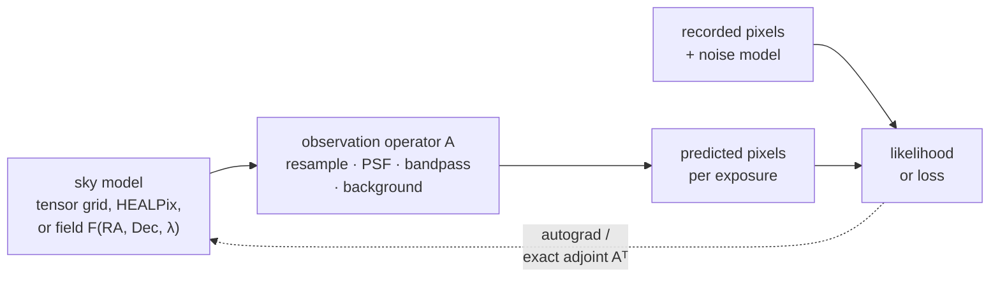

# Models: overview (experimental)

This area models the sky *as observed*: a description of the sky, pushed
through the instrument (resampling onto each detector, PSF, bandpass,
background, noise), compared with the recorded pixels. Because every step is a
torch operation, the comparison has gradients, and you fit the sky, the
instrument, or both by gradient descent instead of first coadding the data.

!!! warning "What experimental means"
    `torchsky.scene`, `torchsky.field`, and the likelihood, query, solver,
    evidence, and native-response modules under `torchsky.map` are
    **experimental**:

    - Names, defaults, result objects, and serialized model formats may change
      between minor releases without a deprecation period. Pin a version if you
      depend on them.
    - They are tested for bounded API, gradient, exact-adjoint, and device
      contracts, like the rest of torchsky.
    - They carry no claim of scientific accuracy on real data. Evaluation on
      real surveys runs in
      [torchsky-harness](https://github.com/astroai/torchsky-harness) and is
      not yet a release gate.

    The geometry and mapmaking layers they build on
    ([WCS](../coordinates/index.md), [maps](../maps/index.md),
    [sphere](../sphere/index.md)) are core and stable. The stability tier of
    each namespace is listed in the [API reference](../reference/index.md#namespaces).

## The Core Idea: A Forward Model With Gradients



- An **observation operator** \(A\) maps the sky model to one exposure's
  pixels. Its adjoint \(A^T\), the transpose that maps pixel residuals back to
  the sky, is exact, so normal equations \(A^T N^{-1} A\) can be solved without
  forming a matrix (\(N\) is the noise covariance). Operators for one exposure
  are grouped in an `ObservationOperatorBundle`; learned instrument models such
  as `LearnedInstrumentOperator` and `ConstrainedKernelPSF` live in
  `torchsky.map.operators`.
- A **field** is a continuous function of sky position and wavelength, such as
  a neural network (an implicit neural representation, INR) or a spectral
  Power Foam (a partition of the sky into cells with spectral appearance). It
  is fitted jointly to all bands and exposures.
- A **likelihood** scores predicted pixels against data under a stated noise
  law, for example Gaussian read noise plus Poisson photon noise.

## Choose a Page

| Task | Page | Entry point |
|---|---|---|
| Describe observations and a target; apply operators with exact adjoints; solve normal equations | [Scenes](scenes.md) | [`scene.render`](../reference/scene.md#torchsky.scene.render), [`scene.operator_adapter_for_observation`](../reference/scene.md#torchsky.scene.operator_adapter_for_observation) |
| Fit a continuous multi-band sky model to images | [Fields](fields.md) | [`field.fit`](../reference/field.md#torchsky.field.fit), [`field.FieldObservation`](../reference/field.md#torchsky.field.FieldObservation) |
| Forced photometry, star stamps, and pixel likelihoods without a global field | [Likelihoods](likelihoods.md) | [`GaussianLikelihoodFactor`](../reference/map-likelihood.md#torchsky.map.likelihood.GaussianLikelihoodFactor) |
| Orient PSF kernels and separate source flux from uniform sky | [PSF conventions](psf-conventions.md) | — |
| Sky and wavelength feature encoders, photometric redshift tokens | [Encoders](encoders.md) | [`torchsky.encoders`](../reference/encoders.md) (core tier) |
| The inverse problem and modelling assumptions behind fields | [Formulation](formulation.md) | — |

## Fit a Sky Through an Operator

One exposure is offset from the model grid by 0.4 pixel. The operator resamples
the model onto the exposure; Adam recovers the sky from the exposure by
differentiating through it.

<!-- docs: run -->
```python
import torch

from torchsky import scene
from torchsky.map import ImageObservation

header = {
    "NAXIS": 2, "NAXIS1": 32, "NAXIS2": 32,
    "CTYPE1": "RA---TAN", "CTYPE2": "DEC--TAN",
    "CRPIX1": 16.5, "CRPIX2": 16.5, "CRVAL1": 150.0, "CRVAL2": 2.0,
    "CDELT1": -0.05 / 3600.0, "CDELT2": 0.05 / 3600.0,
}
target = scene.target_from_header(header, value_semantics="surface_brightness")
yy, xx = torch.meshgrid(torch.arange(32.0), torch.arange(32.0), indexing="ij")
truth = torch.exp(-((xx - 16) ** 2 + (yy - 16) ** 2) / 18.0)

exposure = ImageObservation(data=truth, wcs={**header, "CRVAL1": 150.0 + 0.4 * 0.05 / 3600.0})
forward = scene.operator_adapter_for_observation(
    exposure, resampling_kernel="bilinear"
).bind_image_plane_target(target)
data = forward.apply(truth)

sky = torch.zeros(32, 32, requires_grad=True)
optimizer = torch.optim.Adam([sky], lr=0.05)
for _ in range(50):
    optimizer.zero_grad()
    loss = (forward.apply(sky) - data).square().sum()
    loss.backward()
    optimizer.step()
assert loss.item() < 0.05 * data.square().sum().item()
```

## Conventions and Pitfalls

- **Value semantics are declared.** A target is surface brightness or flux,
  exactly as in [maps](../maps/index.md#conventions-and-pitfalls); PSF kernels
  follow the orientation in [PSF conventions](psf-conventions.md).
- **Normalize coordinates before float32.** Absolute RA/Dec cast to float32
  loses subpixel structure. Fields normalize sky and wavelength through a
  `Domain`; custom models should subtract the sky centre first.
- **MPS.** Fields run in float32 there; fine angular structure on MPS is not
  verified.
- **Identifiability.** A good fit to data does not prove the sky model is
  unique. Hold out exposures or bands, and read the
  [formulation](formulation.md) for what each model can and cannot constrain.

## Connections

Models compose the core areas: each exposure carries a
[WCS](../coordinates/index.md); operators reuse the
[resampling kernels](../maps/resampling.md) and
[coadd](../maps/coadds.md) machinery; HEALPix and harmonic sky representations
come from the [celestial sphere](../sphere/index.md); and passband integrals come
from [synthetic photometry](../spectra/photometry.md). For a classical stacked
product, start with [maps](../maps/index.md) instead.
