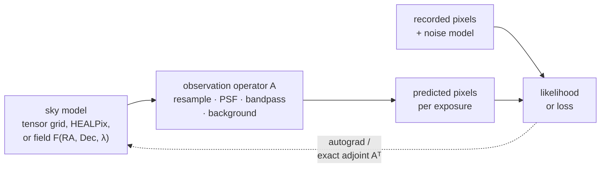

# Models: overview (experimental)

This area models the sky *as observed*: a description of the sky, pushed
through the instrument (resampling onto each detector, PSF, bandpass,
background, noise), compared with the recorded pixels. Because every step is a
torch operation, the comparison has gradients, and you fit the sky, the
instrument, or both by gradient descent instead of first coadding the data.

!!! warning "What experimental means"
    `torchsky.scene`, `torchsky.field`, and the likelihood, query, solver,
    evidence, and native-response modules under `torchsky.map` are
    **experimental**:

    - Names, defaults, result objects, and serialized model formats may change
      between minor releases without a deprecation period. Pin a version if you
      depend on them.
    - They are tested for bounded API, gradient, exact-adjoint, and device
      contracts, like the rest of torchsky.
    - They carry no claim of scientific accuracy on real data. Evaluation on
      real surveys runs in
      [torchsky-harness](https://github.com/astroai/torchsky-harness) and is
      not yet a release gate.

    The geometry and mapmaking layers they build on
    ([WCS](../coordinates/index.md), [maps](../maps/index.md),
    [sphere](../sphere/index.md)) are core and stable. The stability tier of
    each namespace is listed in the [API reference](../reference/index.md#namespaces).

## The Core Idea: A Forward Model With Gradients



- An **observation operator** \(A\) maps the sky model to one exposure's
  pixels. Its adjoint \(A^T\), the transpose that maps pixel residuals back to
  the sky, is exact, so normal equations \(A^T N^{-1} A\) can be solved without
  forming a matrix (\(N\) is the noise covariance). Operators for one exposure
  are grouped in an `ObservationOperatorBundle`; learned instrument models such
  as `LearnedInstrumentOperator` and `ConstrainedKernelPSF` live in
  `torchsky.map.operators`.
- A **field** is a continuous function of sky position and wavelength, such as
  a neural network (an implicit neural representation, INR) or a spectral
  Power Foam (a partition of the sky into cells with spectral appearance). It
  is fitted jointly to all bands and exposures.
- A **likelihood** scores predicted pixels against data under a stated noise
  law, for example Gaussian read noise plus Poisson photon noise.

## Choose a Page

| Task | Page | Entry point |
|---|---|---|
| Describe observations and a target; apply operators with exact adjoints; solve normal equations | [Scenes](scenes.md) | [`scene.render`](../reference/scene.md#torchsky.scene.render), [`scene.operator_adapter_for_observation`](../reference/scene.md#torchsky.scene.operator_adapter_for_observation) |
| Fit a continuous multi-band sky model to images | [Fields](fields.md) | [`field.fit`](../reference/field.md#torchsky.field.fit), [`field.FieldObservation`](../reference/field.md#torchsky.field.FieldObservation) |
| Forced photometry, star stamps, and pixel likelihoods without a global field | [Likelihoods](likelihoods.md) | [`GaussianLikelihoodFactor`](../reference/map-likelihood.md#torchsky.map.likelihood.GaussianLikelihoodFactor) |
| Orient PSF kernels and separate source flux from uniform sky | [PSF conventions](psf-conventions.md) | — |
| Sky and wavelength feature encoders, photometric redshift tokens | [Encoders](encoders.md) | [`torchsky.encoders`](../reference/encoders.md) (core tier) |
| The inverse problem and modelling assumptions behind fields | [Formulation](formulation.md) | — |

## Fit a Sky Through an Operator

The exposure is the 13 × 13 pixel Legacy Surveys g-band cutout of a star in
NGC 288 used in the [quick start](../introduction/quickstart.md). The sky model
lives on a different grid: same pixel size, rotated by 30° and centred on the
Gaia position of the star. The operator resamples the model onto the exposure;
Adam fits the model to the recorded pixels by differentiating through it, and
the fitted star lands on the Gaia position.

<!-- docs: run -->
```python
import math

import torch

from torchsky import scene
from torchsky.map import ImageObservation

stamp = torch.tensor([   # Legacy Surveys DR10 g band, nanomaggies per pixel
    [0.05, 0.06, 0.08, 0.10, 0.13, 0.16, 0.16, 0.16, 0.14, 0.11, 0.09, 0.07, 0.05],
    [0.06, 0.08, 0.12, 0.17, 0.22, 0.28, 0.31, 0.30, 0.25, 0.19, 0.14, 0.10, 0.07],
    [0.07, 0.11, 0.17, 0.27, 0.40, 0.54, 0.63, 0.59, 0.48, 0.34, 0.23, 0.15, 0.09],
    [0.10, 0.15, 0.25, 0.43, 0.71, 1.04, 1.23, 1.19, 0.92, 0.60, 0.35, 0.21, 0.13],
    [0.11, 0.19, 0.34, 0.64, 1.17, 1.82, 2.23, 2.12, 1.59, 0.96, 0.53, 0.28, 0.16],
    [0.13, 0.22, 0.43, 0.85, 1.64, 2.68, 3.32, 3.07, 2.27, 1.33, 0.68, 0.34, 0.18],
    [0.14, 0.24, 0.45, 0.91, 1.81, 2.95, 3.77, 3.45, 2.58, 1.47, 0.73, 0.37, 0.20],
    [0.13, 0.22, 0.41, 0.81, 1.55, 2.52, 3.28, 3.07, 2.21, 1.27, 0.66, 0.33, 0.18],
    [0.12, 0.18, 0.32, 0.58, 1.03, 1.60, 1.97, 1.88, 1.40, 0.86, 0.48, 0.27, 0.15],
    [0.10, 0.15, 0.24, 0.38, 0.60, 0.85, 1.00, 0.96, 0.75, 0.51, 0.32, 0.20, 0.13],
    [0.09, 0.12, 0.17, 0.24, 0.33, 0.43, 0.49, 0.47, 0.40, 0.29, 0.20, 0.14, 0.09],
    [0.10, 0.11, 0.12, 0.15, 0.19, 0.23, 0.25, 0.25, 0.21, 0.17, 0.13, 0.10, 0.07],
    [0.13, 0.10, 0.10, 0.10, 0.12, 0.14, 0.14, 0.14, 0.13, 0.10, 0.08, 0.07, 0.05],
])
exposure = ImageObservation(data=stamp, wcs={
    "NAXIS": 2, "NAXIS1": 13, "NAXIS2": 13, "CTYPE1": "RA---TAN", "CTYPE2": "DEC--TAN",
    "CRVAL1": 13.12, "CRVAL2": -26.5525, "CRPIX1": 113.5, "CRPIX2": 106.5,
    "CD1_1": -7.27777777777778e-05, "CD1_2": 0.0, "CD2_1": 0.0, "CD2_2": 7.27777777777778e-05,
})
s, t = 0.262 / 3600, math.radians(30.0)
target = scene.target_from_header({
    "NAXIS": 2, "NAXIS1": 15, "NAXIS2": 15, "CTYPE1": "RA---TAN", "CTYPE2": "DEC--TAN",
    "CRVAL1": 13.1286345, "CRVAL2": -26.5597488, "CRPIX1": 8.0, "CRPIX2": 8.0,   # Gaia position
    "CD1_1": -s * math.cos(t), "CD1_2": s * math.sin(t), "CD2_1": s * math.sin(t), "CD2_2": s * math.cos(t),
}, value_semantics="surface_brightness")
forward = scene.operator_adapter_for_observation(
    exposure, resampling_kernel="bilinear"
).bind_image_plane_target(target)

sky = torch.zeros(15, 15, requires_grad=True)
optimizer = torch.optim.Adam([sky], lr=0.1)
for _ in range(200):
    optimizer.zero_grad()
    loss = (forward.apply(sky) - stamp).square().sum()
    loss.backward()
    optimizer.step()
assert loss.item() < 0.01 * stamp.square().sum().item()
peak = int(sky.detach().argmax())
assert abs(peak // 15 - 7) <= 1 and abs(peak % 15 - 7) <= 1   # the star sits at CRPIX
```

## Conventions and Pitfalls

- **Value semantics are declared.** A target is surface brightness or flux,
  exactly as in [maps](../maps/index.md#conventions-and-pitfalls); PSF kernels
  follow the orientation in [PSF conventions](psf-conventions.md).
- **Normalize coordinates before float32.** Absolute RA/Dec cast to float32
  loses subpixel structure. Fields normalize sky and wavelength through a
  `Domain`; custom models should subtract the sky centre first.
- **MPS.** Fields run in float32 there; fine angular structure on MPS is not
  verified.
- **Identifiability.** A good fit to data does not prove the sky model is
  unique. Hold out exposures or bands, and read the
  [formulation](formulation.md) for what each model can and cannot constrain.

## Connections

Models compose the core areas: each exposure carries a
[WCS](../coordinates/index.md); operators reuse the
[resampling kernels](../maps/resampling.md) and
[coadd](../maps/coadds.md) machinery; HEALPix and harmonic sky representations
come from the [celestial sphere](../sphere/index.md); and passband integrals come
from [synthetic photometry](../spectra/photometry.md). For a classical stacked
product, start with [maps](../maps/index.md) instead.

Examples on real data: one continuous field fitted to
[Legacy Surveys images of the Cartwheel](../examples/index.md#one-continuous-field-fitted-to-griz-images-of-the-cartwheel),
and [forced photometry of Gaia stars](../examples/index.md#forced-photometry-of-143-gaia-stars-near-ngc-288)
in NGC 288.
