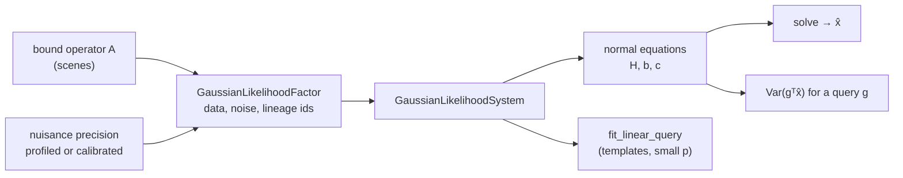

# Likelihoods

!!! warning "Experimental surface"
    The likelihood, query, evidence, nuisance, and native-response modules under
    `torchsky.map` are experimental. Class names, constructor arguments,
    required identifiers, and report fields may change between minor releases
    without a deprecation period. They are tested against independent dense
    and SciPy references, but carry no calibration of any real instrument.

A **likelihood** scores how probable the recorded pixels are for a given model
of the sky and instrument. Its negative logarithm (the **NLL**) is the loss to
minimize: for independent Gaussian pixel noise with variance \(\sigma_p^2\),

\[
-\ln \mathcal L = \sum_p \left[ \frac{(y_p - \mu_p)^2}{2\sigma_p^2}
  + \tfrac12 \ln(2\pi\sigma_p^2) \right],
\]

where \(y_p\) is the data and \(\mu_p\) the prediction. A CCD at low signal is
better described by a **Poisson–Gaussian** law: an integer number of electrons
\(k\), Poisson-distributed with mean \(\lambda_p\), read out with Gaussian noise
of variance \(\sigma_r^2\), gain \(g\), and offset \(b\):

\[
p(y_p) = \sum_{k \ge 0} \frac{\lambda_p^k e^{-\lambda_p}}{k!}\;
         \mathcal N\!\left(y_p;\ g k + b,\ \sigma_r^2\right).
\]

This area provides both laws as differentiable tensor functions, plus the
pieces needed to use them on detector data without first building a global sky
model: a star's flux from a native pixel stamp, a forced-photometry amplitude
with its uncertainty, background or calibration terms treated as **nuisance**
parameters (unknowns that are needed for the fit but not of interest), and a
physical likelihood for a single raw detector read.

Use these components for forced photometry, PSF-star profiling, small blend
fits, and detector-level fitting where the noise model matters. For fitting a
full sky model, the same likelihoods act as the loss of [fields](fields.md).

## How It Works



- A [`GaussianLikelihoodFactor`](../reference/map-likelihood.md#torchsky.map.likelihood.GaussianLikelihoodFactor)
  pairs a linear [bound operator](scenes.md) with its centred data, a precision
  (inverse covariance), and identifiers for the measurements and calibration it
  uses. A [`GaussianLikelihoodSystem`](../reference/map-likelihood.md#torchsky.map.likelihood.GaussianLikelihoodSystem)
  sums independent factors and refuses to count the same measurement twice.
- The system keeps the full quadratic \(Q(x) = x^\mathsf{T} H x - 2 x^\mathsf{T} b + c\)
  matrix-free. `solve()` runs conjugate gradients; `functional_uncertainty(g)`
  returns the sampling variance of a linear quantity \(g^\mathsf{T}\hat x\), such
  as an aperture flux, without inverting \(H\).
- A linear nuisance with basis \(B\) (a constant sky, a gradient) is either
  **profiled**, fitted alongside with no prior, which replaces the precision
  \(W\) by \(W - W B (B^\mathsf{T} W B)^{+} B^\mathsf{T} W\); or **calibrated**,
  given an external mean and covariance that enter the likelihood.

## Assumptions and Accuracy

- Factors are fixed Gaussian quadratics: the operator, noise, and calibration
  are held fixed while they are in use. Rebuild a factor after changing any of
  them; an [`EvidenceSnapshot`](../reference/map-evidence.md#torchsky.map.evidence.EvidenceSnapshot)
  detects in-place changes and makes stale results raise.
- Reported uncertainties are conditional on the model being right. They do not
  include PSF, astrometric, or calibration errors unless those are declared as
  nuisances.
- The Poisson–Gaussian law keeps a finite range of counts around the
  likely values and renormalizes over it, so it is a normalized density; its
  values and derivatives are checked against SciPy in the tests.

## Forced Photometry of a Star Stamp

A star with flux 17 at a known position on a 9×9 stamp, constant background 3,
Gaussian noise of σ = 0.2.
[`profile_native_star`](../reference/map-operators-epsf.md#torchsky.map.operators.epsf.profile_native_star)
fits flux and background together by weighted least squares, using a
pixel-integrated PSF
([`GaussianPixelResponse`](../reference/map-operators-epsf.md#torchsky.map.operators.epsf.GaussianPixelResponse))
evaluated at each pixel centre:

<!-- docs: run -->
```python
import torch

from torchsky.map.operators.epsf import GaussianPixelResponse, native_pixel_stamp, profile_native_star

gen = torch.Generator().manual_seed(42)
variance = torch.full((9, 9), 0.04, dtype=torch.float64)
centre = torch.tensor([4.17, 4.43], dtype=torch.float64)                 # x, y in pixels
psf = GaussianPixelResponse(torch.tensor([0.65, 0.8], dtype=torch.float64))

stamp = native_pixel_stamp(torch.zeros(9, 9, dtype=torch.float64), variance,
                           x_slice=slice(0, 9), y_slice=slice(0, 9))
template = psf(stamp.pixel_xy - centre)                                  # unit-flux star
stamp.data.copy_(17.0 * template + 3.0 + 0.2 * torch.randn(9, 9, generator=gen, dtype=torch.float64))

star = profile_native_star(stamp, psf, centre)
assert abs(float(star.flux) - 17.0) < 1.5
print(star.flux, star.retained_response)       # retained_response: PSF fraction on the stamp
```

The stamp holds the detector pixels as recorded; nothing is interpolated or
resampled. The [native operators example](https://github.com/astroai/torchsky/blob/main/examples/native_operators.py)
continues this with a calibrated background and a normalized likelihood.

## Recipes

### Forced Photometry With a Likelihood Factor

Wrap the template in a one-parameter operator, attach the noise, and ask for
the flux and its standard deviation. A direct template query
([`fit_linear_query`](../reference/map-query.md#torchsky.map.query.fit_linear_query))
gives the same answer for a small number of parameters, and keeps the coupling
between blended sources or bands when several templates are passed.

<!-- docs: run -->
```python
import torch

from torchsky.map.likelihood import GaussianLikelihoodFactor, GaussianLikelihoodSystem
from torchsky.map.operators.epsf import GaussianPixelResponse
from torchsky.map.query import fit_linear_query
from torchsky.map.solvers import BoundObservationOperator
from torchsky.scene import ObservationOperatorBundle, TargetRenderSpec

gen = torch.Generator().manual_seed(1)
variance = torch.full((9, 9), 0.04, dtype=torch.float64)
yy, xx = torch.meshgrid(torch.arange(9.0, dtype=torch.float64), torch.arange(9.0, dtype=torch.float64), indexing="ij")
offsets = torch.stack((xx - 4.2, yy - 4.4), dim=-1)
template = GaussianPixelResponse(torch.tensor([0.7, 0.7], dtype=torch.float64))(offsets)
data = 17.0 * template + 0.2 * torch.randn(9, 9, generator=gen, dtype=torch.float64)   # background removed

operator = BoundObservationOperator(
    ObservationOperatorBundle(),
    TargetRenderSpec(header={}, shape=(1, 1)),
    apply_operator=lambda scene, target: template * scene.data.reshape(()),
    apply_adjoint=lambda residual: (template * residual).sum().reshape(1, 1),
    apply_noise=lambda residual: residual / variance,                   # precision N^-1
)
factor = GaussianLikelihoodFactor(operator, data, ("stamp-001",), "nominal-psf", "docs-example")
system = GaussianLikelihoodSystem((factor,))

flux = system.solve(iterations=2).solution
sigma = system.functional_uncertainty(torch.ones_like(flux)).sampling_variance.sqrt()
query = fit_linear_query(system, (template.unsqueeze(0),))
torch.testing.assert_close(query.coefficients.reshape_as(flux), flux)
assert abs(float(flux) - 17.0) < 4 * float(sigma)
```

### Poisson–Gaussian Pixels With Gradients

[`poisson_gaussian_nll`](../reference/map-operators-noise.md#torchsky.map.operators.noise.poisson_gaussian_nll) takes observed values, expected electrons, read
variance, gain, and offset. At a few electrons per pixel it describes the data
better than a Gaussian ([`gaussian_nll`](../reference/map-operators-noise.md#torchsky.map.operators.noise.gaussian_nll)) with variance \(\lambda + \sigma_r^2\).

<!-- docs: run -->
```python
import torch

from torchsky.map.operators import gaussian_nll, poisson_gaussian_nll

gen = torch.Generator().manual_seed(0)
rate = torch.full((64, 64), 3.0, dtype=torch.float64)                    # electrons
observed = torch.poisson(rate, generator=gen) + 1.5 * torch.randn(64, 64, generator=gen, dtype=torch.float64)
read_var = torch.tensor(2.25, dtype=torch.float64)

scale = torch.tensor(1.0, dtype=torch.float64, requires_grad=True)
nll = poisson_gaussian_nll(observed, scale * rate, read_var, reduction="sum")
nll.backward()
assert torch.isfinite(scale.grad)
assert nll < gaussian_nll(observed, rate, rate + read_var, reduction="sum")
```

**Memory.** The law is a sum over electron counts per pixel. Pixels are
processed in chunks of about \(2^{22}\) count terms, with activation
checkpointing under reverse-mode autograd, so peak memory does not grow with
the frame size. For a whole field fitted through
[`bind_native_integrated_read_likelihood`](../reference/map-field-native-integrated-read.md#torchsky.map.field.native_integrated_read.bind_native_integrated_read_likelihood),
`nll(..., mixture_chunk_size=C)` bounds the stored mixture activations to
\(C\) pixels at a time during backpropagation; the field-sampling graph itself
stays resident.

### Background as a Nuisance

```python
# fragment: variance, stamp, and a 9x9 image shape as in the star example
import torch

from torchsky.map.operators.nuisance import CalibratedNuisancePrecision, ProfiledNuisancePrecision

constant = torch.ones(9, 9, 1, dtype=torch.float64)                     # basis B: one sky level
profiled = ProfiledNuisancePrecision(constant, apply_precision=lambda r: r / variance)
calibrated = CalibratedNuisancePrecision(
    constant, apply_precision=lambda r: r / variance,
    covariance_factor=torch.tensor([[0.1]], dtype=torch.float64),       # sky known to 0.1
    mean=torch.tensor([3.0], dtype=torch.float64),
)
centred = calibrated.center(stamp.data)          # subtract the calibrated mean once
```

Pass either object as `apply_noise` of the operator. Profiling is right when
the background is unknown; calibration when an independent measurement (a sky
annulus, a sky model) constrains it. A shared background across exposures must
be eliminated once, in one joint factor
([`bind_joint_native_likelihood`](../reference/map-field-joint-native-likelihood.md#torchsky.map.field.joint_native_likelihood.bind_joint_native_likelihood)),
not separately per exposure.

### Normalized Densities and Noise Fitting

`system.negative_log_likelihood(x)` needs each factor's `log_normalization`,
\(\tfrac12[n \ln 2\pi + \ln\det C]\) on the observed pixels. Without it, an
absolute density is refused: fitting a noise level from a quadratic alone
inflates the noise without bound.

### Detector Reads and Calibration

| Component | What it models |
|---|---|
| [`integrated_detector_moments`](../reference/map-operators-detector-response.md#torchsky.map.operators.detector_response.integrated_detector_moments) | Mean and covariance of a read: photons, dark current, charge sharing, read noise, gain |
| [`PixelCalibrationOp`](../reference/map-operators-pixel-calibration.md#torchsky.map.operators.pixel_calibration.PixelCalibrationOp) | An explicit per-pixel scale (flat, gain) with declared units |
| [`NativeFieldResponse`](../reference/map-field-native-response.md#torchsky.map.field.native_response.NativeFieldResponse) | A continuous sky sampled at source nodes and transported into detector pixels |
| [`bind_native_integrated_read_likelihood`](../reference/map-field-native-integrated-read.md#torchsky.map.field.native_integrated_read.bind_native_integrated_read_likelihood) | Poisson–Gaussian likelihood of one raw integrated read per pixel |
| [`bind_linear_band_grid_likelihood`](../reference/map-field-gaussian.md#torchsky.map.field.gaussian.bind_linear_band_grid_likelihood) | A Gaussian factor for a group of field observations with shared nuisances |

The raw-read likelihood requires `processing_state="raw_reads"` and a declared
exposure time, quantum efficiency, and read variance; it does not accept a
calibrated (flat-fielded, sky-subtracted) product as a raw read. All units and
conversions are declared by the caller; none is inferred from labels.

## Limits

- Correlated read noise, nonlinear detector effects (saturation,
  brighter-fatter, persistence), and up-the-ramp reads are not modelled.
- Uncertainties are fixed-model sampling uncertainties. They do not account
  for model misspecification or the choice of templates.
- Real-instrument products (HST, JWST, CFHT MegaCam) are validated for
  geometry and headers only; science-level checks on them run in
  [torchsky-harness](https://github.com/astroai/torchsky-harness).

## Pitfalls

- **Gain convention.** `gain` here is output units per electron, the inverse of
  the common electrons-per-ADU.
- **Never integrate a pixel response twice.** `GaussianPixelResponse` and
  `PixelIntegratedResponse` already include the pixel footprint.
- **Masked is not missing.** Masking both sides of a correlated-noise precision
  conditions on the kept pixels; it is not marginalization.
- **Observed curvature is not Fisher information.** The Hessian of a
  Poisson–Gaussian NLL can be indefinite at low counts.

## See Also

- [Scenes](scenes.md): bound operators and normal-equation solvers.
- [PSF conventions](psf-conventions.md): kernel orientation and flux
  conservation.
- [Fields](fields.md): likelihoods as the loss of a sky model.
- Reference: [`torchsky.map.likelihood`](../reference/map-likelihood.md),
  [`torchsky.map.query`](../reference/map-query.md),
  [`torchsky.map.operators.nuisance`](../reference/map-operators-nuisance.md).
