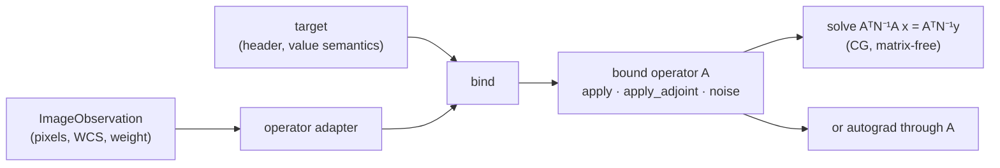
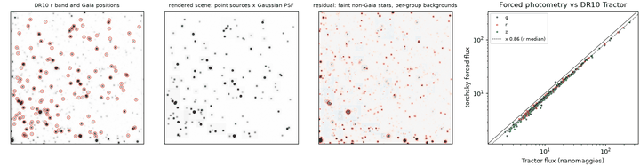

# Scenes

!!! warning "Experimental surface"
    `torchsky.scene` and the solvers in `torchsky.map.solvers` are
    experimental. Constructor arguments, the set of scene representations,
    result objects, and solver diagnostics may change between minor releases
    without a deprecation period. The resampling kernels they wrap are part of
    the stable [maps](../maps/index.md) layer.

A **scene** is a description of the sky on a chosen **target**: a pixel grid
with a WCS and a declared value semantics (surface brightness or flux per
pixel). Each recorded exposure is linked to the scene by an **observation
operator** \(A\), a linear map that predicts the exposure's pixels from the
scene: resampling from the target grid to the detector, and optionally PSF,
bandpass, and background. With several exposures \(A_1, \dots, A_N\), the scene
that best explains all of them under Gaussian noise solves the **normal
equations**

\[
\Big(\sum_n A_n^\mathsf{T} N_n^{-1} A_n\Big)\,x = \sum_n A_n^\mathsf{T} N_n^{-1} y_n ,
\]

where \(y_n\) are the data, \(N_n\) the noise covariance, and \(A_n^\mathsf{T}\)
the **adjoint** (transpose) of each operator, which spreads pixel residuals back
onto the scene.

`torchsky.scene` builds targets from headers, wraps exposures in operators
whose adjoints are exact, and solves the normal equations matrix-free with
conjugate gradients (CG): \(A\) and \(A^\mathsf{T}\) are applied as functions,
and no matrix is ever formed. Use it for image-plane inversion of dithered
exposures (a statistically optimal alternative to a coadd), for forward
modelling with your own scene representation, and as the operator layer under
[fields](fields.md) and [likelihoods](likelihoods.md).

## How It Works



[`operator_adapter_for_observation`](../reference/scene.md#torchsky.scene.operator_adapter_for_observation)
wraps one exposure with the same resampling kernels used by coadds;
`bind_image_plane_target` fixes the target and returns a bound operator with
`apply`, `apply_adjoint`, and the inverse-noise weighting from the exposure's
weight and mask. To start from a FITS file,
[`scene.image_observation`](../reference/scene.md#torchsky.scene.image_observation)
reads the image and header with torchfits. The adjoint is the exact vector–Jacobian product of the
forward projection, so \(\langle A u, v\rangle = \langle u, A^\mathsf{T} v\rangle\)
holds to floating-point rounding, and CG converges to the true least-squares
solution rather than to that of a nearby, inconsistent operator.

## Assumptions and Accuracy

- Operators are linear in the scene with their parameters fixed. Nonlinear
  instrument effects need autograd instead of the normal equations.
- The weight maps are inverse variances. Rescaled or clipped weights still give
  a weighted least-squares solution but not a calibrated likelihood.
- Pixels on the target that no exposure constrains make the normal operator
  singular. Add damping, a prior, or restrict the target.
- Adjoint identities are checked by dot-product tests, and CG against dense
  solves, in the test suite.

## A Dot-Product Test and a Solve

<!-- docs: run -->
```python
import torch

from torchsky import scene
from torchsky.map import ImageObservation

header = {
    "NAXIS": 2, "NAXIS1": 32, "NAXIS2": 32,
    "CTYPE1": "RA---TAN", "CTYPE2": "DEC--TAN",
    "CRPIX1": 16.5, "CRPIX2": 16.5, "CRVAL1": 150.0, "CRVAL2": 2.0,
    "CDELT1": -0.05 / 3600.0, "CDELT2": 0.05 / 3600.0,
}
target = scene.target_from_header(header, value_semantics="surface_brightness")
yy, xx = torch.meshgrid(torch.arange(32.0), torch.arange(32.0), indexing="ij")
sky = torch.exp(-((xx - 16) ** 2 + (yy - 16) ** 2) / 18.0)

shifted = {**header, "CRVAL1": 150.0 + 0.4 * 0.05 / 3600.0}      # 0.4 pixel offset
operator = scene.operator_adapter_for_observation(
    ImageObservation(data=sky, wcs=shifted), resampling_kernel="bilinear"
).bind_image_plane_target(target)

u, v = torch.randn(32, 32), torch.randn(32, 32)
torch.testing.assert_close((operator.apply(u) * v).sum(), (u * operator.apply_adjoint(v)).sum(), rtol=1e-4, atol=1e-4)

solved = operator.solve_normal_equation_cg(operator.apply(sky), iterations=8)
assert solved.solution.shape == sky.shape
```

The [MegaPipe mosaic example](../published-examples/megapipe_mosaic.py) uses the
same resampling kernels in forward (coadd) form.

## Real Data: Forced Photometry of Gaia Stars

A scene does not have to be a pixel grid. A
[`SourceCatalogScene`](../reference/scene.md#torchsky.scene.SourceCatalogScene)
is a list of sources at fixed sky positions with one flux per band, rendered
through each observation's WCS and PSF. Its parameters enter the prediction
linearly, so fitting them is an exact linear least-squares problem.
[`fit_forced_photometry`](../reference/catalogs.md#torchsky.catalogs.fit_forced_photometry)
groups stars whose footprints overlap and solves each group for its fluxes and a
local background on the native pixels.

The [forced photometry example](../published-examples/legacy_forced_photometry.py)
does this on a 100 arcsec Legacy Surveys DR10 g/r/z cutout 4 arcmin from the
globular cluster NGC 288. It uses the 143 Gaia stars in the DR10 Tractor
catalogue of the field. The PSF is a Gaussian whose width is fitted per band
by minimising chi-square over a grid of widths, giving FWHM 1.29, 0.98 and
0.86 arcsec in g, r and z.



```python
# fragment: images, invvar, header, ra, dec and sigma come from the cached cutout and catalogue
import torch

from torchsky.catalogs import fit_forced_photometry
from torchsky.field import FieldObservation, PSFSpec
from torchsky.scene import SourceCatalogScene

observations = [
    FieldObservation(image=images[k], header=header, weight=invvar[k],
                     band_name=band, psf_spec=PSFSpec.gaussian(sigma[k]))
    for k, band in enumerate("grz")
]
scene = SourceCatalogScene(ra, dec, coefficients=torch.zeros((ra.numel(), 3), dtype=torch.float64),
                           band_labels=("g", "r", "z"))
result = fit_forced_photometry(observations, scene, background="constant")
# result.flux: (143, 3) nanomaggies; result.predictions: the rendered scene per band
```

The forced fluxes follow the Tractor fluxes star by star with a robust scatter
of 3 % in every band. Their median ratio, 0.82–0.86, is an aperture
correction, not an error: Tractor fits pixelized PSF models with extended
wings to the individual exposures, and a Gaussian core misses that light. Use
a measured PSF (a kernel `PSFSpec` or a template morphology) when absolute
fluxes matter. The residual image also shows what a forced fit cannot
do: stars missing from the input catalogue stay in the data, and each blend
group absorbs them into its local background. A full fit of all 143 stars and
three bands takes about a second on a CPU.

## Recipes

### Invert Several Dithered Exposures

[`bind_image_plane_observations_to_target`](../reference/scene.md#torchsky.scene.bind_image_plane_observations_to_target)
binds a list of exposures to one target. The normal operator sums over them in
exposure order; `exposure_chunk_size` caps how many predictions are held in
memory at once. Four half-pixel dithers recover the scene to rounding error:

<!-- docs: run -->
```python
import torch

from torchsky import scene
from torchsky.map import ImageObservation

header = {
    "NAXIS": 2, "NAXIS1": 24, "NAXIS2": 24,
    "CTYPE1": "RA---TAN", "CTYPE2": "DEC--TAN",
    "CRPIX1": 12.5, "CRPIX2": 12.5, "CRVAL1": 150.0, "CRVAL2": 2.0,
    "CDELT1": -0.1 / 3600.0, "CDELT2": 0.1 / 3600.0,
}
target = scene.target_from_header(header, value_semantics="surface_brightness")
yy, xx = torch.meshgrid(torch.arange(24.0), torch.arange(24.0), indexing="ij")
sky = torch.exp(-((xx - 12) ** 2 + (yy - 12) ** 2) / 8.0)

dithers = [(0.0, 0.0), (0.5, 0.0), (0.0, 0.5), (0.5, 0.5)]
exposures = [
    ImageObservation(data=torch.zeros(24, 24), wcs={**header, "CRPIX1": 12.5 + dx, "CRPIX2": 12.5 + dy})
    for dx, dy in dithers
]
operators = scene.bind_image_plane_observations_to_target(exposures, target, resampling_kernel="bilinear")
data = operators.apply(sky)                     # one predicted image per exposure
result = operators.solve_normal_equation_cg(data, iterations=50, damping=1e-6)
assert (result.solution - sky)[4:-4, 4:-4].abs().max() < 1e-4
```

`result.residual_norm_history` and `result.diagnostics` report convergence;
`solve_least_squares_lsqr` is available when the normal operator is singular.

### Fit by Gradient Descent Instead

The same bound operator is differentiable, so a nonlinear loss or a prior that
the normal equations cannot express is an ordinary PyTorch loop. The
[models overview](index.md#fit-a-sky-through-an-operator) fits a sky through
one operator with Adam.

### Bring Your Own Forward Model

`adapter.bind_target(target, apply_operator=..., apply_adjoint=...,
apply_noise=...)` binds any linear forward model you supply. The adjoint is
then your responsibility: check it with the dot-product test above before
solving. A `BoundObservationOperator` built this way also feeds a
[`GaussianLikelihoodFactor`](likelihoods.md#forced-photometry-with-a-likelihood-factor).

### Other Scene Representations

[`SceneRepresentation`](../reference/scene.md#torchsky.scene.SceneRepresentation)
adapters let the same observation path render a tensor grid
(`DiscreteTargetImage`), a HEALPix map (`HealpixMapScene`), spherical-harmonic
coefficients (`HarmonicAlmScene`), a fitted field (`ContinuousFieldModel`), or
a list of point, Gaussian, or Sérsic sources (`SourceCatalogScene`).
[`scene.render`](../reference/scene.md#torchsky.scene.render) and
[`scene.predict`](../reference/scene.md#torchsky.scene.predict) dispatch on the
representation.

### Approximate Pixel Uncertainties

An operator set estimates the diagonal of \((H + \epsilon I)^{-1}\), with
\(H = \sum_n A_n^\mathsf{T} N_n^{-1} A_n\), by random probing (Hutchinson's
estimator), each probe solved by CG:

```python
# fragment: operators from bind_image_plane_observations_to_target, reference_map a target-shaped tensor
inverse_curvature = operators.estimate_posterior_variance_diagonal(
    reference_map, num_probes=64, seed=7, iterations=32, damping=1.0e-6,
)
```

Despite the method name, this is the diagonal of the inverse curvature, which
equals a posterior variance only for a well-posed, unregularized Gaussian
problem. Finite-probe estimates are noisy and can be negative; they are
returned signed because clipping would bias them. Every probe solve is checked,
and a failed solve raises instead of returning a number.

## Pitfalls

- **Declare value semantics.** Surface brightness is independent of pixel
  size; flux per pixel scales with pixel area. A mismatch between target and
  data changes the solution by the pixel-area ratio.
- **Unconstrained pixels.** Target pixels outside every exposure, or under
  masks in all of them, have no data; damp them or crop the target.
- **CG iterations are not convergence.** Read the residual history, and check
  that a tighter tolerance leaves the result unchanged.
- **Noise correlations.** Resampled inputs have correlated noise. Invert the
  native exposures, not coadds of them.

## See Also

- [Likelihoods](likelihoods.md): Gaussian and Poisson–Gaussian factors on
  bound operators.
- [Fields](fields.md): continuous scene models through the same operators.
- [Resampling](../maps/resampling.md): the kernels inside the operators.
- Reference: [`torchsky.scene`](../reference/scene.md),
  [`torchsky.map.solvers`](../reference/map-solvers.md).
- Example: [forced photometry of Gaia stars on Legacy Surveys images](../published-examples/legacy_forced_photometry.py).
