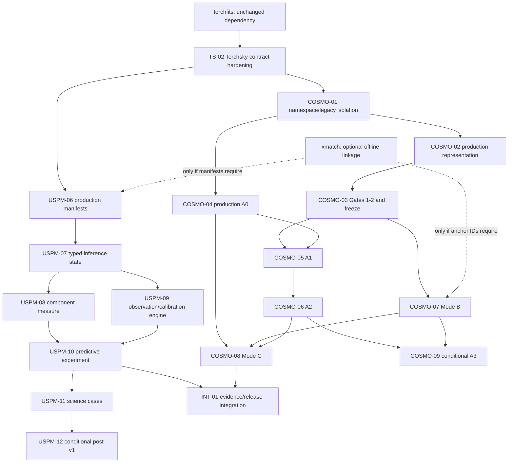

# Torchsky, USPM, and cosmodist consolidated implementation roadmap

Date: 2026-08-25

Status: dependency-ordered implementation and scientific-certification plan

Scope: `torchsky`, `uspm`, `cosmodist`, and `xmatch` only when catalog association is required

## 1. Authoritative specifications and document verdict

The scientific specifications for this roadmap are:

| Project | Authoritative artifact | Version | Pages | SHA-256 |
|---|---|---:|---:|---|
| Torchsky | `/Users/fabbros/src/sfabbro/torchsky/docs/formulation_map.pdf` | current | 15 | `212163e649a060ecec0e5677b73519a2ef2131791a92568c6250bcdccb7d73f9` |
| USPM | `/Users/fabbros/src/sfabbro/uspm/docs/formulation.pdf` | 1.0.1 | 52 | `55e172f5cb205c227408c9a0b770f45015ca58e0af42a80c7955768c292a1859` |
| cosmodist | `/Users/fabbros/src/astroai/cosmodist/docs/formulation.pdf` | 1.0.1 | 18 | `c168f14ad9777b9be7847be7bc9adfd0ae5a6ea30412ea52db65f54e36a6dbc6` |

Both formulations are implementable without scientific redesign.

USPM v1.0.1 repairs the Figure 2 rapidity mapping, removes a possible double
application of cosmological redshift, places telluric transmission before the
LSF, distinguishes the topocentric-vacuum rendering grid from the
barycentric-vacuum encoder view, and limits physical distance scaling to
distance mode. cosmodist v1.0.1 writes the Mode A observed-coordinate intensity
with `J_Theta(z)` applied once, uses `H J^-1 H^T` consistently, and distinguishes
active baselines from optional research extensions. The remaining changes are
presentation repairs.

All certification evidence is bound to the exact formulation hash. Evidence
created for an earlier PDF must fail closed. cosmodist has no passing evidence
to migrate and remains 0/10 certified.

## 2. What “complete” means

A code path is not complete because it imports, trains, or passes unit tests.
Completion has three levels:

1. **Software complete:** public contract, implementation, unit/property tests,
   migration tests, and a reproducible runnable configuration exist.
2. **Experiment complete:** immutable data/split manifests, checkpoints,
   comparator results, and held-out artifacts reproduce the declared
   experiment.
3. **Scientifically certified:** every formulation gate required for the claim
   passes on independent or held-out evidence, with the evidence bound to code,
   configuration, data, split, and formulation hashes.

Normative v1 baselines are completion requirements. Explicit post-v1 or modular
alternatives are conditional tracks. A conditional track is complete either
when its activation criteria are met and it passes its gates, or when its kill
criterion is reached and the negative result is recorded. Optional alternatives
do not block baseline completion.

Status codes used below:

| Code | Meaning |
|---|---|
| `DONE-SW` | Suitable software and contract exist locally; scientific evidence may still be absent. |
| `PARTIAL` | Reusable implementation exists but the formulation contract is incomplete. |
| `MISSING` | Required implementation or production workflow does not exist. |
| `BLOCKED-EVIDENCE` | Software exists, but required data, independent mocks, or held-out evidence do not. |
| `CONDITIONAL` | Formulation-authorized later track with an explicit activation gate. |
| `LEGACY` | Existing path conflicts with the formulation and must be isolated or removed from the normative namespace. |

## 3. Current implementation baseline

This roadmap starts from the uncommitted local implementation state audited on
2026-08-21. It does not treat that state as released or certified.

Execution update, 2026-08-25: USPM and cosmodist scientific environments now
resolve Python 3.13.14, PyTorch 2.13.0, and torchfits 1.0.0. USPM uses explicit
`free_amplitude`/`distance` flux scaling and masks static photometry. cosmodist
uses `True = usable` masks throughout its native-observation path; its evidence
ledger now binds complete provenance hashes, A0 includes Gate 9, and Mode C
freezes overlap, weights, Godambe inputs, and coverage. These are software
checks only. Torchsky's `wcs-aware-integration` commit has been fast-forwarded
onto `main`. Its WCS-aware pose, epoch sampling, native canvas footprint,
catalog association, and native-FITS preparation paths have subsequently been
hardened in the working tree. The shared development lanes now target Python
3.13.14, PyTorch 2.13.0, and torchfits 1.0.0, while Torchsky's published
dependency metadata intentionally remains uncapped above its supported floors.

USPM now also has a non-promoted stochastic object-state posterior,
visit-aware identity declarations, and a versioned lithium-censored source view.
cosmodist evidence is mode-scoped; Gate 8 uses paired-mock difference
covariances and Gate 9 requires named systematic injections. Real-data and
independent-mock exits remain blocked and no scientific gate has passed.

Final safe-scope execution update: USPM's lithium view now rejects non-finite
transformed bounds and has an encoder-level zero-dependency regression.
cosmodist representation checkpoints bind the certified data manifest, spatial
split, held-out query manifest, and configuration hashes; closure rejects a
mismatched checkpoint, uncertified data, sequential pixel caps, and any absent
declared held-out tile, exposure, or band. Gate 4 binds independent simulator
code and renderer-independence audit hashes. Mode C binds the complete Mode-A
lineage, raw-mock and coverage-policy hashes, Godambe dimension, and
per-parameter coverage counts. These are fail-closed software contracts, not
scientific gate results.

| Repository | Current software baseline | Scientific status |
|---|---|---|
| `torchsky` | Shared FLRW/CPL/curvature geometry, AP scaling, query/splat promotion, rapidity regression tests, and normalized detector laws are implemented locally. | Low-level synthetic/property evidence exists; observation metadata and cross-project integration still need hardening. |
| `uspm` | U1–U5 are implemented locally: source-view firewall, identifiable free-amplitude baseline, corrected telluric/LSF order, normalized spectral law, predictive draws/scores, cluster-finite conformal contracts, and banded capacity benchmark. | The real paired A-to-B experiment is blocked by a genuine paired multiview manifest and authoritative held-out high-resolution targets. The full physical state, nuisance hierarchy, and science heads remain incomplete. |
| `cosmodist` | C1–C7 software exists locally: native exposure records, observed-radiance representation, detector objectives, frozen artifacts, A0/A1/A2 primitives, Mode B primitives, executable gate contracts, and a fail-closed generalized Mode C layer. | 0/10 certified. Production exposure closure, overlap invariance, independent mocks, standard A0 recovery, and real Mode B anchors are absent. A3 is intentionally absent. |
| `xmatch` | No change. | Optional offline object linkage only. |
| `torchfits` | Existing dependency. | Complete and out of scope. |

Prior broad local verification was 40 passed/5 dependency or accelerator skips
for the focused Torchsky work, 467 tests through USPM `ci-local`, and 185
non-slow cosmodist tests with one slow test deselected. These counts are software
evidence, not scientific certification.

## 4. Fixed repository ownership

| Owner | Owns | Must not own |
|---|---|---|
| `torchsky` | Survey-independent tensor astronomy: WCS and spherical geometry; spectral and temporal coordinates; passbands; FLRW geometry; native observation contracts; query/splat; PSF, radiometry, background and detector-noise primitives; generic scene representations. | USPM source physics, component measures, calibration or inference; cosmodist representation networks, selection, bias, RSD, modes, standardizers, or certification logic. |
| `uspm` | Source/component/extrinsic state; encoders; physical source and observation model; calibration and nuisance hierarchy; measurement laws; predictive inference; proper scores; conformal calibration; anomaly tests; all USPM science heads. | General WCS, passband, sphere, time, PSF/splat, detector-law, or FLRW implementations already supplied by Torchsky. |
| `cosmodist` | Native-exposure indexing and adaptation; learned multiscale observed-sky representation; firewalls and immutable artifacts; Mode A/B/C; selection and transportability; cross-fitting; nuisance propagation; certification. | FITS I/O, generic coordinates/passbands/PSF/splat/noise/FLRW; source matching; USPM models. |
| `xmatch` | Optional offline physical-object association with immutable candidate/probability/provenance output. | Field rendering, tensor resampling, calibration fitting, representation learning, or cosmological likelihoods. |
| `torchfits` | Existing FITS I/O dependency. | Any redesign in this program. |

Promotion into Torchsky requires both of the following:

- the operation is survey-independent and acts on astronomical tensor fields or
  their coordinate/observation metadata; and
- both USPM and cosmodist have a concrete consumer without importing either
  project's scientific assumptions.

A primitive with one consumer stays local. Full-sky multiscale abstractions stay
conditional until both projects demonstrate the same operation. There is no
runtime dependency between USPM and cosmodist, and no runtime dependency from
Torchsky to xmatch.

## 5. Shared Torchsky foundation

### 5.1 Public API decision

Preserve the lazy namespace and the existing APIs:

```python
from torchsky.cosmology import (
    FLRW,
    APScaling,
    hubble_parameter,
    transverse_comoving_distance,
    comoving_position,
    comoving_separation,
    alcock_paczynski_scaling,
)

from torchsky.scene import (
    FieldObservation,
    ForwardContext,
    PSFSpec,
    ObservationOperatorAdapter,
    sample_image_plane_batched_channels,
    splat_to_native,
)

from torchsky.map import MapBandpassSpec, TargetRenderSpec
```

`Passband`, `SpectralAxis`, spectral WCS, temporal WCS, redshift/rapidity
transforms, and normalized detector laws remain their canonical existing APIs.
No replacement observation class, passband class, cosmology class, or neural
framework is introduced.

TS-02 extends existing records backward-compatibly rather than creating a
parallel abstraction:

- `ForwardContext` gains explicit `time_scale` and immutable provenance fields;
- `FieldObservation` gains explicit value/spectral units, detector-law and gain
  provenance, with certified construction requiring weight, mask, WCS, PSF,
  passband, time, and detector semantics;
- `MapBandpassSpec` and `TargetRenderSpec` carry explicit spectral units while
  physical integration continues to use `Passband`;
- adapters provide `.to(device, dtype)` behavior for floating tensors while
  preserving boolean masks and integer detector indices; and
- validation supports individual 2D observations and padded batched exposure
  sets without changing the single-observation public contract.

### 5.2 Tensor, coordinate, and unit conventions

| Domain | Convention |
|---|---|
| Sky vectors | Unit vectors have trailing shape `[..., 3]`; longitude/latitude APIs state degrees explicitly. Invalid or non-unit vectors are rejected at protected boundaries. |
| WCS | Geometry is evaluated in float64 by default. Feature tensors may be float32 or bfloat16 only after coordinates are computed. Pixel centers follow the existing Torchsky convention and are tested at boundaries. |
| Spectra | Spectral samples use trailing shape `[..., L]`. `SpectralAxis` and `Passband` carry explicit units; scale-based unit inference is forbidden. |
| Passbands | Wavelength and throughput are 1D, ordered, finite, on the caller's device; throughput is dimensionless and non-negative. Coverage failures are explicit. |
| Time | Time is MJD plus an explicit UTC/TAI/TT/TDB scale and provenance. Bare epoch numbers fail certified construction. |
| Observation image | One `FieldObservation.image` is `[H, W]`. Loader batches use `[B, E, H, W]` plus an exposure-valid mask; repeated visits are not collapsed by band. |
| Masks/weights | Mask is boolean with `True = usable`. Inverse variance is finite, non-negative, shape matched, and exactly zero where unusable. |
| Query | `sample_image_plane_batched_channels(image, grid)` consumes `[B,C,Hn,Wn]` and `[B,Hq,Wq,2]`. |
| Splat | `splat_to_native(flux, coordinates)` consumes `[B,Hq,Wq]` and `[B,Hq,Wq,2]`; it reports or exposes out-of-bounds loss rather than silently renormalizing it. |
| PSF | Kernels are finite, non-negative, odd-sized, and normalized by the operator. Spatially varying PSF metadata stay explicit. |
| Detector laws | Normalized Gaussian, Student-t, and bounded Poisson-Gaussian laws expose unreduced per-pixel values and `sum`/valid-pixel-mean reductions separately. |
| Differentiability | Gradients are required through field values, continuous coordinates, rapidities, PSF/kernel parameters, and cosmology parameters. No gradient is promised through masks, sort/search indices, associations, support decisions, or conformal quantiles. |

### 5.3 Shared primitive inventory

| Primitive | Consumers | Status | Completion action |
|---|---|---:|---|
| WCS, spherical coordinates, frame transforms | Both | `DONE-SW` | Reuse; add cross-project boundary fixtures only. |
| Spectral axes and flux-conserving rebinning | Both | `PARTIAL` | Enforce explicit units/device behavior and irregular-grid accuracy in TS-02. |
| Passband evaluation and physical photometry | Both | `DONE-SW` | Reuse `Passband`; remove project-local interpolation variants during integration. |
| Time coordinates and scale conversion | Both | `PARTIAL` | Bind MJD to a required time scale and provenance in TS-02. |
| Rapidity, redshift, BERV transforms | Both | `DONE-SW` | Preserve the positive-receding USPM invariant and round-trip tests. |
| FLRW radial/transverse/luminosity/angular distance | Both | `DONE-SW` | Preserve `FLRW`; add integration fixtures and release documentation. |
| Curved-space separation and AP scaling | cosmodist directly; USPM distance heads | `DONE-SW` | Add stress/gradient and downstream compatibility tests in TS-02. |
| `FieldObservation` and `ForwardContext` | Both | `PARTIAL` | Add units, time scale, provenance, certified validation, batching/device helpers. |
| `PSFSpec` and observation bundles | Both | `PARTIAL` | Add adjoint, normalization, heterogeneous-batch and nuisance-propagation tests. |
| Differentiable query/splat | Both | `PARTIAL` | Finish adjoint, conservation, boundary-loss, coordinate-gradient and GPU tests. |
| Normalized detector noise laws | Both | `DONE-SW` | Add dtype/device, extreme-tail, masking and PIT parity tests. |
| Generic scene/target contracts | Both | `PARTIAL` | Harden `MapBandpassSpec`, `TargetRenderSpec`, and adapter provenance without widening scope. |
| Learned multiscale sky encoder | cosmodist only today | `CONDITIONAL` | Keep in cosmodist; promote nothing until a second real consumer exists. |
| USPM spectral component model | USPM only | `MISSING` in Torchsky by design | Keep in USPM. |
| Catalogue association | ETL only | `CONDITIONAL` | Use xmatch only if manifests cannot supply immutable physical-object IDs. |

## 6. USPM formulation-to-code map

### 6.1 Data, records, and inference contracts

| Formulation requirement | Status | Owner/module decision | Remaining completion |
|---|---:|---|---|
| As-observed calibrated inputs; no silent dereddening/normalization | `PARTIAL` | `uspm.data` manifest/audit | Require provenance for every correction and reject coefficient pseudo-spectra or missing covariance in certified runs. |
| L2 calibrated photometry and L1 reduced spectra as first-class products | `PARTIAL` | `uspm.data` using Torchsky | Production paired manifests, passbands, masks, covariance and aperture metadata. |
| L0 raw counts | `CONDITIONAL` | USPM post-v1 using Torchsky detector laws | Activate only after reduced-product v1 closes; do not block v1. |
| Immutable source, observation, association and cluster IDs | `PARTIAL` | `data.ids`, `data.manifest`, `data.splits` | Visit-aware IDs and the production declaration contract exist; cross-check real manifest values, association lineage, collisions, content hashes and four-way manifests. |
| Train/validation/calibration/test split by independent cluster with buffers | `PARTIAL` | `data.splits` | Plate/night/pointing/spatial clustering and leakage audit on real data. |
| Typed state/source/extrinsic/component/calibration/nuisance records | `MISSING` | Extend `data.contracts`; add one model-state module only if needed | Replace packed scientific state with validated records carrying shapes, units, constraints and provenance. |
| Rigid `sourceView` to barycentric vacuum with metadata denylist | `DONE-SW` | `data.source_view` | Integrate with production loaders and add survey-adapter fixtures. |
| Split/merge-invariant `stdView` excluding amplitude, position, shift and survey | `PARTIAL` | `data.source_view`, `model.physics_heads` | Bind it to decoded normalized state and component-measure embedding. |
| Target-known observation context separated from target realization | `PARTIAL` | `data.observe_meta` | Typed constructor; prove `q_nuis` cannot access hidden target flux/noise realization. |
| Stochastic amortized `q_state(state | sourceView)` | `PARTIAL` | Existing `model.encoder` and `system` | A typed diagonal posterior and reparameterized draws exist for object state; integrate physical support constraints and calibrated predictive propagation. |
| Target-known-only `q_nuis(nuis | meta_known)` | `MISSING` | Existing observer/instrument spine | Hierarchical stochastic nuisance draws with no target-realization path. |
| Set-valued/multiview encoder and arbitrary view masking | `PARTIAL` | Existing encoder/collate | Permutation-invariant set ingestion, missing-view masks, view dropout and source-disjoint tests. |
| Phase A global training and Phase B per-object refinement | `PARTIAL` | `system`, `tasks.optimize_z_task` | Operate on physical records, freeze globals correctly, and preserve the same forward/loss semantics. |
| Measure-valued distillation | `PARTIAL` | Existing distillation script | Distill decoded shape, component measure and anchored rapidity; never raw latent MSE. |
| End-to-end counterfactual predictive draws | `PARTIAL` | `uncertainty.predictive` | Draw state, target nuisance and measurement noise jointly; expose draw provenance and deterministic replay. |

### 6.2 Source and observation physics

| Formulation requirement | Status | Owner/module decision | Remaining completion |
|---|---:|---|---|
| Positive normalized rest-frame source shape and free pre-host `F0` | `DONE-SW` baseline | Existing decoder/INR | Preserve exact normalization and distance-mode separation in all later models. |
| Anonymous component measure `sum_r w_r delta_(U,kin,Delta zeta)` | `MISSING` | USPM decoder/state | Implement only after the single-source high-resolution gate passes. |
| Sparse simplex weights and zero-mean logits | `MISSING` | USPM decoder | Sparsemax/entmax with exact simplex and permutation tests. |
| Component normalization, weighted velocity-offset gauge and zero-centroid kernels | `MISSING` | `model.kinematics`, decoder | Enforce by construction; test split/merge, shift and scale invariance. |
| Continuum, absorption, emission and kinematic component operators | `PARTIAL` | `model.physics_layers`, `model.kinematics` | Positive/constrained operators, capacity controls and physical injection tests. |
| Common host attenuation and dust-subspace separation | `PARTIAL` | Existing extinction/physics layers | Structured smooth screen, non-negativity, projection penalty and anchor tests; differential screens are post-v1. |
| Systemic rapidity and positive-BERV topocentric mapping | `DONE-SW` | Torchsky transform, USPM state | Preserve regression and prohibit duplicate `(1+z)` scaling. |
| Free-amplitude versus physical distance mode | `DONE-SW` contract | USPM distance heads | Every distance head must explicitly replace free `F0` with the standardized luminosity relation; no mixed mode. |
| Distance-integrated 3D MW dust | `MISSING` | USPM foreground model | Monotone path integration, external-map initialization, distance uncertainty and held-out sightline validation. |
| DIB optical depth and cloud rapidity field | `MISSING` | USPM foreground model | Line-localized response, path integration, cloud-frame transforms and injection recovery. |
| Unresolved/aperture-matched v1 coupling | `PARTIAL` | USPM observer using Torchsky PSF | Validate common apertures and constrained scalar chromatic coupling. |
| Learned 2D scenes, multiple sightlines and temporal state | `CONDITIONAL` | USPM-12 | Post-v1 only, after 1D v1 and corresponding data justify them. |
| Exact photon-counting synthetic photometry | `DONE-SW` | Torchsky `Passband` adapter | Use one canonical interpolation/integration path and coverage checks. |
| Wavelength drift | `PARTIAL` | `model.instrument` | Low-order constrained dispersion model with sky/arc anchors and identity-at-zero tests. |
| Telluric transmission before LSF | `DONE-SW` baseline | `model.observer` | Replace any unrestricted production branch with molecular/template-constrained families. |
| General LSF/resolution operator | `PARTIAL` | `model.instrument` using Torchsky | Delivered kernels/matrices, correction priors, normalization, covariance propagation and resolution injections. |
| Throughput, sky and detector residuals | `PARTIAL` | USPM observer/instrument | Smooth spline, physical low-rank sky and detector bases with shrinkage and tangent-space leakage tests. |
| Hierarchical calibration and gauge fixing | `MISSING` | USPM-only calibration module | Instrument/detector/night/local hierarchy, zero-mean gauges, fixed reference band, graph-rank checks and absolute anchors. |

### 6.3 Likelihoods, objectives, calibration, and evaluation

| Requirement | Status | Remaining completion |
|---|---:|---|
| Low-rank-plus-diagonal multivariate Student-t with `nu > 2` | `DONE-SW` core | Integrate all real covariance products; add scale/tail stress and large-`L` profiling. |
| Valid-coordinate covariance submatrices and Woodbury logdet/solve | `DONE-SW` core | Production masks, singular-edge tests and dense-reference parity. |
| Photometric Gaussian working likelihood | `PARTIAL` | Preserve normalization when variance is inferred and label working-likelihood semantics explicitly. |
| Conditional multiview factorization | `PARTIAL` | Enforce conditionally separate channels or use the full joint likelihood when the same photons inform shape and amplitude. |
| Fair multivariate Energy Score over predictive draws | `DONE-SW` core | Freeze feature metric, integrate into held-out evaluation and verify draw-count stability. |
| Denoising/self-reconstruction objective | `PARTIAL` | Keep separate from normalized likelihood and predictive proper scores; report each term. |
| Comparator suite: empirical kNN/MDN, pairwise specialist, SPENDER-like | `MISSING` | Same data, splits, capacity budget and target masks as USPM. |
| CRPS, interval/Winkler score, sharpness and domain slices | `PARTIAL` | Complete spectral-window and population/domain reporting with confidence intervals. |
| Cluster split conformal scalar intervals | `DONE-SW` core | Run on immutable real calibration clusters; unsupported small-`alpha` requests return infinity. |
| Distribution-aware spectral conformal sets | `PARTIAL` | Cluster-max Energy-score nonconformity over frozen draws and predeclared feature metric. |
| Weighted conformal | `CONDITIONAL` | Claim validity only on measured overlap support with stable, independently estimated density ratios. |
| Leave-one-view-out anomaly tests and Mondrian strata | `DONE-SW` core | Real multiview deployment, predeclared strata, cluster calibration and null/anomaly injections. |
| Computational ablation and deterministic replay | `PARTIAL` | Profile draw count, spectral capacity and operator cost; preserve seeds and artifact hashes. |

### 6.4 USPM science cases

Every case consumes the common measurement layer. A science head cannot repair a
failed source/observation model.

| Science case | Status | Required implementation and gate |
|---|---:|---|
| Blind counterfactual cross-survey translation | `BLOCKED-EVIDENCE` | Real paired A-to-B manifest, authoritative target covariance, proper-score comparators, cluster conformal coverage and sharpness. |
| Global spectrophotometric ubercalibration | `MISSING` | Connected full-rank observation graph, anchored gauges, withheld standards, zero-point/throughput injections and stability to graph removal. |
| Stellar atmosphere compatibility and discrepancy discovery | `MISSING` | Compatibility head, physical grid anchor, observation-space Jacobian/tangent projection, line/anomaly injections and null controls. |
| Cross-resolution transfer and wavelength calibration | `PARTIAL` | Capacity gate exists; production low-to-high-resolution experiment, dispersion injections and no-hallucination line tests remain. |
| Stellar physical heads | `MISSING` | `T_eff`, `log g`, abundances and kinematics with compatibility, coverage and model-discrepancy tests. |
| Probabilistic photometric redshift | `MISSING` | Filter/SED coupling, multimodal `p(z)`, OOD handling, CRPS/coverage and no sky/survey shortcut. |
| Stellar distance/parallax/selection and cluster collapse | `MISSING` | Raw parallax likelihood, latent luminosity/distance/extinction, selection normalization, cluster held-out collapse and coverage. |
| 3D dust and DIB tomography | `MISSING` | Distance-aware path fields, cloud kinematics, sightline cross-validation, line censorship/null and injection recovery. |
| Galaxy standardizable submanifolds | `CONDITIONAL` | Nested blind discovery, no-redshift standardizer, bounded evolution/selection and the predeclared `0.10 dex` null policy. |
| Quasar UV/X-ray and invariant-manifold standardization | `CONDITIONAL` | Contemporaneous data, host/AGN separation, support qualification, frozen correction and low-to-high-redshift transport tests. |
| Reverberation/time-domain quasar route | `CONDITIONAL` | Requires USPM-12 temporal state and validated lag likelihood; does not block v1. |
| Primordial lithium/AQN | `CONDITIONAL` | Li-localized likelihood response, Li-censored depletion covariates, external depletion/chemical-evolution anchors, survey consistency and competing-hypothesis coverage. |

## 7. cosmodist formulation-to-code map

### 7.1 Representation and observation layer

| Requirement | Status | Owner/module decision | Remaining completion |
|---|---:|---|---|
| Native calibrated exposure record `D,W,M,WCS,PSF,passband,gain,time,meta` | `DONE-SW` core | `data.exposures` plus Torchsky contracts | Production repeated-exposure manifests, calibrated provenance and fail-closed audits. |
| Arbitrary repeated visits and unordered exposure sets | `PARTIAL` | Dataset/collate/model | Production variable-`E` batching, padding masks, duplicate-ID checks and stress tests. |
| Normalized Gaussian, Student-t and Poisson-Gaussian detector laws | `DONE-SW` core | Torchsky noise, cosmodist loss semantics | Real detector-family configuration, PIT parity and calibration-weight separation. |
| Per-exposure feature extraction | `DONE-SW` core | `SceneFieldModel` | Production architecture/training recipe and scale/throughput profiling. |
| Inverse-WCS feature query on native pixels | `DONE-SW` core | Torchsky query | Float64 geometry, distortion-edge, proper-motion boundary and GPU tests. |
| Permutation-invariant exposure fusion | `DONE-SW` core | cosmodist model | Arbitrary repeated-exposure proof, exposure-dropout and survey-ID shortcut null. |
| Explicit local/environment/LSS multiscale field | `DONE-SW` API | `representation.MultiscaleSkyField` | Train genuine scale-specific planes with truthful fields of view and ablations. |
| Positive observed-frame radiance with no redshift/cosmology input | `DONE-SW` core | cosmodist decoder | Production passband basis, non-negativity, spectral coverage and no-redshift graph audit. |
| Native rendering: passband, splat, PSF, gain, background | `DONE-SW` core | Torchsky operators through cosmodist adapter | Heterogeneous production closure, adjoint/conservation and nuisance injections. |
| Held-out detector closure/PIT | `DONE-SW` tooling | `validation.observation_closure` | Real held-out exposures across declared strata; Gate 1 artifact. |
| Immutable frozen representation artifact | `DONE-SW` | `representation` | Production checkpoint/config/data/split hashes and independent artifact review. |
| Representation firewall: no `Theta`, distance, redshift or labels | `DONE-SW` static checks | `representation.assert_representation_firewall` | Entry-point/data-schema audit plus adversarial shortcut tests; Gate 2 evidence. |
| Sparse spectroscopic anchors and multiscale pooling | `PARTIAL` | Mode A data path | Production immutable anchor manifest; dense `z(theta)` is never normative. |

### 7.2 Mode A

| Requirement | Status | Remaining completion |
|---|---:|---|
| Protected FLRW mapping, volume and AP scaling | `DONE-SW` | Use Torchsky only; remove remaining duplicate wording/imports. |
| Observed-coordinate intensity with `J_Theta` once | `DONE-SW` core | Production selection/radial-density/bias models and quadrature parity. |
| Normalized marked Poisson/Cox process | `DONE-SW` core | Survey window, deterministic/adaptive quadrature, covariance and large-sample numerics. |
| Selection, radial abundance and tracer bias nuisance | `PARTIAL` | Production parameterizations, priors, identifiability and perturbation tests. |
| Stationary/isotropic real-space prior firewall | `PARTIAL` | Implement certified physical prior families downstream of geometry; no representation gradients. |
| A0 positions-only baseline | `DONE-SW` primitives | Standard sample, masks/randoms/window/covariance, inference workflow and Gates 3–6/9. |
| A-Geometry tier | `PARTIAL` | Likelihood now requires a validated tier and rejects mark-density information in Geometry; production radial-abundance marginalization and AP/isotropy-only audits remain. |
| A-Ruler BAO tier | `PARTIAL` | Explicit `r_d`, scale cuts, window convolution and standard recovery. |
| A-Full shape/growth tier | `PARTIAL` | Matter shape, bias, neutrino/growth and nonlinear scale-cut systematics. |
| AP geometry separated from peculiar-velocity RSD | `DONE-SW` primitive | Independent AP-only/RSD-only mocks and nuisance recovery. |
| Predictive field pseudolikelihood | `DONE-SW` | Restrict to initialization/profile use; use Godambe adjustment if used for intervals. |
| A1 frozen marked anchors | `DONE-SW` API | Real marks, selection/bias marginalization and independent incremental-information evidence. |
| A2 frozen tomographic readouts and `W_a b_a` | `DONE-SW` API | Full-sky/footprint readouts, windows, cross-power covariance and Gate 10. |
| A3 probabilistic light cone | `CONDITIONAL` | No implementation until A0–A2 and Mode B justify it. |

### 7.3 Mode B

| Requirement | Status | Remaining completion |
|---|---:|---|
| Raw SN, parallax, Gaussian-modulus and generic probe records | `DONE-SW` core | Real native observables/covariances, provenance, selection and method-specific adapters. |
| Direct normalized probe likelihoods | `DONE-SW` core | End-to-end real-data parity against probe reference implementations. |
| Cosmology-free discriminative standardizer | `DONE-SW` core | Production model/training, calibrated predictive density and frozen artifact. |
| Redshift only through rigid rest-frame wavelength mapping | `DONE-SW` checks | Static graph plus intervention test; missing support fails rather than pads. |
| Immutable physical-object cross-fitting | `DONE-SW` core | Real object linkage, disjoint redshift/method/population folds and association ambiguity audit. |
| No direct-probe/standardizer double use | `DONE-SW` contract | Production overlap ledger and fail-closed likelihood assembly. |
| Empirical support/OOD by method, population and survey | `DONE-SW` core | Fit on real calibration/target samples, freeze decisions and measure density-ratio stability. |
| Selection/transportability treatment | `PARTIAL` | Explicit target-selection model and sensitivity analysis inside measured support. |
| Joint standardizer/calibration posterior ensemble | `DONE-SW` core | Production ensemble training, convergence and content-bound artifacts. |
| Conditional bias calibration | `PARTIAL` | Out-of-fold `b_std(z,h,survey)` on real anchors with uncertainty and support limits. |
| Peculiar-velocity, lensing, calibration, epistemic and survey covariance | `DONE-SW` ownership API | Real covariance models, cross-terms, PSD checks and once-only accounting. |
| Cosmological distance bridge | `DONE-SW` core | Independent recovery, profile/Bayesian workflow and coverage. |
| Exact-redshift-only comparator and held-out `Delta S` | `DONE-SW` metric | Identical folds/capacity and positive gain in every predeclared stratum; Gate 7. |
| Optional generative latent-distance model | `CONDITIONAL` | Activate only after discriminative Mode B passes support, calibration and coverage. |

### 7.4 Mode C, inference semantics, and certification

| Requirement | Status | Remaining completion |
|---|---:|---|
| Independently validated A and B inputs | `BLOCKED-EVIDENCE` | A and B certificates bound to one formulation and compatible data definitions. |
| Explicit overlap/double-use bookkeeping | `PARTIAL` | Observation/object/sky overlap matrix and score ownership ledger. |
| Composite score weights | `DONE-SW` fail-closed primitive | Estimate on mocks; evaluation now rejects weights that differ from the certificate-bound frozen artifact. |
| Sensitivity `H` and variability `J` | `DONE-SW` fail-closed primitive | Inputs are certificate-bound; mock estimation, stability, finite-sample diagnostics and `H J^-1 H^T` coverage remain. |
| Generalized composite profile/posterior | `DONE-SW` fail-closed core | Production inference only after Gate 8; never label it an ordinary joint likelihood. |
| Block-coordinate MAP/profile initialization | `PARTIAL` | Production optimizer, frozen representation/standardizer assertions and multi-start diagnostics. |
| Standard profile/Bayesian semantics for normalized A/B likelihoods | `PARTIAL` | Sampler/profile workflow, nuisance marginalization and coverage. |
| Optional fully unified generative/joint-variational model | `CONDITIONAL` | Does not block baseline Mode C; consider only after calibrated composite inference succeeds. |
| Certification ledger bound to formulation hash | `DONE-SW` | Exact PDF hash and code/diff/environment/data/query/split/seed/checkpoint/metric/decision hashes are mandatory; production signatures, retention and release audit remain. |

### 7.5 Ten mandatory cosmodist gates

| Gate | Current status | Required evidence | First stage that needs it |
|---:|---:|---|---|
| 1. Native-observation closure | `BLOCKED-EVIDENCE` | Held-out detector PIT/randomized residuals by sky, band, seeing, S/N and exposure. | Frozen representation |
| 2. Representation invariance | `BLOCKED-EVIDENCE` | Paired overlap-sky metric, permutation null and survey-shortcut audit. | Any learned-pixel claim |
| 3. Injection/recovery | `BLOCKED-EVIDENCE` | Parameter grid, nuisance variation, bias and 68/95% coverage. | A0, B, then C |
| 4. Independent simulator | `BLOCKED-EVIDENCE` | External mock pipeline not calling cosmodist's renderer. | A0 and later |
| 5. Field nulls | `BLOCKED-EVIDENCE` | Redshift, angle and large-tile scrambles with predeclared score destruction. | A0 and later A modes |
| 6. BAO/AP baseline | `BLOCKED-EVIDENCE` | Established standard-sample A0 recovery with reference covariance. | A0 |
| 7. Redshift shortcut/proxy | `BLOCKED-EVIDENCE` | Static/input audit plus positive held-out `Delta S` on disjoint folds. | Mode B |
| 8. Multimode consistency | `CONDITIONAL` | A/B compatibility on every shared identifiable parameter on realistic mocks. | Mode C |
| 9. Survey systematics/support | `BLOCKED-EVIDENCE` | PSF, zero-point, sky, mask and selection injections below the declared bias budget; Mode B OOD report. | A0/B and later |
| 10. Multiscale ablation | `BLOCKED-EVIDENCE` | Local, band, environment/LSS and faint-pixel removals tied to calibrated information changes. | A1/A2 claims |

## 8. Dependency graph



Mode A0 can proceed in parallel with representation work after TS-02 and
COSMO-01 because it uses a standard spectroscopic sample, not learned marks.
A1 requires both a certified A0 and a frozen representation that passes Gates
1–2. Mode B is validated independently. Mode C cannot proceed scientifically
until A and B pass independently.

## 9. Dependency-ordered PR-sized implementation sequence

### DOC-01: formulation v1.0.1 and roadmap baseline

Status: complete in this documentation pass; not staged or committed.

Repository changes: USPM and cosmodist formulation sources/PDFs, formulation
hash references, cosmodist LaTeX ignore rules, and this roadmap.

Exit criteria:

- both TeX sources compile without undefined references, duplicate destinations,
  malformed bookmarks, or overfull boxes above 2 pt;
- all pages are visually inspected;
- extracted text contains the corrected rapidity, Jacobian and Godambe
  equations;
- all stored hashes match the PDFs; and
- old-hash certification evidence fails closed.

No runtime code belongs in DOC-01.

### TS-02: harden shared observation contracts

Repository: `torchsky`.

Work:

- extend the existing records with explicit unit, time-scale and provenance
  semantics described in Section 5;
- preserve `FLRW`, `APScaling`, `FieldObservation`, `ForwardContext`, `PSFSpec`,
  `MapBandpassSpec`, `TargetRenderSpec`, and `ObservationOperatorAdapter`;
- implement validated device/dtype movement for heterogeneous observations;
- finish query/splat adjoint, conservation, boundary and coordinate-gradient
  behavior;
- propagate PSF, radiometry, masks, weights and detector-law metadata through
  operator adapters; and
- document single-observation versus `[B,E,...]` loader batching.

Tests:

- unit conversion and forbidden implicit conversion;
- MJD time-scale round trips;
- WCS/sphere equivariance and float64 parity;
- query/splat adjoint identity, in-bounds conservation and edge-loss accounting;
- PSF normalization/positivity and detector-law normalization/PIT;
- CPU/CUDA and float32/float64 behavior; and
- USPM/cosmodist adapter fixtures.

Exit: both downstream repositories can consume one shared observation without
local geometry, passband, splat, PSF or detector-noise duplication.

### USPM-06: real paired multiview manifests and leakage-safe partitions

Depends on: TS-02.

Work:

- production source/observation/cluster IDs and immutable association lineage;
- paired A/B view tables retaining every native observation;
- wavelength frame, time scale, passband, aperture, LSF, masks, inverse variance,
  low-rank covariance and provenance;
- source/cluster-disjoint train/validation/calibration/test partitions with
  spatial/plate/night buffers; and
- fail-closed readiness audits.

Use xmatch only if source identity is not already authoritative. Store ambiguous
candidates and association provenance; do not collapse observations into one
field or one representative source.

Exit: one real paired manifest can reproduce every input tensor and split, with
zero identifier overlap across forbidden partitions.

### USPM-07: typed physical state and stochastic inference

Depends on: USPM-06.

Work:

- typed source, component, extrinsic, calibration and nuisance records;
- stochastic reparameterized `q_state`;
- target-known-only hierarchical `q_nuis`;
- permutation-invariant multiview set encoder and view dropout;
- Phase B refinement on physical records with frozen globals; and
- decoded/measure-valued distillation.

Tests: record constraints, permutation invariance, missing-view behavior,
gradient flow, no-target-realization access, split/merge-safe distillation and
deterministic replay.

Exit: `state_draw -> Observe -> measurement_draw` is an end-to-end typed path
with no packed-state fallback in the scientific workflow.

### USPM-08: anonymous component measure and host source physics

Depends on: USPM-07 and a passing high-resolution capacity gate.

Work:

- positive normalized component spectra;
- sparse simplex weights and exact scale/weight/velocity gauges;
- centered kinematic kernels and component rapidities;
- continuum/absorption/emission parameterization;
- common constrained host attenuation; and
- split/merge-invariant component and composite embeddings.

Tests: positivity, exact normalization, simplex, gauge invariance, component
permutation, split/merge equality, equivalent-spectrum gradients, line-core
capacity and ringing.

Exit: a component decomposition cannot change the observable solely by
relabeling, splitting, merging or gauge transformation.

### USPM-09: complete observation, nuisance and calibration engine

Depends on: TS-02, USPM-06 and USPM-07. Can proceed in parallel with USPM-08.

Work:

- hierarchical throughput/zero-point gauges and observation-graph rank checks;
- wavelength drift, molecular tellurics, low-rank sky, delivered/corrected LSF,
  detector residuals and constrained aperture coupling;
- MW dust path, DIB path and cloud rapidity;
- covariance propagation and exact identity at zero nuisance; and
- absolute standards with explicit calibration-floor provenance.

Tests: operator order, identity, units, conservation, graph rank, parameter
recovery, physical/nuisance tangent overlap, injected anomaly survival,
repeat-observation and cross-survey closure.

Exit: every enabled nuisance has an identifiable signal, an explicit gauge and a
held-out ablation benefit. A failed nuisance branch is removed or disabled.

### USPM-10: end-to-end predictive benchmark and calibrated uncertainty

Depends on: USPM-06 through USPM-09.

Work:

- blind paired A-to-B predictive draws;
- normalized likelihood and proper-score reports kept semantically separate;
- kNN/MDN, pairwise-specialist and SPENDER-like comparators;
- cluster conformal scalar and spectral sets;
- leave-one-view anomaly tests; and
- domain, resolution, S/N, source-type and instrument slices.

Exit: held-out proper scores are non-inferior to the strongest comparator,
cluster coverage passes its predeclared acceptance interval, and useful
sharpness remains. This is the first scientifically meaningful USPM experiment.

### USPM-11: sequential science cases

Depends on: USPM-10. Each case is a separate PR or small PR series and cannot
borrow its test set from another case.

Order:

1. stellar compatibility/parameters and discrepancy discovery;
2. probabilistic photo-z;
3. stellar distance, raw parallax, selection and cluster collapse;
4. 3D dust and DIB tomography;
5. galaxy SPS and standardizable-submanifold search;
6. quasar contemporaneous UV/X-ray and invariant-manifold routes; and
7. lithium/AQN population inference.

Each case requires injection recovery, a null, identifiability analysis,
coverage, a baseline comparator, support/OOD reporting and an immutable held-out
artifact. Failure stops that head without invalidating the common measurement
layer.

### USPM-12: conditional post-v1 observation extensions

Depends on: USPM-10 and evidence that the v1 aperture/static assumptions are the
dominant limitation.

Tracks:

- L0 raw-count detector likelihoods;
- learned 2D spatial-spectral scenes and aperture translation;
- multiple line-of-sight/attenuation geometries; and
- temporal source states for non-contemporaneous or reverberation data.

Each track must first show a dataset with the required metadata and a measurable
held-out failure of the v1 model that the extension can address.

### COSMO-01: public namespace and legacy isolation

Repository: `cosmodist`. Depends on: TS-02 for final shared imports.

Work:

- remove stale dense-distance wording from current docs/CLIs;
- export representation, Mode A/B/C and certification modules through narrow
  public namespaces;
- mark 0.1 dense `z(theta)`, dense `mu(theta)`, redshift-driven renderer and
  preconverted-label paths as legacy; and
- add migration tests proving normative code imports none of them.

Exit: users cannot accidentally interpret a legacy dense map as a formulation
product, and no duplicate Torchsky primitive remains in the normative path.

### COSMO-02: production native-exposure representation

Depends on: TS-02 and COSMO-01.

Work:

- reviewed repeated-exposure manifests;
- arbitrary permutation-invariant exposure fusion;
- truthful local/environment/LSS scales;
- positive observed-radiance rendering in native detector coordinates;
- normalized detector objectives, training/checkpoint/resume workflows; and
- held-out closure report generation.

Exit: a checkpoint reconstructs withheld native exposures across declared
strata without redshift/cosmology input and emits a content-bound closure report.

### COSMO-03: representation freeze, invariance and Gates 1–2

Depends on: COSMO-02 and a paired overlap-sky dataset.

Work:

- freeze the exact checkpoint/data/split/config artifact;
- static and intervention-based no-cosmology/no-label audit;
- paired cross-survey latent comparison;
- exposure-order permutation and survey-shortcut nulls; and
- Gate 1 and Gate 2 evidence registration.

Exit: both gates pass. Failure returns to COSMO-02; cosmology is not tuned to
repair representation closure.

### COSMO-04: production A0 and Gates 3–6/9

Depends on: TS-02 and COSMO-01. May run in parallel with COSMO-02/03.

Work:

- standard spectroscopic sample, mask, random catalog and selection domain;
- observed-coordinate process intensity with `J_Theta` once;
- survey-window/quadrature/covariance pipeline;
- A-Geometry, then BAO/ruler, then justified full-shape/RSD tiers;
- profile/Bayesian inference and scale cuts;
- independent-mock recovery, field nulls, systematics injections; and
- established BAO/AP comparator recovery.

Exit: Gates 3–6 and the applicable Gate 9 budget pass. This is the first
cosmodist cosmological result boundary and contains no learned-pixel claim.

### COSMO-05: A1 frozen marked anchors

Depends on: certified COSMO-03 and COSMO-04.

Work: bind frozen multiscale marks to immutable anchors, model mark-dependent
selection and tracer response, marginalize nuisance terms, and compare normalized
held-out information against A0 on independent mocks.

Exit: positive reproducible incremental information after nuisance
marginalization plus applicable Gates 1–6/9/10. Otherwise A1 is killed.

### COSMO-06: A2 continuous tomographic readouts

Depends on: certified COSMO-05.

Work: freeze cosmology-independent full-footprint readouts, infer the identifiable
`W_a(z)b_a(z)` product, apply survey windows and cross-power covariance, and
repeat injection/null/systematics/multiscale ablations against A1.

Exit: a second positive incremental-information artifact and Gate 10. A3 remains
off.

### COSMO-07: independently validated Mode B

Depends on: COSMO-03 and real raw anchor data. It does not depend on Mode A.

Work:

- raw probe adapters and normalized likelihood parity;
- immutable physical-object cross-fitting;
- full and exact-redshift-only standardizers on identical folds;
- selection, support/OOD and transportability reports;
- conditional bias calibration;
- standardizer/calibration ensemble and once-only covariance propagation; and
- independent cosmology injection/recovery and coverage.

Exit: Gate 7, applicable Gates 3/9, positive `Delta S` in every required stratum,
and calibrated interval coverage. Unsupported target populations or unstable
density ratios cannot make a distance claim.

### COSMO-08: calibrated Mode C

Depends on: independently certified A and B; A2 is required only for a C result
that includes A2 information.

Work:

- observation/object/sky overlap bookkeeping;
- shared-parameter compatibility on realistic mocks;
- mock-estimated `H` and `J` with stability diagnostics;
- fixed composite weights;
- generalized profile/posterior inference; and
- mock interval coverage.

Exit: Gate 8 and valid Godambe coverage. A/B disagreement or failed coverage
means no combined result.

### COSMO-09: conditional A3 probabilistic light cone

Depends on: certified A0–A2, Mode B, independent-simulator coverage, and a
predeclared positive value case for the added light-cone prior.

Work: probabilistic continuous 3D density/light-cone field, explicit response
priors, scalable inference and all prior A-mode gates repeated.

Exit: measurable independent-mock value beyond validated A0–A2 and B. Otherwise
A3 remains absent by design.

### INT-01: evidence registry, external adapters and release closure

Depends on: the first accepted USPM experiment and each cosmodist mode intended
for release.

Work:

- one content-addressed evidence schema across projects;
- external simulator adapters with independence attestations;
- data/model/config/split/formulation hash verification;
- API and legacy migration documentation;
- reproducible release bundles, figures and environment lockfiles; and
- final scientific-certification review.

Exit: a clean environment reproduces every claimed table/figure from immutable
artifacts, and no unit test is recorded as a scientific gate pass.

## 10. First scientifically meaningful experiments

### USPM

Blind paired Survey A to Survey B spectral prediction:

- infer from `sourceView(A)` only;
- expose only target-known Survey B metadata to `q_nuis` and `Observe`;
- score hidden B spectra with normalized likelihood diagnostics, fair Energy
  Score, spectral-window CRPS/interval scores and cluster conformal coverage;
- compare against empirical, pairwise and pretrained specialist baselines on
  identical source/cluster splits; and
- report sharpness, failure cases and support by resolution, S/N, source class
  and instrument.

No stellar parameter or distance claim is required for this experiment. Its
purpose is to validate the common measurement and predictive layer.

### cosmodist

The first representation experiment is a frozen native-exposure model passing
held-out closure and cross-survey invariance. The first cosmological experiment
is independently calibrated A0 spectroscopic clustering:

- standard positions/redshifts and selection domain;
- normalized process law or a standard estimator with mock-calibrated
  covariance;
- explicit AP geometry and separate RSD;
- independent injection/recovery and nulls; and
- reproduction of an established BAO/AP result.

A0 does not claim learned-pixel information. That claim begins only with a
certified positive A1 or A2 increment.

## 11. External blockers

| Blocker | Affects | Resolution |
|---|---|---|
| Genuine paired multiview A/B spectra with target covariance | USPM-10 | Build and review an immutable production manifest; do not synthesize away the gap. |
| Authoritative held-out `R ~ 140,000` target artifact | USPM capacity/transfer | Obtain calibrated spectra, LSF and covariance with source-disjoint standards. |
| Reviewed repeated-exposure manifest with PSF/gain/time provenance | cosmodist Gates 1–2 | Survey adapter and human data review. |
| Paired cross-survey overlap sky | cosmodist Gate 2 | Predeclare regions, strata and metric before evaluation. |
| Independent simulator not calling cosmodist renderer | cosmodist Gate 4 | External adapter and independence record. |
| Standard A0 spectroscopic sample/reference covariance | cosmodist Gate 6 | Reproduce established selection/window/covariance configuration. |
| Raw heterogeneous Mode B anchors | cosmodist Mode B | Preserve native observables, covariance, selection and provenance. |
| Immutable physical-object linkage | USPM ETL/Mode B | Use authoritative IDs or optional xmatch offline; retain ambiguity. |

These are data and evidence gaps. They are not reasons to broaden Torchsky or
increase model flexibility.

## 12. Scientific and computational risks

| Risk | Failure mode | Control |
|---|---|---|
| Source/observation leakage | Excellent reconstruction or distance scores with invalid causal routing | Typed views, graph/input audits, counterfactual dropout and immutable source/object/cluster splits. |
| Flexible nuisance absorption | Throughput/sky/telluric branches erase astrophysical anomalies | Constrained bases, gauges, graph rank, tangent projection and physical injections. |
| High-resolution information ceiling | Smooth but uninformative spectra or hallucinated lines | Capacity/ringing gate, proper scores, line censorship, specialist comparators and conformal sharpness. |
| Selection normalization error | Biased cosmology with plausible intervals | Explicit observed-coordinate integral, survey perturbations and independent mocks. |
| AP/RSD conflation | Peculiar velocities masquerade as geometry | Separate operators and mocks varying one effect at a time. |
| Mode B redshift proxy | Standardizer learns the Hubble relation | Rigid rest-frame-only path, exact-redshift comparator, cross-fitting and interventions. |
| Covariance double counting | Artificially tight Mode B/C constraints | Named covariance ownership and one joint provenance-bearing ensemble. |
| Inverse crime | A renderer certifies its own inverse | Mandatory independent-simulator gate. |
| WCS/splat edge loss | Biased flux or morphology | Float64 geometry, adjoint/conservation tests and explicit edge loss. |
| Legacy ambiguity | Users run dense formulation-conflicting products | Namespace isolation, artifact versioning and migration tests. |
| Process/spectral computational cost | Intractable normalization or covariance | Deterministic quadrature and Woodbury first; profile before optimizing; no unmeasured custom kernels. |

## 13. Kill criteria and falsification tests

### Shared Torchsky

- Reject a Torchsky promotion with only one genuine consumer or any
  project-specific scientific assumption.
- Do not release FLRW changes if distance parity, Etherington duality,
  flat-curvature continuity, rotation invariance or parameter gradients fail.
- Do not use query/splat scientifically if the adjoint identity, in-bounds flux
  conservation, boundary accounting or non-boundary gradient checks fail.

### USPM

- Reject the active spectral decoder if the presurvey high-resolution benchmark
  exceeds 1% median line-core error or 0.5% ringing. Test the banded/hash candidate
  instead of widening nuisance capacity.
- Reject any nuisance branch whose whitened tangent projection absorbs an
  injected physical feature at the predeclared limit, or whose null injection
  produces a false signal.
- Do not claim universality if USPM is inferior to pairwise specialists on
  held-out proper scores or fails zero-shot survey-combination transfer.
- Do not claim conformal validity outside measured support, with unstable density
  ratios, or when the requested finite-sample quantile is unsupported.
- Stop each science head when injection recovery, null behavior, identifiability,
  support or coverage fails.
- Stop the stellar-distance route if independently inferred cluster members do
  not collapse after selection/nuisance propagation.
- Publish the specified null and stop the galaxy route if blind outer-test
  intrinsic scatter exceeds 0.10 dex.
- Stop lithium/AQN if Li-censored covariates retain Li-line information, abundance
  response is not localized, or the primordial/depletion gauge lacks an external
  anchor.

### cosmodist

- Stop representation work before cosmology if native held-out closure,
  permutation invariance, WCS equivariance or paired cross-survey invariance
  fails.
- Do not advance A1 or A2 without positive independent-mock information gain over
  the preceding mode after selection/bias/nuisance marginalization.
- Kill Mode A if A0 cannot reproduce the standard BAO/AP baseline, retains signal
  after prescribed scrambles, or fails independent-mock coverage.
- Do not certify Mode B without object-level cross-fitting, support,
  transportability, conditional calibration, once-only covariance and positive
  held-out `Delta S` in required strata.
- Do not run Mode C scientifically when independently validated A and B disagree
  on shared parameters or mock Godambe coverage fails.
- Do not build A3 without measurable value beyond validated A0–A2 and B.
- Unit tests never count as certification evidence.

## 14. Verification and definition of done

Each PR runs the smallest relevant fast gate during development and the
repository pre-push gate before handoff. Full suites and expensive benchmarks
remain human opt-in.

Required engineering checks:

- `git diff --check`;
- each touched repository's `pixi run preflight-push`;
- `pixi run ci-local` before a release/merge candidate;
- public import, serialization and legacy migration tests;
- CPU/GPU, dtype, batching and deterministic-replay tests where applicable; and
- no new dependency unless an existing dependency or standard library cannot
  satisfy the requirement.

Required scientific closure checks are proportional to the component:

- conservation and adjoint identities for operators;
- coordinate equivariance/invariance and numerical parity for geometry;
- normalized likelihood integrals and calibrated PIT/residuals;
- exact gauges and split/merge invariance;
- leakage/null interventions;
- injection/recovery, independent simulator and coverage;
- selection/support and covariance ownership; and
- formulation-specific certification artifacts.

Final program completion requires released, documented APIs; reproducible
first experiments; all mandatory gates for every claimed mode/head; conditional
track decisions; migration away from conflicting legacy paths; and a final
evidence registry whose hashes resolve to the v1.0.1 formulations above.
