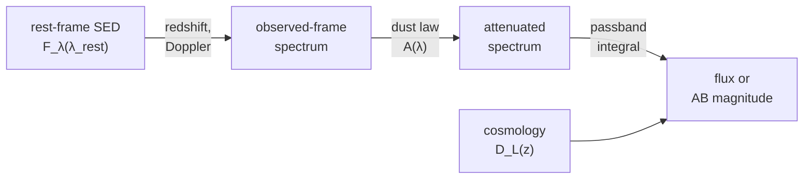

# Spectra and photometry: overview

This area handles the wavelength dimension: spectra and their axes, the
Doppler and cosmological shifts that move them, the dust that dims them, and
the passbands that turn them into photometry. Everything is a tensor function,
so a fit of redshift, dust, and amplitude to a set of magnitudes can run by
gradient descent, batched over many objects at once.

## The Core Idea: A Spectrum Through the Observation Chain

Photometry is the end of a chain of transformations applied to a rest-frame
spectral energy distribution (SED). Each link is a separate module with
explicit units:



The spectrum itself is described by a spectral axis: values plus a type
(wavelength, frequency, energy, wavenumber, velocity) and a unit. Rebinning
conserves the integrated flux, and invalid or partly covered bins are flagged
in a mask rather than renormalized.

## Choose a Page

| Task | Page | Entry point |
|---|---|---|
| Hold spectra and cubes, convert axes, rebin conserving flux | [Spectral axes](spectral-axes.md) | [`SpectralAxis`](../reference/spectral.md#torchsky.spectral.SpectralAxis), [`flux_conserving_rebin`](../reference/spectral.md#torchsky.spectral.flux_conserving_rebin) |
| Redshift a spectrum, relativistic Doppler shifts, velocity conventions | [Kinematics](kinematics.md) | [`shift_wavelength`](../reference/redshift.md#torchsky.redshift.shift_wavelength), [`relativistic_doppler_shift`](../reference/spectral.md#torchsky.spectral.relativistic_doppler_shift) |
| Integrate a spectrum through a filter; AB magnitudes | [Synthetic photometry](photometry.md) | [`synthetic_photometry`](../reference/spectrophotometry.md#torchsky.spectrophotometry.synthetic_photometry), [`Passband`](../reference/spectrophotometry.md#torchsky.spectrophotometry.Passband) |
| Milky Way or host-galaxy dust attenuation | [Extinction](extinction.md) | [`a_lambda`](../reference/extinction.md#torchsky.extinction.a_lambda), [`transmission`](../reference/extinction.md#torchsky.extinction.transmission) |
| Distances, distance modulus, comoving volume | [Cosmology](cosmology.md) | [`luminosity_distance`](../reference/cosmology.md#torchsky.cosmology.luminosity_distance), [`distance_modulus`](../reference/cosmology.md#torchsky.cosmology.distance_modulus) |
| Build a cube from images or IFU frames | [Cubes and IFU](../maps/cubes.md) | [`coadd_cube`](../reference/map.md#torchsky.map.coadd_cube) |

## A Differentiable Magnitude

The spectrum below is the SDSS quasar 0751-52251-0160 (z = 0.0456), averaged in
50 Å bins across the r band; the bump at 6870 Å is its redshifted Hα line. The
passband is the SDSS r total throughput from the SVO Filter Profile Service,
sampled every 50 Å. The synthetic AB magnitude agrees with the one the SDSS
pipeline computed from the full-resolution spectrum (16.764) to 0.012 mag.
Correcting for Milky Way dust with \(E(B-V) = 0.0698\) (Schlafly and
Finkbeiner 2011 at this position) brightens it by 0.18 mag, and the gradient
of the magnitude with respect to \(E(B-V)\) is the extinction coefficient of
the band.

<!-- docs: run -->
```python
import torch

from torchsky.extinction import a_lambda
from torchsky.spectrophotometry import Passband, synthetic_photometry

f64 = dict(dtype=torch.float64)
wave = torch.arange(5325.0, 7350.0, 50.0, **f64)   # bin centres, Angstrom
flux = 1e-17 * torch.tensor([                       # erg/s/cm2/A
    52.11, 52.35, 50.37, 54.77, 54.70, 55.99, 55.68, 54.61, 53.47, 54.81, 54.05, 53.31,
    53.13, 54.38, 55.37, 56.69, 56.59, 54.48, 55.89, 55.18, 56.72, 55.88, 54.85, 53.92,
    52.73, 55.15, 55.09, 56.96, 58.42, 67.85, 78.72, 84.65, 70.60, 59.98, 58.63, 53.83,
    54.05, 53.48, 54.12, 54.38, 54.44,
], **f64)
sdss_r = Passband(
    torch.arange(5350.0, 7301.0, 50.0, **f64),
    torch.tensor([
        0.0000, 0.0011, 0.0227, 0.0745, 0.1537, 0.2463, 0.3256, 0.3789, 0.4120, 0.4317,
        0.4436, 0.4519, 0.4592, 0.4659, 0.4700, 0.4716, 0.4741, 0.4787, 0.4839, 0.4883,
        0.4908, 0.4912, 0.4914, 0.4913, 0.4883, 0.4825, 0.4476, 0.3601, 0.2439, 0.1265,
        0.0441, 0.0150, 0.0081, 0.0042, 0.0021, 0.0013, 0.0008, 0.0002, 0.0000, 0.0000,
    ], **f64),
    name="SDSS r",
)

observed = synthetic_photometry(wave, flux, sdss_r, output="ab_mag")
assert bool(observed.valid) and abs(observed.value.item() - 16.764) < 0.02

ebv = torch.tensor(0.0698, **f64, requires_grad=True)
dereddened = flux * 10.0 ** (0.4 * a_lambda(wave, ebv=ebv, law="f99"))
corrected = synthetic_photometry(wave, dereddened, sdss_r, output="ab_mag")
corrected.value.backward()

r_band = a_lambda(sdss_r.pivot_wavelength.reshape(1), ebv=1.0, law="f99")   # A_r / E(B-V)
assert abs((observed.value - corrected.value).item() - 0.18) < 0.01
assert abs(-ebv.grad.item() / r_band.item() - 1.0) < 0.01
```

The [SDSS spectrum example](../examples/index.md#a-quasar-spectrum-rest-frame-dust-and-ugriz-magnitudes)
reads the full spectrum, moves it to the rest frame with the pipeline redshift,
checks the [O III] line centroids, and computes all five ugriz magnitudes.

## Conventions and Pitfalls

- **Wavelengths are Angstrom** unless a `wavelength_unit` argument says
  otherwise; conversion happens once at the boundary.
- **Flux densities are \(F_\lambda\)** for photometry. AB magnitudes and
  microjansky outputs need cgs \(F_\lambda\) (erg s⁻¹ cm⁻² Å⁻¹).
- **Velocities are signed.** Positive radial velocity is receding, in metres
  per second for `relativistic_doppler_shift`.
- **Coverage is reported, not corrected.** A passband that extends beyond the
  spectrum gives `valid=False` and NaN below `min_coverage`; nothing is
  renormalized silently.
- **Masks mean "this sample exists"** (`True` is good) in spectra and
  photometry. Map products use data-quality bits instead; check each function.
- **Precision.** Passband samples are held in float64 on CPU and
  CUDA. MPS keeps the tensor's own float32 dtype, with correspondingly lower
  precision.

Signatures are in the [`torchsky.spectral`](../reference/spectral.md),
[`torchsky.spectrophotometry`](../reference/spectrophotometry.md),
[`torchsky.extinction`](../reference/extinction.md),
[`torchsky.redshift`](../reference/redshift.md), and
[`torchsky.cosmology`](../reference/cosmology.md) references.
Tabulated filter profiles (`torchsky.filter_profiles`) are experimental.

## Connections

Spectral FITS axes are decoded by the [WCS](../coordinates/index.md#spectral-and-temporal-axes).
[Cubes and IFU](../maps/cubes.md) build spatial-spectral products from images,
and the experimental [field models](../models/fields.md) render through the
same passband integrals. Photometric redshift encoders for machine learning are
described with the [encoders](../models/encoders.md).

Examples on real data: the
[SDSS quasar spectrum](../examples/index.md#a-quasar-spectrum-rest-frame-dust-and-ugriz-magnitudes)
and the [MaNGA IFU cube](../examples/index.md#a-manga-ifu-cube-h-map-rotation-and-reprojection).
