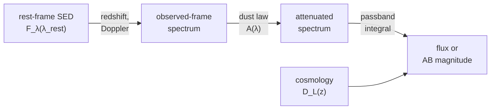

# Spectra and photometry: overview

This area handles the wavelength dimension: spectra and their axes, the
Doppler and cosmological shifts that move them, the dust that dims them, and
the passbands that turn them into photometry. Everything is a tensor function,
so a fit of redshift, dust, and amplitude to a set of magnitudes can run by
gradient descent, batched over many objects at once.

## The Core Idea: A Spectrum Through the Observation Chain

Photometry is the end of a chain of transformations applied to a rest-frame
spectral energy distribution (SED). Each link is a separate module with
explicit units:



The spectrum itself is described by a spectral axis: values plus a type
(wavelength, frequency, energy, wavenumber, velocity) and a unit. Rebinning
conserves the integrated flux, and invalid or partly covered bins are flagged
in a mask rather than renormalized.

## Choose a Page

| Task | Page | Entry point |
|---|---|---|
| Hold spectra and cubes, convert axes, rebin conserving flux | [Spectral axes](spectral-axes.md) | [`SpectralAxis`](../reference/spectral.md#torchsky.spectral.SpectralAxis), [`flux_conserving_rebin`](../reference/spectral.md#torchsky.spectral.flux_conserving_rebin) |
| Redshift a spectrum, relativistic Doppler shifts, velocity conventions | [Kinematics](kinematics.md) | [`shift_wavelength`](../reference/redshift.md#torchsky.redshift.shift_wavelength), [`relativistic_doppler_shift`](../reference/spectral.md#torchsky.spectral.relativistic_doppler_shift) |
| Integrate a spectrum through a filter; AB magnitudes | [Synthetic photometry](photometry.md) | [`synthetic_photometry`](../reference/spectrophotometry.md#torchsky.spectrophotometry.synthetic_photometry), [`Passband`](../reference/spectrophotometry.md#torchsky.spectrophotometry.Passband) |
| Milky Way or host-galaxy dust attenuation | [Extinction](extinction.md) | [`a_lambda`](../reference/extinction.md#torchsky.extinction.a_lambda), [`transmission`](../reference/extinction.md#torchsky.extinction.transmission) |
| Distances, distance modulus, comoving volume | [Cosmology](cosmology.md) | [`luminosity_distance`](../reference/cosmology.md#torchsky.cosmology.luminosity_distance), [`distance_modulus`](../reference/cosmology.md#torchsky.cosmology.distance_modulus) |
| Build a cube from images or IFU frames | [Cubes and IFU](../maps/cubes.md) | [`coadd_cube`](../reference/map.md#torchsky.map.coadd_cube) |

## A Differentiable Magnitude

A power-law SED, redshifted to \(z = 0.2\), dimmed by Milky Way dust with
\(E(B-V) = 0.05\), and integrated through a triangular passband. The magnitude
has a gradient with respect to the redshift.

<!-- docs: run -->
```python
import torch

from torchsky.extinction import a_lambda
from torchsky.redshift import dimming_f_lambda, shift_wavelength
from torchsky.spectrophotometry import Passband, synthetic_photometry

band = Passband(
    torch.tensor([5000.0, 6000.0, 7000.0], dtype=torch.float64),
    torch.tensor([0.0, 1.0, 0.0], dtype=torch.float64),
    name="toy-r",
)
rest = torch.linspace(3000.0, 8000.0, 501, dtype=torch.float64)    # Angstrom
f_lambda = 1e-17 * (rest / 5000.0) ** -1.5                        # erg/s/cm2/A

z = torch.tensor(0.2, dtype=torch.float64, requires_grad=True)
observed = shift_wavelength(rest, 1.0 + z)
redshifted = f_lambda * dimming_f_lambda(1.0 + z)
attenuated = redshifted * 10.0 ** (-0.4 * a_lambda(observed, ebv=0.05))

mag = synthetic_photometry(observed, attenuated, band, output="ab_mag")
assert bool(mag.valid)
mag.value.backward()
assert torch.isfinite(z.grad)
```

## Conventions and Pitfalls

- **Wavelengths are Angstrom** unless a `wavelength_unit` argument says
  otherwise; conversion happens once at the boundary.
- **Flux densities are \(F_\lambda\)** for photometry. AB magnitudes and
  microjansky outputs need cgs \(F_\lambda\) (erg s⁻¹ cm⁻² Å⁻¹).
- **Velocities are signed.** Positive radial velocity is receding, in metres
  per second for `relativistic_doppler_shift`.
- **Coverage is reported, not corrected.** A passband that extends beyond the
  spectrum gives `valid=False` and NaN below `min_coverage`; nothing is
  renormalized silently.
- **Masks mean "this sample exists"** (`True` is good) in spectra and
  photometry. Map products use data-quality bits instead; check each function.
- **Precision.** Passband samples are held in float64 on CPU and
  CUDA. MPS keeps the tensor's own float32 dtype, with correspondingly lower
  precision.

Signatures are in the [`torchsky.spectral`](../reference/spectral.md),
[`torchsky.spectrophotometry`](../reference/spectrophotometry.md),
[`torchsky.extinction`](../reference/extinction.md),
[`torchsky.redshift`](../reference/redshift.md), and
[`torchsky.cosmology`](../reference/cosmology.md) references.
Tabulated filter profiles (`torchsky.filter_profiles`) are experimental.

## Connections

Spectral FITS axes are decoded by the [WCS](../coordinates/index.md#spectral-and-temporal-axes).
[Cubes and IFU](../maps/cubes.md) build spatial-spectral products from images,
and the experimental [field models](../models/fields.md) render through the
same passband integrals. Photometric redshift encoders for machine learning are
described with the [encoders](../models/encoders.md).
