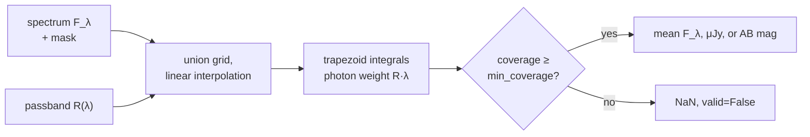
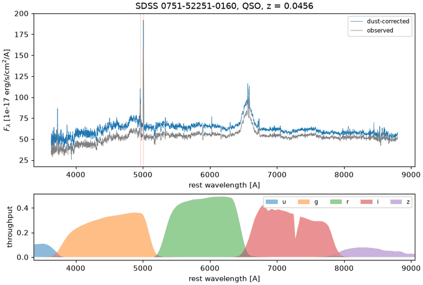

# Synthetic photometry

**Synthetic photometry** predicts what an imaging camera would measure for a
source with a known spectrum: the spectrum is weighted by the filter's
**passband** (its throughput \(R(\lambda)\), the fraction of photons transmitted
at each wavelength) and averaged into a single flux or magnitude.
`torchsky.spectrophotometry` does this on tensors: a
[`Passband`](../reference/spectrophotometry.md#torchsky.spectrophotometry.Passband)
is two tensors, a spectrum is a tensor with any number of leading batch
dimensions, and the result carries its `value`, `unit`, `coverage`, and `valid`
flag. The integral is differentiable with respect to the spectrum, so
magnitudes can sit inside a fitting loss.

Use it to compare spectra with catalogue photometry, to compute colours of
model spectral energy distributions (SEDs) across redshift, and to calibrate
spectra against imaging.

## How It Works

A CCD counts photons, so each wavelength is weighted by its photon rate,
\(F_\lambda \lambda / hc\). The photon-weighted mean flux density in a band is

\[
\langle F_\lambda \rangle
= \frac{\int F_\lambda(\lambda)\, R(\lambda)\, \lambda\, \mathrm d\lambda}
       {\int R(\lambda)\, \lambda\, \mathrm d\lambda},
\qquad
\langle F_\nu \rangle
= \frac{\int F_\lambda\, R\, \lambda\, \mathrm d\lambda}
       {c \int R / \lambda\, \mathrm d\lambda},
\]

and the **AB magnitude** is \(m_\mathrm{AB} = -2.5 \log_{10}(\langle F_\nu\rangle /
3631\,\mathrm{Jy})\): a source with constant \(F_\nu = 3631\) Jy has magnitude
zero in every band.

The integrals are evaluated on the union of the spectrum and passband samples
over their common range. Both curves are interpolated linearly onto that grid
and integrated with the trapezoid rule, so no sample of either curve is
skipped. **Coverage** is the fraction of the passband's photon weight
\(\int R\lambda\,\mathrm d\lambda\) that falls on valid spectrum samples. Below
`min_coverage` (default 0.99) the result is `NaN` with `valid=False`; nothing is
extrapolated or renormalized.



## Assumptions and Accuracy

- Wavelengths are vacuum Angstrom inside the module; `wavelength_unit="nm"`
  converts once at construction.
- `output="mean_f_lambda"` works in any flux unit per Angstrom.
  `"f_nu_microjy"` and `"ab_mag"` require cgs \(F_\lambda\)
  (erg s⁻¹ cm⁻² Å⁻¹).
- Throughput is a dimensionless photon response. Detector quantum efficiency
  and atmosphere belong in the curve if they are part of the system response;
  collecting area and exposure time belong in the flux calibration.
- A constant \(F_\lambda\) or \(F_\nu\) is recovered exactly by construction. On
  the real SDSS spectrum below, the g, r, and i magnitudes agree with the
  synthetic magnitudes of the SDSS pipeline to 0.03 mag (0.017 mag rms).

## A Real Spectrum Through SDSS Filters

Integrate the calibrated SDSS spectrum of plate 0751, fibre 160 through the
SDSS r passband from the [SVO Filter Profile Service](http://svo2.cab.inta-csic.es/theory/fps/):

```python
# fragment: needs spec-0751-52251-0160.fits and SDSS.r.dat (SVO "SLOAN/SDSS.r", ASCII)
import torch
import torchfits

from torchsky.filter_profiles import bandpass_from_transmission_file
from torchsky.spectrophotometry import Passband, synthetic_photometry

coadd = torchfits.read("spec-0751-52251-0160.fits", hdu=1)
wave = 10.0 ** coadd["loglam"].to(torch.float64)
flux = coadd["flux"].to(torch.float64) * 1e-17          # cgs F_lambda
good = coadd["ivar"] > 0

curve = bandpass_from_transmission_file("SDSS.r.dat", band_name="r")
r = Passband.from_samples(
    curve["transmission_wavelength"].to(torch.float64),
    curve["transmission_throughput"].to(torch.float64),
    name="r",
)
mag = synthetic_photometry(wave, flux, r, output="ab_mag", mask=good, min_coverage=0.9)
print(mag.value, mag.coverage, mag.valid)    # 16.776, 1.00, True (SDSS pipeline: 16.764)
```

The spectrum covers 3800–9200 Å, so u (12 per cent of its photon weight) and z
(69 per cent) are reported invalid. The figure shows the spectrum and the five
passbands; the full script is
[`examples/sdss_spectrum_photometry.py`](https://github.com/astroai/torchsky/blob/main/examples/sdss_spectrum_photometry.py).



## Recipes

### Get a Passband

| Source | Function |
|---|---|
| Two-column text file (SVO ASCII, instrument tables) | [`bandpass_from_transmission_file`](../reference/filter-profiles.md#torchsky.filter_profiles.bandpass_from_transmission_file) |
| SVO Filter Profile Service by facility and instrument | [`bandpass_from_svo`](../reference/filter-profiles.md#torchsky.filter_profiles.bandpass_from_svo) (needs `astroquery` unless cached) |
| Gaussian or linear-variable filter | [`evaluate_throughput`](../reference/spectrophotometry.md#torchsky.spectrophotometry.evaluate_throughput) |
| Tensors you already have | [`Passband`](../reference/spectrophotometry.md#torchsky.spectrophotometry.Passband), `Passband.from_samples` |

`Passband` requires strictly increasing wavelengths and non-negative
throughput; `from_samples` sorts an unsorted table and averages duplicate
wavelengths. `torchsky.filter_profiles` is experimental.

<!-- docs: run -->
```python
import torch

from torchsky.spectrophotometry import Passband

band = Passband.from_samples(
    torch.tensor([600.0, 400.0, 500.0], dtype=torch.float64),
    torch.tensor([0.0, 0.0, 1.0], dtype=torch.float64),
    name="toy",
    wavelength_unit="nm",
)
assert band.wavelength.tolist() == [4000.0, 5000.0, 6000.0]
print(band.effective_wavelength.item(), band.pivot_wavelength.item())
```

`effective_wavelength` is photon-weighted; `pivot_wavelength` converts between
\(\langle F_\lambda\rangle\) and \(\langle F_\nu\rangle\) via
\(F_\nu = F_\lambda \lambda_\mathrm{p}^2 / c\).

### AB Magnitudes of a Batch in Several Bands

[`synthetic_photometry_bands`](../reference/spectrophotometry.md#torchsky.spectrophotometry.synthetic_photometry_bands)
puts bands on a trailing axis. A constant \(F_\nu\) gives the same AB magnitude
in every band.

<!-- docs: run -->
```python
import torch

from torchsky.spectrophotometry import Passband, synthetic_photometry_bands

g = Passband(torch.tensor([4000.0, 5000.0, 6000.0], dtype=torch.float64), torch.tensor([0.0, 1.0, 0.0], dtype=torch.float64))
r = Passband(torch.tensor([5500.0, 6500.0, 7500.0], dtype=torch.float64), torch.tensor([0.0, 1.0, 0.0], dtype=torch.float64))
wave = torch.linspace(4000.0, 7500.0, 351, dtype=torch.float64)

f_nu_cgs = torch.tensor([[1e-28], [1e-29]], dtype=torch.float64)       # two sources
flux_lambda = f_nu_cgs * 2.99792458e18 / wave.square()                  # cgs F_lambda
mags = synthetic_photometry_bands(wave, flux_lambda, [g, r], output="ab_mag")
assert mags.value.shape == (2, 2)
torch.testing.assert_close(mags.value[:, 0], mags.value[:, 1], rtol=1e-6, atol=1e-6)
torch.testing.assert_close(mags.value[1] - mags.value[0], torch.full((2,), 2.5, dtype=torch.float64))
```

### Photon or Energy Weighting

CCDs count photons, so the default is photon weighting. Bolometers and some
published curves give the response per unit *energy*, \(R_E\); pass
`weighting="energy"` for the mean \(\int F_\lambda R_E\,\mathrm d\lambda /
\int R_E\,\mathrm d\lambda\), and \(\langle F_\nu\rangle = \int F_\lambda R_E\,
\mathrm d\lambda / (c \int R_E \lambda^{-2}\,\mathrm d\lambda)\) (Bessell & Murphy
2012). Coverage uses the same weight. A constant \(F_\nu\) has the same AB
magnitude in both modes.

<!-- docs: run -->
```python
import torch

from torchsky.spectrophotometry import Passband, synthetic_photometry

wave = torch.linspace(4000.0, 6000.0, 201, dtype=torch.float64)
response_energy = torch.exp(-0.5 * ((wave - 5000.0) / 300.0) ** 2)
flux = (wave / 5000.0) ** -2.0
band = Passband(wave, response_energy)

energy_mean = synthetic_photometry(wave, flux, band, weighting="energy").value
expected = torch.trapezoid(flux * response_energy, wave) / torch.trapezoid(response_energy, wave)
torch.testing.assert_close(energy_mean, expected)
photon_mean = synthetic_photometry(wave, flux, band).value
assert photon_mean < energy_mean                  # photon weighting favours the red side
```

### Vega Magnitudes

[`vega_zero_point`](../reference/spectrophotometry.md#torchsky.spectrophotometry.vega_zero_point)
integrates Vega through a band, with the same `output` and `weighting` as
`synthetic_photometry`; pass it to
[`flux_to_magnitude`](../reference/spectrophotometry.md#torchsky.spectrophotometry.flux_to_magnitude).
Vega is the STScI CALSPEC spectrum `alpha_lyr_stis_012` (Bohlin, Hubeny &
Rauch 2020: HST/STIS from 1152 to 10200 Å joined to a model, 900 Å to
300 µm, vacuum wavelengths), public-domain data shipped with torchsky (92 kB)
and returned by
[`vega_spectrum`](../reference/spectrophotometry.md#torchsky.spectrophotometry.vega_spectrum).
It matches `synphot` given the same spectrum to \(2\times10^{-6}\).

<!-- docs: run -->
```python
import torch

from torchsky.spectrophotometry import (Passband, flux_to_magnitude, synthetic_photometry,
                                        vega_spectrum, vega_zero_point)

band = Passband(torch.tensor([4800.0, 5500.0, 6200.0], dtype=torch.float64),
                torch.tensor([0.0, 1.0, 0.0], dtype=torch.float64))
zero = vega_zero_point(band)                     # erg/s/cm2/A
assert 3.4e-9 < float(zero) < 3.8e-9

wave = torch.linspace(4500.0, 6500.0, 401, dtype=torch.float64)
f_nu = 3631e-23 * 10 ** (-0.4 * 10.0)            # an AB = 10 source
ab_source = f_nu * 2.99792458e18 / wave**2
m_vega = flux_to_magnitude(synthetic_photometry(wave, ab_source, band).value, zero_point=zero)
assert abs(float(m_vega) - 9.995) < 1e-3          # Vega is AB = 0.005 in this band

vega_wave, vega_flux = vega_spectrum()
assert abs(float(flux_to_magnitude(synthetic_photometry(vega_wave, vega_flux, band).value, zero))) < 1e-12
```

Some systems assign Vega a small non-zero magnitude (for example 0.03 in V);
add that offset yourself. `flux_to_magnitude` returns `NaN`, not `-inf`, for
non-positive fluxes.

### Gaps and Coverage

Mark missing samples with `mask` (`True` means the sample exists) rather than
putting `NaN` in the flux. Masked runs are integrated separately, a hole is
never bridged by interpolation, and the hole reduces coverage.

<!-- docs: run -->
```python
import torch

from torchsky.spectrophotometry import Passband, synthetic_photometry

band = Passband(torch.tensor([4000.0, 5000.0, 6000.0], dtype=torch.float64), torch.tensor([0.0, 1.0, 0.0], dtype=torch.float64))
wave = torch.linspace(4000.0, 6000.0, 21, dtype=torch.float64)
flux = torch.ones_like(wave)
mask = torch.ones_like(wave, dtype=torch.bool)
mask[8:13] = False                                  # a detector gap at the band centre

holed = synthetic_photometry(wave, flux, band, mask=mask)
assert not bool(holed.valid) and torch.isnan(holed.value)
relaxed = synthetic_photometry(wave, flux, band, mask=mask, min_coverage=0.0)
assert float(relaxed.coverage) < 0.7 and torch.isfinite(relaxed.value)
```

### Gaussian and Position-Dependent Filters

[`evaluate_throughput`](../reference/spectrophotometry.md#torchsky.spectrophotometry.evaluate_throughput)
evaluates a Gaussian response in the unit you pass. With `lambda_center_map`
the centre varies with detector position, as in a linear-variable filter.

<!-- docs: run -->
```python
import torch

from torchsky.spectrophotometry import evaluate_throughput

wave_nm = torch.tensor([500.0, 510.0, 520.0], dtype=torch.float64)
centres = torch.tensor([[500.0], [520.0]], dtype=torch.float64)    # two detector rows
lvf = evaluate_throughput(wave_nm.expand(2, -1), sigma=4.0, lambda_center_map=centres, wavelength_unit="nm")
assert lvf.shape == (2, 3) and lvf[0, 0] > lvf[0, 2] and lvf[1, 2] > lvf[1, 0]
```

## Pitfalls

- **Lowering `min_coverage` is extrapolation.** If a band is not covered,
  extend the spectrum (or model it) rather than accepting a partial integral.
- **Units.** `ab_mag` from a spectrum in units of \(10^{-17}\) erg s⁻¹ cm⁻² Å⁻¹
  is off by 42.5 mag; scale to cgs first.
- **Air-wavelength filter curves.** Some ground-based curves are tabulated in
  air. Convert them to vacuum before mixing them with vacuum spectra.
- **MPS precision.** Passbands are float64 on CPU and CUDA; MPS has no float64
  and keeps the tensor's float32, with correspondingly lower precision.

## See Also

- [Kinematics](kinematics.md) and [Extinction](extinction.md): shift and
  redden a spectrum before integrating it.
- [Spectral axes](spectral-axes.md): rebin and convert spectral grids.
- [Fields](../models/fields.md): continuous sky models rendered through the
  same passbands.
- Reference: [`torchsky.spectrophotometry`](../reference/spectrophotometry.md),
  [`torchsky.filter_profiles`](../reference/filter-profiles.md).
