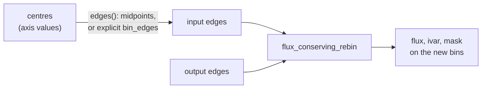

# Spectral axes

A **spectral axis** says where each sample of a spectrum sits along the
electromagnetic spectrum. The same axis can be written as wavelength
\(\lambda\), frequency \(\nu = c/\lambda\), photon energy \(E = h\nu\),
wavenumber \(1/\lambda\), or, relative to a rest frequency, as a velocity.
[`SpectralAxis`](../reference/spectral.md#torchsky.spectral.SpectralAxis) holds
the sample values as a tensor together with a FITS-style type (`WAVE`, `AWAV`
for air wavelength, `FREQ`, `ENER`, `WAVN`, `VRAD`, `VOPT`, `VELO`) and a unit,
and converts between them on the tensor's device.

Use this page to hold spectra and cubes in memory, convert axis types, and move
a spectrum onto another grid without losing flux. Shifting a spectrum by a
velocity or redshift is on the [Kinematics](kinematics.md) page.

## How It Works

A spectrograph pixel does not measure the flux density at one wavelength; it
integrates over a **bin** between two **edges**. The sample value is the mean
flux density \(f_i\) in that bin, and the axis value is a representative
**centre**. Moving to new bins must preserve the integral

\[
\int_{e_0}^{e_N} f(\lambda)\,\mathrm d\lambda
= \sum_i f_i\,(e_{i+1} - e_i),
\]

so [`flux_conserving_rebin`](../reference/spectral.md#torchsky.spectral.flux_conserving_rebin)
treats the input as piecewise constant within its bins and computes each output
value as the overlap-weighted mean of the input bins it covers. Inverse
variances are propagated with the same weights. An output bin that reaches
beyond the input range, or overlaps a masked input bin, is marked invalid in the
returned `mask` instead of being renormalized from the part that is covered.



Without explicit edges, `SpectralAxis.edges()` places interior edges at the
arithmetic midpoints of adjacent centres and extends the outer bins by half the
neighbouring spacing. Grids that are uniform in \(\ln\lambda\) or
\(\log_{10}\lambda\) (SDSS, MaNGA, many echelle products) have geometric edges
instead, so pass `bin_edges` for them.

## Assumptions and Accuracy

- Values are flux *densities* (per Angstrom, per Hz, ...), not counts per pixel.
  To rebin counts, divide by the bin widths first and multiply back afterwards.
- Within a bin the density is assumed constant. Rebinning to coarser bins is
  exact under that assumption; rebinning to finer bins cannot recover structure
  that the input bins averaged away.
- Unit conversions follow the FITS spectral conventions (Greisen et al. 2006,
  FITS-WCS Paper III). `AWAV` air wavelengths are converted to vacuum with the
  Edlén-form refractive index that WCSLIB uses, so values match `astropy.wcs`.
  The flux-conservation identity above is checked in the test suite.

## A Real Spectrum

The SDSS DR16 spectrum of a low-redshift quasar (plate 0751, MJD 52251,
fibre 160) is sampled uniformly in \(\log_{10}\lambda\) with a step of
\(10^{-4}\). Read it with torchfits, give the axis geometric edges, and rebin it
to a linear 5 Å grid:

```python
# fragment: needs spec-0751-52251-0160.fits from
# https://data.sdss.org/sas/dr16/sdss/spectro/redux/26/spectra/0751/spec-0751-52251-0160.fits
import torch
import torchfits

from torchsky.spectral import SpectralAxis, Spectrum1D, flux_conserving_rebin

coadd = torchfits.read("spec-0751-52251-0160.fits", hdu=1)   # SDSS coadd table
loglam = coadd["loglam"].to(torch.float64)                   # log10(wavelength / Angstrom)
flux = coadd["flux"].to(torch.float64)                       # 1e-17 erg/s/cm2/Angstrom
ivar = coadd["ivar"].to(torch.float64)

step = (loglam[-1] - loglam[0]) / (loglam.numel() - 1)
edges = 10.0 ** torch.cat([loglam - 0.5 * step, loglam[-1:] + 0.5 * step])
axis = SpectralAxis(values=10.0 ** loglam, unit="Angstrom", type="WAVE", bin_edges=edges)
spectrum = Spectrum1D(flux=flux, spectral_axis=axis, ivar=ivar, mask=ivar > 0)
assert not axis.is_regular()          # uniform in log(lambda), not in lambda

linear = torch.arange(4000.0, 9005.0, 5.0, dtype=torch.float64)
rebinned = flux_conserving_rebin(flux, edges, linear, ivar=ivar, mask=ivar > 0)
print(rebinned.flux.shape, int(rebinned.mask.sum()))   # (1000,) 1000
```

The same file is used end to end, through the rest frame, dust correction, and
ugriz photometry, in
[`examples/sdss_spectrum_photometry.py`](https://github.com/astroai/torchsky/blob/main/examples/sdss_spectrum_photometry.py).

## Recipes

### Convert Between Wavelength, Frequency, and Energy

Every conversion passes through frequency in Hz. `to_wavelength()` always
returns vacuum Angstrom, so an `AWAV` axis is refracted to vacuum on the way.

<!-- docs: run -->
```python
import torch

from torchsky.spectral import SpectralAxis

axis = SpectralAxis(torch.tensor([3000.0, 5000.0, 10000.0], dtype=torch.float64), "Angstrom", "WAVE")
torch.testing.assert_close(axis.to_energy("eV")[1], torch.tensor(2.4797, dtype=torch.float64), atol=1e-3, rtol=0.0)
print(axis.to_frequency(), axis.to_wavenumber("1/cm"))

h_alpha_air = SpectralAxis(torch.tensor([6562.80], dtype=torch.float64), "Angstrom", "AWAV")
vacuum = h_alpha_air.to_wavelength()
assert 6564.5 < float(vacuum) < 6564.7      # vacuum H-alpha is 6564.6 Angstrom
```

### Rebin Conserving Flux

<!-- docs: run -->
```python
import torch

from torchsky.spectral import flux_conserving_rebin

edges = torch.tensor([5000.0, 5001.0, 5003.0, 5006.0])
flux = torch.tensor([1.0, 2.0, 1.0])
new_edges = torch.tensor([5000.0, 5002.0, 5006.0])

rebinned = flux_conserving_rebin(flux, edges, new_edges)
# Mean density in each new bin: (1*1 + 2*1)/2 and (2*1 + 1*3)/4.
torch.testing.assert_close(rebinned.flux, torch.tensor([1.5, 1.25]))
integral_in = (flux * (edges[1:] - edges[:-1])).sum()
integral_out = (rebinned.flux * (new_edges[1:] - new_edges[:-1])).sum()
torch.testing.assert_close(integral_in, integral_out)

partial = flux_conserving_rebin(flux, edges, torch.tensor([5004.0, 5008.0]))
assert not bool(partial.mask[0])           # extends past 5006: flagged, not rescaled
```

Leading dimensions of `flux` are batches, so a stack of spectra on one grid
rebins in a single call.

### Read an Axis From a FITS Header

[`spectral_axis_from_header`](../reference/spectral.md#torchsky.spectral.spectral_axis_from_header)
finds the spectral `CTYPEn` and returns the axis with the tensor dimension it
belongs to; [`spectral_bin_edges_from_header`](../reference/spectral.md#torchsky.spectral.spectral_bin_edges_from_header)
returns edges by the midpoint rule.

<!-- docs: run -->
```python
import torch

from torchsky.spectral import spectral_axis_from_header, spectral_bin_edges_from_header

header = {"NAXIS": 1, "NAXIS1": 5, "CTYPE1": "WAVE", "CUNIT1": "Angstrom",
          "CRPIX1": 1.0, "CRVAL1": 5000.0, "CDELT1": 2.0}
axis, dim = spectral_axis_from_header(header)
edges, _ = spectral_bin_edges_from_header(header)
assert axis.values.tolist() == [5000.0, 5002.0, 5004.0, 5006.0, 5008.0] and dim == 0
assert edges[0].item() == 4999.0 and edges[-1].item() == 5009.0
```

Tabular (`-TAB`) and non-linear spectral axes are decoded by the
[WCS](../coordinates/index.md#spectral-and-temporal-axes); pass the decoded
`tables` through the same functions.

### Spectra and Cubes in Memory

[`Spectrum1D`](../reference/spectral.md#torchsky.spectral.Spectrum1D) holds
flux, inverse variance, and a mask (`True` is good);
[`DataCube`](../reference/spectral.md#torchsky.spectral.DataCube) holds an
`(L, H, W)` cube with its spectral axis.

<!-- docs: run -->
```python
import torch

from torchsky.spectral import DataCube, SpectralAxis

axis = SpectralAxis(torch.linspace(5000.0, 5100.0, 101, dtype=torch.float64), "Angstrom", "WAVE")
cube = DataCube(data=torch.rand(101, 8, 8, dtype=torch.float64), spectral_axis=axis)
one = cube.extract_spectrum(y=3, x=4)
line = cube.extract_slice(wavelength=5050.0, width=5)
assert one.flux.shape == (101,) and line.shape == (8, 8)
```

[`write_cube_fits`](../reference/spectral.md#torchsky.spectral.write_cube_fits)
writes an `(L, H, W)` tensor with a three-axis WCS through torchfits.

### Match a Resolving Power on a Log-Wavelength Grid

On a grid uniform in \(\ln\lambda\), a Gaussian line-spread function of fixed
resolving power \(R = \lambda/\Delta\lambda_\mathrm{FWHM}\) has a constant
width in velocity, \(\sigma = c/(2.355\,R)\).
[`convolve_log_lambda`](../reference/log-lambda.md#torchsky.log_lambda.convolve_log_lambda)
applies it with a unit-sum kernel, so flux is conserved away from the ends.

<!-- docs: run -->
```python
import math

import torch

from torchsky.log_lambda import convolve_log_lambda, sigma_R_kms

line = torch.zeros(201, dtype=torch.float64)
line[100] = 1.0
dln_lambda = 1e-4 * math.log(10.0)                  # SDSS: 1e-4 in log10(lambda)
broadened = convolve_log_lambda(line, dln_lambda=dln_lambda, sigma_kms=sigma_R_kms(2000.0), kernel_radius=20)
torch.testing.assert_close(broadened.sum(), torch.tensor(1.0, dtype=torch.float64))
```

## Pitfalls

- **Rebin densities, not counts.** Feeding counts per pixel makes wide output
  bins too faint.
- **Log grids need explicit edges.** Midpoint edges on a log grid are close but
  not equal to the true geometric edges.
- **Air or vacuum.** Many optical spectra and line lists use air wavelengths.
  Declare `AWAV` and convert once, before any redshift is applied.
- **The mask is information.** A `False` output bin after rebinning means
  incomplete coverage; do not fill it with the partially covered value.

## See Also

- [Kinematics](kinematics.md): redshift, Doppler shifts, velocity conventions.
- [Synthetic photometry](photometry.md): integrate a spectrum through a filter.
- [Cubes and IFU](../maps/cubes.md): build spectral cubes from images and IFU
  frames.
- Reference: [`torchsky.spectral`](../reference/spectral.md),
  [`torchsky.log_lambda`](../reference/log-lambda.md), and the spectral
  conversions in [`torchsky.wcs`](../reference/wcs.md#torchsky.wcs.convert_spectral).
