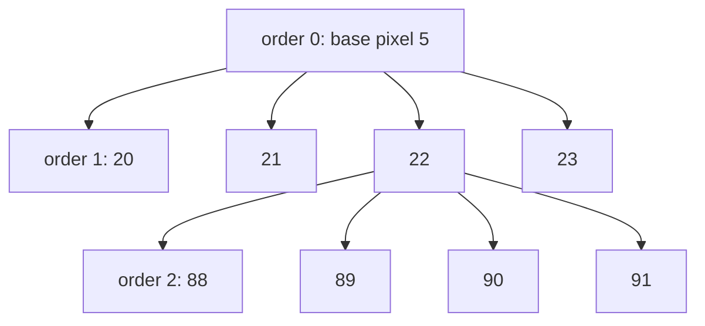
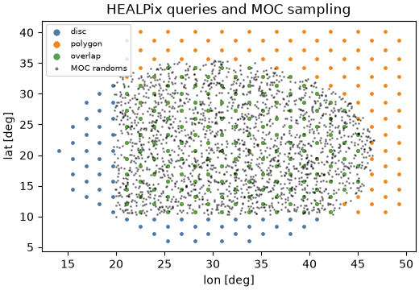

# HEALPix

HEALPix (Hierarchical Equal Area isoLatitude Pixelization, Górski et al. 2005)
divides the sphere into \(N_\mathrm{pix} = 12\,N_\mathrm{side}^2\) pixels of
identical area. \(N_\mathrm{side}\) (`nside`) is a power of two, and the
*order* \(k = \log_2 N_\mathrm{side}\) counts how often the 12 base pixels
have been split into four. Pixel centres lie on \(4N_\mathrm{side} - 1\) rings
of constant latitude. Those three properties make HEALPix the common grid for
full-sky maps, catalog partitions, coverage maps, and harmonic analysis.
`torchsky.sphere` implements it in torch on CPU, CUDA, and MPS.

## How It Works

**Equal area.** Every pixel covers
\(\Omega = 4\pi / (12\,N_\mathrm{side}^2)\) steradians, so counts per pixel are
densities without area weights, and averages over pixels are averages over the
sky.

| `nside` | order | pixels | resolution \(\sqrt{\Omega}\) |
|---|---|---|---|
| 64 | 6 | 49,152 | 55 arcmin |
| 256 | 8 | 786,432 | 13.7 arcmin |
| 1024 | 10 | 12.6 million | 3.4 arcmin |
| 4096 | 12 | 201 million | 0.86 arcmin |
| 16384 | 14 | 3.2 billion | 12.9 arcsec |

`nside2npix`, `nside2order`, `nside2resol`, and `nside2pixarea` give these
numbers.

**Two numbering schemes.** The same pixel has two indices:

- **RING** numbers pixels along iso-latitude rings, north to south. Each ring
  is a row for a fast Fourier transform, which is why
  [spherical harmonic transforms](sht.md) use it.
- **NESTED** numbers pixels along the quadtree: the four children of pixel
  \(p\) at order \(k\) are \(4p, 4p+1, 4p+2, 4p+3\) at order \(k+1\). A region
  is then a few contiguous index ranges, and nearby pixels are near in memory.



RING is the default (`nest=False`), as in healpy; pass `nest=` explicitly and
convert with `ring2nest`, `nest2ring`, or `reorder` for whole maps.

**Angles.** With `lonlat=True`, positions are longitude and latitude in
degrees. Otherwise they are colatitude \(\theta\) and longitude \(\phi\) in
radians, the healpy convention. Region queries take unit 3-vectors and radii
in radians.

## When to Use It

- A full-sky or large-area map with equal-area pixels: use a dense tensor of
  length \(12\,N_\mathrm{side}^2\).
- Partial coverage at high resolution: keep the pixel indices and use a
  [sparse map](sparse-maps.md) for values or a [MOC](moc.md) for coverage.
- A small field with a natural image grid: a WCS image is simpler; see
  [Projections](../coordinates/projections.md).

## Minimal Example: Pixels, Neighbours, and a Disc

<!-- docs: run -->
```python
import math

import torch
import torchsky.sphere as sphere

nside = 128
lon = torch.tensor([10.0, 120.0, 250.0], dtype=torch.float64)
lat = torch.tensor([5.0, -40.0, 70.0], dtype=torch.float64)
pix = sphere.ang2pix(nside, lon, lat, lonlat=True, nest=True)

# The same pixels from colatitude/longitude in radians, and from unit vectors.
theta, phi = torch.deg2rad(90.0 - lat), torch.deg2rad(lon)
assert torch.equal(sphere.ang2pix(nside, theta, phi, nest=True), pix)
x, y, z = sphere.lonlat_to_unit_xyz(lon, lat).unbind(-1)
assert torch.equal(sphere.vec2pix(nside, x, y, z, nest=True), pix)

# pix2ang returns pixel centres; NESTED and RING name the same pixel.
lon_c, lat_c = sphere.pix2ang(nside, pix, nest=True, lonlat=True)
assert (lat_c - lat).abs().max() < sphere.nside2resol(nside) * 180 / math.pi
assert torch.equal(sphere.nest2ring(nside, pix), sphere.ang2pix(nside, lon, lat, lonlat=True))
assert sphere.neighbors(nside, pix, nest=True).shape == (3, 8)

# Pixels whose centres fall within 1 degree of the first position.
disc = sphere.query_disc(nside, sphere.lonlat_to_unit_xyz(lon[0], lat[0]),
                         math.radians(1.0), nest=True)
assert bool(torch.isin(pix[0], disc))
```

## Real Data: Chandra Events on the Sphere

The [Chandra example](../published-examples/chandra_events_on_sphere.py) maps
the 484,000 events of ObsID 5950 (Sgr A*) to sky positions with the event
table's own WCS, then to NESTED pixels at `nside = 16384` (12.9 arcsec). Only
8,105 of the 3.2 billion pixels hold events, which is why the counts go into a
[sparse map](sparse-maps.md) rather than a dense array:

```python
# fragment: needs the cached sample; `pixi run fetch-example-samples` downloads it
from pathlib import Path

import torch
import torchfits
from torchsky.sphere import ang2pix

path = Path.home() / ".cache/torchsky/samples/chandra_events.fits"
events = torchfits.read(str(path), hdu=1)
# ra, dec: sky positions of the events (see the example for the WCS step)
pix = ang2pix(2**14, ra, dec, nest=True, lonlat=True)
cells, counts = torch.unique(pix, return_counts=True)   # 8,105 occupied cells
```

## Recipes

### Query Discs, Polygons, and Strips

<!-- docs: run -->
```python
import math

import torch
import torchsky.sphere as sphere

nside = 256
centre = sphere.lonlat_to_unit_xyz(torch.tensor(266.4168, dtype=torch.float64),
                                   torch.tensor(-29.0078, dtype=torch.float64))
disc = sphere.query_disc(nside, centre, math.radians(2.0), nest=True)
touching = sphere.query_disc(nside, centre, math.radians(2.0), nest=True, inclusive=True)
assert touching.numel() > disc.numel()        # inclusive adds pixels that only overlap

# NESTED results are a few contiguous ranges, and equal the RING query reordered.
ranges = sphere.pixels_to_pixel_ranges(disc)  # (n, 2) half-open [start, stop)
assert ranges.shape[0] < disc.numel() // 4
ring = sphere.query_disc(nside, centre, math.radians(2.0))
assert torch.equal(torch.sort(sphere.ring2nest(nside, ring)).values, torch.sort(disc).values)

square = sphere.query_polygon_general(nside, torch.tensor([10.0, 20.0, 20.0, 10.0]),
                                      torch.tensor([0.0, 0.0, 10.0, 10.0]), nest=True)
ellipse = sphere.query_ellipse(nside, 10.0, 0.0, 2.0, 1.0, pa_deg=30.0, nest=True)
north_cap = sphere.query_strip(nside, 0.0, math.radians(30.0), nest=True)
assert square.numel() > 0 and ellipse.numel() > 0 and north_cap.numel() > 0
```



By default a pixel belongs to a region when its centre does; `inclusive=True`
returns every pixel that touches it (with `fact` controlling the test
resolution, as in healpy). `query_polygon` takes any simple polygon with
great-circle edges: convex ones use a direct half-space test, concave ones are
triangulated (`query_polygon_general`). `query_box` selects a
longitude/latitude box.

With `nest=True`, `query_disc`, `query_polygon`, and `query_strip` descend the
quadtree: a coarse cell wholly inside the region contributes one range, and
only cells crossing the boundary are refined. The work is proportional to the
boundary length, \(O(N_\mathrm{side})\) cells plus the output, not to the area.
`torchsky.sphere.compat.query_circle(..., nest=True, return_pixel_ranges=True)`
returns the ranges without expanding them: a 179-degree disc at
`nside = 4096` is 215 ranges instead of \(2 \times 10^8\) pixels.

### Sample a Map at Arbitrary Positions

[`sample_healpix_map`](../reference/sphere.md#torchsky.sphere.sample_healpix_map)
evaluates a map at sky positions with `"nearest"` or `"bilinear"`
interpolation. Bilinear uses the four nearest pixel centres on the two
bracketing rings, the same weights as healpy's `get_interp_val`, and is
differentiable with respect to the map values.

<!-- docs: run -->
```python
import torch
import torchsky.sphere as sphere

nside = 16
sky = torch.arange(sphere.nside2npix(nside), dtype=torch.float64, requires_grad=True)
lon = torch.tensor([10.0, 120.0], dtype=torch.float64)
lat = torch.tensor([5.0, -40.0], dtype=torch.float64)

values = sphere.sample_healpix_map(sky, nside, lon, lat, interpolation="bilinear")
values.sum().backward()
assert int((sky.grad != 0).sum()) <= 8          # four pixels per position

pixels, weights = sphere.get_interp_weights(nside, lon, lat, lonlat=True)
torch.testing.assert_close(weights.sum(0), torch.ones(2, dtype=torch.float64))
```

`sample_multiband_healpix` and `sample_multiwavelength_healpix` do the same
for `[n_band, npix]` cubes, the latter interpolating along wavelength too.

### Change Resolution

`ud_grade(map, nside_out, order_in="NESTED")` averages children into parents
when degrading and copies parents into children when upgrading; `power=-2`
sums instead of averaging, which preserves counts. `degrade_pixels` and
`upgrade_pixels` map index sets between orders without touching values.

### Measure Distances and Clean a Map

`great_circle_distance` and `pairwise_angular_distance` use the
\(\operatorname{atan2}(|a \times b|, a \cdot b)\) form, accurate for tiny and
antipodal separations alike. `fit_monopole_dipole` and
`remove_monopole_dipole` remove the two lowest multipoles before analysis.

## Accuracy and Validation

Indexing, neighbours, queries, interpolation weights, and `ud_grade` are
checked against healpy, hpgeom, and astropy-healpix in
[torchsky-harness](https://github.com/astroai/torchsky-harness); see the
[parity page](../performance/parity.md). The healpy-shaped
[`torchsky.sphere.compat`](../reference/sphere-compat.md) namespace (`ang2pix`,
`query_disc`, `get_all_neighbours`, `ud_grade`, `map2alm`, …) sits on the same
kernels and rejects keywords that would have no effect;
[Coming from other libraries](../introduction/coming-from.md) has the porting
table.

## Pitfalls

- **Mixing RING and NESTED** is the most common HEALPix bug. Maps read from
  FITS declare `ORDERING`; check it.
- **Angles.** Without `lonlat=True`, inputs are colatitude and longitude in
  radians.
- **Memory.** A dense float64 map at `nside = 4096` is 1.6 GB.
- **MPS** computes in float32: fine for indexing at moderate `nside`, too
  coarse for arcsecond geometry or `nside` above a few thousand.
- `TORCHSKY_DISABLE_CPP=1` forces the pure-torch paths; results are the same.

## See Also

- [Celestial sphere overview](index.md), [MOC](moc.md), [Sparse maps](sparse-maps.md), [SHT](sht.md).
- [HEALPix mapmaking](../maps/healpix-mapmaking.md): coadd images onto HEALPix.
- Reference: [`torchsky.sphere`](../reference/sphere.md),
  [`ang2pix`](../reference/sphere.md#torchsky.sphere.ang2pix),
  [`query_disc`](../reference/sphere.md#torchsky.sphere.query_disc).
- Examples: [HEALPix and MOC](../published-examples/healpix_and_moc.py),
  [Chandra events](../published-examples/chandra_events_on_sphere.py).
