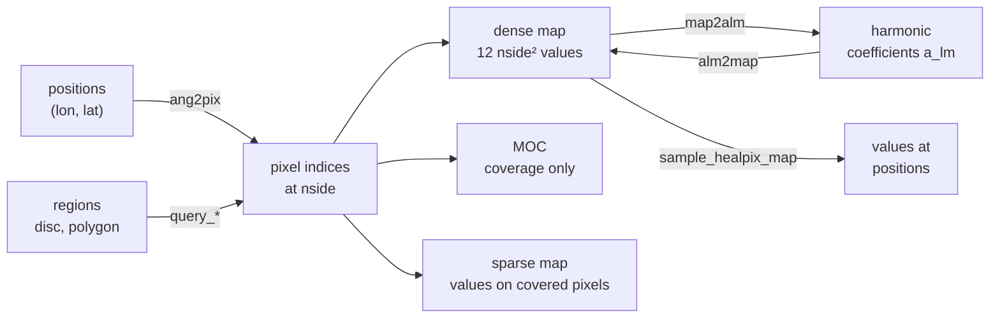

# Celestial sphere: overview

This area works on the whole sphere rather than on one flat image. Its core is
HEALPix (Hierarchical Equal Area isoLatitude Pixelization): a division of the
sphere into \(12\,N_\mathrm{side}^2\) pixels of identical area, where
\(N_\mathrm{side}\) is a power of two. Each pixel splits into four children at
the next resolution, so the same index scheme serves full-sky maps, coverage
masks, catalog partitions, and harmonic analysis. `torchsky.sphere` provides
the pixelization, spherical regions, partial-sky maps, and spherical harmonic
transforms, all as torch code on CPU, CUDA, and MPS.

## How the Pieces Fit



HEALPix numbers its pixels in two orders. **RING** runs along iso-latitude
rings; harmonic transforms use it. **NESTED** follows the quadtree, so children
of a pixel are contiguous; coverage maps, sparse maps, and spatial indexing use
it. RING is the default (`nest=False`), as in healpy.

## Choose a Page

| Task | Page | Entry point |
|---|---|---|
| Positions to pixels, neighbours, discs and polygons, sampling a map | [HEALPix](healpix.md) | [`ang2pix`](../reference/sphere.md#torchsky.sphere.ang2pix), [`query_disc`](../reference/sphere.md#torchsky.sphere.query_disc), [`sample_healpix_map`](../reference/sphere.md#torchsky.sphere.sample_healpix_map) |
| Describe a footprint, intersect surveys, filter a catalog by coverage | [MOC](moc.md) | [`MOC`](../reference/sphere.md#torchsky.sphere.MOC) |
| Store values only where you have data | [Sparse maps](sparse-maps.md) | [`SparseHealpixMap`](../reference/sphere.md#torchsky.sphere.SparseHealpixMap) |
| Power spectra, smoothing, beams, spin-2 polarization | [SHT](sht.md) | [`map2alm`](../reference/sphere.md#torchsky.sphere.map2alm), [`anafast`](../reference/sphere.md#torchsky.sphere.anafast) |
| Exact polygon areas, containment, unions | This page | [`SphericalPolygon`](../reference/sphere.md#torchsky.sphere.SphericalPolygon) |
| Coadd images onto HEALPix | [HEALPix mapmaking](../maps/healpix-mapmaking.md) | [`coadd_healpix`](../reference/map.md#torchsky.map.coadd_healpix) |

A MOC (Multi-Order Coverage map, an IVOA standard) records which cells of the
sphere are covered, mixing resolutions so a footprint costs memory in
proportion to its boundary, not its area. An SHT (spherical harmonic transform)
expands a map into coefficients \(a_{\ell m}\), the spherical analogue of a
Fourier transform.

## Positions, Pixels, and Discs

<!-- docs: run -->
```python
import torch

import torchsky.sphere as sphere

nside = 64                                    # about 55 arcmin pixels
lon = torch.tensor([10.0, 10.5, 200.0], dtype=torch.float64)
lat = torch.tensor([-30.0, -30.2, 45.0], dtype=torch.float64)
pix = sphere.ang2pix(nside, lon, lat, lonlat=True, nest=True)

counts = torch.bincount(pix, minlength=sphere.nside2npix(nside))
assert counts.sum() == 3 and counts.numel() == 12 * nside**2

centre = sphere.lonlat_to_unit_xyz(
    torch.tensor(10.0, dtype=torch.float64), torch.tensor(-30.0, dtype=torch.float64)
)
disc = sphere.query_disc(nside, centre, torch.deg2rad(torch.tensor(1.0)).item(), nest=True)
assert torch.isin(pix, disc).tolist() == [True, True, False]
```

Queries take a unit 3-vector and a radius in radians, as in healpy.

## Spherical Regions

`SphericalPolygon`, `SphericalCap`, and `SphericalMultiPolygon` are exact region
objects with containment, area, and pixel queries. Boolean algebra works on the
polygons themselves and, at a fixed `nside`, on `PixelizedRegion` sets.

<!-- docs: run -->
```python
import torch
from torchsky.sphere import SphericalPolygon

a = SphericalPolygon(
    lon_deg=torch.tensor([10.0, 20.0, 20.0, 10.0]),
    lat_deg=torch.tensor([0.0, 0.0, 10.0, 10.0]),
)
b = SphericalPolygon(
    lon_deg=torch.tensor([15.0, 25.0, 25.0, 15.0]),
    lat_deg=torch.tensor([5.0, 5.0, 15.0, 15.0]),
)

assert bool(a.contains(lon_deg=15.0, lat_deg=5.0))
assert a.intersects(b)
union = a.union(b)
assert bool(union.contains(lon_deg=12.0, lat_deg=2.0))

ra, rb = a.pixelize(nside=64), b.pixelize(nside=64)
overlap = ra.intersection(rb)
assert 0.0 < overlap.area() < ra.area()
```

Areas are in steradians. Polygon edges are great circles.

## Conventions and Pitfalls

- **Angles.** `lonlat=True` takes longitude and latitude in degrees; otherwise
  inputs are colatitude `theta` and longitude `phi` in radians. Query radii are
  radians.
- **Ordering.** Mixing RING and NESTED indices is the most common HEALPix bug.
  Pass `nest=` explicitly and convert with `ring2nest` / `nest2ring`.
- **Resolution.** `nside` must be a power of two. Pixel size halves each time
  `nside` doubles; a full-sky dense map at `nside=4096` holds 201 million values.
  Use a MOC or sparse map when coverage is partial.
- **Boundaries.** `query_disc` and `query_polygon` return pixels whose centres
  fall inside by default; pass `inclusive=True` for every pixel that touches the
  region.
- **Precision.** On MPS, angles are float32: fine for pixel indexing at
  moderate `nside`, too coarse for arcsecond geometry.

## Connections

[Catalogs](../catalogs/index.md) index rows with NESTED HEALPix and filter them
by MOC. [HEALPix mapmaking](../maps/healpix-mapmaking.md) coadds images onto
the sphere, and [models](../models/index.md) can represent the sky as a HEALPix
or harmonic field. The healpy-shaped
[`torchsky.sphere.compat`](../reference/sphere-compat.md) namespace helps port
existing scripts; new code uses `torchsky.sphere` directly.

Indexing, queries, and transforms are validated against healpy, hpgeom,
astropy-healpix, mocpy, and spherical-geometry in
[torchsky-harness](https://github.com/astroai/torchsky-harness); see the
[parity page](../performance/parity.md).
