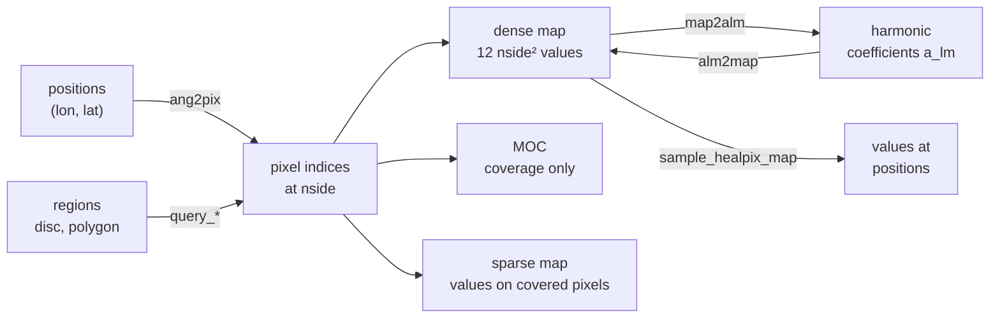

# Celestial sphere: overview

This area works on the whole sphere rather than on one flat image. Its core is
HEALPix (Hierarchical Equal Area isoLatitude Pixelization): a division of the
sphere into \(12\,N_\mathrm{side}^2\) pixels of identical area, where
\(N_\mathrm{side}\) is a power of two. Each pixel splits into four children at
the next resolution, so the same index scheme serves full-sky maps, coverage
masks, catalog partitions, and harmonic analysis. `torchsky.sphere` provides
the pixelization, spherical regions, partial-sky maps, and spherical harmonic
transforms, all as torch code on CPU, CUDA, and MPS.

## How the Pieces Fit



HEALPix numbers its pixels in two orders. **RING** runs along iso-latitude
rings; harmonic transforms use it. **NESTED** follows the quadtree, so children
of a pixel are contiguous; coverage maps, sparse maps, and spatial indexing use
it. RING is the default (`nest=False`), as in healpy.

## Choose a Page

| Task | Page | Entry point |
|---|---|---|
| Positions to pixels, neighbours, discs and polygons, sampling a map | [HEALPix](healpix.md) | [`ang2pix`](../reference/sphere.md#torchsky.sphere.ang2pix), [`query_disc`](../reference/sphere.md#torchsky.sphere.query_disc), [`sample_healpix_map`](../reference/sphere.md#torchsky.sphere.sample_healpix_map) |
| Describe a footprint, intersect surveys, filter a catalog by coverage | [MOC](moc.md) | [`MOC`](../reference/sphere.md#torchsky.sphere.MOC) |
| Store values only where you have data | [Sparse maps](sparse-maps.md) | [`SparseHealpixMap`](../reference/sphere.md#torchsky.sphere.SparseHealpixMap) |
| Power spectra, smoothing, beams, spin-2 polarization | [SHT](sht.md) | [`map2alm`](../reference/sphere.md#torchsky.sphere.map2alm), [`anafast`](../reference/sphere.md#torchsky.sphere.anafast) |
| Exact polygon areas, containment, unions | This page | [`SphericalPolygon`](../reference/sphere.md#torchsky.sphere.SphericalPolygon) |
| Coadd images onto HEALPix | [HEALPix mapmaking](../maps/healpix-mapmaking.md) | [`coadd_healpix`](../reference/map.md#torchsky.map.coadd_healpix) |

A MOC (Multi-Order Coverage map, an IVOA standard) records which cells of the
sphere are covered, mixing resolutions so a footprint costs memory in
proportion to its boundary, not its area. An SHT (spherical harmonic transform)
expands a map into coefficients \(a_{\ell m}\), the spherical analogue of a
Fourier transform.

## Positions, Pixels, and Discs

The positions below are the targets of three [examples](../examples/index.md):
Sgr A* and the pointing of Chandra ObsID 5950, the open cluster M67, and the
globular cluster NGC 288. At `nside = 2048` a pixel is 1.7 arcmin across, and a
10 arcmin disc around the Chandra pointing contains Sgr A* but neither cluster.

<!-- docs: run -->
```python
import math

import torch

import torchsky.sphere as sphere

#                  Sgr A*       Chandra 5950  M67      NGC 288
ra = torch.tensor([266.4168371, 266.401, 132.825, 13.1885], dtype=torch.float64)
dec = torch.tensor([-29.0078106, -28.987, 11.800, -26.5826], dtype=torch.float64)

nside = 2048
pix = sphere.ang2pix(nside, ra, dec, lonlat=True, nest=True)
counts = torch.bincount(pix, minlength=sphere.nside2npix(nside))
assert counts.sum() == 4 and counts.numel() == 12 * nside**2

pointing = sphere.lonlat_to_unit_xyz(ra[1], dec[1])
disc = sphere.query_disc(nside, pointing, math.radians(10 / 60), nest=True)
assert torch.isin(pix, disc).tolist() == [True, True, False, False]
```

Queries take a unit 3-vector and a radius in radians, as in healpy.

## Spherical Regions

`SphericalPolygon`, `SphericalCap`, and `SphericalMultiPolygon` are exact region
objects with containment, area, and pixel queries. Boolean algebra works on the
polygons themselves and, at a fixed `nside`, on `PixelizedRegion` sets. The
union, intersection, or difference of polygons has an exact `area()`: the
result's boundary is clipped from the operands' great-circle edges and
integrated exactly. With a cap, box, or ellipse operand `area()` raises; use
`area_estimate()`, which converges over a ladder of `nside`. The two
polygons below are the footprints of two CFHT MegaPipe cutouts from the
[mosaic example](../examples/index.md#four-megapipe-cutouts-coadded-with-lanczos3-and-drizzle),
from tiles with different tangent points. The corners are the centres of the
corner pixels, as `WCS.footprint` returns them.

<!-- docs: run -->
```python
import math

import torch

from torchsky.sphere import SphericalPolygon

tile_712_165 = SphericalPolygon(   # 512 x 512 px at 0.18577 arcsec
    lon_deg=torch.tensor([358.83839378, 358.83840792, 358.81182784, 358.81181209], dtype=torch.float64),
    lat_deg=torch.tensor([-7.26829861, -7.24193051, -7.24191619, -7.26828424], dtype=torch.float64),
)
tile_712_166 = SphericalPolygon(
    lon_deg=torch.tensor([358.83319463, 358.83318560, 358.80655375, 358.80656127], dtype=torch.float64),
    lat_deg=torch.tensor([-7.25793050, -7.23156228, -7.23157078, -7.25793902], dtype=torch.float64),
)

area = 3600 * tile_712_165.area(degrees=True)                 # arcmin^2
assert abs(area - (511 * 0.18577 / 60) ** 2) < 0.005        # corner pixel centres are 511 px apart
assert tile_712_165.intersects(tile_712_166)
both = tile_712_165.intersection(tile_712_166)
assert bool(both.contains(lon_deg=358.81359, lat_deg=-7.252031))   # a star seen by both

overlap_arcmin2 = 3600 * both.area(degrees=True)            # exact
assert 1.1 < overlap_arcmin2 < 1.3
pixels = tile_712_165.pixelize(nside=2**16).intersection(tile_712_166.pixelize(nside=2**16))
pixel_arcmin2 = pixels.area() * (180 * 60 / math.pi) ** 2    # pixel-centre count, steradians to arcmin^2
assert abs(pixel_arcmin2 - overlap_arcmin2) < 0.05
```

`area` and `PixelizedRegion.area` are in steradians unless `degrees=True`.
Polygon edges are great circles.

## Conventions and Pitfalls

- **Angles.** `lonlat=True` takes longitude and latitude in degrees; otherwise
  inputs are colatitude `theta` and longitude `phi` in radians. Query radii are
  radians.
- **Ordering.** Mixing RING and NESTED indices is the most common HEALPix bug.
  Pass `nest=` explicitly and convert with `ring2nest` / `nest2ring`.
- **Resolution.** `nside` must be a power of two. Pixel size halves each time
  `nside` doubles; a full-sky dense map at `nside=4096` holds 201 million values.
  Use a MOC or sparse map when coverage is partial.
- **Boundaries.** `query_disc` and `query_polygon` return pixels whose centres
  fall inside by default; pass `inclusive=True` for every pixel that touches the
  region.
- **Precision.** On MPS, angles are float32: fine for pixel indexing at
  moderate `nside`, too coarse for arcsecond geometry.

## Connections

[Catalogs](../catalogs/index.md) index rows with NESTED HEALPix and filter them
by MOC. [HEALPix mapmaking](../maps/healpix-mapmaking.md) coadds images onto
the sphere, and [models](../models/index.md) can represent the sky as a HEALPix
or harmonic field. The healpy-shaped
[`torchsky.sphere.compat`](../reference/sphere-compat.md) namespace helps port
existing scripts; new code uses `torchsky.sphere` directly.

Indexing, queries, and transforms are validated against healpy, hpgeom,
astropy-healpix, mocpy, and spherical-geometry in
[torchsky-harness](https://github.com/astroai/torchsky-harness); see the
[parity page](../performance/parity.md).

Examples on real data: the
[Planck power spectrum](../examples/index.md#apodised-mask-power-spectrum-of-the-commander-synchrotron-map)
(masks, apodisation, and \(C_\ell\) of a HEALPix map) and the
[Chandra events](../examples/index.md#sgr-a-events-as-a-sparse-healpix-map-and-moc)
(a sparse counts map and a MOC).
