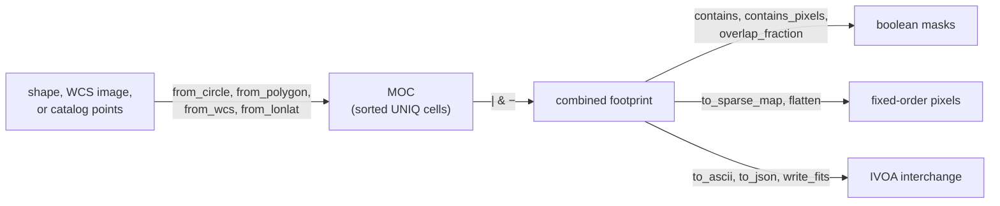

# Multi-order coverage (MOC)

A MOC (Multi-Order Coverage map, IVOA standard 2.0) records *which* parts of
the sky a survey, an image, or a localization covers, with no values attached.
It is a set of [HEALPix](healpix.md) NESTED cells of mixed orders: large cells
fill the interior of a footprint and small cells trace its edge, so the memory
cost follows the length of the boundary, not the area.
[`MOC`](../reference/sphere.md#torchsky.sphere.MOC) builds coverage from
shapes, images, and catalogs; tests points and pixels against it; combines
footprints with set algebra; and reads and writes the IVOA formats.

## How It Works

A cell at order \(k\) (`nside` \(= 2^k\)) with NESTED index \(p\) is stored as
one integer, its UNIQ number:

\[
\mathrm{uniq} = 4 \cdot 4^{k} + p = 4\,N_\mathrm{side}^2 + p .
\]

The leading term encodes the order, so cells of all orders share one sorted
integer space. Internally a MOC is also a list of half-open ranges of NESTED
indices at its maximum order: a coarse cell at order \(k\) is the range of its
\(4^{(k_\mathrm{max} - k)}\) descendants. Union, intersection, and difference
are merges of sorted range lists, and point containment is a binary search.



`max_order` fixes the resolution of the boundary. At order 10 (3.4 arcmin
cells) a footprint edge is uncertain by up to one cell; at order 16 it is
3.2 arcsec. Constructors cover a cell when any part of it overlaps the shape,
so a MOC is a superset of the exact region, larger by roughly half a cell
along the boundary.

## When to Use It

| You have | Use |
|---|---|
| Coverage only: survey footprints, exposure unions, cross-match pruning | `MOC` |
| Values at one resolution where data exist (depth, weight, counts) | [`SparseHealpixMap`](sparse-maps.md) |
| Values whose resolution follows the signal (GW or neutrino localizations) | [`MultiOrderHealpixMap`](sparse-maps.md#multi-order-value-maps) |
| An exact polygon or cap for geometry, not pixels | [`SphericalPolygon`](index.md#spherical-regions) |
| A genuinely full-sky field that fits in memory | A dense tensor |

## Minimal Example: The Footprint of a MegaPipe Cutout

The header below is the real WCS of a 512 × 512 CFHT MegaPipe cutout (sample
`cadc_megapipe_cutout`, see [Projections](../coordinates/projections.md)).
`MOC.from_wcs` turns the pixel grid into coverage; the exact area of the
footprint polygon shows how much the boundary cells add.

<!-- docs: run -->
```python
import math

import torch

from torchsky.sphere import MOC, spherical_polygon_area
from torchsky.wcs import WCS

wcs = WCS({  # CFHT MegaPipe 712.165, g band, CADC cutout
    "NAXIS": 2, "NAXIS1": 512, "NAXIS2": 512,
    "CTYPE1": "RA---TAN", "CTYPE2": "DEC--TAN",
    "CRVAL1": 359.07190997, "CRVAL2": -7.5, "CRPIX1": -2999.0, "CRPIX2": 1001.0,
    "CD1_1": -5.160234650248e-05, "CD1_2": 0.0, "CD2_1": 0.0, "CD2_2": 5.160234650248e-05,
})
moc = MOC.from_wcs(wcs, shape=(512, 512), max_order=16)        # 3.2 arcsec cells

corners = wcs.footprint(shape=(512, 512))
exact_arcmin2 = float(spherical_polygon_area(corners[:, 0], corners[:, 1])) * (180 / math.pi) ** 2 * 3600
moc_arcmin2 = moc.area_sq_deg * 3600
assert 1.0 < moc_arcmin2 / exact_arcmin2 < 1.15                # boundary cells add ~8%

centre = wcs.pixel_to_world(torch.tensor([255.5], dtype=torch.float64),
                            torch.tensor([255.5], dtype=torch.float64))
assert bool(moc.contains(*centre).all())
assert moc.to_ascii(compact=True).startswith("13/")           # coarsest cells are order 13
```

Real footprints are larger and the overhead smaller: the
[Horsehead WCS tour](../published-examples/horsehead_wcs_tour.py) builds the
order-15 MOC of a 15 × 15 arcmin DSS plate in 674 cells, 2% above the exact
area. The [Chandra example](../published-examples/chandra_events_on_sphere.py)
builds coverage from the events themselves:

```python
# fragment: ra, dec are the event positions from the Chandra example
from torchsky.sphere import MOC

moc = MOC.from_lonlat(ra, dec, max_order=12)   # 132 cells, 420 arcmin^2, five ACIS chips
assert bool(moc.contains(ra, dec).all())
```

## Recipes

### Build Coverage from Shapes

<!-- docs: run -->
```python
import torch

from torchsky.sphere import MOC

circle = MOC.from_circle(10.0, 20.0, 1.0, max_order=8)      # lon, lat, radius in degrees
square = MOC.from_polygon(torch.tensor([0.0, 2.0, 2.0, 0.0]),
                          torch.tensor([0.0, 0.0, 2.0, 2.0]), max_order=6)
points = MOC.from_lonlat(torch.tensor([15.0, 16.0]), torch.tensor([-3.0, 4.0]), max_order=6)

assert circle.contains(torch.tensor([10.0, 200.0]), torch.tensor([20.0, -40.0])).tolist() == [True, False]
assert bool(square.contains(torch.tensor(1.0), torch.tensor(1.0)))
assert circle.area_sq_deg > 4.5                             # 13.7' cells inflate a 1-degree disc
fine = MOC.from_circle(10.0, 20.0, 1.0, max_order=12)        # 0.86' cells
assert 3.14 < fine.area_sq_deg < 3.3                          # close to pi square degrees
```

Coverage constructors are hierarchical: interior cells stay coarse and only
the boundary is subdivided to `max_order`. Other entry points:
[`from_region`](../reference/sphere.md#torchsky.sphere.MOC.from_region) (any
torchsky region or a `PixelizedRegion`, kept at its resolution),
[`from_sparse_map`](../reference/sphere.md#torchsky.sphere.MOC.from_sparse_map),
[`from_threshold`](../reference/sphere.md#torchsky.sphere.MOC.from_threshold)
(pixels of a sparse map above or below a value), `MOC.empty()`, and `MOC.full()`.

### Combine Footprints

MOCs are closed under union (`|`), intersection (`&`), and difference (`-`),
across cells of different orders. `overlaps` answers "do these intersect?"
without building the intersection; `contains_moc` is the subset test.

<!-- docs: run -->
```python
import torch

from torchsky.sphere import MOC

a = MOC.from_circle(0.0, 0.0, 2.0, max_order=6)
b = MOC.from_circle(3.0, 0.0, 2.0, max_order=6)

assert a.overlaps(b)
union, both, only_a = a | b, a & b, a - b
assert both.area <= min(a.area, b.area) <= max(a.area, b.area) <= union.area
assert abs(union.area - (a.area + b.area - both.area)) < 1e-12

assert union.degrade(4).max_order <= 4         # coarser, still a superset
mask = a.flatten(64)                           # dense boolean NESTED mask, 12 * 64**2
assert mask.dtype == torch.bool and mask.numel() == 12 * 64**2
```

On CPU the set operations, UNIQ-to-range conversion, and `degrade` run in
small native kernels over the range lists; CUDA and MPS use the torch
implementation, which is also the parity oracle in the tests.

### Filter a Catalog or an Indexed Table

`contains(lon, lat)` returns a boolean mask that broadcasts over tensors and
allocates no dense map; index the catalog with it. For rows that already carry
HEALPix indices, `contains_pixels(nside, pixels, nest=True)` skips the
trigonometry, and `overlap_fraction(uniq)` reports how much of a cell is
covered. [`Catalog.inside(moc)`](../catalogs/index.md) does the same for a
catalog object, and `sample_randoms` draws points uniformly inside the
coverage for random catalogs.

### Save and Exchange

MOC serialization follows the IVOA standard: ASCII (`order/pixel` ranges),
JSON, and FITS. FITS goes through torchfits (`write_fits`, `read_fits`).

<!-- docs: run -->
```python
import torch

from torchsky.sphere import MOC

moc = MOC.from_circle(120.0, -30.0, 0.5, max_order=7)
text = moc.to_ascii(compact=True)
restored = MOC.from_ascii(text)
assert abs(restored.area - moc.area) < 1e-12
assert abs(MOC.from_json(moc.to_json()).area - moc.area) < 1e-12
assert bool(restored.contains(torch.tensor(120.0), torch.tensor(-30.0)))
```

`from_mocpy`/`to_mocpy` convert at a boundary when mocpy is installed; mocpy is
never a runtime backend.

### Add Time: STMOC

[`STMOC`](../reference/sphere.md#torchsky.sphere.STMOC) (MOC 2.0 space-time
coverage) pairs spatial cells with time cells of 1 µs resolution since
JD = 0. Use it for exposure windows, transient searches, and time-filtered sky
queries.

<!-- docs: run -->
```python
from torchsky.sphere import MOC, STMOC

field = MOC.from_circle(10.0, 0.0, 1.0, max_order=6)
night = STMOC.from_spatial_coverages(59000.0, 59001.0, field, time_depth=16)   # MJD window

assert bool(night.contains(59000.5, 10.0, 0.0))
assert not bool(night.contains(60000.0, 10.0, 0.0))
assert night.query_by_time(59000.0, 59000.5).area > 0.0
```

`from_times_positions` quantizes catalog samples onto time × HEALPix cells;
`mjd_to_time_us` and `time_us_to_mjd` convert to the STMOC time axis. `BMOC`
is the boundary-flagged variant for footprints that need their edge cells
marked.

## Accuracy and Validation

Constructors, set algebra, and serialization agree with mocpy in
[torchsky-harness](https://github.com/astroai/torchsky-harness); see the
[parity page](../performance/parity.md). In the test suite the native range
kernels are compared with the torch path.

## Pitfalls

- **A MOC is a superset.** Its area exceeds the exact region by about half a
  boundary cell per unit length of edge. Use
  [`spherical_polygon_area`](../reference/sphere.md#torchsky.sphere.spherical_polygon_area)
  when you need the exact area.
- **`max_order` is a resolution, not a precision knob for free.** Each extra
  order roughly doubles the number of boundary cells.
- **`flatten` and `to_dense`** allocate full-sky arrays. Call them once, at the
  boundary, not inside a loop.
- **`nest2uniq` takes `nside`, not order:** `nest2uniq(nside, pixels)`.

## See Also

- [HEALPix](healpix.md), [Sparse maps](sparse-maps.md), [Celestial sphere overview](index.md).
- [Catalogs](../catalogs/index.md): footprint selection and crossmatch pruning.
- Reference: [`MOC`](../reference/sphere.md#torchsky.sphere.MOC),
  [`STMOC`](../reference/sphere.md#torchsky.sphere.STMOC),
  [`nest2uniq`](../reference/sphere.md#torchsky.sphere.nest2uniq).
- Examples: [HEALPix and MOC](../published-examples/healpix_and_moc.py),
  [Chandra events](../published-examples/chandra_events_on_sphere.py),
  [Planck power spectrum](../published-examples/planck_power_spectrum.py)
  (a Galactic-cut MOC gives \(f_\mathrm{sky}\) exactly).
