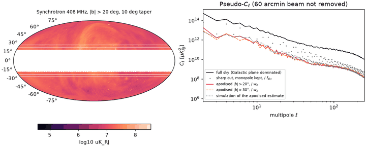

# Spherical harmonic transforms

A spherical harmonic transform (SHT) is the Fourier transform of the sphere.
Any band-limited map \(f(\theta, \phi)\) is a sum of spherical harmonics
\(Y_{\ell m}\), each a pattern with angular wavelength about
\(180^\circ / \ell\):

\[
f(\theta, \phi) = \sum_{\ell=0}^{\ell_\mathrm{max}} \sum_{m=-\ell}^{\ell}
a_{\ell m}\, Y_{\ell m}(\theta, \phi),
\qquad
C_\ell = \frac{1}{2\ell + 1} \sum_{m} |a_{\ell m}|^2 .
\]

*Synthesis* (`alm2map`) evaluates the sum on a HEALPix grid; *analysis*
(`map2alm`) recovers the coefficients \(a_{\ell m}\); the *angular power
spectrum* \(C_\ell\) measures the variance per multipole. `torchsky.sphere`
runs all three, plus beams, spin-2 (polarization) transforms, and masked-sky
spectra, on CPU, CUDA, and MPS without healpy at runtime.

## When to Use It

- Measure the power spectrum of a full-sky or large-area map (CMB, Galactic
  foregrounds, galaxy density).
- Smooth, deconvolve, or filter a map by a function of \(\ell\) (beams, Wiener
  filters).
- Represent a sky model by its coefficients and fit them with gradients.

For a small patch of sky, a flat-sky FFT of a WCS image is cheaper and
simpler. For local operations (a top-hat average, a point source) work in
pixel space.

## How It Works

On HEALPix the analysis integral \(a_{\ell m} = \int f\, Y^*_{\ell m}\, d\Omega\)
becomes a sum over pixels. Pixels lie on iso-latitude rings, so the sum over
longitude on each ring is an FFT, and the latitude part is an associated
Legendre recurrence: cost \(O(N_\mathrm{side}^3)\) instead of
\(O(N_\mathrm{side}^4)\).

- **`lmax`.** It defaults to \(3N_\mathrm{side} - 1\), the largest
  multipole HEALPix can represent at all. Below about \(2N_\mathrm{side}\)
  the pixel sum is an accurate quadrature; between \(2N_\mathrm{side}\) and
  \(3N_\mathrm{side}\) aliasing grows. Choose `lmax` from the map's beam
  rather than from the grid when you can.
- **Iterations.** HEALPix quadrature is not exact. `iter=n` runs \(n\) Jacobi
  refinements: synthesize, subtract, analyze the residual, add. Each costs one
  extra transform pair. `use_weights=True` (computed ring weights) and
  `use_pixel_weights=True` (HEALPix full-pixel weight files read through
  torchfits from `datapath` or `TORCHSKY_HEALPIX_DATAPATH`) improve the
  quadrature instead; missing weight files raise.
  [`map2alm_lsq`](../reference/sphere.md#torchsky.sphere.map2alm_lsq) iterates
  to a residual tolerance and returns `(alm, rel_res, n_iter)` as a diagnostic.
- **Ordering.** Coefficients use the healpy layout: complex, \(m \ge 0\) only,
  in blocks of constant \(m\); `alm_index(ell, m, lmax)` and `alm_size(lmax)`
  are the contract for indexing them. Real maps imply
  \(a_{\ell,-m} = (-1)^m a^*_{\ell m}\).

## Minimal Example: Analysis, Synthesis, and Iterations

<!-- docs: run -->
```python
import torch
import torchsky.sphere as sphere

torch.manual_seed(0)
nside, lmax = 32, 64                              # lmax = 2 nside
ell = torch.arange(lmax + 1, dtype=torch.float64)
cl = torch.zeros(lmax + 1, dtype=torch.float64)
cl[2:] = 1.0 / ell[2:] ** 2

alm = sphere.synalm(cl, lmax=lmax)                # Gaussian a_lm with spectrum C_ell
sky = sphere.alm2map(alm, nside, lmax=lmax)       # (12 nside^2,) RING map

def error(n_iter: int) -> float:
    back = sphere.map2alm(sky, nside=nside, lmax=lmax, iter=n_iter)
    return float((back - alm).abs().max() / alm.abs().max())

assert error(0) < 1e-2 and error(3) < 1e-4       # 3e-3 -> 7e-6 with three iterations
assert alm.shape == (sphere.alm_size(lmax),)
assert sphere.alm_index(1, 1, lmax) == lmax + 1
```

## Real Data: Planck Synchrotron on a Masked Sky

The [Planck power spectrum example](../published-examples/planck_power_spectrum.py)
reads the Commander synchrotron map (`nside = 256`, NESTED, Galactic), builds a
\(|b| > 20^\circ\) cut with `query_strip`, takes \(f_\mathrm{sky}\) from the
area of the cut's MOC, and compares full-sky and masked spectra:

```python
# fragment: needs the cached sample; `pixi run fetch-example-samples` downloads it
from pathlib import Path

import torch
import torchfits
import torchsky.sphere as sphere

path = Path.home() / ".cache/torchsky/samples/planck_commander_sync_256.fits"
sky = torchfits.read(str(path), hdu=1)["I_MEAN"].to(torch.float64)
cl_full = sphere.anafast(sky, nest=True, lmax=383)            # C_ell ~ ell^-1.8
clean = sphere.remove_monopole_dipole(sky, 256, nest=True, valid_mask=weight > 0)
w2 = float((weight * weight).mean())  # weight: |b| > 20 deg, 10 deg cosine taper
cl_cut = sphere.anafast(clean * weight, nest=True, lmax=383) / w2
```



The mask is apodised with a 10° cosine taper, the monopole and dipole are
removed on the unmasked sky, and the pseudo-\(C_\ell\) is divided by
\(w_2\), the mean of the squared mask. On Gaussian simulations masked the same
way this recovers the input spectrum to within 4 % above \(\ell = 30\).
The real high-latitude spectrum still lies 30–60 times below the full-sky one.
That is physical, not a normalisation error: most synchrotron power sits in
the Galactic plane, which the mask removes, so the high-latitude sky is not
a statistically isotropic sample of the full sky.

## Recipes

### Power Spectra and Cross-Spectra

`anafast(map1, map2=None, ...)` goes from maps to \(C_\ell\); `alm2cl` works on
coefficients you already have. Polarized input is `(3, npix)` in `(T, Q, U)`
order and returns spectra in healpy's stacked order (TT, EE, BB, TE, EB, TB);
pass `alm=True` to receive the coefficients too.

<!-- docs: run -->
```python
import torch
import torchsky.sphere as sphere

torch.manual_seed(1)
nside, lmax = 16, 8
a = sphere.synfast(torch.ones(lmax + 1, dtype=torch.float64), nside=nside, lmax=lmax, pol=False)
b = a + 0.1 * torch.randn_like(a)

cl_map = sphere.anafast(a, nside=nside, lmax=lmax, pol=False)
cl_alm = sphere.alm2cl(sphere.map2alm(a, nside=nside, lmax=lmax), lmax=lmax)
torch.testing.assert_close(cl_map, cl_alm, rtol=1e-10, atol=1e-12)

cross = sphere.anafast(a, b, nside=nside, lmax=lmax, pol=False)
assert cross.shape == (lmax + 1,)
```

### Beams, Filters, and Smoothing

`gaussian_beam(fwhm_rad, lmax)` returns \(B_\ell\); `almxfl(alm, f_ell)`
multiplies coefficients by any function of \(\ell\); `smoothmap` analyzes,
filters, and synthesizes in one call and also takes a measured `beam=` or
`beam_window=`. `smoothalm` keeps a coefficient-space pipeline.

<!-- docs: run -->
```python
import math

import torch
import torchsky.sphere as sphere

torch.manual_seed(2)
nside, lmax = 16, 32
ell = torch.arange(lmax + 1, dtype=torch.float64)
sky = sphere.synfast(torch.exp(-ell / 10), nside=nside, lmax=lmax, pol=False)

fwhm = math.radians(5.0)
beam = sphere.gaussian_beam(fwhm, lmax)
smoothed = sphere.alm2map(sphere.almxfl(sphere.map2alm(sky, nside=nside, lmax=lmax), beam),
                          nside, lmax=lmax)
assert float(smoothed.std()) < float(sky.std())
one_call = sphere.smoothmap(sky, nside=nside, lmax=lmax, mmax=lmax, fwhm_rad=fwhm)
assert one_call.shape == sky.shape

window = sphere.pixwin(nside, lmax=lmax)          # HEALPix pixel window function
assert abs(float(window[0]) - 1.0) < 1e-6 and float(window[-1]) < 0.9
```

The pixel window \(W_\ell\) is the transfer function of averaging over a
HEALPix pixel. Following the definition behind the HEALPix tables,
\(W_\ell^2\) is the mean over pixels of each pixel's harmonic power,

\[
W_\ell^2 = \frac{1}{N_\mathrm{pix}} \sum_p \frac{1}{\Omega_p^2}
\iint_{p \times p} P_\ell(\hat n \cdot \hat n')\, \mathrm d\Omega\, \mathrm d\Omega' .
\]

[`pixwin`](../reference/sphere.md#torchsky.sphere.pixwin) computes it for any
`nside` up to 8192 and \(\ell \le 4\,n_\mathrm{side}\) from the pixel shapes,
with no tables. With \(t = (1 - \hat n\cdot\hat n')/2\), \(P_\ell(1-2t)\) is
a terminating hypergeometric series in \(t\), so \(W_\ell^2\) is a short sum
of pixel-averaged moments \(\langle t^k\rangle\) with a rigorous truncation
bound. The moments are integrated with Gauss–Legendre rules on every distinct
pixel shape (pixels at the poles and on the polar-cap boundary are split into
triangles). `pol=True` adds the spin-2 window from \(d^\ell_{22}\), with the
polarization frame parallel-transported across the pixel.

- **Accuracy:** to \(10^{-12}\) or better. It reproduces the healpy tables to
  \(10^{-12}\) for `nside` up to 128. For `nside` 256 to 2048 the healpy
  tables differ by up to \(1.3\times10^{-5}\), an error in the tables:
  \(1 - W_\ell\) here keeps its exact \(n_\mathrm{side}^{-2}\) scaling, and an
  independent transform of every pixel's indicator map converges to the same
  values. The healpy polarization windows use a frame convention that differs
  by \(10^{-6}\) at `nside` 8, falling as \(n_\mathrm{side}^{-4}\).
- **Cost:** \(O(n_\mathrm{side}^2)\) once per `nside`, on the CPU: under a
  second up to `nside` 256, about 15 s at 1024 and a minute at 2048 on a
  laptop CPU. Results
  are cached in memory and, from `nside` 256, in
  `$TORCHSKY_CACHE_DIR/pixwin` (default `~/.cache/torchsky/pixwin`).

<!-- docs: run -->
```python
import torchsky.sphere as sphere

w_t, w_p = sphere.pixwin(64, pol=True)              # l = 0 .. 191
assert w_t.shape == w_p.shape == (192,) and float(w_p[1]) == 0.0
w_ratio = (1.0 - sphere.pixwin(128)[2]) / (1.0 - w_t[2])
assert abs(float(w_ratio) - 0.25) < 1e-3            # 1 - W_l at fixed l ~ nside^-2
```

### Polarization (Spin 2)

Polarization \(Q \pm iU\) has spin \(\pm 2\); its transform yields gradient
(E) and curl (B) coefficients, which, unlike \(Q\) and \(U\), do not depend
on the coordinate frame. `map2alm(iqu, pol=True)` returns `(3, nalm)`
coefficients in `(T, E, B)` order.
`map2alm_spin(qu, spin=2)` works on a `(2, npix)` Q/U pair and returns the
(E, B) pair; `alm2map_spin` goes back. Spins must be non-negative integers.

<!-- docs: run -->
```python
import torch
import torchsky.sphere as sphere

torch.manual_seed(3)
nside, lmax = 16, 24
cl = torch.ones(lmax + 1, dtype=torch.float64)
cl[:2] = 0.0
teb = torch.zeros(3, sphere.alm_size(lmax), dtype=torch.complex128)
teb[1] = sphere.synalm(cl, lmax=lmax)                   # pure E mode
iqu = sphere.alm2map(teb, nside, lmax=lmax, pol=True)

e, b = sphere.map2alm_spin(iqu[1:], 2, nside=nside, lmax=lmax, iter=3)
assert float((e - teb[1]).abs().max()) < 1e-3          # E recovered
assert float(b.abs().max()) < 1e-3                      # no B leaks in
assert sphere.alm2map_spin((e, b), nside=nside, spin=2, lmax=lmax).shape == (2, 12 * nside**2)
```

### Masked Skies: Pseudo-\(C_\ell\)

A mask couples multipoles: the spectrum of a masked map, the *pseudo*-\(C_\ell\),
is \(\tilde C_\ell = \sum_{\ell'} M_{\ell\ell'} C_{\ell'}\), with a coupling
matrix \(M\) set by the mask's own spectrum. Dividing by \(f_\mathrm{sky}\)
(as in the Planck example) is the zeroth-order correction. The MASTER method
inverts \(M\) on bandpowers:
[`ModeCouplingWorkspace`](../reference/sphere.md#torchsky.sphere.ModeCouplingWorkspace)
computes it exactly in correlation space, without an \(\ell \times \ell\)
kernel, for scalar and spin-2 fields on CAR grids
([`CARGeometry`](../reference/sphere.md#torchsky.sphere.CARGeometry)).
[`PseudoClField`](../reference/sphere.md#torchsky.sphere.PseudoClField)
carries the map, mask, beam, pixel window, and optional E/B purification and
template deprojection.

<!-- docs: run -->
```python
import torch

import torchsky.sphere as sphere
from torchsky.sphere import (BandpowerBinning, CARGeometry, ModeCouplingWorkspace,
                             PseudoClField, coupled_spectra, synthesize)

torch.manual_seed(0)
lmax = 16
nlat, nlon = 2 * lmax + 1, 4 * lmax + 1
geometry = CARGeometry.from_header({
    "NAXIS1": nlon, "NAXIS2": nlat, "CTYPE1": "RA---CAR", "CTYPE2": "DEC--CAR",
    "CRVAL1": 0.0, "CRVAL2": 0.0, "CRPIX1": 1.0, "CRPIX2": (nlat + 1.0) / 2.0,
    "CDELT1": 360.0 / nlon, "CDELT2": -180.0 / (nlat - 1),
}, spin_convention="iau")

lat = geometry.latitudes(dtype=torch.float64, device="cpu")       # one per row
mask = torch.sigmoid((lat.abs() - 0.44) / 0.15).reshape(-1, 1).expand(geometry.shape)  # |b| > 25 deg

ell = torch.arange(lmax + 1, dtype=torch.float64)
cl_true = 1.0 / (ell + 3.0) ** 2
binning = BandpowerBinning.from_edges([2, 6, 10, 17], lmax)
estimates, workspace = [], None
for _ in range(30):
    sky = synthesize(sphere.synalm(cl_true, lmax=lmax), geometry, lmax=lmax).values
    field = PseudoClField(sky, mask, geometry, lmax)
    if workspace is None:                         # the mask fixes the coupling
        workspace = ModeCouplingWorkspace.from_fields(field, None, binning)
    estimates.append(workspace.decouple(coupled_spectra(field)))

ratio = torch.stack(estimates).mean(0) / binning.bin(cl_true)
assert bool(((ratio - 1.0).abs() < 0.25).all())   # unbiased within the scatter of 30 skies
```

### Explicit Geometry and Backends

[`SHTRequest`](../reference/sphere.md#torchsky.sphere.SHTRequest) binds a
geometry ([`HEALPixGeometry`](../reference/sphere.md#torchsky.sphere.HEALPixGeometry)
or `CARGeometry`), a bandlimit, and a spin convention; `synthesize`,
`adjoint_synthesize`, `analyze`, and `pseudo_analyze` dispatch through a
backend that reports its `SHTBackendCapabilities`. Unsupported combinations
fail: `CARGeometry`, for example, accepts only separable, unrotated,
full-longitude grids with Clenshaw-Curtis or Fejér-1 latitude rings. This is
the entry point for matrix-free and differentiable solvers whose maps are not
HEALPix.

## Devices, Precision, and Memory

CPU uses fused C++ kernels; CUDA and MPS use an ATen ring-FFT path and keep
maps on the device. `TORCHSKY_DISABLE_CPP=1` selects the pure-torch path with
the same results. `lmax` up to \(3N_\mathrm{side} - 1\) works at every `nside`: the Legendre
recurrence carries a power-of-\(2^{256}\) exponent per (m, ring), so the
sectoral seed \(\sin^m\theta\) never underflows float64, and rings where
\(m > \ell_\mathrm{max} \sin\theta\) plus a WKB margin are skipped (dropped
weight below \(e^{-90}\)). MPS has no float64: the spin-weighted Legendre
recurrence runs on the host in float64 and returns float32/complex64 tensors
on the MPS device.

`TORCHSKY_SCALAR_MAX_CACHE_BYTES` (default 512 MiB) bounds the cached basis
matrices; `TORCHSKY_SPIN_THREADS` caps the CPU spin thread pool.

## Accuracy and Validation

Transforms, spectra, beams, and pixel windows are checked against healpy in
[torchsky-harness](https://github.com/astroai/torchsky-harness), at
`nside` 512, 1024, and 2048 up to `lmax = 6143`; see the
[parity page](../performance/parity.md). Mode-coupling matrices are tested
against direct Wigner-3j sums.

## Pitfalls

- **`pol=True` shapes are validated, not inferred:** `(3, npix)` maps and
  `(3, nalm)` coefficients in `(T, E, B)` order.
- **Monopole and dipole** dominate many real maps and leak under a mask;
  remove them first with `remove_monopole_dipole`.
- **`rotate_alm`** requires `mmax == lmax` and uses the healpy ZYZ Euler
  convention.
- **NESTED maps** need `nest=True`; analysis reorders internally.

## See Also

- [HEALPix](healpix.md), [MOC](moc.md) (masks and \(f_\mathrm{sky}\)), [Celestial sphere overview](index.md).
- [Fields](../models/fields.md): harmonic sky models fitted with gradients.
- Reference: [`torchsky.sphere`](../reference/sphere.md),
  [healpy-shaped `compat`](../reference/sphere-compat.md).
- Examples: [Planck power spectrum](../published-examples/planck_power_spectrum.py),
  [SHT power spectrum](../published-examples/sht_power_spectrum.py),
  [T/E/B polarization](../published-examples/polarization_teb.py).
