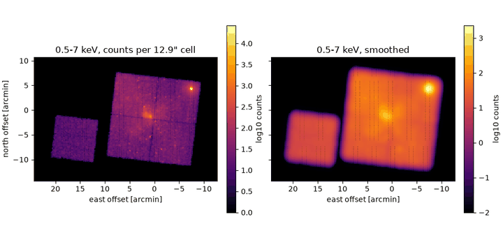

# Sparse maps

A sparse HEALPix map stores values only on the pixels where you have data.
Survey depth, exposure counts, masks, and event counts at high resolution
cover a small fraction of the sky: at `nside = 16384` (12.9 arcsec pixels) the
sphere has 3.2 billion pixels, and a dense float64 map would take 26 GB even if
only a few thousand pixels were observed.
[`SparseHealpixMap`](../reference/sphere.md#torchsky.sphere.SparseHealpixMap)
keeps the sorted indices of the valid pixels and their values, and follows the
healsparse data model, so files and workflows carry over.

## How It Works

The healsparse model has two resolutions:

- **`nside_sparse`**, the resolution of the values.
- **`nside_coverage`**, a coarse grid (typically 32 or 64) that records which
  coarse pixels contain any data. Each coarse pixel owns a contiguous block
  of \((N_\mathrm{sparse}/N_\mathrm{coverage})^2\) NESTED children.


A lookup is therefore a shift, a coverage test, and a gather: no search over
the whole map, and no dense allocation. Pixels with no data return the
*sentinel* (the HEALPix `UNSEEN` value, \(-1.6375 \times 10^{30}\), unless you
pass another), which is how "no data" stays distinct from a stored zero.
Values may carry leading dimensions, so a multi-band map is one object, and
`from_columns` builds named multi-column maps (weight, number of exposures,
fraction detected, …).

## When to Use It

| Coverage and content | Use |
|---|---|
| Values on a small fraction of the sky at one resolution | `SparseHealpixMap` |
| Coverage only, any resolution, set algebra | [`MOC`](moc.md) |
| Values whose resolution varies across the sky | `MultiOrderHealpixMap` (below) |
| Full sky, or most of it, at modest `nside` | A dense tensor of length \(12\,N_\mathrm{side}^2\) |
| Values for harmonic analysis | A dense RING map; see [SHT](sht.md) |

The crossover is memory: a sparse map costs one int64 index plus the values per
valid pixel, so it wins once less than about half the sky is covered, and
overwhelmingly so at high `nside`.

## Minimal Example: Depth of Overlapping Exposures

Two copies of a real CFHT MegaPipe cutout WCS (see
[Projections](../coordinates/projections.md)), offset by half a cutout,
become coverage maps at `nside = 16384`. `sum_union` adds them on the union of
their pixels, giving the number of exposures per pixel.

<!-- docs: run -->
```python
import torch

from torchsky.sphere import SparseHealpixMap, sum_union
from torchsky.wcs import WCS

cutout = {  # CFHT MegaPipe 712.165 cutout WCS
    "NAXIS": 2, "NAXIS1": 512, "NAXIS2": 512, "CTYPE1": "RA---TAN", "CTYPE2": "DEC--TAN",
    "CRVAL1": 359.07190997, "CRVAL2": -7.5, "CRPIX1": -2999.0, "CRPIX2": 1001.0,
    "CD1_1": -5.160234650248e-05, "CD1_2": 0.0, "CD2_1": 0.0, "CD2_2": 5.160234650248e-05,
}
shifted = {**cutout, "CRPIX1": -2999.0 + 256}           # half a cutout further east

maps = [
    SparseHealpixMap.from_wcs(WCS(h), 2**14, shape=(512, 512), nside_coverage=32)
    for h in (cutout, shifted)
]
depth = sum_union(maps)

assert maps[0].valid_pixels.numel() < 100              # of 3.2e9 pixels on the sphere
assert depth.get_values(depth.valid_pixels).unique().tolist() == [1.0, 2.0]
values, valid = depth.lookup_radec(torch.tensor([358.89, 0.0], dtype=torch.float64),
                                   torch.tensor([-7.54, 0.0], dtype=torch.float64))
assert valid.tolist() == [True, False]                 # inside the footprint, far away
```

`sum_intersection` keeps only pixels present in every input.
`from_observations` builds survey-property maps (`weight`, `nexp`, `fracdet`)
from a list of [`Observation`](../reference/map.md#torchsky.map.Observation)
objects in one call.

## Real Data: Chandra Events

The [Chandra example](../published-examples/chandra_events_on_sphere.py) bins
the 324,000 events of ObsID 5950 in 0.5–7 keV into a counts map at
`nside = 16384`. 8,105 pixels are occupied, the event count is conserved, and
the map is then smoothed on the sparse pixel set with `neighbors`, never
touching a dense array.

```python
# fragment: ra, dec are the event positions from the Chandra example
import torch
from torchsky.sphere import SparseHealpixMap, ang2pix

pix = ang2pix(2**14, ra, dec, nest=True, lonlat=True)
cells, counts = torch.unique(pix, return_counts=True)
counts_map = SparseHealpixMap.from_pixels(cells, counts.double(), 2**14, nest=True)
```



## Recipes

### Build, Query, and Convert

<!-- docs: run -->
```python
import torch

from torchsky.sphere import SparseHealpixMap

nside = 16
dense = torch.randn(12 * nside**2, dtype=torch.float64)
sparse = SparseHealpixMap.from_pixels(
    pixels=torch.arange(100, dtype=torch.int64), values=dense[:100],
    nside_sparse=nside, sentinel=0.0,
)
assert sparse.valid_pixels.numel() == 100
assert sparse.get_values(torch.tensor([0, 99, 5000])).tolist()[2] == 0.0   # sentinel

nearest = sparse.interpolate(torch.tensor([0.0]), torch.tensor([0.0]), method="nearest")
assert nearest.shape == (1,)

back = sparse.to_dense(fill_value=0.0)
assert torch.equal(back[:100], dense[:100])
```

`from_dense` extracts the valid pixels of a dense map, `from_moc` and
`from_region` realize coverage, and `update_values_pix` adds or overwrites
pixels in place. `interpolate` supports `"nearest"` and `"bilinear"`; bilinear
drops uncovered neighbours and renormalizes the remaining weights.

### Change Resolution

`ud_grade(nside_out)` degrades with averaging by default; `power=-2` sums
(counts), `pess=True` marks a parent invalid unless all children are valid,
and `reduction=` selects other reductions. The coverage hierarchy is kept when
the output resolution allows it.

### Move Between Values and Coverage

`sparse.to_moc()`, `MOC.from_sparse_map`, and `MOC.to_sparse_map(nside,
nside_coverage=...)` convert between values and topology at an explicit
resolution, never expanding a high-order MOC into dense pixels.
`MOC.from_threshold` keeps the pixels above or below a value, for example the
area deeper than a target exposure time.

<!-- docs: run -->
```python
import torch

from torchsky.sphere import MOC, SparseHealpixMap

depth = SparseHealpixMap.from_pixels(
    pixels=torch.arange(64, dtype=torch.int64),
    values=torch.ones(64, dtype=torch.float64), nside_sparse=16, sentinel=0.0,
)
footprint = MOC.from_sparse_map(depth)
again = footprint.to_sparse_map(nside=16, nside_coverage=2)
assert again.valid_pixels.numel() == 64 and again.nside_coverage == 2
```

### Draw Randoms

`sample_randoms(n, weights=...)` draws points uniformly in solid angle inside
the valid pixels, or weighted by a column such as depth: the random catalog
for clustering measurements.

### Read and Write Healsparse Files

`write_fits` writes the healsparse layout (COV and SPARSE images) through
torchfits; `read_fits` reads it back, or a PIXEL/VALUE table. `to_healsparse`
and `from_healsparse` convert at a boundary when healsparse is installed; it
is never a runtime backend.

## Multi-Order Value Maps

[`MultiOrderHealpixMap`](../reference/sphere.md#torchsky.sphere.MultiOrderHealpixMap)
attaches values to sorted, disjoint UNIQ cells of mixed orders: the format of
gravitational-wave and neutrino localization maps, whose resolution follows
the probability density. `values_are_densities=True` declares values per
steradian, so `integral(footprint)` multiplies by cell area and by the covered
fraction of each cell. The integral is differentiable in the values.

<!-- docs: run -->
```python
import torch

from torchsky.sphere import MOC, MultiOrderHealpixMap, nest2uniq

uniq = nest2uniq(torch.tensor([1, 2]), torch.tensor([0, 4]))   # nside 1 and 2
density = torch.tensor([2.0, 3.0], dtype=torch.float64, requires_grad=True)
skymap = MultiOrderHealpixMap(uniq, density, values_are_densities=True)

probability = skymap.integral(MOC(nest2uniq(2, torch.tensor([0, 4]))))
probability.backward()
assert float(probability) > 0.0 and density.grad is not None
```

`from_sparse_map`/`to_sparse_map` exchange fixed-resolution maps and
`from_columns`/`to_columns` exchange UNIQ plus value columns. Host adapters for
`mhealpy` and `cdshealpix` copy to CPU; the tensor path has no peer
dependency.

## Accuracy and Validation

Construction, lookups, `ud_grade`, and file round trips are compared with
healsparse in [torchsky-harness](https://github.com/astroai/torchsky-harness);
see the [parity page](../performance/parity.md).

## Pitfalls

- **Sentinel versus zero.** A stored `0` and an uncovered pixel are different;
  `lookup_radec` and `get_values_pos(..., valid_mask=True)` return a validity
  mask next to the values. Boolean and integer maps keep a pixel list so an uncovered child is
  never read as a stored `False` or `0`.
- **NESTED only.** Sparse maps index NESTED pixels; convert RING input first.
- **`coverage_mask`** is a dense boolean array at `nside_coverage` (small);
  `to_dense` is the only full-resolution dense allocation.
- **Device.** Lookups stay on the device of the map's tensors; a fused CPU
  gather is used when a coverage map is present.

## See Also

- [HEALPix](healpix.md), [MOC](moc.md), [Celestial sphere overview](index.md).
- [HEALPix mapmaking](../maps/healpix-mapmaking.md): coadd images into HEALPix maps.
- Reference: [`SparseHealpixMap`](../reference/sphere.md#torchsky.sphere.SparseHealpixMap),
  [`MultiOrderHealpixMap`](../reference/sphere.md#torchsky.sphere.MultiOrderHealpixMap),
  [`sum_union`](../reference/sphere.md#torchsky.sphere.sum_union).
- Examples: [Chandra events](../published-examples/chandra_events_on_sphere.py),
  [HEALPix and MOC](../published-examples/healpix_and_moc.py).
