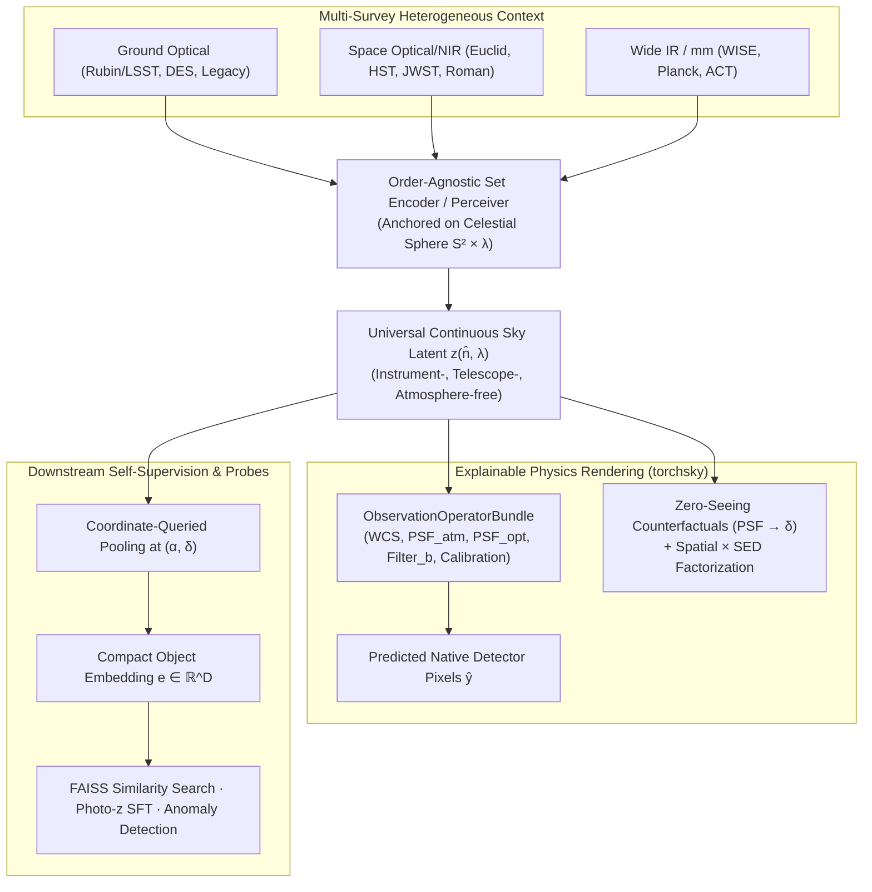

# Continuous Latent Field World Models for Multi-Survey Cosmology & Astrophysics

> **Research Note / Thread Synthesis (2026-11-08 — 2026-11-09)**
> Outside published docs per [`docs/project/authoring.md`](../../docs/project/authoring.md) and excluded from source distributions in [`pyproject.toml`](../../pyproject.toml).

This document synthesizes the architecture, literature, and strategic design decisions covering:
1. Comparing two world-model whitepaper plans against `torchsky`'s engineering contract.
2. Defining continuous vs. discrete latents (and classifying MAE / DINOv3).
3. Formulating valid causal structures on continuous sky fields.
4. Designing an instrument-free, multi-survey, downstream-ready, explainable latent field.
5. Evaluating six recent arXiv papers (including Coconut, DiscoLoop, and CoSIM) for astronomical adaptation, particularly non-discrete photo-$z$.
6. Mapping the ecosystem lineage across `torchz`, `cosmodist`, `cosmapper`, and `torchsky`.

---

## 1. Comparison of White Paper Plans & Verdict for `torchsky`

We compared two candidate documents framing a continuous latent field world-model research program:

| Dimension | Plan 1: Full White Paper Draft (*Observation-Native Continuous Latent Field World Models for Cosmology*) | Plan 2: Strategic Spec (*Archived World-Model Whitepaper Plan*) |
| :--- | :--- | :--- |
| **Role** | Visionary research manifesto proposing a predictive-first field model $z : \mathcal{U} \to \mathbb{R}^{d_z}$ ($\mathcal{U} = S^2 \times \mathbb{R}_\tau$, extendable to $\chi, \Lambda, t$) and a `torchsky` / `torchsky-world` split. | Disciplined strategic plan replacing abandoned root-level drafts, explicitly engineered to prevent conceptual inflation ("rhetorical drift"). |
| **Codebase Grounding** | Abstract mathematical symbols ($E_\theta, R_\theta, \mathcal{U}, \Pi_{\Delta\tau}$) detached from actual classes. | Anchored to shipped `torchsky` surfaces ([`ObservationOperatorBundle`](../../src/torchsky/map/operators/bundle.py#L48), [`FieldObservation`](../../src/torchsky/map/field/types.py#L374), [`ForwardContext`](../../src/torchsky/map/field/types.py#L108), [`SceneRepresentation`](../../src/torchsky/map/scenes.py#L50), [`TargetRenderSpec`](../../src/torchsky/map/target.py#L13)) and honest about gaps. |
| **Repo Firewall** | Mentions a repo split in §8, while devoting most prose to ML philosophy, RG analogies, and ELBO/training loops. | Enforces a hard firewall: `torchsky` stays a lean, reusable operator/rendering substrate; training loops, context/target samplers, and probes stay strictly outside in `torchsky-world`. |
| **Scientific Discipline** | Acknowledges risks (§6: predictive $\neq$ cosmological sufficiency, nuisance entanglement, weak identifiability), but leaves verification open-ended. | Defines explicit **Claims To Avoid** and commits to a sequential, falsifiable **5-Phase Empirical Ladder (Phases A–E)**. |

### Plan 2 Empirical Evaluation Ladder
1. **Phase A — Predictive baseline:** Infer from context observations, render held-out targets, and beat strong coadd and field-fit baselines (RMSE, robust residuals, NLL, stratified by instrument/PSF/mask).
2. **Phase B — Cross-view generalization:** Train on a subset of bands/epochs/PSFs/instruments and predict held-out views.
3. **Phase C — Nuisance disentanglement:** Verify via explicit leakage diagnostics that operator perturbations (masks, PSF shifts, exposure subsets, zero-point shifts) stay out of the scene latent.
4. **Phase D — Probe usefulness:** Attach field decoders, cosmology score heads, parameter heads, and verify recovery of scientifically meaningful structure.
5. **Phase E — Failure sensitivity:** Detect out-of-distribution regimes, unusual morphology, and calibration failures instead of failing silently with high confidence.

### Strategic Verdict
**Plan 2 makes significantly more sense for `torchsky`.** It aligns with [`AGENTS.md`](../../AGENTS.md) and [`docs/project/roadmap.md`](../../docs/project/roadmap.md) ("thin, stable public APIs", "no heuristics", "scalability first"), protects `torchsky` from turning into an unmaintainable training playground, and preserves Plan 1 only as motivating prose gated by falsifiable experiments.

---

## 2. Continuous vs. Discrete Latents & Where MAE / DINOv3 Sit

"Continuous vs. discrete" refers to two orthogonal axes:

1. **Domain Continuity (Coordinate / Spatial Indexing):**
   - **Continuous-Domain Latents** (*Continuous Latent Fields*, *Neural Fields*, *Implicit Neural Representations / INRs*, *Function-space Latents*): Coordinate maps $z : \mathcal{U} \to \mathbb{R}^{d_z}$ defined over smooth manifolds ($S^2$, wavelength $\lambda$, scale $\tau$, radial distance $\chi$). Resolution-free and queryable at arbitrary sub-pixel coordinates.
   - **Discrete-Domain Latents** (*Lattice / Grid Latents*, *Token Sequences*, *Patch Embeddings*): Indexed by integer pixels, fixed HEALPix $N_{\mathrm{side}}$ cells, or sequence positions $\{z_i\}_{i=1}^N$.
2. **State-Space Continuity (Values):**
   - **Continuous State Space:** Real-valued vectors/tensors $z \in \mathbb{R}^d$ (VAEs, normalizing flows, diffusion latents, ViT embeddings).
   - **Discrete State Space:** Quantized codebook IDs / categorical tokens $z \in \{1, \dots, K\}$ (VQ-VAE, VQ-GAN, BEiT, Gumbel-Softmax).

### Classification of MAE and DINOv2 / DINOv3

| Paradigm / Model | State Space (Values) | Spatial Domain (Indexing) | Latent Character & Training Target |
| :--- | :--- | :--- | :--- |
| **VQ-VAE / BEiT / Discrete World Models** | Discrete (Codebook IDs) | Discrete (Grid / Tokens) | Categorical token matching |
| **MAE** ([He et al., 2021](https://arxiv.org/abs/2111.06377)) | **Continuous** ($\mathbb{R}^d$) | **Discrete** (Patch sequence) | Pixel-level MSE on masked patches; retains high-frequency appearance |
| **DINOv2 / DINOv3** ([Oquab et al., 2023](https://arxiv.org/abs/2304.07193)) | **Continuous** ($\mathbb{R}^d$) | **Discrete** (`[CLS]` + Patch grid + `[REG]`) | Self-distillation + iBOT patch loss; high-level semantic invariance |
| **`torchsky` / World-Model Latent Field** | **Continuous** ($\mathbb{R}^{d_z}$) | **Continuous** ($S^2 \times \mathbb{R}_\tau \times \dots$) | Multi-operator forward rendering in native measurement space |

**Why ViT patch latents (MAE / DINOv3) are insufficient for multi-survey astronomy:**
- Fixed Cartesian $14\times 14$ or $16\times 16$ patch lattices break spherical geometry ($S^2$) and WCS polynomial/tangent distortions.
- Patch embeddings conflate true astrophysical flux with exposure-specific PSF seeing, pixel phase, and filter curves.

---

## 3. Causal Structure in Continuous Latent Fields

A continuous latent field can incorporate strict **causal structure**, provided causality is aligned with valid physical or multiscale directions rather than isotropic sky angles:

- **Symmetry Warning (What NOT to do):** Angular directions $(\theta, \phi) \in S^2$ are isotropic. Raster-scanning pixels or autoregressively ordering HEALPix indices destroys $SO(3)$ rotational symmetry and coordinate gauge invariance.

### Three Valid Causal Axes
1. **Line-of-Sight & Past Light-Cone Causality ($\chi$ or $z_{\mathrm{redshift}}$):**
   - Increasing comoving distance $\chi$ corresponds to looking backward in cosmic time. Gravitational lensing and radiative transfer are strictly directional along the past light cone (background $\to$ foreground lens $\to$ observer).
   - Formulated via continuous Neural ODEs or Continuous State-Space Models (SSMs) evolving along $\chi$:
     $$\frac{d z(\hat{n}, \chi)}{d\chi} = f_\theta\big(z(\hat{n}, \chi), \nabla_{\hat{n}} z(\hat{n}, \chi), \chi\big)$$
2. **Scale-Space & Renormalization Group (RG) Causality ($\tau$):**
   - Following Witkin/Koenderink scale-space causality, coarsening satisfies a semi-group property: information merges/dissipates monotonically as $\tau$ increases without creating spurious extrema:
     $$z(\hat{n}, \tau_2) = \mathcal{T}_{\tau_2 - \tau_1}\big(z(\cdot, \tau_1)\big), \quad \tau_2 > \tau_1$$
   - Fine $\to$ coarse is deterministic projection; coarse $\to$ fine is conditional generative refinement.
3. **Structural / Interventional Causality (Pearl SCM Boundary):**
   - The true sky scene $z$ causes observed detector pixels through the observation operator $\mathcal{O}_m$, never the reverse: $y_i = \mathcal{O}_{m_i}(z) + \epsilon_i$.
   - Enforces interventional invariance: $\mathbb{E}[z \mid do(\text{telescope} = A)] = \mathbb{E}[z \mid do(\text{telescope} = B)]$.

Mechanically, continuous causal models replace discrete triangular attention masks with **Volterra integral kernels**, **Continuous SSMs (S4 / Mamba / Neural ODEs)**, or **causal-cone continuous kernel attention**.

---

## 4. Target Architecture: Instrument-Free, Multi-Survey, Downstream-Ready & Explainable

To build a universal latent capable of spanning any survey, supporting similarity search and photo-$z$ fine-tuning (SFT), fusing heterogeneous observatories, and providing interpretability:

$$y_{i, \text{survey}} = \mathcal{O}_{\text{survey}}(z_{\text{sky}}) + \epsilon_i$$

1. **Instrument-, Telescope-, and Atmosphere-Free Latent:** [`ObservationOperatorBundle`](../../src/torchsky/map/operators/bundle.py#L48) absorbs WCS projections, atmospheric/optical PSFs, bandpass integration $\int T_b(\lambda)\, d\lambda$, background, and zero-points, forcing $z$ to learn the deconvolved top-of-atmosphere sky.
2. **Downstream ML Tasks (Similarity Search & Photo-$z$ SFT):** Querying and pooling $z$ around a celestial coordinate $(\alpha, \delta)$ produces fixed-width embeddings $e_{\mathrm{obj}} \in \mathbb{R}^D$ directly usable in FAISS cosine retrieval (cross-survey invariant) and supervised fine-tuning (SFT) heads for spectroscopic redshift.
3. **Multi-Survey Fusion:** Because celestial coordinates $(\alpha, \delta)$ and physical wavelength $\lambda$ form a universal frame, order-agnostic cross-attention over heterogeneous context exposures naturally fuses ground seeing-limited optical bands with space diffraction-limited NIR data.
4. **Mechanistic Explainability:**
   - **Zero-seeing counterfactual rendering:** Set $\mathrm{PSF} \to \delta$ to inspect deconvolved morphology.
   - **Spatial $\times$ Spectral Tensor Factorization:** $z(\hat{n}, \lambda) = \sum_{k=1}^K S_k(\hat{n}) \cdot \phi_k(\lambda)$, exposing interpretable morphology maps $S_k$ and physical SED templates $\phi_k$.
   - **Component separation:** Compact point sources ($z_{\text{compact}}$) vs. extended/diffuse flux ($z_{\text{extended}}$).

---

## 5. Literature Evaluation & Astronomical Adaptation

### Highly Relevant Blueprints & Mechanisms

1. **[arXiv:2505.15222](https://arxiv.org/abs/2505.15222) — *Continuous Representation Methods, Theories, and Applications: An Overview and Perspectives*** *(Yisi Luo et al., May 2025)*
   - **Role:** **Essential mathematical blueprint.** Systematizes INRs, basis expansions, approximation bounds, and **tensor function decompositions** across remote sensing and inverse problems, directly supporting morphology $\times$ SED factorization $z(\hat{n}, \lambda) = \sum_k S_k(\hat{n})\phi_k(\lambda)$.
2. **[arXiv:2412.06769](https://arxiv.org/abs/2412.06769) — *Training Large Language Models to Reason in a Continuous Latent Space (Coconut)*** *(Shibo Hao, Sainbayar Sukhbaatar, DiJia Su, Xian Li, Zhiting Hu, Jason Weston, Yuandong Tian; Meta FAIR & UCSD, Dec 2024)*
   - **Role:** **Transformative conceptual fit for non-discrete photo-$z$ and self-deblending.**
   - **Core idea:** Replaces discrete token bottlenecks during intermediate reasoning with continuous hidden-state loops, maintaining a **superposition of multiple hypotheses** (implicit BFS) rather than prematurely committing to one discrete token.
   - **Astronomical adaptation:** Eliminates the brittle catalog bottleneck (`Pixels -> Source Extractor -> Discrete Aperture -> Scalar Photo-z`) that breaks on blended galaxies, strong gravitational lenses, diffuse low-surface-brightness emission (ICL, tidal streams), and line intensity mapping (21cm, Ly-$\alpha$, CO). Operating in continuous latent space lets every coordinate $(\alpha, \delta)$ hold a **continuous superposition of overlapping redshift components** until constrained by multi-survey rendering—unifying object photo-$z$ and dense 3D redshift tomography. *(Adapt the continuous-superposition and iterative refinement loop, not the 1D autoregressive sequence geometry.)*
3. **[arXiv:2607.00341](https://arxiv.org/abs/2607.00341) — *DiscoLoop: Looping Discrete Embeddings and Continuous Hidden States for Multi-hop Reasoning*** *(Hengyu Fu, Tianyu Guo, Zixuan Wang, Hanlin Zhu, Jason D. Lee, Jiantao Jiao, Stuart Russell, Song Mei; UC Berkeley, July 2026)*
   - **Role:** **Strong architectural inspiration for the Object–Field interface.** Dual-channel recurrence between discrete tokens and continuous hidden states maps cleanly to looping between discrete catalog anchors/object embeddings (Gaia priors, FAISS tokens) and continuous sky fields.

### Deferred / Wrong-Domain Papers

4. **[arXiv:2506.06778](https://arxiv.org/abs/2506.06778) — *Continuous Semi-Implicit Models (CoSIM)*** *(Longlin Yu et al., June 2025)*
   - **Role:** **Future Phase 4 generative/probabilistic acceleration.** Simulation-free continuous transition kernels for fast generative sampling or stochastic deconvolution; deferred past the deterministic Phase 1 baseline.
5. **[arXiv:2505.05522](https://arxiv.org/abs/2505.05522) — *Continuous Thought Machines (CTM)*** *(Luke Darlow, Sebastian Risi, Llion Jones / Sakana AI, May 2025)*
   - **Role:** **Not a fit.** Neuron-level temporal synchronization for adaptive compute in mazes/RL; orthogonal to spatial inverse problems.
6. **[arXiv:2610.42149](https://arxiv.org/abs/2610.42149) — *Latent Reasoning in Continuous Space for Unified Multimodal Models (LARC)*** *(Byungwoo Jeon et al., Oct 2026)*
   - **Role:** **Not a fit.** Targets LLM text-token vs. image-generation mismatch rather than physical sky observation models.

---

## 6. Ecosystem Lineage: `torchz`, `cosmodist`, `cosmapper`, and `torchsky`

Historical design records in `torchsky` confirm how this continuous latent architecture resolves long-standing tensions across the `astroai` stack:

| Package | Primary Focus | Historical Limitation / Key Lesson |
| :--- | :--- | :--- |
| **`torchz`** (`astroai/torchz`) | Torch-native photometric redshift inference ($p(z)$, SED/neural regression). | Bound to the **discrete catalog regime** (extracted stamps/fluxes), inheriting upstream deblending failures and discarding diffuse emission. |
| **`cosmapper` & `cosmodist`** (`astroai/cosmodist`) | Field-first cosmology and dense distance/distribution inference. | Early "dense-distance / dense-$z(\theta)$" designs risked **redshift shortcuts** (latches onto seeing variations, dust, or zero-points). Audits enforced a strict **Representation Firewall** (*no $\Theta$, distance, redshift, or labels in the representation; dense $z(\theta)$ is never normative*; cosmology anchored via sparse spectroscopic anchors and shape-retention probes, referenced in commit `172e5115`). |
| **`torchsky`** (`astroai/torchsky`) | Clean, stable, torch-native physics and forward-operator substrate. | Owns WCS/sphere/HEALPix geometry, [`ObservationOperatorBundle`](../../src/torchsky/map/operators/bundle.py#L48), [`ConvergenceMagnification`](../../src/torchsky/map/operators/magnification.py#L166), [`FieldObservation`](../../src/torchsky/map/field/types.py#L374), [`ForwardContext`](../../src/torchsky/map/field/types.py#L108), [`SceneRepresentation`](../../src/torchsky/map/scenes.py#L50), [`TargetRenderSpec`](../../src/torchsky/map/target.py#L13), [`torchsky.encoders`](../../docs/models/encoders.md), and shared spectrophotometry/extinction/cosmology kernels (commit `85b68cbb`). |

### Convergence
Putting all pieces together cleanly:
- **`torchsky`** remains the verified forward-operator and astronomical compute substrate.
- **The Continuous Latent Field (`torchsky-world` / `cosmodist`)** lives behind the **Representation Firewall** as an instrument-free physical sky state $z(\hat{n}, \lambda)$, using **Coconut-style continuous superposition** to resolve blending without premature catalog collapse and **tensor decomposition (`2505.15222`)** for explainability.
- **Downstream Probes (`torchz`-style photo-$z$ SFT, FAISS search, sparse-anchored tomography)** query the field via **DiscoLoop-style object–field coupling**, gated sequentially by Plan 2's Empirical Ladder (Phases A–E).

---

## 7. Complete Reference Index

### Repository & Governance Files
- [`AGENTS.md`](../../AGENTS.md) — workflow, I/O boundaries, performance/testing/push rules.
- [`docs/project/roadmap.md`](../../docs/project/roadmap.md) — `torchsky` 0.5 release goals and post-0.5 engineering backlog.
- [`docs/project/authoring.md`](../../docs/project/authoring.md) & [`tests/test_docs_integrity.py`](../../tests/test_docs_integrity.py) — published-docs boundaries and Zensical site integrity checks.
- [`docs/models/index.md`](../../docs/models/index.md), [`docs/models/formulation.md`](../../docs/models/formulation.md), [`docs/models/encoders.md`](../../docs/models/encoders.md) — experimental forward-model formulation and encoder surfaces.
- [`src/torchsky/map/operators/bundle.py`](../../src/torchsky/map/operators/bundle.py#L48) (`ObservationOperatorBundle`), [`src/torchsky/map/operators/magnification.py`](../../src/torchsky/map/operators/magnification.py#L166) (`ConvergenceMagnification`), [`src/torchsky/map/field/types.py`](../../src/torchsky/map/field/types.py#L108) (`ForwardContext`, `FieldObservation`), [`src/torchsky/map/scenes.py`](../../src/torchsky/map/scenes.py#L50) (`SceneRepresentation`), [`src/torchsky/map/target.py`](../../src/torchsky/map/target.py#L13) (`TargetRenderSpec`).
- **Key Commits:** `172e5115` (differentiable lensing magnification & `cosmodist` shape-retention gate), `85b68cbb` (extinction/redshift/cosmology/spectrophotometry primitives), `a6d76886` (`astroai/*` org links), `e960f758` / `203ce476` / `775e8969` (docs/notes cleanup).

### Papers & External References
- Luo, Y., et al. (2025). *Continuous Representation Methods, Theories, and Applications: An Overview and Perspectives.* [arXiv:2505.15222](https://arxiv.org/abs/2505.15222)
- Hao, S., et al. (2024). *Training Large Language Models to Reason in a Continuous Latent Space (Coconut).* [arXiv:2412.06769](https://arxiv.org/abs/2412.06769)
- Fu, H., et al. (2026). *DiscoLoop: Looping Discrete Embeddings and Continuous Hidden States for Multi-hop Reasoning.* [arXiv:2607.00341](https://arxiv.org/abs/2607.00341)
- Yu, L., et al. (2025). *Continuous Semi-Implicit Models (CoSIM).* [arXiv:2506.06778](https://arxiv.org/abs/2506.06778)
- Darlow, L., et al. (2025). *Continuous Thought Machines (CTM).* [arXiv:2505.05522](https://arxiv.org/abs/2505.05522)
- Jeon, B., et al. (2026). *Latent Reasoning in Continuous Space for Unified Multimodal Models (LARC).* [arXiv:2610.42149](https://arxiv.org/abs/2610.42149)
- He, K., et al. (2021). *Masked Autoencoders Are Scalable Vision Learners (MAE).* [arXiv:2111.06377](https://arxiv.org/abs/2111.06377)
- Oquab, M., et al. (2023). *DINOv2: Learning Robust Visual Features without Supervision.* [arXiv:2304.07193](https://arxiv.org/abs/2304.07193)
